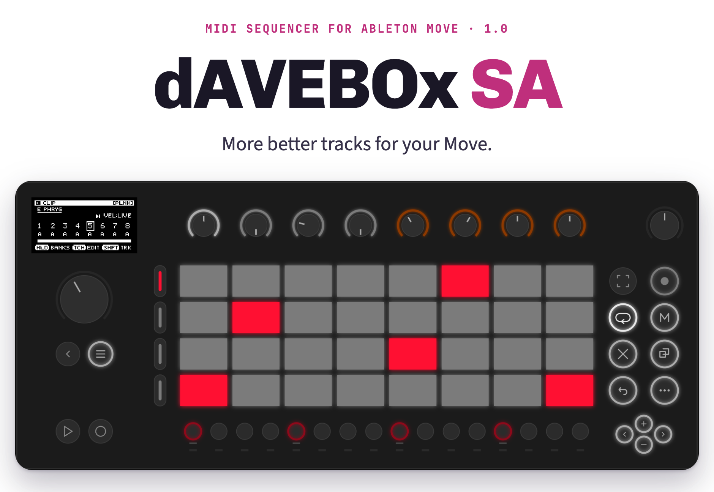
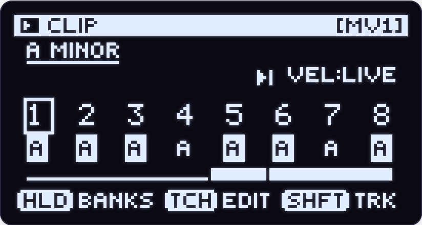
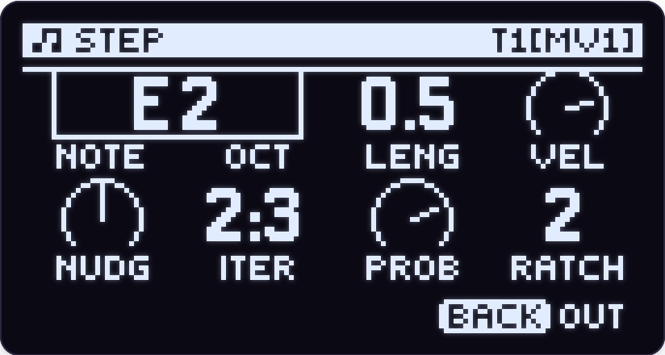
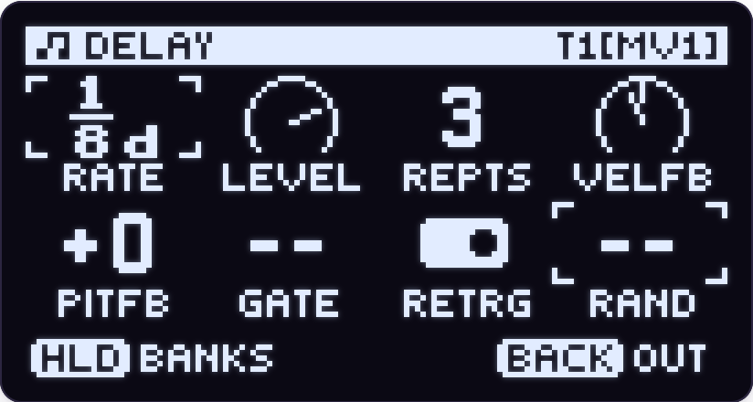
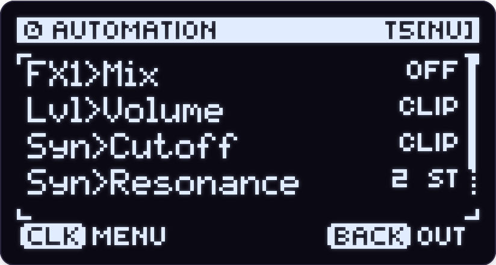
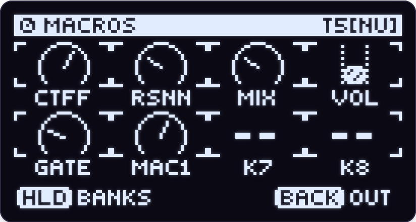
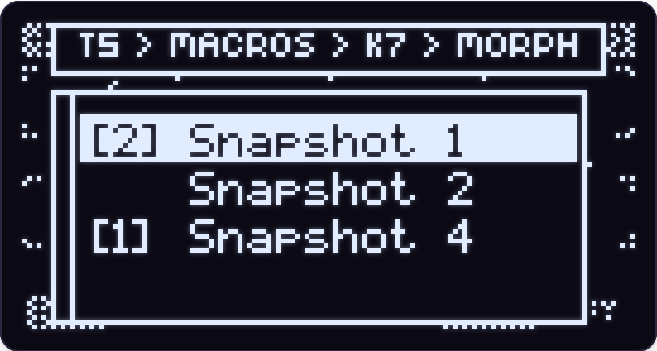
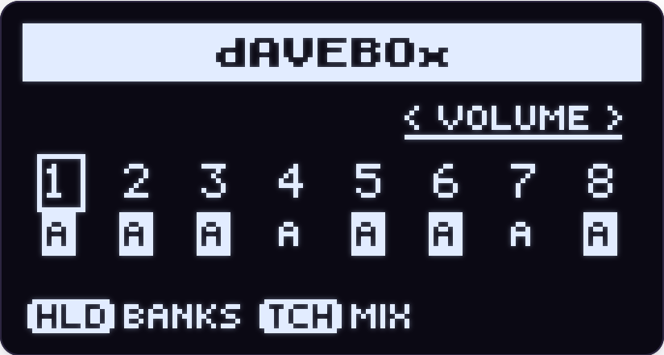
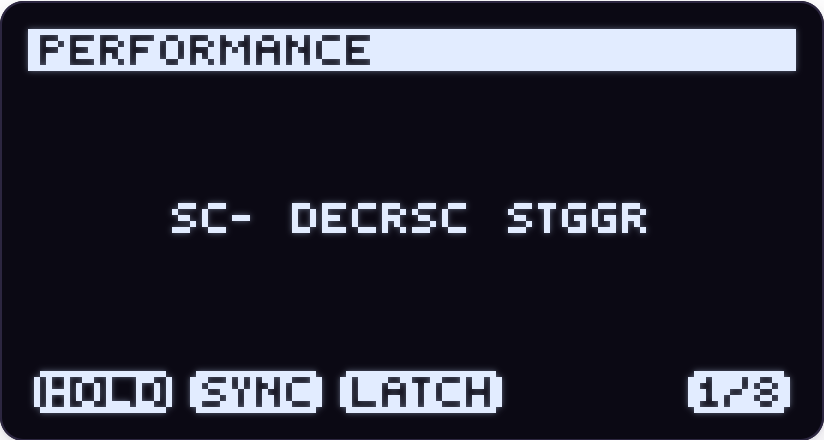
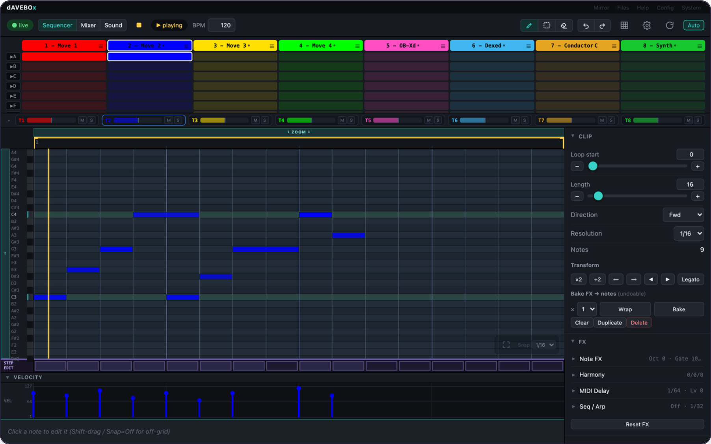

<p align="center">
  <picture>
    <source media="(prefers-color-scheme: dark)" srcset="docs/readme/hero-dark.png">
    
  </picture>
</p>

dAVEBOx SA is an 8-track MIDI sequencer for Ableton Move: clips and scenes on
the pads, a sound of your choice on every track, note effects and automation
per clip, and a browser editor on the same Wi-Fi.

**SA stands for standalone.** dAVEBOx SA is not a tool or overtake module
running inside [Schwung](https://github.com/charlesvestal/schwung). When you
launch it, Move restarts under dAVEBOx's own build of the Schwung host, and
dAVEBOx *is* the session — the sequencer, the instruments and effects it plays,
and the screens you work in. Quit, and Move restarts back into your normal
Schwung, untouched.

It is the successor to [dAVEBOx](https://github.com/legsmechanical/schwung-davebox),
which was an ordinary module inside Schwung. That version is frozen; everything
new happens here.

**[Read the manual](https://legsmechanical.github.io/dbxhost/)** ·
**[Watch the tutorials](https://www.youtube.com/playlist?list=PLYG911Ay8pgk)** ·
**[See it in action](https://youtu.be/8-Cta7-WApQ)**

---

## What it does

dAVEBOx makes no sound of its own. Every track sends its notes to an
instrument: one of Move's own, a Schwung synth (OB-Xd, Dexed and the rest of
the module catalog), or an external synth on the USB-A port.

**Sequencing**

- 8 tracks, 16 clips each, up to 256 steps per clip. Melodic and drum tracks;
  every drum lane has its own length, so polyrhythms need no setup.
- Per-step pitch, velocity, length, nudge, probability, conditions and ratchets.
- Five pad layouts for playing in: Scale, Chromatic, Piano, Chord and your own
  Custom chords.
- Capture: whatever you just played is already recorded.
- A Conductor track transposes the other tracks, in key, as its clips play.
- Groove: swing, or the feel of any MIDI file or Ableton groove, per project or
  per track.

<table><tr><td align="center" width="50%"><br><sub>Track View: every track's clip, the key and the bank</sub></td><td align="center" width="50%"><br><sub>Hold a step to edit its note, length, velocity and more</sub></td></tr></table>

**Shaping the notes**

- Every clip has its own note effects: arpeggiator, harmonizer, MIDI delay with
  pitch and velocity feedback, pitch randomization that stays in key, and
  quantize, gate and velocity shaping. **Bake** writes the result into the clip
  so you can stack more on top.
- Schwung MIDI effect modules on any track — after the clip, or in front of the
  sequencer so you record what they play. They follow dAVEBOx's key, scale and
  tempo.

<table><tr><td align="center" width="50%"><br><sub>The MIDI delay, one of each clip's note effects</sub></td><td align="center" width="50%"><br><sub>Everything automated in a clip</sub></td></tr></table>

**Sound and mixing**

- Four insert effects per track, two send buses, master effects and two LFOs
  per track — on Move's instruments as well as Schwung's.
- Macros: one knob moves several parameters, each over its own range.
- Sound snapshots, and SnapMorph to glide between them on one knob.
- Automation for any parameter, in lanes of their own length, recorded from
  the knobs or drawn per step.

<table><tr><td align="center" width="50%"><br><sub>Macros: each knob shows what it drives</sub></td><td align="center" width="50%"><br><sub>SnapMorph: glide between sound snapshots</sub></td></tr></table>

**Playing live**

- Performance mode turns the pads into real-time modulation, with 16 preset slots.
- Note repeat with groove, latch and multi-lane patterns on drum tracks.
- 16 mute/solo snapshots, and scenes launched from the pads.

<table><tr><td align="center" width="50%"><br><sub>Session View: each track's playing clip and the mixer</sub></td><td align="center" width="50%"><br><sub>Performance mode with mods engaged</sub></td></tr></table>

**Getting things in and out**

- Projects live on the pads, separate from your Move sets.
- Export a project to an Ableton Live set, or any clip to a MIDI file; import
  MIDI files into clips.
- The browser editor at `move.local:7700` has the sequencer, mixer and sound
  pages, a live mirror of the screen you can record, and the full manual.

<p align="center">
  <br>
  <sub>The browser editor's sequencer, live in both directions with the Move</sub>
</p>

---

## Your Move stays yours

- **Nothing is installed over stock.** Official Schwung and Move's firmware are
  never modified. dAVEBOx restarts Move under its own build, and leaving hands
  the device back to stock.
- **A reboot returns to stock** — even after a power cut — unless you have made
  dAVEBOx your boot default.
- **Your Move sets are untouched.** dAVEBOx keeps its own projects and its own
  copy of Move's settings.
- **One folder.** Everything dAVEBOx keeps on the Move — projects, settings,
  logs and MIDI exports — is in `/data/UserData/daveboxSA`.

---

## Install

You need an Ableton Move with [Schwung](https://github.com/charlesvestal/schwung)
**1.7.3 or newer**.

1. Open Schwung Manager at `move.local:7700` and go to **Modules**.
2. Find **dAVEBOx SA** in the catalog (under Tools) and click **Install**.
3. On the Move, press **Shift + Step 13** to open the Tools menu and choose
   **dAVEBOx SA**. The first launch finishes the install by itself, which takes
   about a minute.

**Start it** from the Tools menu, or hold **Back** while the Move boots and
pick it. **Leave** with **Quit** in Project Settings (**Shift + Step 2**).

**Update** from Schwung Manager when it shows a newer version. Your projects
carry over; an install from an earlier test build (folder `dbx-host`) is moved
into `daveboxSA` on its first launch.

Not in your catalog yet? Download `davebox-sa-module.tar.gz` from the
[Releases page](https://github.com/legsmechanical/dbxhost/releases) and install it
through **Modules → Install Custom Module → From Tarball → Install from File**.

**Remove** it by installing `davebox-uninstall-module.tar.gz` from the
[Releases page](https://github.com/legsmechanical/dbxhost/releases) the same way and choosing **Uninstall dAVEBOx SA** in the Tools menu. Your projects
and settings are kept.

New to it? The [Quick Start](davebox/QUICKSTART.md) gets you from an empty
project to a looping pattern in about fifteen minutes.

---

## Coming from dAVEBOx

The original dAVEBOx — now **dAVEBOx Legacy** — still works but gets no new
features, and dAVEBOx SA replaces it in the Schwung module catalog. The two install side by side, but their projects are separate:
dAVEBOx SA doesn't open Legacy projects.

---

## For developers

This repo is the whole of dAVEBOx SA: the sequencer module (`davebox/`), a fork
of [Schwung](https://github.com/charlesvestal/schwung) that hosts it, the
browser editor and its server (`schwung-manager/`), and the launcher and
installer (`standalone/`). They ship together under one version. Changes that
make sense for Schwung itself are offered upstream.

```sh
./standalone/scripts/install-sa.sh          # build everything and deploy it to a Move over SSH
./standalone/scripts/build-sa-release.sh    # assemble the release tarball
```

- [`standalone/README.md`](standalone/README.md) — the launcher, installer and
  on-device layout
- [`BUILDING.md`](BUILDING.md) — the build system and cross-compiling
- [`docs/`](docs/) — the host's architecture, the module and JS APIs, and the
  OLED UI specification
- [`davebox/CHANGELOG.md`](davebox/CHANGELOG.md) — what changed in each release

---

## License

MIT, as inherited from Schwung — see [LICENSE](LICENSE).

Two shipped binaries carry stricter licenses: `schwung-shim.so` links eSpeak NG
for the screen reader and is GPL-3.0-or-later, and `link-subscriber` (Ableton
Link) is GPL-2.0-or-later. See [THIRD_PARTY_LICENSES.md](THIRD_PARTY_LICENSES.md).

dAVEBOx was built by AI goblins and designed by a human who is not Dave. It
comes with no warranty: if it breaks your Move, makes your child cry or cleans
out your fridge, that's on you.
