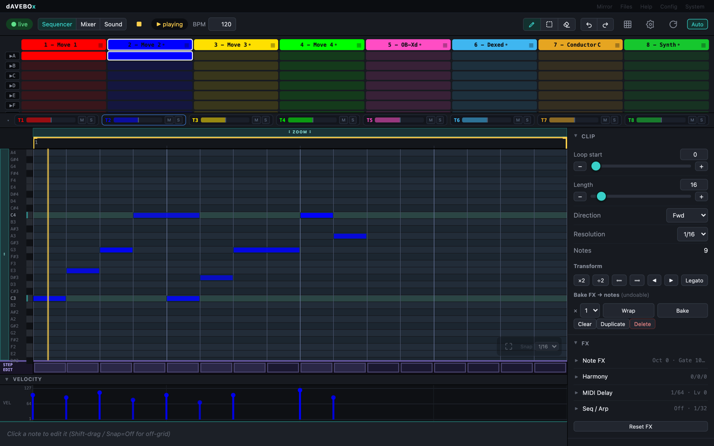
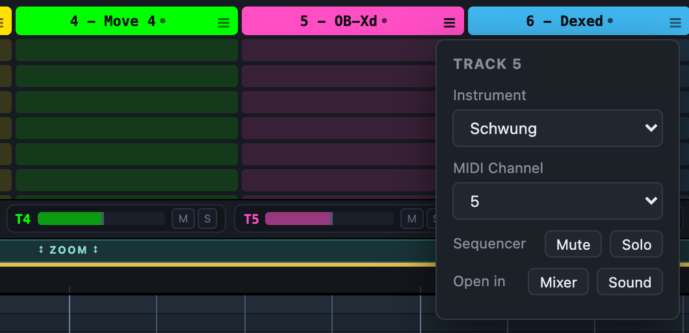
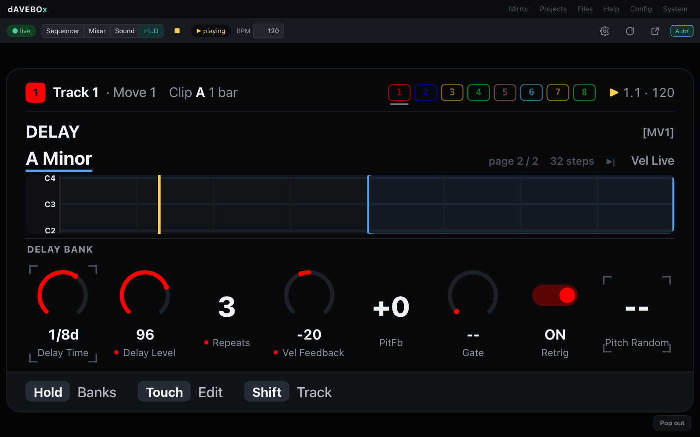

<!-- DRAFT-BANNER-START -->
> ⚠️ **WORKING DRAFT — for the next release.** Edit *this* file (`MANUAL-SA.draft.md`) for every user-facing change as it lands. The **released** manual is `MANUAL-SA.md` — do **not** edit it directly; `scripts/cut_release.sh` promotes this draft into `MANUAL-SA.md` (banner stripped) at release time.
>
> **This is the only manual under active development.** `MANUAL.md` documents dAVEBOx running as an ordinary tool on official Schwung and is **frozen** at its final release — do not edit it, and do not port changes into it.
<!-- DRAFT-BANNER-END -->

# The dAVEBOx SA Manual

dAVEBOx is an 8-track sequencer and sampler for Ableton Move. It records, arranges and plays back
notes and automation. Each track plays one of Move's own instruments, a Schwung effect chain, an
external synth on the USB-A port, or samples of its own on an [Audio](#16-audio-tracks) or
[Slicer](#17-slicer-tracks) track.

dAVEBOx runs inside [Schwung](https://github.com/charlesvestal/schwung) and takes over Move's pads,
knobs and screen while it is open. It uses Move's vocabulary of tracks and clips, and
[Coming from Move](#14-coming-from-move) sums up what carries over and what is different.

If you are new to dAVEBOx, start with the [Quick Start](QUICKSTART.md). It takes about fifteen
minutes to go from a new project to a looping pattern with effects and scenes. This manual is the
full reference.

> 🎬 Seven short videos walk through dAVEBOx on a real Move. Watch the
> [whole playlist](https://www.youtube.com/playlist?list=PLYG911Ay8pgk), or start with the
> [four-minute showcase](https://youtu.be/8-Cta7-WApQ). Sections of this manual that a video
> covers link to the moment it starts.
>
> 1. [Getting around](https://youtu.be/3kP6Zwm79_0)
> 2. [Drums](https://youtu.be/qqZKsu6e244)
> 3. [Melodic sequencing](https://youtu.be/36-v3uYKR78)
> 4. [MIDI effects](https://youtu.be/jOnQWmr71JI)
> 5. [Performance](https://youtu.be/rV0Vhle7INg)
> 6. [Mixing and automation](https://youtu.be/nrZD8SnbD6Q)
> 7. [Projects](https://youtu.be/DOw_4zAO6cI)

This manual covers dAVEBOx SA, which runs as its own session started from Schwung. If you run
dAVEBOx as an ordinary tool inside official Schwung, read [`MANUAL.md`](MANUAL.md) instead;
[dAVEBOx SA and Schwung](#15-davebox-sa-and-schwung) explains the difference.

---

# 1. Overview

## 1.1 How a Project Is Built

- A note, or an automation point, sits on a step: one slot of a clip's grid.
- A run of steps makes a clip, which also carries its own
  [sequencer effects](#13-sequencer-effects) and [automation](#14-automation). An Audio clip plays
  a sample instead of steps of notes.
- A track holds 16 clips, and only one of them plays at a time. An Audio track has a sample in each
  clip, and a Slicer track has one sample that its clips play in slices.
- A scene is one clip from each of the 8 tracks, launched together.
- The whole thing is saved as a dAVEBOx project. See [Projects](#51-the-project-picker).

Tracks and clips are the same objects as on Move; scenes are dAVEBOx's own. dAVEBOx replaces
Move's sequencer, not its instruments.

## 1.2 The Two Views

> 🎬 **Video:** [Tutorial 1.1: Two views](https://youtu.be/3kP6Zwm79_0)

[Note/Session] switches between the two views (see [Switching Views](#33-switching-views)).

| | Track View | Session View |
|---|---|---|
| For | Building one clip in detail | Launching and arranging clips |
| Pads | Play notes or drum lanes | The clip grid |
| Steps | The clip's steps | Launch scenes |

## 1.3 Five Kinds of Track

| Type | How it works |
|---|---|
| Melodic | Scale-snapped notes on the pads and steps. See [Melodic Clips](#8-melodic-clips) |
| Drum | The pads become 32 drum lanes, each its own step sequence. See [Drum Clips](#9-drum-clips) |
| Audio | Each clip plays its own sample, in time with the project. See [Audio Tracks](#16-audio-tracks) |
| Slicer | One sample for the track, cut into slices you play and sequence from the pads. See [Slicer Tracks](#17-slicer-tracks) |
| Conductor | Plays no notes of its own; it transposes the other tracks live. See [The Conductor](#25-the-conductor) |

## 1.4 Coming from Move

Most of Move's gestures work here as they do on Move, including:

- Placing notes: press a pad and then a step, or hold a step and press pads.
- [Loop]: hold it to see the clip's pages on the step buttons, and turn the jog while holding it to
  change the length.
- Automation: turn a knob while recording. To switch a knob's automation off, hold [Mute] and touch
  the knob; to clear it, hold [Delete] and touch it. To set a value for one step, hold the step and
  turn a knob. Holding [Mute] lights automated knobs red.
- Most [Shift] + Step shortcuts: [Step 1] opens your projects, 2 settings, 5 tempo, 6 the metronome,
  7 groove, 9 key and scale, 10 fixed velocity, 11 the arpeggiator, 15 doubles the loop and 16
  quantizes.

Where dAVEBOx differs:

| On Move | In dAVEBOx |
|---|---|
| There are 4 tracks, chosen with the track buttons. | There are 8 tracks. Tracks 1–4 play Move's instruments and tracks 5–8 Schwung instruments. To choose one, hold [Shift] and turn the jog, or hold the jog and press [Step 1–8]. See [Selecting a track](#35-selecting-a-track). |
| The buttons left of the pads select tracks. | The side buttons launch the track's clips in Track View, and scenes in Session View. |
| Session Mode has a row per track, a column per scene and 8 clips per track. | Session View has a column per track, a row per scene and 16 clips per track. It shows 4 rows at a time; [+] and [−] scroll. See [Session View](#22-session-view). |
| You slide a finger down a column to play a scene. | You press a side button or a step button to launch a scene. See [Scenes](#223-scenes). |
| The knobs play the selected device, and the jog picks the device. | The knobs play a bank: clip settings, sequencer effects, sound, macros or automation. The jog's bank map picks the bank. See [Banks and the Bank Map](#4-banks-and-the-bank-map). |
| When you hold a step, the jog sets length and Volume sets velocity. | When you hold a step, the knobs set pitch, length, velocity, nudge and more. See [Editing notes](#86-editing-notes). |
| You browse a track's presets with the jog. | On a Move track, you open Move's own editor from the track's menu and browse there. See [Choosing a track's sound](#201-choosing-a-tracks-sound). |
| [Mute] and a track button mutes a track; add [Shift] to solo. | In Track View, press [Mute], or hold [Shift] and press [Mute]. In Session View, hold [Mute] and touch a track's knob. See [Mute and solo in Session View](#232-muting-in-session-view). |
| You hold a track button and turn Volume to set its level. | Hold [Shift] and turn the Volume knob to set the active track's volume. In Session View the knobs are a mixer. |
| [Shift] + [Step 8] turns on 16 Pitches for a drum track. | [Shift] + [Step 8] switches the right-hand pads between velocity zones and Note Repeat. See [Drum Clips](#9-drum-clips). |

## 1.5 dAVEBOx SA and Schwung

dAVEBOx SA runs as its own session. You start it from Schwung (see [Open dAVEBOx](#22-open-davebox)),
and Move restarts into the sequencer, on a fork of the Schwung host that plays the modules, presets
and samples installed in your Schwung. It needs Schwung installed and does not replace it.

- A reboot returns you to official Schwung, unless you made dAVEBOx your boot default.
- Samples, presets and modules are shared between the two, but settings are not. See
  [dAVEBOx and official Schwung](#303-davebox-and-official-schwung).
- Your Move Sets are not shared. dAVEBOx keeps its own [projects](#51-the-project-picker).

An earlier form of dAVEBOx runs as an ordinary tool inside official Schwung and is described in
[`MANUAL.md`](MANUAL.md). It still works but is no longer developed. It has 2 insert effects per
chain instead of 4 and no send effect buses, where dAVEBOx SA has two (A and B).

---

# 2. Getting Started

## 2.1 Install and Remove

dAVEBOx SA needs Schwung 1.7.3 or newer. To install it:

1. In a browser, open Schwung's web manager at move.local:7700 and go to Modules. Plain move.local
   is Ableton's own Move Manager.
2. Find dAVEBOx SA in the catalog, under Tools, and click Install.
3. On the Move, [open dAVEBOx SA](#22-open-davebox). The first launch finishes installing by itself
   in about a minute.

Updates arrive the same way, and your projects carry over.

If dAVEBOx SA isn't in your catalog yet, download davebox-sa-module.tar.gz from its
[release page](https://github.com/legsmechanical/dbxhost/releases), then in Modules open Install
Custom Module, choose the file under From Tarball, and click Install from File.

To remove dAVEBOx SA, install davebox-uninstall-module.tar.gz from the
[release page](https://github.com/legsmechanical/dbxhost/releases) the same way, quit dAVEBOx, and
choose Uninstall dAVEBOx SA in Schwung's tool menu. Your projects and settings stay in
`/data/UserData/daveboxSA`, so a later install picks them up.

## 2.2 Open dAVEBOx

Hold [Shift] and press [Step 13] (the star) to open Schwung's tool menu, then choose dAVEBOx SA and
confirm. Move restarts under the dAVEBOx host, which takes a few seconds, and you land on the
project picker, with one pad per project.

To load the project you had open last, click the jog. To start a new project, hold [Shift] and tap
an empty pad. To load another project, hold [Shift] and tap its pad. See
[The Project Picker](#51-the-project-picker).

To leave dAVEBOx from anywhere, hold [Shift] and press [Back]; it saves first. See
[Saving, Suspending and Leaving](#52-saving-suspending-and-leaving).

You can also open dAVEBOx at power-on. While the screen reads "Loading Schwung — press [Back] to
change", hold [Back], turn the jog to dAVEBOx SA and click the jog. Picking a row in that boot menu
also makes it your default for the next power-on; to change back, hold [Back] at power-on and pick
Schwung. Leaving dAVEBOx always returns you to Schwung.

## 2.3 Nothing to Set Up

Every new project is ready to play. Tracks 1–4 play Move's four instruments, loaded with a random
stock drum kit, a bass and two polyphonic sounds, like a new Move Set. Track 1 is a drum track.
Tracks 5–8 stay silent until you [choose a sound](#201-choosing-a-tracks-sound) for them.

Tracks that play Move instruments need Move's Link setting. dAVEBOx turns Link on each time it
starts, set to Tempo with start/stop sync off. If you turn it off in Move Settings, it stays off until the next session, and dAVEBOx warns
you while it is off.

The [Quick Start](QUICKSTART.md) walks you through a first pattern.

---

# 3. The Basics

## 3.1 The Controls


Each named button also works as a modifier when you hold it. The
[Quick Reference](#31-quick-reference) lists every gesture.

The four side buttons left of the pads launch the active track's clips in Track View, and whole
scenes in Session View. [+] and [−] shift the pads' octave; on a drum track they shift the lane
bank, and in Session View the rows.

## 3.2 Transport

Press [Play] to start and stop. With modifiers:

- To restart from the top, hold [Shift] and press [Play].
- In Track View, hold [Loop] and press [Play] to restart with the current clip at the page you are
  looking at. A page outside the loop wraps into it, so the clip always restarts inside its loop.
- To turn the metronome on or off, hold [Mute] and press [Play].
- To stop every clip while playing, hold [Delete] and press [Play]. While stopped, the same gesture
  sends a MIDI panic.

dAVEBOx can also lock to Move's transport or send clock to external gear; see
[Clock Follow](#282-clock-follow).

## 3.3 Switching Views

On either view's overview (its home screen), press [Note/Session] to switch between Track View and
Session View. Hold it to peek at the other view.

Anywhere else, such as a bank page, a menu or a dialog, [Note/Session] closes everything and takes
you to Session View in one press.

[Back] steps out one level at a time. Hold [Back] to go straight to the overview.

## 3.4 Reading the Screen

The Track View overview shows, from top to bottom:

- The header: the bank the knobs are on and, at the right, what the track plays. `[MV1]` is
  Move instrument 1, `[CH3]` MIDI channel 3, `[TR2]` track 2's instrument, `[CNDT]` the
  Conductor and `[--]` nothing loaded; otherwise a Schwung instrument's short name.
- The key and scale, and the track's input velocity (`VEL:LIVE` means velocity follows how hard you
  play). On a drum track, the lane bank and the selected lane's note instead of the key.
- The track numbers. A box marks the active track, a muted track's number blinks, and a soloed
  one is filled in.
- The clip letters (A–P), filled while the clip plays or is about to.
- The page bar: the page you are viewing is solid, the page playing is outlined, and a tick marks
  the playhead. A small mark at either end means there are notes outside the loop.
- The footer: what the controls do here. `HLD BANKS` means hold the jog for the
  [bank map](#4-banks-and-the-bank-map), `TCH EDIT` means touch a knob or the jog to see the
  bank's page, and `SHFT TRK` means [Shift] picks the track.

In Session View the footer reads `HLD BANKS` `TCH MIX`: touch a knob or the jog for the
mixer page.

## 3.5 Selecting a Track

In either view, hold [Shift] and turn the jog to change the active track.

In Track View you can also hold the jog for the [bank map](#4-banks-and-the-bank-map) and press
[Step 1–8].

In Session View, tapping a clip pad selects its track and also launches or stops that clip. To
open the clip in Track View instead, hold [Shift] and tap its pad.

## 3.6 Menus, Lists and Typing

To open Project Settings, hold [Shift] and press [Step 2]. Every row is listed in
[Project Settings](#301-project-settings) and
[Settings for the Whole Move](#302-settings-for-the-whole-move); many also have a [Shift] + Step
shortcut, listed in the [Quick Reference](#31-quick-reference).

In a list, turn the jog to move and press it to open or change a row. A number shows in [brackets]
while you change it; press again to set it. In a list of choices, [Back] leaves the value as it was.
In Project Settings, [Back] also cancels a change in progress.

### 3.6.1 Typing a Name

The on-screen keyboard opens whenever you name something. Turn the jog to a key and click to type
it. The last page of keys holds symbols, the comma among them.

### 3.6.2 Speaking a Name

You can also speak a name: on the keyboard, hold [Record], speak, and let go. Dictation is an add-on
that you install once from Project Settings (see [Dictation](#302-settings-for-the-whole-move)).

- The limit is 30 seconds per take, and it understands English only.
- It works only while the music is stopped.
- If you have not typed anything yet, what you say replaces the name; otherwise it is added after
  it. Commas and the closing full stop are left out.
- It listens through the Move's microphone, or through the line input whenever a cable is plugged
  in, so anything else playing into the line input is heard too. Input monitoring is switched off
  while you talk.
- It can't be used while the sampler ([Shift] + Volume + Sampling) is in use.

Press [Back] to cancel the dictation, and again to leave the keyboard. While a message card is up,
the keys under it don't respond; press [Back] to take it down.

## 3.7 Copy, Delete and Undo

These work the same way on steps, clips, drum lanes, pages and scenes:

- To copy, hold [Copy], press the thing you want to copy, then press where it should go.
- To cut instead, hold [Shift] as well as [Copy].
- To clear something, hold [Delete] and press it.
- To reset something, clearing it and returning its settings to their defaults, hold [Shift] and
  [Delete] and press it.

What each one keeps is described with the thing itself: [steps](#86-editing-notes),
[clips](#73-switching-clips), [drum lanes](#95-copying-clearing-and-muting-lanes),
[pages](#74-clip-length-and-the-loop), [scenes](#223-scenes),
[Audio and Slicer clips](#166-copying-clearing-and-undo), [banks](#44-resetting-a-bank) and
[projects](#51-the-project-picker).

[Undo] reverses the last edit, and [Shift] + [Undo] redoes it. It is one step deep.

A few changes cannot be undone: a committed [Key or Scale transpose](#62-key-and-scale),
and a Trim or Normalize that overwrites a sample (see [SAMPLE](#162-the-sample-editor)).

---

# 4. Banks and the Bank Map

> 🎬 **Video:** [Tutorial 1.3: The bank map](https://youtu.be/3kP6Zwm79_0?t=160) (from 2:40)

In Track View the eight knobs play a bank: one page of related controls. To choose a bank, hold the
jog for the bank map, tap a pad, and let go.

Each track remembers its bank. In Session View the knobs are the mixer, and holding the jog brings
up the Session map instead. See [The session mixer](#213-the-session-mixer).

## 4.1 The Bank Map

While you hold the jog, the left 4×4 pads become a map of the track's banks, and the screen shows
the same map. You can tap as many pads as you like before you let go.

The four columns of pads are groups, and each group's banks run from top to bottom:

- IN: what you play into the track. PAD MODE, LIVE ARP and RPT GROOVE.
- CTRL: what moves the parameters. MACROS, AUTOMATION, and MIX at the foot.
- SEQ: the sequence. STEP, CLIP, DRUM LANE, ALL LANES and INPUT.
- FX: the sequencer effects, in the order the notes pass through them. NOTE FX, HARMONY, DELAY,
  SEQ ARP and REMIX. On a drum track they act on the selected lane.

A bank the track doesn't have leaves its pad dark, so a bank is always on the same pad. On a drum
track, RPT GROOVE takes LIVE ARP's pad, DRUM LANE takes CLIP's, and ALL LANES sits below it. Audio
and Slicer tracks put SAMPLE or SLICER on INST's pad and REMIX on DELAY's. An Audio track has
INPUT below CLIP and nothing in IN.

On a Conductor the second column is the RSPD group, which sets how the other tracks respond. See
[The Conductor's banks](#253-the-conductors-banks).

### 4.1.1 Screens on the Map

Three pads open screens rather than banks: CONFIG opens [TRACK CONFIG](#202-track-config), AUTO the
[AUTOMATION](#14-automation) screen, and INST the track's instrument. The screen opens when you let
go of the jog, and it doesn't change the bank you are on.

### 4.1.2 More on the Map

In Track View, [Steps 1–8] on the map switch track. The map stays up, now showing the new track's
banks.

In Track View, the right-hand pads open the track's module editors: MIDI FX above INSTRUMENT in
the third column, and FX 1–4 down the far-right column. Each opens when you let go. A MIDI track
has only MIDI FX, and a Conductor has none.

To switch view under the map, keep holding the jog and press [Note/Session].

To jump straight to LIVE ARP, hold [Shift] and hold [Step 11].

### 4.1.3 From Inside a Screen

Inside a menu, TRACK CONFIG, a module's editor (Move's own included) or the AUTOMATION screen, hold
the jog for about a third of a second and the same map comes up over it. Tap a pad to leave the
screen for that bank, or let go without tapping to stay. A quick press of the jog is still a press.

The map doesn't come up over the on-screen keyboard, over a question, or while [Shift], [Delete],
[Copy], [Mute] or [Loop] is held.

## 4.2 Playing a Bank

Touch a knob or the jog to see the bank's page; let go and the overview is back.
[Card Hold](#301-project-settings) in Project Settings keeps the page up for half a second, one or
two after you let go.

A knob with named choices, such as an arp style, opens its list while you turn it.

The knob LEDs light on every bank: knobs 1–4 white and 5–8 amber, with brightness following the
value. A dark LED means nothing is on that knob.

On a bank with pages, turning the jog flips the pages, and the header shows which page you are on
(2/3). The paged banks are MIX (the levels, then the [channel strip](#212-the-channel-strip)), SEQ
ARP and LIVE ARP (the settings, then [Arp Steps](#1341-the-arp-steps-editor)), RPT GROOVE
(Velocity, then Nudge), an Audio clip's SAMPLE and a Slicer's SLICER editor.

LIVE ARP opened with [Shift] and a held [Step 11], the module editors, AUTOMATION and TRACK CONFIG
stay up until you press [Back].

## 4.3 Touch and Click

Some controls do more when you touch the knob and click the jog. These cells wear corner brackets,
and while you touch one the bottom of the screen shows CLK and what the click will do.

A touch and click does one of these:

- It switches a knob marked Alt in the bank tables to its alternate: Res to Zoom, Shift to
  Nudge, Dir to Reverse Style, Rand to Algo, and Rate to Clock Feedback. Touch and click again,
  press [Back], or leave the bank to switch it back.
- It runs a one-shot action, such as Crop or Legato.
- It opens an editor: a knob on MACROS opens that macro.

On AUTOMATION, hold [Delete] and click the jog to clear the lane under the cursor.

## 4.4 Resetting a Bank

To reset every parameter in the bank you are on, hold [Delete] and click the jog. One-shot actions
(Stretch, Shift, Legato and Crop) are left alone, and on a paged bank only the page showing is
reset. Each parameter goes back to the value a new clip starts with. This doesn't work on ALL LANES, STEP, or the Conductor's ON/OFF, OCTAVE and TIMING banks.
On a drum track's RPT GROOVE bank, or on any bank while Note Repeat is on, it resets the selected
lane's groove.

On MACROS, the same gesture unassigns all eight macros on the track, after asking. Their
values and automation are left alone.

To reset all the sequencer effects (NOTE FX, HARMONY, DELAY and SEQ ARP), hold [Shift] and [Delete]
and click the jog. To reset the whole clip, notes and all parameters, hold [Shift] and [Delete] and
press the clip's side button. Resets can be undone.

Resetting a parameter also clears its [automation](#14-automation): a bank reset clears the
automation for that bank's parameters, and clearing or resetting a clip clears all of it. On a drum
track, clearing a single lane leaves automation alone, because a drum clip's automation covers the
whole clip.

## 4.5 Where Each Bank Is Covered

| Bank | Where it is covered |
|---|---|
| PAD MODE | [Pad layouts](#82-pad-layouts) (melodic), [The SLICER editor](#172-the-slicer-editor) (Slicer) |
| LIVE ARP, RPT GROOVE | [Live input modifiers](#135-live-input-modifiers) |
| MACROS | [The MACROS bank](#241-the-macros-bank) |
| AUTOMATION | [Automation](#14-automation) |
| MIX | [Track levels](#211-track-levels) and [the channel strip](#212-the-channel-strip) |
| STEP | [Editing notes](#86-editing-notes) |
| CLIP, DRUM LANE, ALL LANES | [Clip Timing and Grid](#12-clip-timing-and-grid); an Audio clip's CLIP in [The banks](#165-the-banks) |
| INPUT | [Recording into an Audio clip](#191-recording-into-an-audio-clip) |
| SAMPLE, SLICER | [SAMPLE](#162-the-sample-editor), [The SLICER editor](#172-the-slicer-editor) |
| NOTE FX, HARMONY, DELAY, SEQ ARP | [Sequencer Effects](#13-sequencer-effects) |
| REMIX | [REMIX](#18-remix) |
| ON/OFF, OCTAVE, TIMING | [The Conductor's banks](#253-the-conductors-banks) |

---

# 5. Projects

dAVEBOx keeps its own projects, separate from your Move Sets, which it never sees or changes.

## 5.1 The Project Picker

> 🎬 **Video:** [Tutorial 7.1: Projects and Save state](https://youtu.be/DOw_4zAO6cI)

To open the project picker, hold [Shift] and press [Step 1] from anywhere. The pads become your
projects, 32 slots, each in its own color; the open project is solid white. A dim red pad is a
project that can't open, but you can still rename, recolor or delete it.

### 5.1.1 Opening a Project

Tap a project to select it, then choose Load. Load stops playback first. To load a project at once,
hold [Shift] and tap its pad.

### 5.1.2 Creating a Project

Tap an empty pad and confirm. The new project gets a random two-word name, such as Quiet Harbor. To
create a project and open it in one press, hold [Shift] and tap the empty pad.

Once you have saved a [template](#54-templates), creating a project asks Empty or Template.

### 5.1.3 Renaming and Coloring

Rename and Color are on the selected project's screen. Two projects can't share a name.

### 5.1.4 Copying and Deleting

To copy a project, hold [Copy], tap the project, then tap an empty pad.

To delete a project, hold [Delete], tap the project, then tap it again to confirm. If you delete the project you are in, dAVEBOx restarts at the project picker with nothing
loaded.

### 5.1.5 When a Project Won't Open

If PROJECT DID NOT OPEN appears, choose Retry to try again, or press [Back] to return to the picker.

## 5.2 Saving, Suspending and Leaving

> 🎬 **Video:** [Tutorial 7.1: Projects and Save state](https://youtu.be/DOw_4zAO6cI)

dAVEBOx saves as you go, but never during playback: it saves when you stop the transport, a moment
after your last edit while stopped, at the end of a recording, and when you suspend, quit or switch
projects. There is no manual save; for named backups, use [Save state](#53-save-states).

A project has a size limit of about 1 MB. Past it, dAVEBOx shows PROJECT TOO BIG and saves only
when you quit or suspend, until you remove some clips.

### 5.2.1 Leaving and Suspending

To leave dAVEBOx and hand the device back to official Schwung, hold [Shift] and press [Back] from
anywhere and answer Yes to QUIT dAVEBOx?, or choose Quit in Project Settings. Either one saves first.

To use Move while dAVEBOx keeps playing in the background, choose Suspend session in Project
Settings. To come back, hold [Shift] and hold [Step 13] for half a second, or press [Shift] +
[Step 13] twice quickly, or pick dAVEBOx SA in the Tools menu.

If dAVEBOx is your boot default, a reboot returns to dAVEBOx. To go back, hold [Back] at power-on
and pick Schwung.

### 5.2.2 Powering Off

Tap or hold the power button and confirm. dAVEBOx saves before the Move turns off.

## 5.3 Save States

For named backups, choose Save state in Project Settings, which keeps up to 16 dated snapshots per
project; when all 16 are used it asks which one to replace. To restore one, choose Load state.
Snapshots survive Clear Sess.

Snapshots saved by a different dAVEBOx version can't be loaded.

The other kinds of preset and snapshot are compared in
[Presets and Snapshots at a Glance](#3111-presets-and-snapshots-at-a-glance).

## 5.4 Templates

A template is a starting point for new projects. To save one, choose Save as Template... in Project
Settings. It keeps each track's instrument, effects, MACROS and track settings, its groove amounts and
Input Quantize, and the project settings, including a loaded groove. No clips, notes or automation come along, and every sequencer bank starts at its default.
A Slicer comes along whole, sample included; Audio tracks arrive empty.

To use a template, see [Creating a Project](#512-creating-a-project). To rename, replace or delete
one, choose Templates... in Project Settings.

If a template uses a module this Move doesn't have, that slot starts empty (MODULES MISSING).

## 5.5 Backing Up and Moving Projects

The Projects page of the web manager (move.local:7700, during a session) can download one project
or all of them, templates included, as a file. Stop playback before you download the open project,
or its last second of edits may not be in the file. See
[dAVEBOx and official Schwung](#303-davebox-and-official-schwung).

To restore, upload a downloaded file, on this Move or another one. Each project is added on the
first free pad; nothing on the Move is replaced, so restoring a project you still have
gives you a second one named "Name (imported)".

Samples and recordings from your Move library aren't part of a project and don't travel with it.

## 5.6 Compatibility and What's Saved

dAVEBOx opens every project an earlier version saved. A project saved by a newer dAVEBOx says
PROJECT TOO NEW and is left as it is, never erased. Once saved, a project made before dAVEBOx 1.1
opens in dAVEBOx 1.0.0 without its automation.

dAVEBOx 1.1.3 and earlier can't read a project saved by this version, and ask to erase it. If you go
back to one of those versions, answer No.

If you used dAVEBOx when it worked in your Move Sets, that work stays in those Sets. dAVEBOx
projects start fresh.

---

# 6. Tempo, Key and Groove

Tempo, metronome, key, scale and groove belong to the project. You set them in Project Settings:
hold [Shift] and press [Step 2]. Every row is listed in [Project Settings](#301-project-settings).

## 6.1 Tempo and Metronome

> 🎬 **Video:** [Tutorial 1.4: Tempo and key](https://youtu.be/3kP6Zwm79_0?t=227) (from 3:47)

BPM sets the tempo, from 40 to 250. While [Clock Follow](#282-clock-follow) is on, it reads Move
and the project follows Move's tempo.

To tap the tempo, hold [Shift] and press [Step 5], then tap any pad in time.

Metro sets when the metronome sounds: Off, Cnt-In (the default, count-in only), Play or Always.
Metro Vol sets its level, from 0 to 150 %.

To switch Metro between Cnt-In and Always, hold [Shift] and press [Step 6]. To turn the metronome
on and off from the transport, hold [Mute] and press [Play].

## 6.2 Key and Scale

Key sets the project's root note. Scale sets the scale that melodic tracks snap to. A new project
starts in a random key and scale. To jump straight to Scale, hold [Shift] and press [Step 9].

Scale Aware sets whether scale-aware parameters move by scale degree (On, the default) or by
semitone (Off).

Instruments and MIDI effects with a Host key setting follow dAVEBOx's key, scale and tempo live.

### 6.2.1 Moving Your Clips to a New Key

When you change Key or Scale and a melodic clip holds notes, TRANSPOSE CLIPS? asks whether to move
the notes to the new key. While it asks, the pads show the new key and, if the music is playing,
you hear the clips in it.

Key moves notes by the shortest distance. A new scale remaps notes by scale degree between scales of
the same size, and otherwise to the nearest in-scale note. Drum tracks are untouched.

Note that a committed transpose can't be undone, so check the preview before you confirm.

## 6.3 The Groove

> 🎬 **Video:** [Tutorial 6.4: Groove and swing](https://youtu.be/nrZD8SnbD6Q?t=443) (from 7:23)

One groove plays for the whole project. To jump to Groove Amt, hold [Shift] and press [Step 7].

| Setting | What it does | Values | Default |
|---|---|---|---|
| Groove | The project's timing feel | Off, Browse..., Swing 1/16, Swing 1/8, the loaded groove | Swing 1/16 |
| Groove Amt | How much of the groove is applied. On a swing: 50 % is straight, 66 % is triplet swing | 0–100 % (50–75 % on a swing) | 0 % (50 % on a swing) |
| Grv Timing | How much of the loaded groove's timing shifts are applied | 0–100 % | The groove's own |
| Grv Velocity | How far notes are pulled toward the groove's velocities | 0–100 % | The groove's own |
| Grv Random | How much each note wanders from its place, differently every time | 0–100 % | The groove's own |

Grv Timing, Grv Velocity and Grv Random are shown only for a loaded groove. Off plays straight,
whatever Groove Amt says.

### 6.3.1 Loading a Groove

Browse... opens a list of MIDI files and Ableton groove files (.agr). Turning the jog to a file
plays it at once, over whatever is playing. Click the jog to keep it; [Back] restores the groove
you had.

A MIDI file is read over its whole length, on the grid its notes were played on (1/16, swung 1/8 or
triplets), up to 128 positions. If a file has several parts, dAVEBOx asks which one to use.

Notes the sequencer plays are moved both earlier and later. Arps, repeats, delay echoes and the
looper are only ever moved later.

The loaded groove appears at the foot of the Groove list, so you can go to a swing and come back. It
is saved inside the project, so it survives the file being removed.

### 6.3.2 Groove on Each Track

In a track's [settings](#207-track-settings), Grv Amt reads Global. Turn it and that track takes
its own amount instead, from 0 to 100 % in 5 % steps. With a loaded groove, Grv Timing, Grv
Velocity and Grv Random work the same way on each track. Turn a row back down to Global and the
track follows the project again.

### 6.3.3 Recording Under a Groove

With Input Quantize off, what you play is stored so that the groove plays it back at the moment you
played it; it is not grooved a second time. With Input Quantize on, the note snaps to the grid and
the groove moves it from there.

---

# 7. Tracks and Clips

dAVEBOx has 8 tracks. Each track holds 16 clips and plays one clip at a time. A track plays one instrument (see [Choosing an instrument](#204-choosing-an-instrument)), except an Audio or Slicer track, which plays samples.

Track View always shows the current clip of the active track. To choose the bank that shapes the clip, hold the jog for the [bank map](#4-banks-and-the-bank-map) and tap a pad. What goes into a clip is covered in [Melodic Clips](#8-melodic-clips) and [Drum Clips](#9-drum-clips).

## 7.1 Track Type

| Type | Where you set it | How it works |
|---|---|---|
| Melodic | Mode, Melodic | Scale-snapped notes on the pads and steps. See [Melodic Clips](#8-melodic-clips). |
| Drum | Mode, Drums | 32 drum lanes, each its own step sequence. See [Drum Clips](#9-drum-clips). |
| Audio | Instmt/Dest, Audio | A sample per clip. See [Audio Tracks](#16-audio-tracks). |
| Slicer | Instmt/Dest, Slicer | One sample, chopped; each clip is a sequence of slices. See [Slicer Tracks](#17-slicer-tracks). |
| Conductor | Instmt/Dest, Conductor | Plays no notes and transposes the other tracks. See [The Conductor](#25-the-conductor). |

Mode is a row of the track's TRACK CONFIG menu. Audio, Slicer and Conductor are in the Instmt/Dest picker, after the Move instruments: hold [Shift] and click the jog on the Instmt/Dest row. Choosing an instrument in the same picker turns the track back into an ordinary one.

Track 1 of a new project starts as a drum track, and the rest as melodic. A track keeps its color, clips and routing whatever its type, so a Conductor's instrument is still there when you switch back.

## 7.2 Changing Type

A track cannot change type while the transport is playing.

Changing type keeps your notes across all 16 clips. It resets the sequencer effects (NOTE FX, HARMONY, DELAY and SEQ ARP).

From melodic to drum, each pitch becomes its own lane and per-step conditions are dropped. Note that a clip with more than 32 pitches loses the least-used ones.

From drum to melodic, dAVEBOx does not ask. The lanes merge into one clip, with the length of the first lane that has notes, and per-step conditions are dropped.

Making a track the Conductor keeps the notes and their conditions, and clears effects, arps and automation. Only one track can be the Conductor. Choosing an instrument turns a Conductor back into a melodic track, without asking.

Choosing Audio or Slicer clears the track's notes. The track's instrument goes and its effects stay. The track plays through its own Schwung slot; a track that used a Move instrument takes one.

If you choose Audio on a track that plays an instrument and has clips, Resample the clips? asks first. Yes records each clip with notes into an Audio clip, so the track sounds the same, as in [Flattening a track](#193-flattening-a-track). No converts without recording, and the notes are cleared.

Leaving Audio or Slicer clears every clip's steps and lets go of the samples. One [Undo] brings it all back. The files stay in the project until you [purge them](#194-the-projects-samples).

## 7.3 Switching Clips

The four side buttons launch the active track's clips. They follow the four clip rows shown in [Session View](#22-session-view), and the lit button is the clip you are editing.

To stop the playing clip at the end of its page, press its side button; press it again to cancel. To scroll the four visible clips by one, hold [Shift] and press the top or bottom side button.

The side buttons take the gestures in [Copy, Delete and Undo](#37-copy-delete-and-undo):

- [Copy] and a side button, then another side button, copies the clip to that slot. [Shift] and [Copy] cuts it.
- [Delete] and a side button clears the clip's notes, step conditions and automation, and frees its length for the next recording.
- [Shift], [Delete] and a side button resets the clip: notes and all parameters.

## 7.4 Clip Length and the Loop

> 🎬 **Video:** [Tutorial 3.9: Loop length and pages](https://youtu.be/36-v3uYKR78?t=610) (from 10:10)

A clip plays its loop: up to 256 steps, shown as pages of 16. On a drum track, each lane has its own loop, set the same way (see [Per-lane loops](#93-per-lane-loops)). [Left] and [Right] move between pages.

To grow or shrink the loop by one step, hold [Loop] and turn the jog. To double the loop and copy what is in it into the new half, hold [Shift] and press [Step 15].

Note that the loop length cannot be changed while a take is recording.

### 7.4.1 Seq Follow

Seq Follow keeps the step buttons on the page that is playing. It is one switch for the whole device and is remembered between sessions.

To turn it on or off, hold [Left] or [Right] and press [Play]; the transport is not affected. It works in the module editors too, but not in Session View. A small play-to-bar mark to the left of `Vel:` shows it is on.

If you press [Left] or [Right] while the transport runs, Seq Follow pauses and the mark blinks. It follows again the next time the transport stops. Restarting with [Shift] and [Play], or [Loop] and [Play], is not a stop, so the pause stays.

### 7.4.2 The Loop View

Hold [Loop] for the loop view. The step buttons now stand for pages, and a page inside the loop lights in the track color. While you hold [Loop]:

- Turn the jog to grow or shrink the loop from its end.
- Press a step button to end the loop on that page. The loop runs from page 1, or from the loop's start if it starts later.
- Hold one step button and press another to set the loop to the range between them.

Notes outside the loop are kept, and return when you widen it.

A clip that is playing stays in time when its length or loop changes: it carries on from where it
would be had it always had the new length.

To keep the loop view up hands-free, tap [Loop] instead of holding it; [Loop] blinks white and the pads keep playing. Press [Loop] or [Back] to close it.

Note that a press of [Loop] that already does something else still does only that. On a drum track with a latched repeat it releases the repeat, and while LIVE ARP's latch holds notes it clears them. With pads held on a melodic or Slicer track, it latches or unlatches LIVE ARP (see [LIVE ARP](#1351-live-arp)).

### 7.4.3 Copying Pages

To copy one page of a clip onto another, hold [Loop] and [Copy], press a lit page, then press another page. Keep holding [Copy] to paste onto more pages. [Shift] and [Copy] cuts instead. One [Undo] takes a paste back.

A paste past the end of the clip makes the clip longer, and a paste before the loop's start moves the start back. Steps outside the loop count as empty. Automation stays where it is.

On a drum track, page copying copies the selected lane, or every lane on the ALL LANES bank.

### 7.4.4 Cropping the Loop

The clip transforms (Stretch, Shift, Nudge, Legato and Zoom) do nothing unless the loop starts on [Step 1].

Crop makes the loop the whole clip: on the CLIP bank, touch knob 6 and click the jog. Everything outside the loop is removed. One [Undo] brings it back.

---

# 8. Melodic Clips

The [Sequencer Effects](#13-sequencer-effects) and [Automation](#14-automation) that shape a clip have their own chapters, and recording into a clip is in [Recording and Capture](#10-recording-and-capture).

## 8.1 Playing and Placing Notes

> 🎬 **Video:** [Tutorial 3.1: Placing notes](https://youtu.be/36-v3uYKR78)

The pads play notes from the current [key and scale](#62-key-and-scale). [+] and [−] shift them by an octave.

While you hold notes, on the pads or an external keyboard, the screen names the note or chord in brackets, such as `[F#3]`. Middle C is C3, as on Move. A raised dot after a chord name, as in `[A♭MAJ7˙]`, means the chord is played without its third.

### 8.1.1 Placing Notes on the Steps

To place a note, play it on a pad, then press an empty step button. The step gets the last note you played, at velocity 100, or at the track's fixed VelIn if it has one. To clear a step, press it again. These step gestures work on drum steps too (see [Drum Clips](#9-drum-clips)).

To edit a step, hold it: the knobs on screen now act on that step (see [Editing notes](#86-editing-notes)). An empty step stays empty until you tap a pad while holding it. To stretch a note, hold its step and press a later step (also in [Editing notes](#86-editing-notes)).

If you press several steps at once, each empty step gets the last note. On a melodic track, a filled step after the first is silenced but keeps its notes; do it again to bring them back. On a drum track, a filled step is cleared.

To copy a step's notes within the clip, hold [Copy], press the step, then press another step. [Shift] and [Copy] cuts. To clear a step and any automation on it, hold [Delete] and press the step.

## 8.2 Pad Layouts

Each melodic track has its own pad layout. There are five:

- Scale (the default) shows only in-scale notes. Each row starts three scale notes above the row below.
- Chrom shows all 12 semitones, with in-scale notes highlighted. Each row carries on from the end of the row below.
- Piano shows two keyboard octaves, and can switch to a bass neck. See [Piano and Bass](#821-piano-and-bass).
- Chord plays a whole chord from one pad. See [The Chord layout](#83-the-chord-layout).
- Custom puts chords you build yourself on the bottom row, and the Scale layout on the other three. See [The Custom layout](#84-the-custom-layout).

To choose a layout, open the Pad Mode bank (the top pad of the IN column on the bank map) and turn knob 1, Mode. Each layout keeps its settings when you switch away and back. You can also hold [Shift] and press [Step 8] to step through the layouts.

To reset the current layout's settings, hold [Delete] and click the jog on the Pad Mode bank. Mode, Piano's Instr and your Custom chords stay. [Undo] brings the settings back.

Note that a Conductor's pads have Scale and Chrom only, chosen with [Shift] and [Step 8]. A Conductor has no Pad Mode bank.


### 8.2.1 Piano and Bass

The Piano layout shows two keyboard octaves from C: the lower on the bottom two rows, the higher on the top two. In each, the bottom row is the white keys and the row above is the black keys.

Oct A and Trans A move the bottom octave (zone A), and Oct B and Trans B the top one (zone B).

The Instr knob switches the pads to Bass: four strings, E A D G from the bottom row up, with the open string and seven frets across each. Bass has one Oct and one Trans for the whole neck.

### 8.2.2 Splitting the Pads

The Scale and Chrom layouts can split the pads into two zones on the Pad Mode bank:

- Split is None, Vert or Horz. Vert splits left from right; Horz splits the bottom two rows from the top two. Zone A is the left or bottom one.
- Oct A and Oct B set each zone's octave.
- Trans A and Trans B set where each zone starts. In Scale they count scale notes (+2 in C major starts on E). In Chrom they count semitones.

Zone B shows its colors the other way round, so the two zones read apart. Scale and Chrom share the split and the octaves; each keeps its own Transpose.

### 8.2.3 The Octave Buttons

To move only zone B, hold [Shift] and press [+] or [−]. Zone B is the B split, Piano's top octave, or the pads above the chords in the Chord and Custom layouts.

## 8.3 The Chord Layout

> 🎬 **Video:** [Tutorial 3.8: The Chord layout](https://youtu.be/36-v3uYKR78?t=532) (from 8:52)

The Chord layout plays a whole chord from one pad, always in the track's key and scale.


- The bottom row holds eight chords: by default I ii iii IV V vi vii° and I an octave up. They are colored by function and follow key and scale changes.
- Row 2 holds modifiers: 7, 9, sus2, sus4, add9 and 5. Hold one while you tap a chord, or tap one while a chord is held to change it as it sounds.
- The last two pads of row 2, Inv− and Inv+, move the voicing down or up one note. Hold one before a chord for that tap, or tap it while a chord is held; each tap moves it further.
- Row 3 holds the notes of the last chord you played, to strum or pick. They stay after you let go.
- The top row is the scale, with the key's root on the fourth pad.

To write a whole chord into a step, hold the step and tap the chord.

### 8.3.1 The Chord Layout's Settings

| Knob | Setting | What it does |
|---|---|---|
| Map | Diatonic, Function | How the chords sit on the bottom row. Function groups them by job: home (I vi iii), away (IV ii), pulling home (V vii°), then I an octave up. |
| Voicing | | Moves every chord at once. |
| Smooth | Off, Follow, Anchor | Follow gives each chord the voicing nearest the last one. Anchor uses the voicing nearest one chord you choose on the Anchor knob. |
| Bass | Off, −1, −2 | Adds the root one or two octaves below. |
| Pad Oct | | Moves rows 3 and 4 by octaves, as [Shift] and [+] or [−] does. |
| Slots | Play, Select | In Select, the chord pads are silent and only choose what row 3 strums. |

### 8.3.2 Editing a Chord

To edit a chord, hold its pad while on the Pad Mode bank. The page switches to that chord until you let go. Its knobs are Root, Stack, Inversion, Spread, Bass (Off, Root, 3rd or 5th) and Octave. To reset the chord, touch knob 8, Reset, and click the jog.

On every other bank, a held chord leaves the knobs alone, so you can play chords and turn other knobs at the same time.

Note that a stack with no in-key version on that chord, such as sus4 on IV in a major key, plays the plain chord.

## 8.4 The Custom Layout

The Custom layout gives you eight chords of your own on the bottom row, with the Scale layout on the other three rows. A chord keeps its exact notes when the key or scale changes. Chords are saved per track.

To play a chord, tap its pad; an empty chord pad is dark and silent. To write a whole chord into a step, hold the step and tap the chord.

### 8.4.1 Building a Chord

To build or edit a chord, hold its pad and tap pads on the upper rows. Each tap adds that note, or removes it if the chord already has it. A chord holds up to six notes. Notes added this way are not written into a recording in progress.

You can also work notes first: hold the notes on the upper rows and tap an empty chord pad, and it takes them (the lowest six). A pad that already has a chord just plays.

Both ways work from a USB keyboard on dAVEBOx's MIDI-in channel. Keys used this way are not recorded or captured.

### 8.4.2 Copying, Moving and Clearing Chords

- To copy a chord, hold [Copy], tap the chord, then tap each pad that should get it. [Shift] and [Copy] moves it instead.
- To move one chord an octave, hold its pad and press [+] or [−]. This works only when Hold is set to Assign.
- To clear a chord, hold [Delete] and tap its pad.

[Shift] and [+] or [−] moves only the upper rows; use it to reach notes in another octave while building a chord.

### 8.4.3 The Custom Layout's Settings

| Knob | What it does |
|---|---|
| Hold | Assign (the default): holding a chord pad edits it. Play: holding a chord pad just plays it, and holding notes never fills an empty pad. |
| Chd Oct | The chord row's octave. |
| Pad Oct | The upper rows' octave. |
| Trans | Where the upper rows start, counted in scale notes. |

To build a chord by name, hold a chord pad while on the Pad Mode bank. The page becomes its card, with the same knobs as the Chord layout's card:

- Root: any note.
- Stack: Maj, Min, Dim, Aug, Sus2, Sus4, 7, Maj7, Min7, m7b5, Dim7, 6, Min6, Add9, 9, Maj9, Min9, 7sus4 or 5.
- Inv: the inversion.
- Sprd: Open lifts the second-lowest note an octave.
- Bass: Off, Root, 3rd or 5th.
- Oct: the octave.
- Reset: touch knob 8 and click the jog, and the pad empties.

A turn replaces the pad's notes with the chord on the card. One [Undo] brings back what the pad held before. The card works with Hold set to Assign or Play.

## 8.5 Several Notes on One Step

A step holds up to eight notes. Hold one or more pads, then press a step; or hold a step, then tap pads one at a time. Tap a held note again to remove it.

## 8.6 Editing Notes

> 🎬 **Video:** [Tutorial 3.2: Editing a step](https://youtu.be/36-v3uYKR78?t=62) (from 1:02)

Holding a step points whatever knobs are on screen at that step.

On the STEP bank (the top pad of the SEQ column on the bank map), the knobs are the note's own settings, listed below.

On a module editor, MACROS, or a sequencer-effect bank (NOTE FX, HARMONY, DELAY, SEQ ARP, and CLIP's Dir), the knobs write a lock at that step (see [Automation](#14-automation)). LIVE ARP and the rest of CLIP do nothing under a held step.

| Knob | Adjusts |
|---|---|
| 1 · Note | Pitch, by scale degree |
| 2 · Oct | Pitch, by octave |
| 3 · Leng | Note length (gate) |
| 4 · Vel | Velocity |
| 5 · Nudg | Timing, up to ±1 step |
| 6 · Iter | Iteration (see [Per-step conditions](#863-per-step-conditions)) |
| 7 · Prob | Probability |
| 8 · Ratch | Ratchet |

Edits apply to every note in the step. A note nudged past half a step moves to the neighbouring step when you let go.

### 8.6.1 Reaching the Note Settings From Any Bank

To open a step's STEP page from any bank, hold a step with notes and turn the jog right; turn it left, or let go, to return.

### 8.6.2 Stretching a Note or a Lock

To stretch a note, hold its step until the Edit step card shows, then press a later step. Press that step again to shorten the note by one step. [Left] and [Right] still page, so a note can stretch past the current page.

Note that pressing steps together, without the pause, toggles them instead.

If the last thing you did while holding the step was turn a knob to set a lock, pressing a later step stretches that lock's value up to it instead, as on the [AUTOMATION screen](#142-the-automation-screen). The range lights orange while you hold. Editing the note again, with a STEP knob or a pad, puts the press back to stretching the note.

### 8.6.3 Per-Step Conditions

> 🎬 **Video:** [Tutorial 3.4: Steps that decide for themselves](https://youtu.be/36-v3uYKR78?t=261) (from 4:21)

- Iteration (Iter) plays the step only on certain passes of the loop: `2:3` plays on the 2nd pass of every three. The counter resets when you stop the transport and press [Play] again; [Undo] leaves it where it is.
- Probability (Prob) gives the step a chance of playing, from 100 % down to 1 %. The roll is per note, so chords thin out unevenly.
- Ratchet (Ratch) retriggers the step 2, 3 or 4 times within its slot.

Removing the step's last note clears its conditions, and so does clearing the clip. Stretch, Shift, doubling the loop and copying a page take each step's conditions along with its notes.

---

# 9. Drum Clips

On a drum track, each sound is a lane: its own step sequence, with its own length, timing and effects. A track has 32 lanes, each mapped to a MIDI note.

## 9.1 The Drum Pads

The left 4x4 holds 16 drum lanes: tap one to hear and select it, and the step buttons show that lane. The right 4x4 holds velocity zones, or a [Note Repeat](#94-note-repeat) mode. [+] and [−] switch between lane bank A and bank B.

On the DRUM LANE bank, the selected lane is the track's color and lanes with hits are light grey. On every other bank, the selected lane is white and lanes with hits are the track's color. A muted lane is always off.


## 9.2 Placing Hits

> 🎬 **Video:** [Tutorial 2.1: Lanes, hits and velocity](https://youtu.be/qqZKsu6e244)

To place hits, select a lane, then press the step buttons to add or clear its hits.

The 16 velocity zones, from 8 at the bottom left to 127 at the top right, set the velocity of the hits you place next and play the selected lane at that velocity. With a step held, a zone pad sets that hit's velocity, or places the hit if the step was empty.

A lane's sound is set by its MIDI note, on the [NOTE FX bank](#131-note-fx): knob 1 moves it by an octave and knob 2 by a semitone. A new drum track's bank A plays notes 36–51, so a Move kit lines up pad for pad.

Editing a hit works the same as [editing a note](#86-editing-notes), without the pitch knobs: Leng, Vel and Nudg are on knobs 1–3, and Iter, Prob and Ratch on 5–7. Note that on a drum hit, pressing the same later step again does not shorten it.

## 9.3 Per-Lane Loops

> 🎬 **Video:** [Tutorial 2.2: Euclidean rhythms and per-lane loops](https://youtu.be/qqZKsu6e244?t=99) (from 1:39)

Each lane has its own loop length, so lanes of different lengths make a polyrhythm from one clip.

To set the selected lane's length, hold [Loop] and turn the jog, or use the [loop view](#74-clip-length-and-the-loop). On the ALL LANES bank, these set every lane at once.

Hits and their conditions past a lane's loop are kept, and saved with the project, ready for when you widen it.

The transforms need a lane's loop to start on [Step 1]. To crop, touch knob 6 on DRUM LANE for the selected lane, or knob 5 on ALL LANES for every lane, and click the jog.

## 9.4 Note Repeat

> 🎬 **Video:** [Tutorial 2.3: Note Repeat](https://youtu.be/qqZKsu6e244?t=188) (from 3:08)

Note Repeat retriggers a lane at a steady rate. Hold [Shift] and press [Step 8] to cycle the right pads between velocity zones and the two repeat modes. Opening a project puts the right pads back on velocity zones.

The bottom two rows of the right pads are rates, straight and then triplet. The top two rows are an 8-step gate mask (see the [drum pad diagram](#91-the-drum-pads)).

In Rpt1, the selected lane repeats while you hold a rate pad. Velocity follows pad pressure, and you can change lanes while holding.

In Rpt2, tap a rate pad to assign it to the selected lane, then hold a lane pad. Hold several lane pads for layered repeats.

### 9.4.1 Latching a Repeat

To latch, hold [Loop] and tap a rate pad in Rpt1, or a lane pad in Rpt2; you can also press [Loop] while already holding one. Latched lanes light cyan.

To release a latched pad, tap it again. To release every latch on the track, press [Loop] with no pads held, or hold [Delete] and press [Loop]. Stopping the transport clears them too.

### 9.4.2 The Gate Mask

The gate mask is a looping on and off pattern over the repeats. Tap a gate pad to toggle it.

To set the mask's cycle length, from 1 to 8, hold [Loop] and tap a gate pad. This also turns every gate in the cycle back on. To reset a step's groove, hold [Delete] and tap its gate pad.

Per-step velocity and timing are on the [RPT GROOVE bank](#1352-rpt-groove).

## 9.5 Copying, Clearing and Muting Lanes

The lane pads take the gestures in [Copy, Delete and Undo](#37-copy-delete-and-undo), and a mute and solo of their own:

- To copy a lane, hold [Copy], tap its pad, then tap another lane. The destination keeps its own MIDI note. [Shift] and [Copy] cuts.
- To clear a lane's hits and their conditions, hold [Delete] and tap its pad.
- To reset a lane, hold [Shift] and [Delete] and tap its pad. This resets its hits, length, loop, effects and repeat groove, but keeps its sound.
- To mute a lane, hold [Mute] and tap its pad. To solo it, hold [Shift] and [Mute] and tap its pad.
  A muted lane does not repeat, even while you hold its pad in a Note Repeat mode.
- To clear the track's lane mutes and solos, hold [Delete] and press [Mute].

---

# 10. Recording and Capture

To record knob moves as automation, see [Making it](#141-making-it). To record audio into an Audio clip, see [Recording into an Audio clip](#191-recording-into-an-audio-clip).

## 10.1 Recording

> 🎬 **Video:** [Tutorial 3.5: Recording](https://youtu.be/36-v3uYKR78?t=340) (from 5:40)

Press [Record] to record into the active clip. If the transport is stopped, a 1-bar count-in plays first. While the transport plays, [Record] punches in and out at the moment you press.

A take that began with the count-in into an empty clip grows a page at a time for as long as you play. Press [Record] to finish; the clip keeps the page the playhead is in, so press it in the last page you want.

Recording adds to what is there and never erases. For a clean take, hold [Delete] and press the clip's side button first; that also frees its length, so the take sizes itself.

Notes played in the last half-beat of the count-in land on [Step 1]. Recording follows the active track if you switch tracks during a take.

Note that recording needs the Forward [playback direction](#121-the-clip-bank). Otherwise the screen shows REC UNAVAILABLE: set Dir to Fwd, or choose Bake Now (see [Bake](#152-bake)).

## 10.2 Step Recording

> 🎬 **Video:** [Tutorial 3.7: Step recording](https://youtu.be/36-v3uYKR78?t=483) (from 8:03)

Step recording places notes one step at a time, without the transport running. It works on melodic tracks only.

To start, stop the transport and hold [Shift] and press [Record]. A blinking white cursor starts at the first step of the page you are viewing. Tap a pad, or several for a chord; the cursor moves on when you let go.

To tie a note longer, press [Right] while holding its pads; each press adds one step at the clip's resolution. [Left] with the pads held takes one step back off.

To enter a rest, press [Right] alone. [Left] alone steps back and erases what you entered there in this session; notes already in the clip stay. The cursor stops at the clip's last step and never wraps.

To leave, press [Record] or [Back]. You can also press [Play] to hear the result. One [Undo] takes back the whole step recording session.

Note that [Live Merge](#153-live-merge) is unavailable while step recording is open.

## 10.3 Capture

> 🎬 **Video:** [Tutorial 3.6: Capture](https://youtu.be/36-v3uYKR78?t=393) (from 6:33)

dAVEBOx is always listening: notes you play while not recording are held in a buffer, and [Capture] writes them into the clip. [Capture] blinks white while there is something to keep. It works on melodic and drum clips.

The buffer includes external MIDI and your knob moves, which land as [automation](#14-automation). With LIVE ARP on, what is kept is the arpeggio you heard, not the pads you held. With a MIDI effect set to Pre, what is kept is what the effect played (see [Editing a module](#205-editing-a-module)).

One [Undo] takes back any capture. To clear the buffer, knob moves included, hold [Shift] and press [Capture].

### 10.3.1 What Capture Does

| Transport and clip | What [Capture] does |
|---|---|
| Playing | Adds the buffered notes where you played them. Into an empty clip, the take keeps its beat and starts on the next bar. |
| Stopped, empty project | Reads a tempo from your playing and offers it with nearby candidates, sizes a clip to whole bars, and starts it. |
| Stopped, current clip empty | Fits the take to the current tempo; turn the jog to pick how many bars, or hold [Shift] and turn to fine-stretch. |
| Stopped, current clip holds notes | Opens Session View: tap a blinking empty clip on that track to keep the take, or press [Record] to cancel. |

### 10.3.2 What the Buffer Holds

The buffer holds at most the last 8 bars. Playing over a spot you already played on an earlier lap replaces that lap.

The buffer starts afresh when you select another track, edit a clip by hand, launch a clip or scene, arm [Record], start or stop the transport, or pause for about two bars. Every press of [Capture] empties it, even one that found nothing to keep.

### 10.3.3 Capturing Encoder Moves

Knob moves are buffered only while the transport runs with [Record] off. One press of [Capture] commits them into the clip you heard them in, as editable lanes. Another lap replaces what the last lap kept, and stopping the transport clears them.


---

# 11. Importing MIDI

> 🎬 **Video:** [Tutorial 7.2: MIDI import and export](https://youtu.be/DOw_4zAO6cI?t=61) (from 1:01)

You can fill a clip with the notes from a standard MIDI file (`.mid`, `.midi`, `.smf`, `.kar` or `.rmi`), on any track except a Conductor.

To open the MIDI browser, go to the CLIP or DRUM LANE bank, touch knob 8 and click the jog.

Keep your MIDI files anywhere in your user data folder; the Files page of the [web manager](#303-davebox-and-official-schwung) uploads there. No MIDI files come with dAVEBOx.

## 11.1 The List

Every file plays as you land on it, in place of what the track plays, in time with the song if the track is playing. `DRM` marks an all-drums file. A file with several parts shows `NAME>` and its part count; click it to see the parts.

Click the jog on a file or part to open its card. To leave the browser from anywhere, hold [Back].

Each track remembers its own last file while you work.

## 11.2 The Card

The card is the file you picked, still playing. Each new file starts at Start 1, Res 1/16, Stretch x1 and its own length.

| Knob | Parameter | What it does |
|---|---|---|
| 1 · Start | Start | The bar of the file to start from |
| 2 · Bars | Bars | How many bars land in the clip, up to what the file has from Start and the clip holds at this resolution (1/16 holds 16 bars of 4/4) |
| 3 · Res | Resolution | The clip's step size, 1/32 to a whole bar. Notes keep their timing |
| 4 · Stretch | Stretch | /8, /4, /2, x1, x2, x4 or x8 of its length |
| 5 · Oct | Octave | Up to three octaves up or down |
| 6 · Semi | Semitone | Up to eleven semitones up or down |
| 7 · Scale | Scale | On folds every note into the project's key and scale (between two scale notes, it goes up); Off plays it as written |
| 8 | Tempo | The file's tempo in BPM, if it has one |

Oct and Semi move the notes before Scale folds them.

On a drum track, knob 5 is Map instead: GM (lanes play their General MIDI notes), Move (Move's kit layout) or Off (starting from the lane you are on). The right-hand pads are the file's sounds. Hold one to hear it alone and see where every sound goes, and tap a lane pad to put it there; tap the lane pad again to take it off. Up to eight sounds are placed.

The line under the top knobs shows the file's notes, with brackets around what will land. The top right says what won't land: CUT (outside the brackets), OVER (past the clip's note limit) or OFF (drum sounds with no lane). REPLACES means the clip already has notes.

To mute or unmute the preview, hold [Shift] and click the jog.

## 11.3 Loading

To load the file, click the jog on the card and confirm. The notes replace the clip you are on. On a drum track only the lanes a sound goes to are replaced. One [Undo] takes the whole load back.

Only notes come in: no controllers, pitch bend or program changes, and not the file's tempo. Bars follow the file's time signature.

A melodic clip's automation is cleared with the load ([Undo] brings it back). A melodic clip holds up to 512 notes, and so does a drum lane.

The step buttons are blocked while you browse.

---

# 12. Clip Timing and Grid

Some parameters rewrite your notes permanently. They are marked Yes in the Rewrites notes column, and [Undo] reverses them. The rest only change how the clip plays. To reset a bank, see [Banks and the Bank Map](#4-banks-and-the-bank-map).

The CLIP bank holds different things on each track type:

| Track | What CLIP holds | Where it is covered |
|---|---|---|
| Melodic | Grid, stretch, shift, legato, input quantize, crop, direction, MIDI import | [The CLIP Bank](#121-the-clip-bank) |
| Drum | DRUM LANE and ALL LANES take its place | [The DRUM LANE Bank](#122-the-drum-lane-bank) |
| Audio | Mode, Strch and Dir; the sample itself is on SAMPLE | [Audio track banks](#165-the-banks) |
| Slicer | As a melodic clip's, plus >Seq› to lay the slices out as steps | [Slicer track banks](#175-the-banks) |
| Conductor | Timing and direction, plus Cond Lock | [The Conductor's banks](#253-the-conductors-banks) |

## 12.1 The CLIP Bank

> 🎬 **Video:** [Tutorial 3.3: The CLIP bank](https://youtu.be/36-v3uYKR78?t=156) (from 2:36)

| Knob | What it does | Rewrites notes | Default |
|---|---|---|---|
| 1 · RES | Resolution: keeps the pattern's steps and changes how long a step is. Alternate (ZOOM): keeps the timing and changes how many steps it takes. | Yes | 1/16 |
| 2 · STRCH | Stretch: turn right to double the clip, left to halve it. | Yes | — |
| 3 · SHIFT | Shift: rotates the notes in the loop by whole steps. Alternate (NUDGE): finer. | Yes | 0 |
| 4 · LGTO | Legato: lengthens every note in the loop to reach the next. | Yes | — |
| 5 · INQNT | Input Quantize: snaps recorded notes to the grid (Off, 1/64 … 1/4t). | No | Off |
| 6 · CROP | Crop: the loop becomes the whole clip. | Yes | — |
| 7 · DIR | Direction: Forward, Backward or ping-pong. Alternate (REVRS): Reverse Style. | No | Fwd |
| 8 · IMPRT | Import MIDI: fills the clip from a MIDI file. | Yes | — |

To switch a knob marked Alternate to its alternate parameter, touch the knob and click the jog. Press [Back] to switch it back.

Stretch makes one change per touch; let go and touch again to stretch again. It is refused with COMPRESS LIMIT when notes would collide, and doubling is refused past step 256, or with NOTES PAST THE LOOP END / CROP FIRST if notes lie past the loop's end.

A note shifted off the loop's end comes round to its start.

Legato, Crop and Import MIDI are actions: touch the knob and click the jog. Legato lengthens the last note to the loop's end. Crop moves the loop to step 1 and removes everything outside it, automation included, as one [Undo]. Import MIDI is covered in [Importing MIDI](#11-importing-midi).

Zoom, Stretch, Shift and Legato need the loop to start at step 1. If it starts later, Stretch says LOOP STARTS AFTER STEP 1 / CROP FIRST. Crop puts the loop at step 1.

Input Quantize is one value per track, shared with the ALL LANES bank. It applies to notes recorded from [LIVE ARP](#1351-live-arp) too.

### 12.1.1 Direction and Reverse Style

The two ping-pong directions differ only in which end they start from.

Reverse Style, the alternate of DIR, sets what backward playback does to each note:

- Step (the default) reverses the order of the steps. Each note still triggers at its start and sounds unchanged.
- Audio also mirrors each note within its slot, with the note-on at the note's end and the note-off at its start, for a tape-reverse feel. In ping-pong, Audio plays the endpoints twice, so every note gets one forward and one reversed pass.

Recording needs Forward direction. [Bake](#152-bake) and [export](#271-export-to-ableton) freeze the direction into the notes and reset it to Forward.

## 12.2 The DRUM LANE Bank

> 🎬 **Video:** [Tutorial 2.2: Euclidean rhythms and per-lane loops](https://youtu.be/qqZKsu6e244?t=99) (from 1:39)

The DRUM LANE bank is the drum counterpart to the CLIP bank, acting on the selected lane only.

| Knob | What it does | Rewrites notes | Default |
|---|---|---|---|
| 1 · RES | Resolution. Alternate: ZOOM. | Yes | 1/16 |
| 2 · STRCH | Stretch. | Yes | — |
| 3 · SHIFT | Shift. Alternate: NUDGE. | Yes | 0 |
| 4 · LGTO | Legato, for this lane. | Yes | — |
| 5 · EUCLD | Euclid: spreads a number of hits evenly across the lane. | Yes | 0 |
| 6 · CROP | Crop, for this lane. | Yes | — |
| 7 · DIR | Direction. Alternate (REVRS): Reverse Style. | No | Fwd |
| 8 · IMPRT | Import MIDI. | Yes | — |

Doubling with Stretch is refused with NOTES PAST THE LOOP END / CROP FIRST if hits lie past the loop's end.

Euclid keeps hand-placed hits on steps the pattern does not use. A hand-placed hit on a step the pattern lands on becomes part of it, and turning Euclid down removes it.

To set the lane's length, hold [Loop] and turn the jog. The lane's MIDI note is on the [NOTE FX bank](#131-note-fx).

Zoom, Stretch, Shift and Legato need the lane's loop to start at step 1. Crop puts it there.

## 12.3 The ALL LANES Bank

The ALL LANES bank applies one setting to all 32 lanes at once. [Loop] and the [Shift] + Step shortcuts also act on every lane while it is open.

| Knob | What it does | Rewrites notes |
|---|---|---|
| 1 · RES | Resolution for all lanes. | Yes |
| 2 · STRCH | Stretch all lanes. | Yes |
| 3 · SHIFT | Shift. Alternate: NUDGE. | Yes |
| 4 · QUANT | Quantize all lanes at playback. | No |
| 5 · CROP | Crop every lane. | Yes |
| 6 · INQNT | Recording input quantize for the track. | No |
| 7 · DIR | Direction for all lanes. Alternate (REVRS): Reverse Style. | No |
| 8 · RSYNC | Repeat Sync: held repeats wait for the beat grid (On) or fire at once (Off). | No |

Stretch shows NO ROOM if any lane can't fit. Doubling is refused if hits lie past the loop's end; crop first. Stretch and Shift are refused with LOOP STARTS AFTER STEP 1 / CROP FIRST if any lane's loop starts later than step 1.

The track's velocity input, VelIn, is in [TRACK CONFIG](#207-track-settings). You can also hold [Shift] and press [Step 10].

# 13. Sequencer Effects

> 🎬 **Video:** [Tutorial 4.5: The signal flow](https://youtu.be/jOnQWmr71JI?t=385) (from 6:25)

These effects work on notes before they reach the instrument. For audio effects such as reverb, see [FX 1–4](#203-the-menu). There are two kinds:

- Sequencer effects (NOTE FX, HARMONY, DELAY and SEQ ARP) reshape every note, sequenced or live, at playback, per clip. Return a knob to its default and the clip plays exactly as written.
- [Live input modifiers](#135-live-input-modifiers) act only on what you play live, before it is sequenced. They are LIVE ARP on melodic tracks, and on drum tracks [Note Repeat](#94-note-repeat), shaped by RPT GROOVE.

Drum tracks have NOTE FX and DELAY only. Alternates work as on CLIP: touch the knob and click the jog, and press [Back] to switch back.

Everything runs as one chain, the live modifier first, then the effects:


A track's MIDI FX module comes before all of this. Set to Post, the default, it plays first and the effects work on what it plays. Set to Pre, it sits on what you play live, before LIVE ARP and before recording. See Position — Pre or Post in [Editing a module](#205-editing-a-module).

The project's [groove](#63-the-groove) is applied after the chain. [Performance Mode](#26-performance-mode) comes last.

## 13.1 NOTE FX

> 🎬 **Video:** [Tutorial 4.1: NOTE FX and HARMONY](https://youtu.be/jOnQWmr71JI)

NOTE FX shifts every note's pitch, velocity, timing and length, on melodic and drum tracks.

| Knob | What it does | Default |
|---|---|---|
| 1 · OCT | Octave shift (±4). | 0 |
| 2 · OFFST | Note offset, in scale degrees or semitones (±24). | 0 |
| 3 · VEL | Velocity offset (±127). | 0 |
| 4 · QUANT | Quantize at playback (0–100 %). | 0 % |
| 5 · LEN> | Fixed note length in step-multiples (-- = as written). | -- |
| 6 · GATE | Scales the length, 0–400 %. | 100 % |
| 7 | Empty. | |
| 8 · RAND | Pitch randomness (0–24; -- at 0). Alternate (ALGO): Pure, Gaus or Walk. | -- |

The ALGO choices set how RAND spreads its notes: Pure spreads them evenly, Gaus clusters them near the note, and Walk drifts from note to note.

On a drum track, knobs 1 and 2 (OCT, NOTE) set the selected lane's MIDI note. Knobs 3–6 apply to that lane, and 7–8 are empty.

### 13.1.1 Three Kinds of Quantize

- INQNT, on CLIP and ALL LANES, snaps notes as you record them.
- QUANT, here and on ALL LANES, pulls notes toward the grid as they play, and leaves the clip as written.
- Holding [Shift] and pressing [Step 16] sets QUANT to 100 %.

## 13.2 HARMONY

> 🎬 **Video:** [Tutorial 4.1: NOTE FX and HARMONY](https://youtu.be/jOnQWmr71JI)

HARMONY adds up to four voices to every note, on melodic tracks.

| Knob | What it does |
|---|---|
| OCT | An octave voice, ±4 octaves. |
| HARM1–HARM3 | Harmony intervals, ±24: scale degrees with Scale Aware on, semitones with it off. |

A value of 0 turns that voice off. Negative values add the voice below the note.

## 13.3 DELAY

> 🎬 **Video:** [Tutorial 4.2: MIDI DELAY](https://youtu.be/jOnQWmr71JI?t=118) (from 1:58)

DELAY echoes every note in rhythm, on melodic and drum tracks.

| Knob | What it does | Default |
|---|---|---|
| 1 · RATE | Delay time, dotted and triplet values included. Alternate (CLKFB, ±100): Clock Feedback. | 1/8D |
| 2 · LEVEL | Echo velocity. | 127 |
| 3 · REPTS | Number of echoes (0 = off). | 0 |
| 4 · VELFB | Velocity change per repeat. | 0 |
| 5 · PITFB | Pitch change per repeat (scale-aware). | 0 |
| 6 · GATE | Fixed echo length (-- = natural). | -- |
| 7 · RETRG | A new note clears the echoes in flight. | On |
| 8 · RAND | Pitch randomness on echoes. Alternate (ALGO): Pure, Gaus or Walk. | -- |

Clock Feedback makes each echo come sooner (negative values) or later (positive values) than the last, like a bouncing ball.

On a drum track DELAY has no pitch controls, and knobs 5–7 are Gate (as knob 6 above), Clock Feedback (±100) and Retrigger.

## 13.4 SEQ ARP

> 🎬 **Video:** [Tutorial 4.3: SEQ ARP](https://youtu.be/jOnQWmr71JI?t=201) (from 3:21)

SEQ ARP is an arpeggiator that runs after DELAY, on both sequenced and live notes. It is on melodic tracks and is set per clip.

| Knob | What it does | Default |
|---|---|---|
| 1 · STYLE | Style: Up, Down, Up/Down, Converge, Diverge, Ordered, Random, and more. | Off |
| 2 · RATE | Arp rate. | 1/16 |
| 3 · OCT | Octave range (±4). Negative values extend downward. | Off |
| 4 · GATE | Note length. Under 100 % shortens, over lengthens. | 100 % |
| 5 · STEPS | How silenced steps behave: rest (Mute) or skip (Step). | Mute |
| 6 · RETRG | Restarts the arp on each new note. | On |
| 7 · SYNC | Waits for the next rate boundary. Off starts on the note. | On |

The extra octaves set by OCT join the notes the style orders. For example, Down with OCT at +1 plays from the top octave down.

### 13.4.1 The Arp Steps Editor

Each arp step can have its own pitch offset and velocity. The per-step editor is SEQ ARP's second and third pages: turn the jog right. It works the same on LIVE ARP.

- On page 2, knobs 1–8 set each step's pitch offset (±24 scale degrees). On page 3 they set each step's velocity. Thru passes the incoming velocity.
- On the pads, the column is the step and the row is one of four velocity levels, bottom to top. Press the bottom row again to turn the step off. Hold [Delete] and tap a pad to set Thru.
- To set the step-loop length (1–8), hold [Loop] and tap a pad.

To go back to the settings, turn the jog left or press [Back].

## 13.5 Live Input Modifiers

Live input modifiers shape what you play live, on the pads or over external MIDI, before it is sequenced. The stored clip is left untouched.

### 13.5.1 LIVE ARP

> 🎬 **Video:** [Tutorial 4.4: LIVE ARP](https://youtu.be/jOnQWmr71JI?t=309) (from 5:09)

LIVE ARP arpeggiates live pad and external input only, on melodic tracks and Slicers. It is set per track, not per clip.

The controls match [SEQ ARP](#134-seq-arp), except that Retrigger defaults to Off. Knob 8 adds Latch (LATCH), which keeps the arp running after you let go of the pads.

- To latch, press [Loop] while holding pads (with a LIVE ARP style set). Press [Loop] again with pads held to unlatch.
- Press [Loop] with no pads held to clear the latched notes. Latch stays on.
- Stop, [Delete] + [Play], or switching to Session View unlatches.

Latch is saved with the project.

On a Slicer, Step replaces Oct; see [Slicer track banks](#175-the-banks). Audio tracks have no LIVE ARP.

To turn LIVE ARP on or off with the last style, hold [Shift] and press [Step 11].

On a melodic track, hold [Shift] and hold [Step 11] for about half a second to open LIVE ARP; press [Back] to close it. On a Slicer, pick it on the bank map. LIVE ARP is an ordinary bank: the knobs stay on it after the page closes, and it is the second pad of the IN column on the bank map.

LIVE ARP can't be automated, because its settings belong to the track rather than a clip. It is still available as a macro destination.

### 13.5.2 RPT GROOVE

Repeat Groove shapes the 8-step gate mask of a drum lane's [Note Repeat](#94-note-repeat). It is set per lane, and you hear it while a repeat mode is active.

RPT GROOVE has two pages. Turn the jog to switch pages.

| Knob | Velocity page | Nudge page |
|---|---|---|
| 1–8 | Velocity per gate step: Thru (the pad's own velocity) or a value 1–127 | Nudge per gate step (±50 % of the step) |

To reset the selected lane's groove, hold [Delete] and click the jog, even with no repeat mode on.

# 14. Automation

> 🎬 **Video:** [Tutorial 6.2: Automation](https://youtu.be/nrZD8SnbD6Q?t=82) (from 1:22) · [Tutorial 6.3: Automating sounds and effects](https://youtu.be/nrZD8SnbD6Q?t=248) (from 4:08)

Almost anything you can turn in dAVEBOx, you can automate: a Schwung instrument's or effect's parameter, a level, a bank knob, or a MIDI target. There is no lane to arm. The knob that plays a parameter records it.

A Move instrument's own parameters can't be automated. On a track that plays one of Move's instruments, such as Drift, Wavetable or a drum rack, dAVEBOx can't reach those knobs: holding a step and turning one writes no lock, and recording doesn't capture it. The track's levels, its MACROS (Aftertouch, Pitch Bend) and dAVEBOx's own bank knobs still automate there.

## 14.1 Making It

There are two ways to make automation: record it, or lock a step.

### 14.1.1 Recording It

With the transport playing and [Record] armed, turn a knob. The move is written at the playhead for as long as your hand is on the knob, round the loop as many times as you hold it. See [Recording](#101-recording).

Each time you start, a notice gives the length of the lane you are recording onto, for example ● LANE: 2 BAR, or ● LANE: 13 ST when it isn't whole bars. The move repeats on that cycle.

### 14.1.2 Locking a Step

To lock a step, hold the step and turn a knob. The step takes a lock, also called a punch: the value is held flat for the whole step. The parameter jumps to it as the step starts, and jumps back to what the lane was doing when the step ends. To stretch the lock across several steps, press a later step while you hold; see [Editing a Lane on the Steps](#143-editing-a-lane-on-the-steps). See also [Editing notes](#86-editing-notes).

To place a point instead, tap [Shift] while you hold the step, before or after turning. The step gets a single point, which the lane glides into and on from. Tap [Shift] again for PUNCH. Every hold starts as a punch. Holding [Shift] while you turn is still fine adjustment.


While you hold a step, every automated parameter on screen shows the value it plays at that step, until you let go.

To remove the automation on a step, on every lane, hold [Delete] and press the step. Deleting a punch gives the lane back as it was before it.

### 14.1.3 How a Lane Plays

Each lane is one envelope. Its points glide into each other, and a lock is where it jumps. Parameters that are a choice or a switch step from value to value instead.

A lane starts where its parameter rests: its first point also puts one on the lane's first step, carrying the resting value. At the end of the loop the lane does what its Wrap says; see [Lane Operations](#144-lane-operations).

The resting value is where a parameter sits when nothing automates it: on Stop, and in clips without automation for it. There is one per parameter on its track. Turn the knob while stopped, or while a clip with no automation for it is playing, and that becomes the new resting value. While the playing clip does automate it, turning the knob without [Record] takes the parameter over until you let go.

Switching clips returns the old clip's automated parameters to rest. A clip that automates the same parameter starts where its own lane starts, straight away. A parameter whose automation you muted stays where you put it.

### 14.1.4 What Can Be Automated

- A Schwung module's editor pages.
- The levels on MIX and in the session mixer.
- The eight MACROS.
- These dAVEBOx bank knobs: CLIP and ALL LANES direction, NOTE FX (all but LEN>), HARMONY, DELAY, and SEQ ARP (all but STEPS).
- An Audio clip's Gain, Pitch, Detune and Tempo on SAMPLE, and Dir on its CLIP bank, listed as Smp>Gain and so on.
- A Slicer's every-slice settings ([Shift] on the SLICER editor), listed as Slcs>Attack and so on.

Holding a step of an Audio or Slicer parameter opens that editor. On a drum track, NOTE FX is set per lane and isn't automated. See [Banks and the Bank Map](#4-banks-and-the-bank-map) and [Sequencer Effects](#13-sequencer-effects).

### 14.1.5 Seeing, Muting and Clearing a Parameter

An automated knob shows a dot on its cell and a blinking ring.

To mute a parameter's automation, hold [Mute] and touch its knob. In the session mixer, [Mute] + touch still mutes the track.

To clear a parameter's automation, hold [Delete] and touch its knob. On a module page with its own hold-[Delete] gesture, such as DR32's pad pages, the touch clears the automation and a pad you pick later in the same hold is left alone.

## 14.2 The AUTOMATION Screen

The AUTOMATION screen lists everything automated in the current clip, the pads' aftertouch included, and lets you see and edit each lane. To open it, hold the jog for the bank map, tap AUTO and let go. The knobs do nothing here.

Each row shows its cycle, the length it repeats over: whole bars (4 BAR), steps when it isn't whole bars (13 ST, or 13 ST/32 when its steps aren't sixteenths), or CLIP when it follows the clip. A muted row reads OFF, a cleared one EMPTY and its length, and the pads' aftertouch PADS.

### 14.2.1 What the Steps Show

With the cursor on a row, the step buttons, pages and screen show that row's lane instead of the clip's notes.

- The step buttons are coloured by the value the lane plays on each step: dim for low, bright for high.
- A step with a point on it blinks off briefly. That is a lock, the step after a lock (where the lane jumps back), a recorded point, or the lane's first step.
- Steps past the end of the cycle are dark grey.
- The playhead shows where the lane is in its own cycle.

[Left] and [Right] page through the lane's own length. A 4-bar lane under a 1-bar clip has four pages.

With Seq Follow on, the lane's page follows its playhead while the transport runs, as the note steps do. To turn Seq Follow on or off, hold [Left] or [Right] and press [Play]. A step you are holding keeps its page, and paging by hand pauses Seq Follow until you stop.

### 14.2.2 Closing the Screen

Press [Back] at the list, or leave by the bank map, to close the screen. [Back] returns you to the bank you were on.

## 14.3 Editing a Lane on the Steps

You can set a lane's value on any step from the AUTOMATION screen, without finding the parameter first.

### 14.3.1 Holding a Step

Hold any step of the lane to jump to where its parameter is edited: its bank, its module's page (for a per-pad parameter, that pad's), MIX for a level, or MACROS for a MIDI target or a SnapMorph knob. Turn the knob to set the value on that step, whether it held one or not. Let go to come back, on the same row and page.

While the step is held the parameter shows the value the lane plays there, but it doesn't move until you turn the knob. The lane's current page is drawn beside the parameter, with the held step marked.

In a module's editor only the held lane's knob turns while you hold. Turning another shows its name with ONLY in the header, and the editor stays on its page.

### 14.3.2 Setting a Range of Steps

1. Hold a step.
2. Turn the knob to set a value, if you want a new one.
3. Press a later step. The value now runs up to and including that step.

The value is the one you turned or, before any turn, what the lane plays on the held step, even between two points. Anything already set in between is replaced. As a punch, the range jumps back after its last step to what the lane played there. As a point ([Shift] tapped), it holds flat to its last step and glides on from there.

While you hold, you can still:

- Page the lane with [Left] and [Right], so the range can reach into later bars.
- Press an earlier step to wrap the range round the end of the cycle.
- Press the end step again to shorten the range by one, or a step inside it to shorten it there. The steps you give back play what they did before.
- Turn the knob again to give the whole range the new value.

One [Undo] takes back the whole hold.

### 14.3.3 Jumping to a Parameter

To go to where a lane's parameter is edited and stay there, hold [Shift] and click the jog on its row. Press [Back] to return to the list, on the same row; leave any other way and the jump is over.

The step buttons keep showing the lane while you are there, so you can hold a step and turn the knob to set it, as when holding a step.

## 14.4 Lane Operations

Each lane has a short menu of operations. To open it, click the jog on the lane's row. The rest of the screen graphs the whole lane as it plays.

| Operation | What it does |
|---|---|
| Mute / Unmute | Mutes or unmutes the lane. |
| Wrap | What the lane does at the end of its loop: Reset (default) or Carry. |
| Link | Whether the automation moves with the notes: On (default) or Off. |
| Loop | The lane's own loop length in steps, or CLIP to follow the clip. |
| Match pad | On a drum track only: makes the lane's cycle the selected lane's. |
| Rate | /16 to ×16, the loop stretching to match. |
| Scale | 0–200 %: how far the lane moves. |
| Clear | Removes every value, but keeps the lane and its settings. |
| Delete | Removes the lane altogether. |

Wrap Reset holds the last value to the end of the loop, then jumps back to the lane's start. Carry glides from the last point into the start across the loop point.


With Link on, the automation is transformed with the note sequence. Resolution and Stretch scale it. Shift and Nudge move it, inside the clip's loop. Doubling the loop copies it forward. Crop moves it to step 1 with the loop and removes what lay outside. On a drum track these are the ALL LANES versions, and a lane with its own Loop is left as it is. With Link off, the automation stays put whatever you do to the notes.


Loop can be shorter than the clip, so the lane repeats inside it, or longer, up to 256 steps, so it runs across several passes of the clip. A lane with its own Loop runs in step with the song, and restarts when its clip is launched at Launch 1-bar; see [Launching clips](#221-launching-clips). On a drum track, Loop shows the lane's cycle; see [On a Drum Track](#145-on-a-drum-track).


Rate plays the lane faster or slower than the clip. At x2 it runs twice in each pass of the clip; at /2 one pass covers only half of it.


Scale moves the lane toward zero or, on a centred parameter such as pan or pitch bend, toward and away from its centre.


On a drum track, set Loop on a cleared lane, and new recording or step input lands at that length.

The pads' aftertouch row (PADS) has only Delete.

### 14.4.1 Adding a Lane

You can add an empty lane to set its Wrap, Loop, Rate and Scale before writing anything into it.

1. Click the jog on + Add lane, after the lanes.
2. Choose where the parameter is, as you would for a macro: a module, a bank, Levels or MIDI. On an Audio track or a Slicer you can also choose Sample, and on a Slicer All Slices.
3. Choose the parameter. See [The MACROS bank](#241-the-macros-bank).

The new lane's operations open. Choosing a parameter that already has a lane in this clip opens that lane.

### 14.4.2 Clearing Lanes

To clear just one lane, put the cursor on it, hold [Delete] and click the jog. Its points go and the row stays. To clear everything, click the jog on the last row, Clear all.

Every operation is one [Undo]. Conductor tracks don't have the AUTOMATION screen.

## 14.5 On a Drum Track

On a drum track, automation belongs to the whole track, and each automated parameter has its own cycle, taken from the lane that was selected when you first recorded or locked the parameter.

For example, select a 12-step hat lane and record a filter sweep. The sweep repeats every 12 steps while the 16-step kick carries on around it.

Recording more onto the cycle from another lane, editing it, or changing the lanes' lengths afterwards doesn't change it. Two operations do: Loop sets it in the parameter's own steps, and it can run longer than any lane and plays in full. Match pad makes it the selected lane's.

ALL LANES Shift, Nudge, Resolution, Stretch and doubling the loop move each parameter's automation inside its own cycle.

The clip as a whole runs the length of its longest lane. Shorter lanes loop inside it.

## 14.6 Copying Clips with Automation

Copying or cutting a clip takes its automation with it.

When you copy to another track, automation of the track's levels and of dAVEBOx's own knobs always comes along. Automation of an instrument or effect parameter comes along only when the destination has the same instrument or effect in the same place. Anything left behind is counted in a notice, for example AUTOMATION / 1 LANE NOT CARRIED.

## 14.7 MIDI Targets

A macro can point at Aftertouch or Pitch Bend on any track, and at any MIDI CC on a MIDI track. Setting this up is covered in [The MACROS bank](#241-the-macros-bank).

MIDI target lanes work like any other and appear in the AUTOMATION list by name. On Stop and on a clip switch, Pitch Bend returns to centre, Aftertouch to zero, and a CC to its resting value. Aftertouch played from the pads is recorded on its own, as the PADS row.

# 15. Bake and Live Merge

Bake renders a clip's effects into plain notes instantly. Live Merge records what your tracks play, in real time, into plain clips.

## 15.1 The Sample Menu

Bake, Live Merge and resampling start from the [Sample] menu. It offers different items in each view:

- In Session View: Bake scene, Resample scene, Resample clip and Live merge.
- In Track View: Bake clip, Resample clip and Live merge track.

Bake scene and Resample scene then ask for the row: press a side button, or a step button for any of the 16. Resample clip in Session View asks for the clip: tap its pad. In Track View it takes the track's current clip. Resampling is covered in [Resampling a scene or clip](#192-resampling-a-scene-or-clip).

## 15.2 Bake

> 🎬 **Video:** [Tutorial 4.6: Bake](https://youtu.be/jOnQWmr71JI?t=481) (from 8:01)

Bake renders a clip's sequencer effects (NOTE FX, HARMONY, DELAY and SEQ ARP) into plain notes, then resets those effects. The clip sounds the same.

To bake a melodic clip:

1. In Track View, press [Sample] and choose Bake clip.
2. Choose the loop count: 1×, 2× or 4×.
3. Choose whether to wrap the delay tails, for a seamless loop.

On a drum clip, Bake first asks whether to bake the whole clip or just the selected lane.

To bake a scene, press [Sample] in Session View, choose Bake scene, choose the row, then make the same choices. Empty clips are skipped.

A Slicer clip bakes its [REMIX](#181-the-remix-bank) first. The remixed steps, with their reversals and pitches written onto each step's own sound, become the clip's, and then NOTE FX bakes over them. The slices themselves are never changed.

An Audio clip has no notes to bake. Bake clip records what the clip plays, its [REMIX](#181-the-remix-bank) included, into a new sample in its place (BAKE CLIP), and the clip starts over with it; this is an In place resample, described in [Resampling a scene or clip](#192-resampling-a-scene-or-clip).

### 15.2.1 Applying the Conductor

When you bake a scene whose [Conductor](#25-the-conductor) clip has responding tracks, a last step, Apply Conductor?, can fold its transposition into those clips. Baking a single clip never applies the Conductor.

For an Audio clip, when the Conductor holds one shift wherever the clip hears it, the shift goes into the clip's Pitch and the track stops following. When the shift changes, the clip is left alone and the track keeps following the Conductor live. The notice names the tracks that still follow.

### 15.2.2 Baking with a MIDI FX Module

When the clip's track has a MIDI FX module set to Post, loaded and not bypassed, Bake runs the module too, and the clip holds what you would hear: the module's notes with dAVEBOx's effects on them. It works with the transport running or stopped, and nothing is played.

The module is then bypassed, not removed, so the clip isn't processed twice. [Undo] puts the clip back. A Pre module is already in the clip, so the clip bakes instantly as usual.

If a module bakes differently from how it plays, print it live instead: hold [Shift] on the confirm. With the transport stopped, the clip plays alone after a one-bar count-in (PRINTING), and what you hear becomes the clip. BAKE FAILED also suggests printing.

On a drum clip, each of the module's hits lands on the lane whose note it is, with that lane's effects. A hit that no lane plays is dropped.

Scene bakes and [Export to Ableton](#271-export-to-ableton) stay instant and leave a Post MIDI FX module out. They tell you which tracks.

## 15.3 Live Merge

Live Merge records the actual output of your tracks, arps, delays, knob moves and all, into plain clips.

1. With the transport stopped, press [Sample] and choose Live merge, or Live merge track in Track View.
2. Press [Record]. A 1-bar count-in plays, then a clean take starts from the top.
3. Press [Record] again to stop. The take also stops at the 256-step limit.
4. Choose where the take goes.

The view you arm from sets the scope. From Session View, Live Merge captures all 8 tracks, and you place them in a scene row: press a side button, or a step button for the scene. From Track View it captures the active track alone. When you stop, Session View opens with that track's empty clips blinking; tap one to keep the take.

[Back] cancels at any point, even while you are placing the take.

### 15.3.1 Audio and Slicer Tracks

An Audio track records its sound, not notes: everything the track plays, before its effects. Each Audio track's recording goes into its clip at the destination as a Loop sample, so it still plays through the track's effects. An Audio track that made no sound keeps its clip. With an Audio track in the merge, [Record] stops at the end of the bar, so the recording loops.

A Slicer track is captured as notes, as a melodic track is: the slices it plays, from its clip and from the pads, become the new clip's steps.

---

# 16. Audio Tracks

An Audio track plays samples instead of sending notes. Each clip holds its own sample and plays it locked to the clip's playhead, in time with the project. Use it for loops, stems and whole recordings.

| | Audio | Slicer |
|---|---|---|
| What holds the sample | Each clip has its own | One sample for the whole track |
| What a clip is | The sample, played from Start for the clip's length | A step sequence of slices |
| What the pads do | Show where the loop is; tapping does nothing | Play the slices |
| What it is for | Loops, stems, recordings | Breaks, and chopping up anything |

To make an Audio track, hold [Shift] and click the jog on the Instmt/Dest row of TRACK CONFIG, then choose Audio. For one sample cut into slices, see [Slicer Tracks](#17-slicer-tracks). What happens to the track's notes and instrument is explained in [Flattening a Track](#193-flattening-a-track).

An Audio track plays through its own Schwung slot, so its effects, fader, pan, sends and mute apply. Nothing on it receives MIDI.

## 16.1 How It Plays

Each clip knows its sample's own Tempo, from 0.1 to 999.9 BPM, guessed when you pick the sample. A tempo in the file's name ("84 bpm") is taken as it is, even with a tail after the loop. Otherwise dAVEBOx uses bars in the name ("4bar"), then where the sample's beats fall, then the project's tempo. If the guess is wrong, turn Tempo.

The clip is then set to the sample's length in whole bars at that Tempo, up to 256 bars, and the sample plays from Start each time the clip comes round.

Two settings on the SAMPLE editor's TIME page decide how the sample meets the project's tempo. A Slicer's Sync means something different: see [How It Plays](#171-how-it-plays) in Slicer Tracks.

| Setting | Values | What it does |
|---|---|---|
| Sync | Grid (default) | The clip keeps to the sequencer, fitted to the project's tempo. |
| | Free | The clip plays on its own, off the sequencer's timing. See [Free Clips](#163-free-clips). |
| Warp | Warp (default) | Time-stretches the loop and keeps its pitch. |
| | Vintage | Cuts the sample into tiny pieces and starts each on its place, with the grit of an old sampler. |
| | Pitch | Speeds the loop up or slows it down to the tempo, like a record. |

With Warp, Pitch and Detune transpose without changing the length. Warp is processor-intensive: one or two warped tracks are fine, but many at once can overload the Move and cause clicks or dropouts.

With Vintage, the pieces follow the sequencer's clock, finer than any step, crossfading into each other, so you hear the sample's own sound at its own tempo and in time at any other.

With Pitch, the tempo sets the speed, so Pitch and Detune give way. Vintage and Pitch cost almost nothing.

To set the loop, use the [Loop] gestures as on any clip. The clip plays the part of the sample under those steps, laid over it from Start at its Tempo.

### 16.1.1 What the Pads and Steps Show

The pads show where the loop is: 32 even sections of the clip, one per pad. The sections played this time round are bright, and the one playing pulses; on a backwards pass they fill from the end. Sections past the end of the sample show grey and never play. Tapping a pad does nothing.

The step buttons follow the playhead page by page. An Audio clip has no sequence, so it has no STEP, NOTE FX or PAD MODE bank.

In Track View at rest, the screen shows the clip as SAMPLE does zoomed out, with its Tempo above, for example Loop 112. A [Free](#163-free-clips) clip shows its Speed instead, for example Loop Free 100% or Shot Free 50%.

## 16.2 The SAMPLE Editor

SAMPLE is an Audio clip's editor, and works as the track's instrument. It follows the clip.

To open it, hold the jog for the [bank map](#4-banks-and-the-bank-map) and tap the SAMPLE pad, which sits where INST is on other tracks, or click the jog on the instrument row of TRACK CONFIG. A Slicer has its own editor: see [The SLICER Editor](#172-the-slicer-editor). On an empty clip, click the jog to open the sample chooser (see [Choosing a Sample](#164-choosing-a-sample)).

SAMPLE has three pages; turn the jog for the next. Each setting sits on the same knob on every page that has it.

### 16.2.1 Page 1: The Waveform

| Knob | What it does | Values |
|---|---|---|
| 1 · Start | Where the loop begins | A screen pixel per detent; a single sample when zoomed all the way in |
| 2 · Zoom | Zooms the waveform | — |
| 3 · End | Where the loop ends | Off (default), or any point up to the end of the sample |
| 4 · Offset | Where in the audio the clip starts | As on the TIME page |
| 5 · Pitch | Transposes the whole sample | — |
| 6 · Detune | Fine-tunes the whole sample | — |
| 7 · Tempo | The sample's own tempo, which Warp follows | 1 BPM per detent; hold [Shift] for 0.1 |
| 8 · Gain | The whole sample's level | — |

Start and End mark the loop, for a sample that isn't a perfect loop. Nothing past End sounds. One detent past the end of the sample turns End Off again. Moving End never changes the speed; Bars, on the TIME page, does that. Zoom in to scroll before Start.

When the transport is stopped, the playhead rests at Offset (the small arrow), and [Step 1] plays from it.

The clip's length is set with the [Loop] gestures (see [Clip length & the loop](#74-clip-length-and-the-loop)), by the bar or the step. A clip longer than the loop plays it once and is silent until it comes round: a 1-bar loop in a 2-bar clip plays one bar, then rests one.

Zoomed all the way out, the screen shows the clip itself: from Start for its length, at the sample's Tempo, with beat and bar ticks under it. It is empty where the length runs past the end of the sample.

### 16.2.2 Page 2: TIME

| Knob | What it does | Values |
|---|---|---|
| 1 · Sync | How the clip keeps time | Grid (default), Free |
| 2 · Warp | How the speed is changed | Warp (default), Vintage, Pitch |
| 3 · Nudge | Moves the sample against the bar | 5 ms per detent; hold [Shift] for 1 ms |
| 4 · Offset | Where in the audio the clip starts | A step of the clip's resolution per detent |
| 7 · Tempo | The sample's own tempo | 1 BPM per detent; hold [Shift] for 0.1 |
| 8 · Bars | How many bars the sample lasts | Whole bars per detent |

Offset reads as a note value: 3/16 means three 1/16 steps in. [Step 1] plays from there, and what lies before it comes round at the end of the loop. The beat ticks and the pads count from it.

The Warp values are described in [How It Plays](#161-how-it-plays). A knob that does nothing on this clip reads --.

### 16.2.3 Page 3: SOUND

| Knob | What it does |
|---|---|
| 5 · Pitch | Transposes the whole sample |
| 6 · Detune | Fine-tunes the whole sample |
| 8 · Gain | The whole sample's level |

### 16.2.4 Tempo and Bars

Tempo and Bars both describe the sample itself, not the clip. A small arrow after one marks the one in charge: the one that stays put when Start or End moves.

Bars is how many bars the sample lasts from Start to End, or to the end of the sample when End is Off. When you set Bars, the Tempo follows; if you then move Start or End, Bars stays put and the Tempo adjusts. Turning Tempo hands the speed back to Tempo.

Until you set it, Bars reads what the Tempo makes of the sample, for example 1.7, and the first detent lands on the nearest whole bar in that direction.

To fit a sample that isn't neatly cut:

1. Set Start on the first beat.
2. Set End where the loop repeats.
3. Set Bars to how long that is.

The clip's length is separate. Make it as long as you want the clip to run.

To open Tempo's menu, touch Tempo and click the jog, on page 1 or the TIME page. A Free clip has no Tempo menu.

- Fit to clip sets Bars to the clip's length, so Start to End lasts exactly as long as the clip, within 0.1–999.9 BPM. It fits once: if you change the clip's length afterwards, Bars stays as it is.
- Original tempo makes the sample's Tempo the project's, so it plays exactly as recorded.

### 16.2.5 Trim and Normalize

To open the waveform page's menu, click the jog on page 1, with or without [Shift].

- Load sample opens the sample chooser.
- Trim cuts the file to what the clip plays, from Start for its length. Start moves to the beginning.
- Normalize raises the file's loudest point to full scale.

Trim and Normalize then ask where to write the result. New makes a new sample named "… trim" or "… norm" and keeps the original. Overwrite changes the project's copy itself, so everything using it changes, and can't be undone.

### 16.2.6 Automating a Sample

Gain, Pitch, Detune, Tempo and the CLIP bank's Dir can be automated like any knob (see [Automation](#14-automation)). The setting comes back when you stop. A lane on Dir turns the loop round at its step.

### 16.2.7 Leaving SAMPLE

Press [Back] to leave SAMPLE. The [Shift] shortcuts (hold [Shift] and press a step button, or use the jog) leave SAMPLE and do what they always do.

## 16.3 Free Clips

A Free clip plays off the sequencer's timing. To make one, set Sync on the TIME page to Free.

When launched, a Free clip plays Start to End at the sample's own speed. The project's tempo, the clip's length and its loop don't touch it, so it drifts against the beat. In Loop mode it loops Start to End for as long as the clip plays. In Shot mode it plays Start to End once, then the clip stops, even when that is longer than the clip.

On a Free clip, the TIME page changes:

- Warp offers two values. Pitch changes speed and pitch together, as a tape does. Warp changes the time alone.
- Speed takes Tempo's knob: 1–400% of the sample's own speed, 1% per detent (hold [Shift] for 0.1%). Knob 7 on page 1 turns it too.
- Offset and Nudge work as on the grid. A launch starts that far into Start to End, less the Nudge. The Offset is measured at the sample's Tempo and wraps round inside Start to End.

Pitch and Detune still tune a Free clip. Bars reads --.

The Tempo, Bars and Warp you had come back when you switch to Grid. REMIX works on bars, so it does nothing on a Free clip: its settings are kept and read --.

Note that a Warp start comes about 15 ms after the launch, because the stretcher needs a head start. A Pitch start is on the launch.

## 16.4 Choosing a Sample

The sample chooser opens from Load sample, or by clicking the jog on an empty clip. It starts with This project (the samples the project already holds), dAVEBOx Resample, Recordings, Samples and the Core Library.

The file under the cursor plays as you rest on it. The chooser takes WAV and AIFF files. dAVEBOx copies the file you pick into the project. See [The Project's Samples](#194-the-projects-samples) for limits and storage.

None clears the clip. On a Slicer it asks first, because the sample and its slices go; the steps stay.

Note that starting the transport partway through an Audio clip, changing Dir, or moving Start or the length while it plays can leave a few milliseconds of silence before the sample comes in, on time.

## 16.5 The Banks

An Audio track has two banks of its own besides the mix banks.

| Bank | What it does |
|---|---|
| CLIP | How the clip plays: Mode, Strch and Dir |
| REMIX | Rearranges the loop as it plays; see [REMIX](#18-remix) |

There is no LIVE ARP, RPT GROOVE, HARMONY, SEQ ARP, DELAY, NOTE FX or MIDI FX on an Audio track. Everything else is on [SAMPLE](#162-the-sample-editor)'s pages.

### 16.5.1 The CLIP Bank

| Knob | What it does | Values |
|---|---|---|
| 1 · Mode | Whether the clip loops or plays once | Loop (default), Shot |
| 2 · Strch | Stretches or squeezes the clip | x2, /2 |
| 7 · Dir | Which way the sample plays | Fwd (default), Bwd, PPf, PPb |

In Shot mode, a launch plays the clip's length once from the top, then stops.

Strch x2 doubles the clip's length and the sample's Tempo, so the loop plays at half speed across twice the bars; /2 does the reverse. If Bars is set, Bars doubles instead of the Tempo. On a Free clip, x2 halves the Speed and /2 doubles it. Strch stops at 256 steps or the Tempo's range.

Dir: PPf and PPb play ping-pong, a pass forwards then backwards; PPb starts backwards. A Shot offers only Fwd and Bwd; a ping-pong set before plays in its first direction, and comes back when you switch to Loop.

To put Mode back to Loop and Dir to Fwd, hold [Delete] and click the jog.

## 16.6 Copying, Clearing and Undo

Copying, clearing and [Undo] work on Audio and Slicer clips with the gestures every clip uses (see [Copy, Delete and Undo](#37-copy-delete-and-undo)). What a copy carries depends on the kind of clip:

- An Audio clip onto an Audio clip carries its sample and settings.
- An Audio clip onto a Slicer that has no sample gives the Slicer that sample. The part the clip plays becomes the Slicer's range, cut into 16 even slices laid on the clip's steps in order, so it sounds just as the loop did.
- A Slicer's clip onto another Slicer's carries its steps and their automation. They play the destination's slices.
- A Slicer's clip onto an Audio clip gives that clip the Slicer's sample, without the steps.

Nothing crosses between these and a melodic or drum track, and a cut stays on its own kind.

When you paste an Audio clip onto a Slicer, Pitch, Detune, Gain and Tempo come too. Warp Pitch becomes Sync Pitch, and Warp Warp becomes Sync Warp on a sample up to a minute long. Vintage becomes Off. A Slicer that already has a sample refuses the paste (CAN'T PASTE); clear it with None first.

### 16.6.1 Clearing and Resetting

To clear an Audio clip's sample, hold [Delete] and press its side button. Hold [Shift] and [Delete] and press the side button to reset the clip completely, sample and all.

On a Slicer, [Delete] and the side button clear the clip's steps, and [Shift] and [Delete] reset the clip. The sample belongs to the track and stays.

### 16.6.2 What Undo Covers

Each of these comes back with one [Undo]:

- loading a sample, or choosing None;
- a [Shift] and [Delete] reset;
- a Resample In place, or a Flatten track (one [Undo] for every clip);
- a Trim or Normalize to a New sample;
- a visit to a chopping tool or the slice editor;
- pasting an Audio clip onto a Slicer.

Turning a setting isn't an [Undo] step of its own, and an Overwrite can't be undone.

---

# 17. Slicer Tracks

A Slicer holds one sample for the whole track, cut into slices that you play, sequence and rearrange from the pads. Every clip of the track plays the same slices: a clip is a step sequence of slices.

To make a Slicer, hold [Shift] and click the jog on the Instmt/Dest row of TRACK CONFIG, then choose Slicer. For a sample per clip, see [Audio Tracks](#16-audio-tracks).

A Slicer plays through its own Schwung slot, so its effects, fader, pan, sends and mute apply.

## 17.1 How It Plays

Each step holds one slice. Hold a step and tap a pad to place that slice, or record as on any track.

One slice plays at a time, so a new slice cuts off the last, unless it is the next piece of the sample, reached right where the last one has got to: that one simply plays on.

Velocity is ignored. For more voices or velocity, use [Convert to Kit](#174-convert-to-kit) and play the result on a drum track.

Loading a sample doesn't chop it: it is one slice, from Start to End, until you chop it (see [Making Slices](#173-making-slices)). The steps you already have stay. A Slicer takes samples up to 4 minutes long.

### 17.1.1 Each Step's Sound

Hold a step to set its own sound:

| Knob | What it does | Values |
|---|---|---|
| 1 · Slice n | Picks the step's slice | — |
| 2 · Pitch | Transposes the step, on top of the slice's own pitch | ±24 semitones |
| 3 · Length | How much of its slice the step plays | 100% (default) is all of it |
| 3 · Start | Where in the slice the step begins (touch knob 3 and click the jog) | 0% (default) |
| 4 · Dir | Which way the step plays | Slice (default), forwards, backwards |

So one slice can play whole on one step, just its tail backwards on the next, and an octave up on a third. A ratchet repeats these settings. A pad you play by hand always plays the slice as it is. REMIX's Revrs turns a step round whatever its Dir.

### 17.1.2 The Range

Start and End on page 3 of the SLICER editor set the Slicer's range. Slices play only inside it: a slice crossing Start or End plays just the part inside, and one wholly outside is silent and its pad dark grey, until the range covers it again.

Moving the range never moves or re-cuts the slices.

### 17.1.3 The Pads

The pads are the slices, in time order, 32 to a page. A Slicer holds up to 128 slices; press [+] or [−] to show the next or previous 32.

The PAD MODE bank sets how the slices sit on the pads:

- 4 Rows: 8 to a row, from the bottom-left.
- 16 Pads: the left 4×4, then the right 4×4. These are two banks, the right one in the colours of its partner track: 1 with 5, 2 with 6, 3 with 7, 4 with 8.

From an external keyboard, note 36 plays slice 1.

### 17.1.4 Tempo and Sync

A Slicer has its own Tempo, guessed when the sample loads, as an Audio clip's is. Its Sync setting, on page 3 of the SLICER editor, works more like an Audio clip's Warp than its Sync.

| Value | What it does |
|---|---|
| Off (default) | Plays the slices at their own speed, as cut. |
| Pitch | Speeds the slices up or slows them down by the project's tempo against the sample's Tempo, as a record would. |
| Warp | Stretches the whole sample to the project's tempo at its own pitch. Offered for samples up to a minute long. |

With Warp, a tempo change re-stretches the sample in the background a moment later.

### 17.1.5 Following the Conductor

A Slicer follows the [Conductor](#25-the-conductor) through the Conductor's ON/OFF bank, but starts with its switch off, both when the track becomes a Slicer and when a Conductor is made.

## 17.2 The SLICER Editor

The SLICER editor is a Slicer's instrument. To open it, hold the jog for the [bank map](#4-banks-and-the-bank-map) and tap the SLICER pad, which sits where INST is on other tracks, or click the jog on the instrument row of TRACK CONFIG.

The editor has three pages; turn the jog for the next. On pages 1 and 2, the pads pick the slice the knobs edit.

The sequence keeps working while the editor is up: you can tap or hold steps, press [Record], and hold a step and turn the jog right for its step page. The [Shift] shortcuts leave the editor and do what they always do.

### 17.2.1 Page 1: SLICES

| Knob | What it does |
|---|---|
| 1 · Start | Moves the picked slice's start, one screen pixel per detent |
| 2 · Zoom | Zooms the waveform |
| 3 · End | Moves the picked slice's end, one screen pixel per detent |
| 4 · Play | How the slice plays: One, Gate or Thru |
| 5 · Pitch | The slice's pitch, on top of the sample's |
| 6 · Detune | The slice's fine tuning, on top of the sample's |
| 7 · Revrs | Plays the slice backwards |
| 8 · Gain | The slice's level, on top of the sample's |

A slice ends where the next begins, and End then reads E NEXT. Turn its end away to give the slice its own end. Once you have touched End, picking another slice shows that slice's end, until you touch Start or leave the slice editor.

One plays to the slice's end. Gate plays as long as the step. Thru plays on to the range's End, until the next slice cuts it off.

To remove a slice, hold [Delete] and tap its pad. It joins the slice before it. Slice 1 always stays.

### 17.2.2 Page 2: SHAPE

| Knob | What it does |
|---|---|
| 1 · Attk | The slice's attack |
| 2 · Decay | The slice's decay |

Decay falls away as a drum pad's does, and is finest at the short end, 1 ms per detent.

### 17.2.3 Setting Every Slice at Once

On pages 1 and 2, hold [Shift] and turn Play, Revrs, Attk or Decay to set every slice at once. Pitch, Detune and Gain do nothing with [Shift]: to move every slice's together, use page 3, which keeps each slice's own difference.

### 17.2.4 Page 3: SAMPLE

Page 3 is the whole file.

| Knob | What it does | Values |
|---|---|---|
| 1 · Start | The range's start | A strip pixel per detent; hold [Shift] for a single sample |
| 2 · Zoom | Zooms the strip round the edge you moved last | — |
| 3 · End | The range's end | A strip pixel per detent; hold [Shift] for a single sample |
| 4 · Sync | How the slices meet the project's tempo | Off (default), Pitch, Warp |
| 5 · Pitch | The sample's pitch | — |
| 6 · Detune | The sample's fine tuning | — |
| 7 · Tempo | The sample's own tempo | 1 BPM per detent; hold [Shift] for 0.1 |
| 8 · Gain | The sample's level | — |

Sync, Pitch, Detune, Tempo and Gain are the sample's: the base every slice adds its own to. Sync is described in [Tempo and Sync](#171-how-it-plays). To make the sample's Tempo the project's, touch Tempo, click the jog and choose Original tempo.

To open the SAMPLE menu, click the jog on page 3, with or without [Shift]. It offers Load sample, Trim and Normalize. Trim cuts the file to the range and keeps your slices. A slice wholly outside the range goes, and its steps join the nearest slice kept. Trim and Normalize ask New or Overwrite, as on an Audio clip (see [Trim and Normalize](#162-the-sample-editor)).

### 17.2.5 Resetting a Page

To reset the page showing, hold [Delete] and click the jog:

- Page 1 resets the picked slice's Play, Pitch, Detune, Revrs and Gain. With [Shift], it resets every slice's Play and Revrs.
- Page 2 resets the picked slice's Attk and Decay. With [Shift], it resets every slice's.
- Page 3 resets the sample's Gain, Pitch and Detune.

A reset also clears the automation lanes of what it reset; one [Undo] brings it all back.

### 17.2.6 Automating a Slicer

The sample's Gain, Pitch, Detune and Tempo automate as an Audio clip's do. So do every slice's Attack, Decay, Revrs and Play, set with [Shift] held: while such a lane plays, every slice plays at the lane's value, and when you stop, each goes back to its own. A single slice's own sound isn't automated.

## 17.3 Making Slices

To open the SLICE menu, hold [Shift] and click the jog on page 1 or 2 of the SLICER editor. You can't open it from inside the slice editor, where clicking the jog adds a slice.

- Load sample opens the sample chooser (see [Choosing a Sample](#164-choosing-a-sample)).
- Even cuts the range into equal slices.
- Transient cuts at the sample's hits.
- Lazy chops by ear, as you tap.
- Clear all removes every slice.
- Convert to kit makes a drum kit from the slices (see [Convert to Kit](#174-convert-to-kit)).

### 17.3.1 Even and Transient

With Even, turn the jog for the number of slices, from 2 to 128.

With Transient, turn the jog to set Sens: lower keeps only the strongest hits, higher every small one.

In both, press [Back] to keep the cut, or click the jog to keep it and go straight into the slice editor.

### 17.3.2 Lazy

1. Choose Lazy. Pad 1 lights white.
2. Tap pad 1. The range starts to play.
3. Tap the next white pad to drop a slice where the sample has got to.
4. Repeat until you are done.

Lazy ends at the range's end, when you press [Back], or when you click the jog.

### 17.3.3 The Slice Editor

To enter the slice editor, click the jog on page 1. Turn the jog to move a cursor through the range, and click it to add a slice there. Press [Back] to leave it.

### 17.3.4 Clear All

Clear all leaves one slice covering the range, as a fresh load does.

### 17.3.5 Slices and Your Steps

Adding or removing a slice renumbers the steps of every clip of the track, so each step keeps playing the same piece of the sample. A slice's sound settings belong to its number.

One [Undo] takes back a whole visit to a chopping tool or the slice editor, with every clip's steps.

## 17.4 Convert to Kit

Convert to kit, in the SLICE menu, makes a Move drum rack preset from the slices, so you can play them on a drum track.

The kit has a pad for each slice inside the range, up to 32, in order. The sample is first resampled as it sounds: just the range, stretched to the project's tempo if Sync is Warp, retuned by Sync Pitch and the sample's Pitch and Detune, at its Gain. The file goes into Samples → dAVEBOx → Exported kits.

The preset goes to Track Presets → dBx-slice, named after the project and track. Move's own drum tracks play the first 16 pads; all 32 stay in the preset, and an instrument that loads larger Move drum racks, such as DR32, gets them all.

Each pad takes its slice's Pitch, Detune, Gain, Attk, Decay and Play. Gate holds a pad as long as you hold it.

A slice set to Revrs plays from a second file, the resample reversed ("… rev"). The pads cut each other off, as the slices do.

Unlike a slice, a pad responds to velocity: a full-velocity hit plays at the slice's level. Turning a pad's velocity amount up past that can clip on hard hits, as on any Move kit.

## 17.5 The Banks

| Bank | What it does |
|---|---|
| CLIP | As a melodic clip's, with >Seq› added (below) |
| PAD MODE | Layout: 4 Rows or 16 Pads, how the slices sit on the pads |
| LIVE ARP | As on a melodic track, but Step replaces Oct: each repeat moves one slice up (or down), up to 15 |
| REMIX | Rearranges the loop as it plays; see [REMIX on a Slicer](#184-on-a-slicer) |
| NOTE FX | As on a drum track, with nothing that changes a pitch. Quant lives here only |

There is no RPT GROOVE, HARMONY, SEQ ARP, DELAY or MIDI FX on a Slicer. In the step editor, knobs 1–4 are the step's Slice n, Pitch, Length / Start and Dir (see [Each Step's Sound](#171-how-it-plays)).

The CLIP bank has a melodic clip's Res, Strch, Shift, InQnt, Crop› and Dir, but no Legato.

On knob 8, >Seq› lays the sample out as a sequence: touch it and click the jog. It writes one step per slice, each at its place at the sample's Tempo, so the clip plays the sample back as it was, now as slices you can rearrange. A clip whose length you never set grows to hold all of it, at a coarser resolution past 256 steps. A length you set stays, and the slices past it fall beyond the loop's end.

To copy, clear or undo on a Slicer, see [Copying, Clearing and Undo](#166-copying-clearing-and-undo).

---

# 18. REMIX

REMIX chops the bar up and plays it back rearranged, with reversed bits, stutters, breaks and pitch jumps, without changing your clip. It works on Audio and Slicer tracks, and each clip has its own settings.

## 18.1 The REMIX Bank

To open REMIX, hold the jog for the [bank map](#4-banks-and-the-bank-map) and tap the third pad of the FX column.

| Knob | What it does | Values |
|---|---|---|
| 1 · Remix | Turns REMIX on or off (turn deliberately) | Off, On |
| 2 · Chop | How the bar is cut into pieces, from big to small | 10+6, 6+6+4, … 8ths, … 16ths |
| 3 · Order | Where the pieces go | Numbered from gentlest to wildest; Rev |
| 4 · Shufl | How many pieces follow the Order | 0% to 100% |
| 5 · Revrs | How much of what plays runs backwards | — |
| 6 · Stutr | How many stutters (quick repeats) play | — |
| 7 · Gaps | How many gaps cut into the bar | — |
| 8 · Pitch | How far the pitched pieces move | −24 to +24 semitones |

Chop 10+6 cuts the bar into two pieces, 10 and 6 sixteenths long. The Orders run from a phrase repeated to pieces from all over; how many there are depends on the Chop. Rev plays the whole bar backwards.

Shufl at 0% plays the bar as written, and at 100% the whole Order. On Pitch, values below 0 invert the moves: what went up goes down.

Three knobs have a second setting behind them. Touch the knob and click the jog to switch:

- Order opens Presets…: 80 ready-made remixes (Normal, Reverse, Roll, Break and Pitch, 1–16 each). Clicking one loads it, with its Order and all its amounts.
- Stutr switches to Rate (Orig, 1/32 or 1/64: how fast the stutters repeat), then to Vel. With Vel On, the repeats ramp in level; with Off, every repeat is at full level.
- Gaps switches to Depth: how hard a gap cuts, from 100% (silent) down to a slight shortening.

The effects combine, and the same settings always give the same bar. A change lands at the next bar line.

To put the clip's REMIX back as a new clip has it (Off, the first Chop and Order, and their amounts), hold [Delete] and click the jog. One [Undo] brings it back.

## 18.2 Reading the Pop-up

Turning any REMIX knob shows the bar the remix makes, a column per 1/16. Each column is as tall as the part of the loop it plays, so in order they rise like a stair. A tick under the bar marks each piece's start.

- A hollow column is reversed.
- A dotted column is stuttered.
- A narrow column is cut short.
- An empty column is silent.
- A caret marks a pitched piece.

The line under the bar names the Chop and how much of the bar the Order moves, for example 6/16 MOVED.

On an Audio clip the pads follow the remix: the 1/16 you are hearing pulses.

## 18.3 Keeping a Remix

To keep a remix, bake the clip (see [Bake](#152-bake)). On an Audio clip, Bake records the remix into a new sample, and REMIX turns off so it isn't applied twice.

REMIX does nothing on a [Free](#163-free-clips) clip, because it works on bars.

## 18.4 On a Slicer

On a Slicer, REMIX rearranges your steps bar by bar: a remixed step plays its slice reversed or pitched as the remix says, on top of the step's own sound.

Baking a Slicer clip writes the remixed steps, their reversals and pitches into the clip, and REMIX turns off.

---

# 19. Recording and Resampling

## 19.1 Recording into an Audio Clip

On an Audio track, [Record] records the Move's audio input into the active clip: the line-in jack when a cable is plugged in, otherwise the built-in microphone.

To record into an empty clip:

1. Select an empty clip on an Audio track.
2. Press [Record]. When the transport is stopped, you get a one-bar count-in and recording starts from the top. When it is playing, the take waits for the next bar.
3. Press [Record] again to stop. Recording stops at the end of that bar, up to 64 bars, and the clip becomes that many bars long.

A clip that already has a sample records a new layer: one pass of the clip, with what you play mixed over the clip as you hear it. When playing, the take waits for the clip's next loop. Pitch, Start, Dir, Speed, REMIX and the rest are baked into the new sample, which the clip then plays as it is. Mode and Free stay as they were. On a Shot clip the take is its one pass, and on a Free one-shot it lasts however long that pass runs.

To punch out, press [Record] during the pass. What you played stays, and the rest of the pass keeps the old sound.

### 19.1.1 What You See and Hear

While the take waits, [Record] blinks red; while it records, it is solid red. In Session View, the clip's pad blinks white while it waits and pulses white while it records.

You hear the input through the track's effects and fader while the take runs. The take itself is recorded without them.

### 19.1.2 After the Take

[Undo] brings back the clip as it was. Stopping the transport cancels a take, and a take that heard nothing is dropped.

On a Slicer, [Record] still records slices from the pads.

### 19.1.3 The INPUT Bank

To open the INPUT bank, hold the jog for the [bank map](#4-banks-and-the-bank-map) and tap the green pad above SAMPLE.

| Knob | What it does | Values |
|---|---|---|
| 1 · Monitor | When you hear the input | Off, Rec (default), On |
| 2 · Input | Both channels, or one on both sides | Stereo (default), Mono L, Mono R |
| 3 · Gain | The input's level, for the take and what you hear | −24 to +24 dB (0 dB default) |
| 4 · Length | How long a take into an empty clip is | Free (default), 1, 2, 4, 8 bars |
| 5 · Overdub | What a take into a clip with a sample does | Layer (default), Replace |

Monitor Rec plays the input through the track while a take runs. On plays it always: straight to the output, and through the track while a take runs. Length Free records until you press [Record] again. With Overdub Replace, the clip's sound is left out while you record and comes back after a punch-out.

Monitor, Input and Gain are one setting for the whole Move, also in [Project Settings](#301-project-settings), so you can set them with no Audio track. Length and Overdub belong to the track.

To put all five back to their defaults, hold [Delete] and click the jog.

While INPUT is up, the track's overview shows the input's level, and CLIP when it reaches full scale.

## 19.2 Resampling a Scene or Clip

Resampling records what dAVEBOx plays into a sample, cut to loop exactly. [Sample] opens a short menu of what it can do (see [Bake, Merge & Export](#15-bake-and-live-merge)).

### 19.2.1 Resampling a Scene

1. Stop the transport. Clock Follow must be off.
2. Press [Sample], choose Resample scene, then choose the row.
3. Set the options (below).
4. Click the jog on Start.

The scene plays from the top with no count-in and the metronome silent. Press [Back] to cancel; the other buttons wait until it is done.

The options:

- Length starts where all the scene's clips line up again, or at the longest clip's length if that is past 32 bars.
- Warm-up plays the scene once first, so delay and reverb tails carry into the start of the loop. It starts off.
- Tail records extra bars after the clips stop, for the ring-out. The file is then longer than the loop. It starts off.

A scene resample records the whole mix, after Master FX. Files go to Samples → dAVEBOx → Resample, named after the project, scene, length and tempo (mngk Scene C 4bar 120bpm.wav). They are not part of the project.

### 19.2.2 Resampling a Clip

To resample a clip, press [Sample] and choose Resample clip, then follow the same steps. Only that track plays while it records. The file is named like an exported clip (mngk 3B 2bar 120bpm.wav).

A clip resample adds a Source option. Wet records the track as you hear it, with its send effects and Master FX. Dry records just the track's own instrument and effects at its level; for a Move instrument, that is its Move track through its FX 1–4. See [The Audio Path](#216-the-audio-path) for where each is taken.

Warm-up starts on for a Move instrument, because it sounds a few milliseconds late. A muted track, or one that plays MIDI out, has nothing to record.

### 19.2.3 Audio and Slicer Clips

An Audio clip's length is the clip's own; a Slicer clip's is its sequence's.

An Audio clip's options add In place. With In place on, the recording goes into the project and replaces the clip, which starts over with the recording as its sample, at default settings. It is recorded before the track's effects and volume, which go on playing on it, so they apply once. In place is a flatten of one clip; see [Flattening a Track](#193-flattening-a-track).

A Slicer has no In place, because its sample belongs to the whole track.

## 19.3 Flattening a Track

Flattening turns a track into audio. Every clip with notes is recorded on its own, and the track becomes an [Audio track](#16-audio-tracks) with each clip playing its recording. The notes and the instrument go.

To flatten a track:

1. Stop the transport. Clock Follow must be off.
2. Open the track's TRACK CONFIG menu, turn to Flatten track and click the jog.
3. Set the options (below).
4. Click the jog on Flatten.

Pressing [Back] while it records cancels the whole flatten.

The options:

- Effects. Pre, the default, records the instrument before the track's effects, which stay on the Audio track and keep sounding. Post records through the effects, then bypasses them so they don't apply twice.
- Warm-up plays each clip once before recording it, so delay and reverb tails carry into the start of the loop. It starts on for a Move instrument, which sounds a few milliseconds late, and off otherwise.

Either way, the recording leaves out the track's volume, pan and sends; the Audio track keeps its volume and pan. See [The Audio Path](#216-the-audio-path) for where Pre and Post are taken.

A Move instrument's FX 1–4 are copied onto the Audio track, with the Move track's volume, pan and sends; the originals stay where they were. The same goes for a track that plays another track's instrument.

### 19.3.1 Which Tracks Flatten

Melodic and drum tracks flatten, and so does a MIDI track that plays another track's instrument: it records that instrument with this track's notes. A Slicer becomes an Audio track the same way.

An Audio track flattens in place: every clip with a sample starts over with its recording, at default settings, as In place does for one clip.

A track that plays MIDI out, has no instrument, is muted, or has no notes (or samples) has nothing to flatten.

### 19.3.2 Changing a Track to Audio or Slicer

Choosing Audio or Slicer in the Instmt/Dest picker needs the transport stopped. It clears the track's notes, because on a Slicer a pitch is a slice; dAVEBOx asks first. The track's instrument goes and its effects stay. A Move track takes a Schwung slot.

Choosing Audio on a track that plays an instrument and has clips first asks Resample the clips?:

- Yes records each clip with notes, alone, then converts the track, so every clip becomes an Audio clip playing its recording. The instrument is recorded before its effects, which stay on the track, and a Move instrument's FX 1–4 are copied as for a flatten. Pressing [Back] while it records cancels the whole change.
- No converts without recording, and the notes are cleared.

Flatten track does the same from TRACK CONFIG, and lets you record the effects too.

### 19.3.3 Leaving Audio or Slicer

Choosing an instrument on an Audio or Slicer track, or choosing the other of the two, clears every clip's steps and lets go of the samples. dAVEBOx asks first, and one [Undo] brings it all back. The files stay in the project until you [purge them](#194-the-projects-samples).

### 19.3.4 Undoing a Flatten

[Undo] right after a flatten brings the track back as it was, instrument, routing and effects included; effects that Post bypassed are switched back on. Hold [Shift] and press [Undo] to flatten it again. Choosing Audio in Instmt/Dest undoes the same way. Only the last change can be undone.

### 19.3.5 Faster Than Real Time

A Flatten, or a Resample clip In place, of a track that plays a Schwung instrument, or of an Audio track, usually records without playing: the clips aren't heard, and each takes a fraction of its length. Dry takes record this way too. Move instruments and Wet takes always record in real time.

It records in real time instead when the sound can't be copied, and the card says why, for example REAL TIME: MODULATION:

- a modulation source, such as an LFO, on the track;
- an effect that listens to MIDI;
- voices sent to buses;
- the line input;
- a knob mapped to a controller the clip sends;
- the track's own macro lane;
- automation of a MIDI effect;
- a MIDI effect that plays into the sequencer.

## 19.4 The Project's Samples

Picked samples, recordings, In place resamples, flattens and New Trims or Normalizes are all saved in the project. Scene and clip resamples and Convert to kit files are not.

An Audio clip takes samples up to 30 minutes long, and a Slicer up to 4 minutes. A sample longer than a minute streams from the card, so a long one costs little memory.

[Export to Ableton](#271-export-to-ableton) brings Audio and Slicer tracks across as Live audio tracks.

### 19.4.1 Purging Samples

Samples you no longer use stay in the project. To remove them, choose Purge samples in [Project Settings](#301-project-settings). It removes every sample that no clip, no Slicer, no [Undo] step and no saved state uses.

## 19.5 Schwung's Samplers

For anything else, use Schwung's two samplers. Both work inside dAVEBOx.

- Quantized Sampler: hold [Shift], touch the Volume knob and press [Sample].
- Skipback: hold [Shift], touch the Volume knob and press [Capture]. Set its length under Host Settings... → Audio → Skipback Len.

---

# 20. Instruments and Effects

A track's instrument and effects are set in its own menu, TRACK CONFIG; its levels are in
[Mixing](#21-mixing). Playback carries on while TRACK CONFIG is open, and the pads and step buttons
stay with the sequencer.

## 20.1 Choosing a Track's Sound

> 🎬 **Video:** [Tutorial 1.5: Instruments](https://youtu.be/3kP6Zwm79_0?t=308) (from 5:08) · [Tutorial 1.6: Adding effects](https://youtu.be/3kP6Zwm79_0?t=374) (from 6:14)

Hold the jog, tap the CONFIG pad at the bottom left of the bank map, and release the jog. TRACK
CONFIG opens on the Instmt/Dest row.

- Hold [Shift] and click the jog on Instmt/Dest to choose what the track plays.
- Click the jog on Instmt/Dest to edit the instrument. On a Move track this opens Move's own editor.
- Click the jog on an empty FX row to add an audio effect, or on the empty MIDI FX row to add a MIDI
  effect in front of the instrument. MIDI FX works on Move and MIDI tracks too.

The right-hand pads of the [bank map](#4-banks-and-the-bank-map) open these editors directly: MIDI
FX, INSTRUMENT and FX 1–4. On an empty one, the pad opens the module list. While an editor is open,
the bank map marks it instead of the bank underneath.

## 20.2 TRACK CONFIG

The menu opens over the bank you were on and stays up until you leave it:

- Press [Back] to step out one level. From the top of the menu, [Back] returns to the bank you were on.
- Hold [Back] to return to the track overview. When you come back, the menu comes back with you.
- Press [Note/Session] to close the menu and go to Session View.

Outside a module's own pages, knobs 1–4 stay the track's levels.

Lists work as in [Menus, lists and typing](#36-menus-lists-and-typing). The exception is the track's
own settings at the foot of the menu, where clicking the jog hands the setting to the jog (see
[Track Settings](#207-track-settings)).

## 20.3 The Menu

> 🎬 **Video:** [Tutorial 1.6: Adding effects](https://youtu.be/3kP6Zwm79_0?t=374) (from 6:14)

The rows follow the signal, top to bottom. A track shows only the rows it has.

| Row | What it does |
|---|---|
| MIDI FX | A Schwung MIDI effect in front of the instrument, separate from the [sequencer effects](#13-sequencer-effects). On Move and MIDI tracks, the notes pass through it on their way out. |
| Instmt/Dest | What the track plays. Click the jog to edit it; hold [Shift] and click the jog to change it. See [Choosing an instrument](#204-choosing-an-instrument). |
| FX 1–4 | Four audio insert effects after the instrument. On a Move track these are the track's Move FX bus. |
| Volume, Pan, Send A, Send B | The track's levels. |
| Buses | Voice groups. See [Presets, LFOs and buses](#206-presets-lfos-and-buses). |
| Presets | Save and load the whole chain. |
| LFOs | Two LFOs for the track. |
| Mode through Parallel | The track's own settings. See [Track settings](#207-track-settings). |

To reach a send's own effects, hold [Shift] and click the jog on Send A or Send B.

To bypass one effect without muting the track, hold [Mute] and click the jog on its row.

### 20.3.1 Swapping and Reordering Effects

To swap an effect, hold [Shift] and click the jog on its row and pick another module.

To reorder effects, use the `<Move up` and `>Move down` rows indented under an effect. The effect
keeps playing through the move, so a reverb keeps its tail, and its automation, macros and preset
name go with it. The same rows reorder the effects on the Master, Send and Move FX buses.

## 20.4 Choosing an Instrument

> 🎬 **Video:** [Tutorial 1.5: Instruments](https://youtu.be/3kP6Zwm79_0?t=308) (from 5:08)

To change where the track's notes go, hold [Shift] and click the jog on Instmt/Dest.

| Group | Makes the track |
|---|---|
| List: All | A filter, not an instrument. See below. |
| None | A Schwung track with no instrument. Its MIDI FX, effects, levels and Presets stay. On a Schwung track, None removes the instrument. |
| Move 1–4 | Play one of Move's four instruments. |
| Conductor | A [Conductor](#25-the-conductor), after a confirmation, with the transport stopped. |
| Audio, Slicer | An [Audio or Slicer track](#71-track-type). |
| Every Schwung instrument, by name | A Schwung track with that instrument loaded. |
| MIDI Ch 1–16 | A MIDI track, sending out the USB-A port on that channel. |
| Track N | Play another track's instrument. |

Tracks that play Move instruments need Move's Link setting, which dAVEBOx turns on each time it
starts. If you turn it off, dAVEBOx warns you with LINK AUDIO ROUTE.

A Move instrument belongs to one track at a time, and the picker skips one another track already
plays. To play it from a second track, point that track at the owner with Track N.

### 20.4.1 Instrument Lists

The List: All row filters the Schwung instruments to a list of your own; click the jog on it to
choose or manage lists. To add an instrument to a list or take it out, hold [Shift] and click the
jog on it.

### 20.4.2 Editing a Move Instrument

Clicking the jog on Instmt/Dest, or tapping INST on the bank map, opens Move's own editor, in Track
View only.

While it is open, Move has the screen, the jog, the knobs, [Back], [Mute] and [Shift]. The pads,
step buttons and transport stay with dAVEBOx, and dAVEBOx's own [Shift] gestures still work.

Hold the jog and the [bank map](#4-banks-and-the-bank-map) comes up over Move's screen. Tap a bank
or a track to leave for it, or release the jog to stay. A quick press of the jog still goes to Move.

To leave Move's editor:

- Press [Back] at the top of Move's editor (the instrument's main screen) to return to dAVEBOx.
- Press [Note/Session] to go to Session View.
- Hold the jog and press [Step 1–8] to go straight to that track.

## 20.5 Editing a Module

Click the jog on an instrument or effect to open its editor. The knobs edit its parameters and the
jog turns the pages. Hold [Shift] and turn the jog to switch track; the editor follows.

Drum modules bring up the parameters of the pad you physically press. A playing pattern or incoming
MIDI never moves the editor.

### 20.5.1 The Sequencer's Page

[Left] and [Right] page the sequencer from the module editor. While the transport runs, the bottom
row shows the track's page bar: the page you are on is solid, the page playing is outlined.

### 20.5.2 Modules With Their Own Screen

Some modules draw their own editor in Schwung, and dAVEBOx shows that same screen. If the module
takes the pads, a pad goes to the module first and still plays and records on the track.

The module's knobs record automation like any editor knob.

[Back] steps back inside the module, then leaves it. Holding [Shift] and turning the jog leaves at
once. Volume, [Note/Session], [Play] and [Record] stay with dAVEBOx.

### 20.5.3 Files, Text and Long Lists

For a file, text, a long list or a sample marker, touch its knob and click the jog. On the
full-screen waveform for a sample marker, the jog moves the marker, knob 8 zooms, and holding
[Shift] and clicking the jog picks the file.

### 20.5.4 My Presets and Module

The last two pages are the same for every module.

My Presets holds the module's own presets; the list auditions each as you scroll. To delete a
preset, hold [Shift] and press the jog on it.

Module holds Module Menu (the full parameter list), Module Help, Buses, Swap Module, Remove Module
and, on a MIDI effect, Position. Remove Module is the way to empty an effect slot.

### 20.5.5 Position: Pre or Post

Position sets where a MIDI effect module sits, on any kind of track. Post is the default.

On Post, what you play is recorded as you played it, and the effect plays on top, on the clip and
on your playing. The clip's notes go into the module, and the track's sequencer effects (NOTE FX,
HARMONY, DELAY, SEQ ARP) work on what the module plays, so DELAY echoes an arpeggiator's notes. Note
length (Gate, Len) is set before the module. Bake and Live Merge record the module's output into the
clip and then bypass the module, so the clip doesn't play through it twice.

On Pre, the effect's output is what you hear, what [Record] writes and what [Capture] keeps. The
clip then plays back without the effect: an arpeggiator records its arpeggio.

On a drum track, each note the module plays goes to the lane whose note it is. On Post, a note no
lane plays is not heard. On Pre, it is heard but not recorded.

Aftertouch goes through the effect in either position. On Pre, the clip's recorded aftertouch also
plays through it, so its response to pressure is heard again on playback.

Position goes back to Post when the effect is removed.

### 20.5.6 How the Encoders Feel

In a module editor, on MACROS, and for pan and the sends on MIX and in the session mixer:

- Every knob sweeps its whole range in one gesture. Turning faster moves further.
- A count or list of up to about 48 values takes 4 clicks per step.
- An On/Off or two-choice knob goes On turning right and Off turning left. It doesn't wrap.
- Hold [Shift] for fine control: a tenth of the step, or one option per click on a list.

## 20.6 Presets, LFOs and Buses

### 20.6.1 Chain Presets

Presets saves and loads the track's whole chain: instrument, effects and
[macros](#241-the-macros-bank). To delete a preset, hold [Shift] and click the jog on it.

### 20.6.2 LFOs

LFOs opens LFO 1 and LFO 2, on Schwung and Move tracks.

| Setting | Range |
|---|---|
| Target | Any parameter of the track's modules, or the other LFO's Depth, Rate or Phase |
| Enabled | On, Off |
| Shape | Sine, Tri, Saw, Square, S&H, Swishy |
| Mode | Unipolar, Bipolar |
| Sync | Free, Sync |
| Rate | 0.1–20 Hz free, or 16 bars to 1/32T synced |
| Depth | −1 to 1 |
| Phase | Start point of the wave |
| Retrigger | Restart the wave with each note |

### 20.6.3 Buses

Buses appears only on an instrument that can split its voices, such as a drum module. Each bus has
its own Inserts and Send A and Send B levels. To assign a voice, play its pad and the Voices list
jumps to it, then press the jog. A voice belongs to one bus at a time.

## 20.7 Track Settings

The track's own settings sit at the foot of TRACK CONFIG, not in Project Settings. Click the jog on
a row to give it the jog, turn to change it, then click the jog or [Back] to let go. Rows that don't
apply to the track are hidden.

| Setting | Values | What it does |
|---|---|---|
| Mode | Melodic, Drums | The [track type](#71-track-type). Scrolling previews it; clicking the jog commits it. |
| Transpose | −24 to +24 st | Shifts everything the track plays. |
| VelIn | Live, 1–127 | A fixed value overrides the input velocity. |
| AftTch | Off, Poly, Chan | Pad aftertouch, on melodic tracks. A Move track offers Off and Poly. |
| Looper | On, Off | Feeds [Performance Mode](#26-performance-mode). |
| Mute Mode | MIDI, Audio | What muting the track does. See below. |
| Grv Amt | Global, 0–100 % in 5 % steps | How much of the project's [groove](#63-the-groove) this track takes. |
| Grv Timing, Grv Velocity, Grv Random | Global, 0–100 % in 5 % steps | Shown when a groove is loaded. |
| Export to MIDI | (press) | Saves the clip you are on as a MIDI file. See [Export a clip as a MIDI file](#272-export-a-clip-as-a-midi-file). |
| Flatten track | (press) | Records every clip and turns the track into an Audio track. See [Flattening a track](#193-flattening-a-track). |
| Parallel | On, Off | Runs the instrument on another processor core. See below. |

Mute Mode: MIDI stops the track's notes. Audio lets the notes play on and mutes the track's sound
at its mixer channel, so held notes and tails are still there when you unmute. A solo elsewhere
mutes the track the same way.

Parallel appears on Schwung tracks with an instrument, and starts on. It lets you run more
instruments before the audio breaks up; turn it off if an instrument misbehaves. It belongs to the
instrument, not the track: it applies to every track that uses that instrument, on this Move, in
every project.

---

# 21. Mixing

Every track has a fader, pan, two sends and a channel strip. The tracks feed three buses: Master FX
and the two sends.

## 21.1 Track Levels

The track's levels are on MIX, the bottom pad of the CTRL column. Knobs 1–4 are Volume, Pan,
Send A and Send B.

To reach a send's effects, touch the Send A or Send B knob and click the jog. The session mixer does
the same on its SEND A and SEND B pages.

On a MIDI track, MIX holds that track's controllers instead: Expression, Pan, Mod, Sustain,
Program, Bank MSB and Bank LSB. Program and the banks belong to the clip: a clip sends them when it
launches, and a copied or cut clip takes them along.

## 21.2 The Channel Strip

Turn the jog on MIX to its second page, MIX 2.

| Knob | Control | Range |
|---|---|---|
| 1 · Low | A shelf at 100 Hz | ±15 dB |
| 2 · Mid | A broad peak at the Mid Freq | ±15 dB |
| 3 · Freq | Where the Mid acts | 250 Hz to 5 kHz (about 1.1 kHz at the middle) |
| 4 · High | A shelf at 10 kHz | ±15 dB |
| 5 · Comp | A one-knob compressor | Off to 100% |

Each gain moves 0.5 dB per detent, or 0.1 dB while you hold [Shift], and stops at 0 dB on its way
across.

Comp lowers the threshold, raises the ratio and adds make-up gain together. At 100% that is −30 dB,
4:1 and +7 dB. A dot on the knob shows the gain reduction.

The compressor comes first, then the EQ, then the fader and pan, so the sends hear the strip (see
[The Audio Path](#216-the-audio-path)). The strip can be automated and is included in track
snapshots and SnapMorph. A flat strip with the compressor off uses no processing power.

## 21.3 The Session Mixer

> 🎬 **Video:** [Tutorial 6.1: The session mixer and the sends](https://youtu.be/nrZD8SnbD6Q)

In Session View, the knobs are the mixer. To choose what they control, hold the jog for the Session
map:

- The MIXER column is Volume, Pan, Send A and Send B.
- The second column is the [channel strip](#212-the-channel-strip): EQ over COMPRESS.
- The fourth column is the FX column. It opens the Master, Send A and Send B effects directly.

On EQ, the knobs set one band on every track at once. Turning the jog steps through Low, Mid, Mid
Freq and High.

On the Send A or Send B page, touch a track's send and click the jog to open that send's effects.

Mixer knobs record automation into the track's clip like any other.

A track that plays another track's instrument has no strip. On a MIDI track, Volume is CC 7 and Pan
is CC 10.

## 21.4 Volume

The Volume knob controls Move's master output, everywhere. To set the active track's volume, hold
[Shift] and turn the Volume knob; this also works everywhere.

## 21.5 Master FX and the Sends

The three buses are MASTER FX, SEND FX A and SEND FX B. Each has four effect blocks, edited like a
track's. Each send's Return level sets how much comes back into the mix.

To reach a bus, hold the jog in Session View, tap MASTER, SEND A or SEND B on the Session map, and
release the jog.

## 21.6 The Audio Path

The numbers mark where a resample or a flatten records the track's sound.


1. Flatten with Effects set to Pre, and Resample clip with In place on.
2. Flatten with Effects set to Post. The channel strip and the fader go on working on the flattened
   track.
3. Resample clip with Source set to Dry: without the sends or Master FX.
4. Resample clip with Source set to Wet, and Resample scene: after Master FX. Resample clip plays
   only that track while it records.

On a Move track, FX 1–4 are its Move FX bus. Per-pad and module-bus sends are taken inside the
instrument, before the strip. See [Resampling a scene or clip](#192-resampling-a-scene-or-clip) and
[Flattening a track](#193-flattening-a-track).

---

# 22. Session View

> 🎬 **Video:** [Tutorial 1.2: Clips, scenes and the session grid](https://youtu.be/3kP6Zwm79_0?t=69) (from 1:09)

The pads show the clip grid: a column for each track and a row for each scene. Four of the 16 rows
are visible at a time; press [+] and [−] to scroll. The knobs are the
[session mixer](#213-the-session-mixer).


## 22.1 Launching Clips

To launch a clip, tap its pad. Clips launch at once by default; to quantize, set Launch in
[Project Settings](#301-project-settings). When a clip launches at once, a note the old clip is
already sounding plays to its end; notes it had not yet started are dropped.

- To stop the playing clip, tap it. It stops at the end of its page. Tap it again to cancel the stop.
- To cancel a queued launch, tap the queued clip.
- To switch a track to an empty slot, tap the empty clip. The track goes quiet, and recording lands
  in that slot.
- To open a clip in Track View, hold [Shift] and tap it. While the transport is stopped, a clip with
  notes opens without launching; an empty clip launches.

At a Launch of 1-bar, a clip starts from its beginning: its notes, every drum lane, and any
automation lane with its own Loop. At every other setting, it plays from wherever it would be had it
been running since you pressed [Play].

Switching to a track launches its current clip only if that clip is empty.

## 22.2 Copying and Clearing Clips

Clips copy and clear as described in [Copy, Delete and Undo](#37-copy-delete-and-undo).

- To copy a clip, hold [Copy] and tap the clip, then tap the slot to copy it to. To cut it instead,
  hold [Shift] and [Copy].
- To paste one clip into several slots, keep holding [Copy] and tap each slot.
- To clear a clip's notes, hold [Delete] and tap the clip. The clip keeps playing.
- To reset a clip completely, hold [Shift] and [Delete] and tap the clip.

## 22.3 Scenes

To launch a scene, press the side button beside its row, or [Step 1] … [Step 16] for any of the 16
rows. To launch it at the end of the current page, hold [Shift] and press the side button. A track
whose clip in that row is empty falls silent. Every other track switches exactly as if you had
launched its clip in that row.

- To copy a row, hold [Copy] and press its side button, then press the side button of the target row.
- To cut a row, hold [Shift] and [Copy] and press its side button.
- To copy the clips that are playing into a row, hold [Capture] and press the row's side button.
- To clear a row's notes, hold [Delete] and press its side button.
- To reset a row's clips, hold [Shift] and [Delete] and press its side button.

---

# 23. Mute and Solo

Each track's Mute Mode, in its [track settings](#207-track-settings), decides what muting does:

- MIDI stops the track's notes. A live pad you hold still plays through the muted track.
- Audio silences the track's sound while the notes play on, so tails and held notes are there when
  you unmute. A live pad is silenced too.

One track is soloed at a time: soloing a track un-solos the one before. A solo never pauses the
[Conductor](#25-the-conductor). Mutes and solos are saved with the project.

## 23.1 Muting in Track View

To mute the active track, press [Mute]. To solo it, hold [Shift] and press [Mute].

To clear every mute and solo, hold [Delete] and press [Mute]. On a drum track, this clears only that
track's lane mutes and solos. To mute a single drum lane, see
[Drum Clips](#95-copying-clearing-and-muting-lanes).

## 23.2 Muting in Session View

> 🎬 **Video:** [Tutorial 5.1: Mutes and mute snapshots](https://youtu.be/rV0Vhle7INg)

- To mute a track, hold [Mute] and touch its knob (knobs 1–8 are tracks 1–8).
- To solo a track, hold [Shift] and [Mute] and touch its knob.
- To clear every mute and solo, hold [Delete] and press [Mute].

A knob's LED is dark when its track is muted and blinks when it is soloed.

## 23.3 Mute Snapshots

> 🎬 **Video:** [Tutorial 5.1: Mutes and mute snapshots](https://youtu.be/rV0Vhle7INg)

In Session View you can store up to 16 mute and solo states, and they persist across reboots.

- To save the current state, hold [Mute] and [Shift] and press a step button.
- To recall a state, hold [Mute] and press its step button.
- To clear a slot, hold [Mute] and [Delete] and press its step button.

To store the sound itself rather than the mutes, use [sound snapshots](#242-sound-snapshots).

---

# 24. Macros and Sound Snapshots

## 24.1 The MACROS Bank

> 🎬 **Video:** [Tutorial 5.4: Macros](https://youtu.be/rV0Vhle7INg?t=238) (from 3:58)

MACROS is the top pad of the CTRL column on the bank map. Its eight knobs play whatever you assign
to them.

To assign a macro, touch a knob, click the jog, and choose a module (or a bank, Levels, MIDI or
SnapMorph), then a parameter. To clear a knob, choose (None) at the top of the list.

On an Audio or Slicer track, the list also has Sample (SAMPLE's Gain, Pitch, Detune and Tempo) and,
on a Slicer, All Slices. The knob turns the clip the track is on and records the same lane as the
editor's knob. Of the banks, these tracks offer only CLIP and NOTE FX.

Assignments belong to the project, and a saved chain preset carries them with it.

### 24.1.1 One Knob, Several Parameters

Once a knob has a target, touching it and clicking the jog opens its list of targets, each with
its Lo, Hi and Travel:

```
Ctff          Syn>cutoff
  Lo                  0%
  Hi                100%
  Travel         Bounded
+ Add target
```

To put another parameter on the same knob, choose + Add target. To point an entry somewhere else,
click the jog on it; it keeps its range. To remove an entry, hold [Shift] and click the jog on it.

Lo and Hi set how far the parameter travels across the knob's turn. If you set Hi below Lo, the
parameter runs backwards, so one knob can open a filter while it closes a reverb.

A module parameter's range is a percentage. A dAVEBOx bank knob's or an Audio clip setting's range
is in its own units: Tempo is in BPM. A new Tempo target starts with Hi at 400 BPM.

Travel: Bounded, the default, keeps the parameter's own feel and stops at the range, stepping as
finely as the range is narrow (Tempo held to 120–140 BPM moves 0.1 BPM per detent). Full spreads the
range across the knob's whole sweep.

### 24.1.2 Recording a Macro

A macro records as its parameters: each records its own lane. Turn it while holding a step and that
step takes a lock.

- To clear all of a macro's lanes at once, hold [Delete] and touch its knob.
- To switch all of its lanes off together, hold [Mute] and touch its knob.

A parameter recorded separately is pulled back in line by the next turn of the macro. A macro on a
LIVE ARP setting moves it but is never recorded.

### 24.1.3 MIDI Targets

Any track can point a macro at Aftertouch or Pitch Bend under MIDI. A MIDI track can also point one
at any MIDI CC.

Pitch bend springs back to centre when you let go of the knob. To latch it, hold [Shift] while you
turn.

## 24.2 Sound Snapshots

> 🎬 **Video:** [Tutorial 5.5: Sound snapshots and SnapMorph](https://youtu.be/rV0Vhle7INg?t=372) (from 6:12)

A sound snapshot stores a whole sound in one of 16 slots. In Track View they hold the active
track's sound; in Session View, the whole device's.

- To save the sound into a slot, hold [Capture] and [Shift] and press a step button.
- To recall it, hold [Capture] and press its step button. [Undo] takes back a recall.
- To clear a slot, hold [Capture] and [Delete] and press its step button.

A snapshot does not hold mutes; for those, use [mute snapshots](#233-mute-snapshots).

## 24.3 SnapMorph

SnapMorph turns one knob into a path between two or more of the track's sound snapshots. Touch an
unassigned macro, click the jog, choose SnapMorph, then click the jog on the snapshot slots in the
order the knob should travel. The knob is live once two are in, and Lo and Hi window the path.

Numbers glide from one snapshot to the next; a choice, such as a waveform, flips halfway across. A
block whose module differs between the snapshots stays out of the morph. On a Move track, the morph
covers the track's bus effects and levels. A MIDI track has nothing to morph.

SnapMorph records as one lane. It does not export to Live.

---

# 25. The Conductor

> 🎬 **Video:** [Tutorial 5.3: The Conductor](https://youtu.be/rV0Vhle7INg?t=146) (from 2:26)

A Conductor is a track that transposes every playing melodic clip in real time, following the note
it plays. It sends no MIDI of its own, and the other tracks' written notes never change. A project
can hold one Conductor at a time.

## 25.1 Creating a Conductor

Stop the transport, hold [Shift] and click the jog on the track's Instmt/Dest row, and choose
Conductor.

The track's notes carry over; its effects, arps and automation reset. If another track is already
the Conductor, route that track back first.

The track's instrument is parked: choose an instrument from the same picker and it returns with
everything attached.

To pause conducting, mute the Conductor. The responding tracks snap back to their written pitch.
Soloing another track does not pause it. When the track stops being the Conductor, the responding
tracks return to their written pitch too.

## 25.2 How the Shift Works

Zero transposition is the project's root note in middle C's octave (C3). In a seven-note scale it
is the second row's fifth pad; the bottom-left pad is an octave down.

Play higher and the responding tracks rise; play lower and they fall. With Scale Aware on, tracks
move by scale degree and stay in key; off, they move by semitone.

Between Conductor notes, the responding tracks return to zero, unless Cond Lock is on (see
[The Conductor's Banks](#253-the-conductors-banks)). Drum tracks never respond.

### 25.2.1 Audio and Slicer Tracks

An Audio track responds by playing its audio higher or lower, in semitones. A Slicer responds the
same way only when its cell on the ON/OFF bank is on; it is switched off when a track becomes a
Slicer and when a Conductor is created. A Slicer never responds by changing which slice plays.

An Audio clip whose Warp is set to Pitch does not move.

## 25.3 The Conductor's Banks

ON/OFF, OCTAVE, TIMING and Cond Lock belong to the Conductor's current clip, so different Conductor
clips can steer different tracks.

| Bank | Controls |
|---|---|
| CLIP | The clip's timing and direction, with Cond Lock (`CDLK`) on knob 6. |
| STEP | Edits the held step, as on any track. |
| NOTE FX | Shapes the Conductor's note before the shift is worked out: an octave, an offset, and a per-note random amount. |
| ON/OFF | An on/off cell per track. On means the track follows. |
| OCTAVE | A per-track octave (−4…+4) added on top of the shift. |
| TIMING | Per track: Next or Now. |

Cond Lock: Off holds the shift only for the length of each Conductor note; Lock holds it until the
next one.

TIMING: Next means a responding track takes the shift at its next note (an Audio clip when it comes
round). Now means a sounding note is retriggered at the new pitch at once.

## 25.4 Making It Permanent

[Bake](#152-bake) and [Export to Live](#271-export-to-ableton) both offer an `Apply Conductor?` step
that folds the shift into the responding clips. The Conductor track itself exports as a silent
placeholder.
# 26. Performance Mode

> 🎬 **Video:** [Tutorial 5.2: Performance Mode](https://youtu.be/rV0Vhle7INg?t=73) (from 1:13)

Performance Mode captures a short loop of what is playing and lets you transform it live from a
grid of effects, called mods. It runs in Session View.

## 26.1 Entering and Exiting

To lock Performance Mode on, tap [Loop]. To use it only while you hold it, hold [Loop].

To leave, tap [Loop], [Back] or [Note/Session]. The captured loop stops, but latched mods stay on for
next time. Stopping the transport stops the captured loop too.

To toggle Latch, hold [Shift] and press [Loop].

## 26.2 The Grid

The pads are arranged in four rows. From the top: the wild mods (blue), the velocity and gate mods
(yellow), the pitch mods (magenta, melodic tracks only), and capture length and mode on the bottom
row.

### 26.2.1 Capture Length and Mode

| Pad | Sets |
|---|---|
| 1–5 | Capture length: a 1/32, 1/16, 1/8, 1/4 or 1/2 note |
| 6 | Hold: keep the loop while you hold this pad |
| 7 | Sync: clock-aligned capture |
| 8 | Latch: sticky mods |

Sync and Latch start on.

To keep a length looping after you let go, hold [Shift] and tap its length pad. Lengths stack, and
Hold clears them.

### 26.2.2 The Mods

With Latch on, tapping a mod pad turns its mod on until you tap it again. With Latch off, a mod runs
only while you hold its pad.

<details>
<summary><b>Pitch mods</b> (magenta, melodic only)</summary>

| Pad | Name | Effect |
|---|---|---|
| 1 | Oct Up | Alternates octave up / original |
| 2 | Oct Down | Alternates octave down / original |
| 3 | Scale Up | +1/+2/+3 scale degrees over 3 loops, then resets |
| 4 | Scale Down | −1/−2/−3 over 3 loops |
| 5 | Fifth | Up 4, 8, then 12 scale degrees (stacked fifths), then resets |
| 6 | Tritone | Up 3, 6, then 9 scale degrees over 3 loops, then resets |
| 7 | Drift | ±1 random walk, drifts to ±6 |
| 8 | Storm | Random ±6 scale degrees per note — chaotic, in key |

</details>

<details>
<summary><b>Velocity / gate mods</b> (yellow, all tracks)</summary>

| Pad | Name | Effect |
|---|---|---|
| 1 | Decrescendo | −15 % velocity each loop, down to 10 % |
| 2 | Swell | 16-loop triangle |
| 3 | Crescendo | +15 % velocity each loop, up to full |
| 4 | Pulse | Even loops full, odd loops 20 % |
| 5 | Sidechain | −15 % per successive note in a loop |
| 6 | Staccato | Gates to 1/8 of the loop |
| 7 | Legato | Gates to the full loop |
| 8 | Ramp Gate | Gate ramps up across notes |

</details>

<details>
<summary><b>Wild mods</b> (blue)</summary>

| Pad | Name | Effect |
|---|---|---|
| 1 | Half Time | Every other loop dropped |
| 2 | 3 Skip | Every third loop dropped |
| 3 | Phantom | Ghost note an octave below, ¼ velocity |
| 4 | Sparse | ~50 % of notes dropped |
| 5 | Glitch | ±2 scale-degree shift per note |
| 6 | Stagger | Notes offset +0, +1, +2… scale degrees |
| 7 | Shuffle | Pitch/hit order shuffled each loop |
| 8 | Backwards | Pitch/hit order reversed each loop |

</details>

Glitch and Stagger move pitches, so like the pitch mods they act only on melodic tracks.

## 26.3 Which Tracks It Captures

A track feeds Performance Mode when its Looper setting is on, in the track's
[track settings](#207-track-settings). While Performance Mode is locked on, you can also touch a
knob to toggle its track's Looper; the knob LED shows the track's color when Looper is on.

- A melodic or MIDI track takes every mod.
- A drum track takes every mod that does not move a pitch. Shuffle and Backwards reorder its hits.
- A Slicer takes the same mods as a drum track except Phantom, and Shuffle and Backwards reorder its
  slices. It plays every slice at the same level, so the velocity mods do not change it.
- An Audio track plays no notes, so Performance Mode leaves it playing as it is.
- The Conductor is never captured.

## 26.4 Presets

The step buttons are 16 preset slots while Performance Mode is locked on or [Loop] is held.

- To recall a preset, press its step button. Press it again to turn it off.
- To save the current mods into a slot, hold [Shift] and press a step button.
- To clear a slot, hold [Delete] and press its step button.

Slots 1–8 hold factory combinations (Float, Sink, Heartbeat, Fairy Dust, Robot, Dissolve, Chaos and
Lift). You can save over them, but they return to the factory set at the next launch. Slots 9–16 are
yours and are saved with the project.

---

# 27. Export

A Slicer's slices can become a Move drum rack with [Convert to Kit](#174-convert-to-kit), resampled audio goes to the sample library ([Resampling a Scene or Clip](#192-resampling-a-scene-or-clip)), and whole projects are covered in [Backing Up and Moving Projects](#55-backing-up-and-moving-projects).

## 27.1 Export to Ableton

To export a project as a bundle Ableton Live opens directly, stop the transport, open Project Settings (hold [Shift] and press [Step 2]) and click Export to Ableton.

The `.ablbundle` file lands in the `daveboxSA/davebox-exports` folder; download it from the Files page of the [web manager](#303-davebox-and-official-schwung). The set opens in Live as 8 tracks with 16 scene slots, at the project's tempo, root note and scale.

The bundle carries its own samples. Move Drum Racks need Live 12.1 or later. Export is one-way.

### 27.1.1 What Comes Across

- Move tracks export the real Move instrument and preset.
- Schwung, MIDI and Conductor tracks, and a Move track with no matching Move instrument, get a placeholder instrument, switched off. The notes are there, but nothing plays until you drop in your own instrument.
- Audio tracks become Live audio tracks, each clip recorded as it sounds.
- Schwung tracks are named for what they played, such as `SCH-nusaw`, plus the patch name if the module reports one (most don't).

Notes are baked: each clip exports what you hear, with effects rendered, delay tails wrapped, drum polymeters flattened, and a randomized clip written as several loops of variation. An Audio or Slicer clip with [REMIX](#181-the-remix-bank) on is rendered with it, and a Slicer's steps play their own Pitch, Length, Start and Dir.

Send levels come across, with two empty return tracks. Level and pan come across as automation.

The channel strip becomes a Live Compressor and Channel EQ. The EQ is an approximation (Live's Mid is ±12 dB at most), and the screen names those tracks with EQ/Comp approx. Strip automation does not come across.

The export asks APPLY CONDUCTOR?, as [Bake](#152-bake) does. Your answer only affects the export.

### 27.1.2 How Audio Tracks Are Recorded

The export records every Audio clip through the track's effects, level, pan and automation, and with the Conductor if you answered Yes to APPLY CONDUCTOR?. Muted and soloed-out tracks are recorded too. The Master FX are not included.

Each recording is as long as the clip loops, up to 256 bars, or until it and the Conductor's clip line up, so it loops in Live as it does in dAVEBOx.

Most clips render faster than real time. Some (for example with Modulation, Line input or a macro lane) record in real time, and the card says why.

To cancel the export while it records, press [Back]. Your project is not changed.

### 27.1.3 What Automation Carries

These lanes come across, with the same shape as in dAVEBOx:

- Volume, pan and both sends, as clip automation on the track's mixer.
- Aftertouch, on any track.
- Pitch bend, on Move-routed tracks, scaled to that instrument's bend range.

Aftertouch and pitch bend are written onto the notes, so they exist only while a note is sounding.

These do not come across:

- CC automation and SnapMorph lanes.
- Pitch bend on Schwung tracks.
- An Audio track's automation, except the sends; the rest is in each clip's recording.
- Automation inside a Schwung module, and dAVEBOx's own bank parameters.
- The part of a lane that runs past its clip. A 4-bar filter sweep over a 1-bar loop exports as its first bar, repeated.

## 27.2 Export a Clip as a MIDI File

> 🎬 **Video:** [Tutorial 7.2: MIDI import and export](https://youtu.be/DOw_4zAO6cI?t=61) (from 1:01)

To save the clip you are on as a standard MIDI file, stop the transport, open the track's TRACK CONFIG menu and click Export to MIDI.

The clip is saved as it plays. NOTE FX, HARMONY, SEQ ARP and DELAY are baked in, a clip with random settings is saved as 8 cycles, and a track that follows the Conductor is saved transposed. A drum clip is one file, each lane on its own note on channel 10.

A MIDI effect module set to Post is left out. To keep it, [bake](#152-bake) the clip first.

The file goes to the `daveboxSA/MIDI` folder, named after the project, track and clip (for example `mngk 3B.mid`); a repeat export adds ` 2` rather than overwriting. Download it from the Files page of the [web manager](#303-davebox-and-official-schwung), or bring it back with [Importing MIDI](#11-importing-midi).

---

# 28. External MIDI and Sync

To send a track to a MIDI channel, see [Choosing an Instrument](#204-choosing-an-instrument).

## 28.1 External MIDI In and Out

A controller plugged into the USB-A port plays the active track, on that track's channel. To listen to only one incoming channel, set MIDI In in [Project Settings](#301-project-settings). On a drum track, an incoming note plays the lane set to that note.

| Destination | Live external input |
|---|---|
| Schwung | Through the sequencer effects |
| MIDI channel | Through the sequencer effects, out USB-A |
| Another track | Through the sequencer effects, into that track's instrument |
| Move | Straight to Move, without the sequencer effects, which would loop back. With a MIDI FX module loaded, notes go through the module first |

On a track set to a MIDI channel, everything goes out USB-A: the sequence, live pads, effects and automation. To send a MIDI panic on every channel, hold [Delete] and press [Play] while the transport is stopped.

### 28.1.1 Bluetooth MIDI

On a Move with a Bluetooth radio, a paired Bluetooth LE MIDI device works like one plugged into USB-A. Turn the radio on with Bluetooth in [Settings for the Whole Move](#302-settings-for-the-whole-move). SysEx is not carried.

## 28.2 Clock Follow

To lock dAVEBOx to Move's transport, set Clock Follow to Move in [Project Settings](#301-project-settings). dAVEBOx then sequences while Move supplies the clock, transport and voices.

While Clock Follow is on Move:

- Tempo comes from Move, and BPM can't be changed.
- [Play] starts and stops Move's transport, from the same downbeat.
- Recording counts one bar on Move's clock first.

If Move's clock stops, dAVEBOx stops too, although held arpeggios and synced delay keep running. If Move doesn't start, dAVEBOx plays on at its last tempo.

Keep Move's own sequencer empty on the tracks dAVEBOx feeds.

## 28.3 Clock Out

To make external gear follow dAVEBOx, set Clock Out to On in [Project Settings](#301-project-settings). dAVEBOx then sends MIDI clock and start/stop out USB-A. It is suppressed while Clock Follow is on Move.

---

# 29. The Browser Editor

During a dAVEBOx session, `move.local:7700` serves the browser editor: a sequencer, mixer, sound editor and heads-up display that mirror the Move from a computer, tablet or phone.



## 29.1 Opening It

Go to `http://move.local:7700` in a browser on the same network as the Move. The editor mirrors the device both ways.

The ribbon along the top links to the other pages of the [web manager](#303-davebox-and-official-schwung):

- Mirror: a live view of the Move's screen and controls, with a fading finger on each control you use, for making videos. Record saves a video with the device's sound.
- Projects: back up and restore projects. See [Backing Up and Moving Projects](#55-backing-up-and-moving-projects).
- Files: upload and download files.
- Help: this manual and the Quick Start.
- Config: dAVEBOx's own settings.
- System: the version and system status.

The header holds a BPM field, a settings pop-up (⚙) for tempo, key, scale, swing and launch quantize, and Undo and Redo (Cmd-Z and Cmd-Shift-Z). A key or scale change follows the same rule as on the Move: when a melodic clip holds notes, Transpose clips? asks first. Yes moves every melodic clip into the new key; No leaves the key as it was.

### 29.1.1 Switching Views

The header switches between the sequencer, Mixer, Sound and HUD. To edit a track's sound, press its instrument name in the Mixer, or its track header in the sequencer. The addresses `#seq`, `#mix` and `#sound` can be bookmarked.

## 29.2 The Sequencer

### 29.2.1 The Session Grid

Press a clip to launch it. To view a clip without launching it, Alt-click or Shift-click it. Drag a clip to move it, or Alt-drag to copy it. The cells at the left of each row (▶A and so on) launch scenes.

A track header's menu (☰) sets the instrument (Schwung, Move or MIDI) and MIDI channel, and mutes or solos the track's sequence. As on the Move, each Move instrument belongs to one track: picking one another track already plays is refused, and a message says which track has it. A Conductor, Audio or Slicer track's instrument is changed on the Move.



The level ribbon under the grid has one cell per track. Drag a cell to trim the level, and double-click it to return to 1.00x. Press a cell's track number to open the Mixer there.

### 29.2.2 The Piano Roll

The Draw tool adds notes and drags them on the Snap grid. To delete a note, right-click it or use the Erase tool. On drum tracks, drag a hit up or down to move it to another lane.

Keyboard shortcuts:

- B, V and E pick the Draw, Select and Erase tools.
- Delete removes the selection, and the arrow keys move it.
- Cmd-A selects all.
- Holding [Shift] ignores Snap.

Press a step in the step band to set its Iter, Prob, Ratchet, Nudge, Velocity and Gate, or to clear it. Drag the loop handles on the ruler to set the loop. Automation is edited on the device.


To zoom, drag the strip along the roll's top edge (horizontal) or left edge (vertical); dragging down zooms in. Ctrl and the mouse wheel zoom horizontally, and Ctrl, Shift and the wheel vertically. Double-click either strip, or press Fit, to fit.

### 29.2.3 Audio and Slicer Tracks

A Slicer's roll has a row per slice, Slice 1 at the bottom, and adding a step replaces what was there. An Audio clip shows no roll. The sample, its slices and the clip's NOTE FX are edited on the device.

### 29.2.4 The Transport

If the browser and device transport drift apart, the sync button forces a re-read.

## 29.3 Touch Screens

On a tablet, or a phone held sideways:

- Tap to add a note, drag to move it, and drag its right edge to resize it.
- Press and hold a note to delete it.
- Drag empty space to scroll, and pinch to zoom.

On a narrow screen, the clip settings and effects open from the toolbar's sliders button. On a short screen, the site links move into the settings pop-up (⚙), and the grid button hides the session grid.

A clip's menu adds Edit without launching, and the Select tool shows Select all. To run the editor full screen, add the page to your home screen.

## 29.4 Mixer

The Mixer has a strip per track: level (double-click to reset), pan, Send A and Send B, the [channel strip](#212-the-channel-strip)'s EQ and Compress, and audio mute and solo.


To edit the EQ, press its picture. Drag the L, M and H points up and down for gain, and drag M sideways to set its frequency. Hold [Shift] for fine moves, double-click a point to flatten it, and press Flat to flatten all three.


The Mixer's mute and solo are for the audio, separate from Mute and Solo in the track header's menu, which stop the sequence. The Mixer's solos add up: several strips can be soloed at once. MIDI tracks have no mixer or Sound controls.

Press a clip chip above the Mixer to launch that track's playing or first clip.

## 29.5 Sound

The Sound view shows the selected track's instrument and effects in signal order, each as a card of controls with preset browsing. The track chips at the top switch tracks.

A module that ships its own editor page opens as that editor. The Custom UI / Generic switch falls back to generated controls, remembered per module. Open in tab gives the editor a whole window.

On a track that plays a Move instrument, the Sound view shows its effects; the instrument is edited on the device.

## 29.6 The HUD

The HUD (heads-up display) is dAVEBOx's screen, redrawn large and in color, with room for more, such as every knob and every lane's curve. While you edit a Move instrument, it shows Move's own screen.



To open the HUD in its own window, for example on a tablet beside the Move, press Pop out.

Some of the HUD works the Move:

- Drag a knob up or down, or scroll over it, to turn it.
- Press a track to select it: a number along the top, a track row or a Session column.
- Press a pad on the bank map.

Menus, lists and dialogs on the HUD are for looking at only.

---

# 30. Settings

Anything that belongs to one track is in its TRACK CONFIG menu; see [Track Settings](#207-track-settings).

## 30.1 Project Settings

To open Project Settings, hold [Shift] and press [Step 2]. Many settings also have their own [Shift] + step shortcut, listed in the [Quick Reference](#31-quick-reference). Rows work as in [every list](#36-menus-lists-and-typing). The menu also holds the rows in [Settings for the Whole Move](#302-settings-for-the-whole-move).

| Setting | What it does | Values | Default |
|---|---|---|---|
| BPM | Tempo. Reads Move while Clock Follow is on | 40–250 | — |
| Metro | When the metronome sounds | Off, Cnt-In, Play, Always | Cnt-In |
| Metro Vol | Metronome level | 0–150 % | 100 % |
| Clock Follow | Lock to Move's transport and tempo. See [Clock Follow](#282-clock-follow) | Off, Move | Off |
| Clock Out | Send MIDI clock out USB-A. See [Clock Out](#283-clock-out) | Off, On | Off |
| Groove | The project's timing feel. See [The Groove](#63-the-groove) | Off, Browse..., Swing 1/16, Swing 1/8, the loaded groove | Swing 1/16 |
| Groove Amt | How much groove is applied. For a swing, 50 % is straight and 66 % is triplet | 0–100 % (50–75 % for a swing) | 0 % (50 % on a swing) |
| Grv Timing | Loaded groove: how much of its timing is applied | 0–100 % | The groove's own |
| Grv Velocity | Loaded groove: pull toward its velocities | 0–100 % | The groove's own |
| Grv Random | Loaded groove: random timing wander per note | 0–100 % | The groove's own |
| Key | Root note. See [Key and Scale](#62-key-and-scale) | C to B | Random |
| Scale | The scale melodic tracks snap to. See [Key and Scale](#62-key-and-scale) | The scales listed below | Random |
| Scale Aware | Scale-aware parameters move by scale degree (On) or semitone (Off) | On, Off | On |
| Launch | When a launched clip or scene starts. At 1-bar it starts from its beginning; otherwise in step with the song. See [Launching Clips](#221-launching-clips) | Now, 1/16, 1/8, 1/4, 1/2, 1-bar | Now |
| Beat Marks | Dim markers on [Steps 1], 5, 9 and 13 | On, Off | On |
| MIDI In | Channel filter for external input | All, 1–16 | All |
| Projects... | The project picker. See [Projects](#51-the-project-picker) | Action | — |
| Save as Template... | Save this project as a starting point for new ones | Action | — |
| Templates... | Rename, replace or delete templates | Action | — |
| Save state / Load state | Named snapshots. See [Save States](#53-save-states) | Action | — |
| Clear Sess | Clear the whole project back to empty | Action | — |
| Export to Ableton | See [Export to Ableton](#271-export-to-ableton) | Action | — |
| Purge samples | Remove samples no clip or saved state uses. See [The Project's Samples](#194-the-projects-samples) | Action | — |
| Suspend session | Park dAVEBOx and go back to Move. See [Saving, Suspending and Leaving](#52-saving-suspending-and-leaving) | Action | — |
| Quit | Save and hand the device back to official Schwung | Action | — |

The scales are Major, Minor, Dorian, Phrygian, Lydian, Mixolydian, Locrian, Harmonic Minor, Melodic Minor, Pentatonic Major, Pentatonic Minor, Blues, Whole Tone and Diminished.

Tap Tempo has no row. Hold [Shift] and press [Step 5], then tap any pad in time, or turn the jog.

## 30.2 Settings for the Whole Move

These rows in Project Settings apply to every project.

| Setting | What it does | Values | Default |
|---|---|---|---|
| Card Hold | How long a knob's page stays up after you let go (the mixer page in Session View). See [Banks and the Bank Map](#4-banks-and-the-bank-map) | Off, 0.5 s, 1 s, 2 s | Off |
| Monitor | When you hear the Move's input. See [Recording into an Audio Clip](#191-recording-into-an-audio-clip) | Off, Rec, On | Rec |
| Input | Both input channels, or one on both sides | Stereo, Mono L, Mono R | Stereo |
| Input Gain | Input level, for recording and monitoring | −24 to +24 dB | 0 dB |
| Host Settings... | dAVEBOx's copy of Schwung's settings. See [dAVEBOx and Official Schwung](#303-davebox-and-official-schwung) | Action | — |
| Move Settings... | dAVEBOx's copy of Move's settings menu | Action | — |
| Bluetooth | The radio, for [Bluetooth MIDI](#281-external-midi-in-and-out). Only on a Move that has one | On, Off | — |
| Dictation | Download, update or remove the dictation add-on | Action | — |

Monitor, Input and Input Gain are the same settings as on an Audio track's INPUT bank.

### 30.2.1 Host Settings

Host Settings opens Schwung's settings screen over dAVEBOx, including Skipback Len (the length of Skipback) under Audio.

### 30.2.2 Move Settings

Move Settings shows Move's own settings menu, with Link, MIDI sync, the inputs and more. The pads, step buttons, knobs and transport stay dAVEBOx's, so the music plays on.

To return to Project Settings, hold [Shift] and press [Step 2], or press [Back] at the top of Move's menu.

### 30.2.3 Dictation

Dictation lets you speak a name on the on-screen keyboard instead of typing it (see [Menus, Lists and Typing](#36-menus-lists-and-typing)). It is a separate add-on of about 113 MB, not part of the dAVEBOx update, so the Move needs to be online. Click the Dictation row to get it; the download carries on with the menu closed. Click it again when Installed to remove it.

### 30.2.4 The Battery

The header shows the battery charge at the right. Just after launch it shows the last level dAVEBOx saw, until the level changes.

When the battery is low (around 6 %) and the Move is not charging, a LOW BATTERY card comes up; the music keeps playing. Click the jog to dismiss it. It comes back every 5 minutes until you plug the Move in.

## 30.3 dAVEBOx and Official Schwung

dAVEBOx runs on a fork of the Schwung host. It is started from your official Schwung install and depends on it, and only one of the two runs at a time.

The web manager is the set of pages at `move.local:7700`. During a dAVEBOx session they are dAVEBOx's own. To install modules, use official Schwung's web manager, outside a session.

| What | Between the two |
|---|---|
| Instruments, audio effects and MIDI FX | Shared. Install or update them in official Schwung. dAVEBOx can't install modules itself |
| Module presets and chain presets | Shared |
| The instrument picker's lists | Shared |
| Samples and files | Shared |
| Move sets and dAVEBOx projects | Separate. See [Projects](#51-the-project-picker) |
| Schwung's settings | Separate. Host Settings in dAVEBOx and Global Settings in official Schwung are two copies |
| Move's settings | Separate. The first dAVEBOx session starts from a copy of your Move settings |
| The web manager | dAVEBOx's own during a session |
| Parallel, exports and logs | dAVEBOx's own |

Shared presets and lists are stored in official Schwung's folders, so removing or resetting official Schwung removes them too.

---

# 31. Quick Reference

This chapter lists the gestures, shortcuts, lights and maps of dAVEBOx in tables, for looking up. Each is explained in full in its own chapter.

## 31.1 The Bank Map

Hold the jog in Track View to see the bank map on the left 4×4 pads. The four columns are groups; read each cell from top to bottom. A dash is a dark pad. See [The Bank Map](#41-the-bank-map).

| | IN | CTRL | SEQ | FX |
|---|---|---|---|---|
| Melodic | PAD MODE, LIVE ARP, —, CONFIG | MACROS, AUTO, —, MIX | STEP, CLIP, —, INST | NOTE FX, HARMONY, DELAY, SEQ ARP |
| Drum | —, RPT GROOVE, —, CONFIG | MACROS, AUTO, —, MIX | STEP, DRUM LANE, ALL LANES, INST | NOTE FX, —, DELAY |
| Audio | —, —, —, CONFIG | MACROS, AUTO, —, MIX | —, CLIP, INPUT, SAMPLE | —, —, REMIX |
| Slicer | PAD MODE, LIVE ARP, —, CONFIG | MACROS, AUTO, —, MIX | STEP, CLIP, —, SLICER | NOTE FX, —, REMIX |
| Conductor | —, —, —, CONFIG | ON/OFF, OCTAVE, TIMING (RSPD) | CLIP, STEP | NOTE FX |

While the map is up, [Steps 1–8] switch track. The right-hand pads open the MIDI FX, instrument and FX 1–4 editors.

## 31.2 Track View

| Control | Action |
|---|---|
| Pad | Play a note |
| Pads + step, or step + pads | Enter a chord |
| Step: tap / hold | Toggle the step / edit it |
| Hold a step, turn the jog right | Show the step's STEP page (turn left or let go to return) |
| Steps pressed together | Toggle them all |
| Hold a step, then tap a later one | Stretch the note to reach it |
| Plus / minus buttons | Octave |
| [Left] / [Right] | Page |
| [Shift] + plus / minus | Zone B's octave only (a split, Piano's top octave, the pads above the chords) |
| Hold [Left] or [Right], press [Play] | Seq Follow on / off (FOLLOW ON / OFF) |
| Side buttons | Launch the active track's clips (press the playing one to stop it) |
| [Shift] + top / bottom side button | Scroll the four visible clips up / down one (the same window for every track) |
| Hold the jog | The bank map while you hold: tap a pad to pick, let go to play. Inside a menu, an editor or Move's editor, hold about a third of a second |
| Touch a knob + click the jog | Switch that knob to its Alt (Zoom, Nudge, Reverse Style, Algo, Clock Feedback), or open a macro's editor |
| [Shift] + turn the jog | Switch tracks |
| [Loop] (hold, or tap to keep it up) | Loop view |
| Hold pads + [Loop] / [Loop] alone (LIVE ARP) | Latch or unlatch LIVE ARP / clear the latched notes |
| [Loop] + turn the jog | Clip length |
| [Loop] + one or two steps | Set the loop to those pages |
| [Loop] + [Copy] + page, then another page ([Shift] = cut) | Copy a whole page |
| [Play] / [Shift] + [Play] / [Loop] + [Play] | Start and stop / restart / restart at the page |
| [Record] / [Shift] + [Record] | Record / step record |
| [Capture] / [Shift] + [Capture] | Keep / clear what you just played |
| [Sample] | Menu: Bake clip, Resample clip, Live merge track |
| [Mute] / [Shift] + [Mute] / [Delete] + [Mute] | Mute / solo / clear all |
| [Mute] + [Play] | Metronome on / off |
| [Mute] + touch a knob / [Delete] + touch a knob | Automation on or off / clear it |
| [Copy] + step / side button ([Shift] = cut) | Copy the step / clip |
| Hold [Capture], then step / [Shift] + step / [Delete] + step | Recall / save / clear a track sound snapshot |
| [Shift] + Volume knob | Active track's volume |
| [Delete] + step / side button | Clear the step / clip |
| [Shift] + [Delete] + side button | Reset the clip |
| [Shift] + [Delete] + click the jog | Reset the sequencer effects |
| [Delete] + click the jog | Reset the bank |
| [Delete] + [Play] | Deactivate clips (playing) / MIDI panic (stopped) |
| [Undo] / [Shift] + [Undo] | Undo / redo |
| [Back]: tap / hold | Step out one level / back to the overview |
| [Shift] + [Back] | Save and leave dAVEBOx (asks QUIT dAVEBOx? first) |
| Power button | Save and turn the Move off (asks first) |
| [Note/Session]: tap / hold | On an overview: switch view / peek. Anywhere else: close it and go to Session View |
| [Shift] + [Step 2] | Project Settings |
| On the keyboard: hold [Record], speak, let go | Dictate a name |
| [Shift] + touch the Volume knob + [Sample] | Schwung's Quantized Sampler |
| [Shift] + touch the Volume knob + [Capture] | Schwung's Skipback |

## 31.3 Drum Tracks

These add to the Track View gestures.

| Control | Action |
|---|---|
| Lane pad | Trigger and select the lane |
| Plus / minus buttons | Lane bank A or B |
| [Shift] + [Step 8] | Cycle velocity / Rpt1 / Rpt2 |
| [Loop] + turn the jog | Lane length |
| [Loop] + rate pad (Rpt1) / lane pad (Rpt2) | Latch a repeat |
| [Loop] (tap) / [Delete] + [Loop] | Release latched repeats |
| [Copy] + lane pad / [Mute] + lane pad / [Shift] + [Mute] + lane pad | Copy / mute / solo the lane |
| [Delete] + lane pad / [Shift] + [Delete] + lane pad | Clear / reset the lane |
| [Delete] + [Mute] | Clear lane mutes and solos |

## 31.4 Audio and Slicer Tracks

| Control | Action |
|---|---|
| [Shift] + click the jog on Instmt/Dest, choose Audio or Slicer | Make the track an Audio or Slicer track |
| SAMPLE or SLICER pad on the bank map | Open the sample editor |
| Turn the jog in SAMPLE, SLICER, MIX, SEQ ARP, LIVE ARP or RPT GROOVE | Next page |
| [Loop] + steps | Set the loop |
| [Shift] + turn Tempo | Tempo in 0.1 BPM steps |
| Touch Tempo + click the jog | Tempo menu: Fit to clip (Audio), Original tempo |
| Click the jog on SAMPLE's waveform page | Menu: Load sample, Trim, Normalize |
| [Record] (Audio track) | Record the input into the clip. Press again to stop (empty clip) or punch out (a clip with a sample) |
| [Delete] + click the jog on INPUT | Monitor, Input, Gain, Length and Overdub back to their defaults |
| [Delete] + click the jog on an Audio clip's CLIP bank | Mode back to Loop, Dir back to Fwd |
| [Delete] + clip (Audio) | REMOVE SAMPLE? |
| [Delete] + clip (Slicer) | Clear the steps (the sample stays) |
| [Shift] + [Delete] + clip | Reset the clip (on an Audio track, sample and all) |
| Pad (Slicer) | Play a slice, and pick it for the SLICER editor |
| Hold a step + tap a pad (Slicer) | Place that slice |
| Hold a step, knobs 2–4 (Slicer) | The step's Pitch, Length and Dir |
| Hold a step, touch knob 3 + click the jog (Slicer) | The step's Start |
| Plus / minus buttons (Slicer) | Next / previous 32 slices |
| Touch knob 8 + click the jog on a Slicer's CLIP bank | >Seq: one step per slice, as the sample plays |
| Click the jog on SLICER page 1 | Enter the slice editor. There, click the jog to add a slice at the cursor |
| [Shift] + click the jog on SLICER pages 1–2 | SLICE menu: Load sample, Even, Transient, Lazy, Clear all, Convert to kit |
| Click the jog on SLICER page 3 | SAMPLE menu: Load sample, Trim, Normalize |
| Hold [Shift] on SLICER pages 1–2 | Play, Revrs, Attk and Decay set every slice |
| [Delete] + pad (SLICER editor) | Remove the slice |
| [Delete] + click the jog (SLICER editor) | Reset the page showing |

## 31.5 REMIX

| Control | Action |
|---|---|
| Knob 1 | REMIX on / off |
| Touch knob 3 + click the jog | Presets: 80 ready-made remixes |
| Touch knob 6 + click the jog | Switch Stutr to Rate, then to Vel |
| Touch knob 7 + click the jog | Switch Gaps to Depth |
| [Delete] + click the jog | Reset the clip's REMIX |

## 31.6 Automation

| Control | Action |
|---|---|
| With [Record] armed and playing, turn a knob | Record automation |
| Hold a step + turn a knob | Lock that step (a punch) |
| Tap [Shift] while holding the step | Switch between POINT and PUNCH |
| [Delete] + step | Remove the automation on that step, on every lane |
| [Mute] + touch a knob / [Delete] + touch a knob | Mute / clear that parameter's automation |
| AUTO pad on the bank map | Open the AUTOMATION screen |
| Turn the jog (AUTOMATION screen) | Choose a lane; the steps show it |
| Click the jog on a lane | The lane's operations: Mute, Wrap, Link, Loop, Rate, Scale, Clear, Delete |
| [Shift] + click the jog on a lane | Jump to where the parameter is edited |
| [Delete] + click the jog on a lane | Clear that lane |
| Hold a lane's step | Jump to the parameter and set that step |
| Hold a step, then press a later one | Stretch the held step's value up to it |
| [Left] / [Right] | Page through the lane's own length |

## 31.7 TRACK CONFIG

| Control | Action |
|---|---|
| CONFIG pad on the bank map | Open it |
| [Shift] + click the jog on Instmt/Dest | Choose what the track plays |
| Click the jog on Instmt/Dest | Edit the instrument (on a Move track, Move's own editor) |
| Click the jog on an empty FX row / [Shift] + click the jog on an FX row | Add an effect / swap or move it |
| [Mute] + click the jog on an FX row | Bypass that effect |
| [Back] / hold [Back] / [Note/Session] | Step out / back to the overview / go to Session View |

## 31.8 Shift and Step Shortcuts

Hold [Shift] and press a step button:

| Step | Action | Views |
|---|---|---|
| 1 | Projects (the project picker) | Both |
| 2 | Project Settings | Both |
| 5 | Tap Tempo | Both |
| 6 | Metro (Cnt-In or Always); the icon is lit while it plays (Play or Always) | Both |
| 7 | Groove: jump to Groove Amt in Project Settings | Both |
| 8 | Pad layout (Scale, Chrom, Piano, Chord, Custom) / cycle the right-pad mode | Track |
| 9 | Scale: jump to Scale in Project Settings | Both |
| 10 | VelIn (Live or 100); the icon is lit while fixed | Track |
| 11 | Tap: LIVE ARP on or off; the icon is lit while on. Hold: LIVE ARP, until [Back] (the knobs stay on LIVE ARP) | Track (melodic; on a Slicer, the tap only) |
| 13 | Hold: come back from Suspend | Both |
| 15 | Double the loop and copy its contents into the new half | Track |
| 16 | Set NOTE FX Quantize to 100 % | Track |

## 31.9 Session View

| Control | Action |
|---|---|
| Clip pad | Launch or queue; tap the playing clip to stop it, a queued one to cancel |
| Empty clip pad | Switch the track to it (silence; recording lands there) |
| [Shift] + clip pad | Open it in Track View |
| Side button / [Steps 1–16] | Launch a scene |
| [Shift] + side button | Launch at the end of the page |
| Plus / minus buttons | Scroll rows |
| Knobs 1–8 | Each track's Volume / Pan / Send A / Send B |
| Hold the jog | The Session map: what the knobs set (Volume, Pan, Send A, Send B, EQ, Compress) and the Master and Send FX |
| Touch a knob or the jog | Show the mixer page |
| [Mute] + touch a knob / [Shift] + [Mute] + touch a knob | Mute / solo that track |
| [Delete] + [Mute] | Clear every mute and solo |
| [Mute] + step / [Mute] + [Shift] + step / [Mute] + [Delete] + step | Recall / save / clear a mute snapshot |
| Hold [Capture], then step / [Shift] + step / [Delete] + step | Recall / save / clear a device sound snapshot |
| [Copy] + clip pad / side button | Copy the clip / row |
| [Capture] + side button | Copy the playing clips to a row |
| [Sample] | Menu: Bake scene, Resample scene, Resample clip, Live merge |
| [Delete] + clip pad / side button | Clear the clip / row (an Audio clip asks to remove its sample) |
| [Shift] + [Delete] + clip pad / side button | Reset the clip / the row's clips |
| [Loop]: tap / hold | Lock / hold Performance Mode |
| [Shift] + [Loop] | Performance Mode Latch |
| [Loop] + step / [Loop] + [Shift] + step / [Loop] + [Delete] + step | Recall / save / clear a Performance preset (no [Loop] needed while it is locked) |

## 31.10 Lights and Screen

Clip pads and side buttons:

- Off (grey on a side button): empty. Dim track color: holds notes.
- Solid: the current clip, or set to play when you press [Play].
- In Session View, a playing clip pulses on the quarter note, a queued clip blinks on the eighth, and a clip set to stop flickers.
- In Track View, the side button of the playing clip flashes on the eighth. A queued clip's button doesn't blink.
- In Session View the side buttons light only as you press them.

Step buttons:

- Track View: white is the playhead, track color a filled step, dim the beat markers, grey outside the loop.
- Session View: red marks the rows in view (blinking while playing), white out-of-view content.
- Session View, holding [Mute]: yellow is a saved mute snapshot, grey is empty.

Knob lights:

- A ring is lit when its knob does something on this page: knobs 1–4 white, 5–8 amber, brighter for a higher value.
- A ring blinks when its parameter is [automated](#14-automation) in this clip.
- Holding [Mute] or [Delete]: red means automation is on, white off.
- In Session View each ring is its track's color: dark when muted, flashing when soloed.

[Back] button:

- Lit when a tap does something: closes a menu, picker or dialog, puts away the bank map or a bank page, steps out of a screen, switches an alt knob back, or unlocks Performance Mode.
- Dark on the overviews, where a tap does nothing. Holding [Back] still works.

Track numbers, in the lower half of the overview:

- The active track's number sits inside a box.
- A muted track's number blinks, and a soloed track's number is filled in.
- The header names the bank you are on.

## 31.11 Presets and Snapshots at a Glance

| Kind | Holds | Kept | Recall |
|---|---|---|---|
| [Save state](#53-save-states) | The whole project | With the project, 16 | Project Settings, Load state |
| [Sound snapshots](#242-sound-snapshots) | A track's sound (Track View) or every track's (Session View) | With the project, 16 | Hold [Capture], tap a step |
| [Mute snapshots](#233-mute-snapshots) | Mute and solo states | With the project, 16 | Session View: [Mute] + step |
| [Performance presets](#264-presets) | A combination of Performance mods | With the project (1–8 are factory) | Performance Mode: a step |
| [Chain presets](#206-presets-lfos-and-buses) | A track's whole chain: instrument, effects, macros | On the device, for every project | TRACK CONFIG, Presets |
| [Module presets](#205-editing-a-module) | One instrument's or effect's settings | On the device, for every project | The module's My Presets page |
