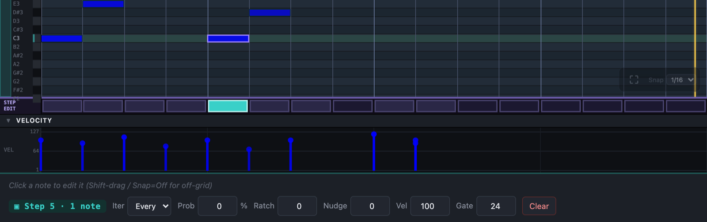
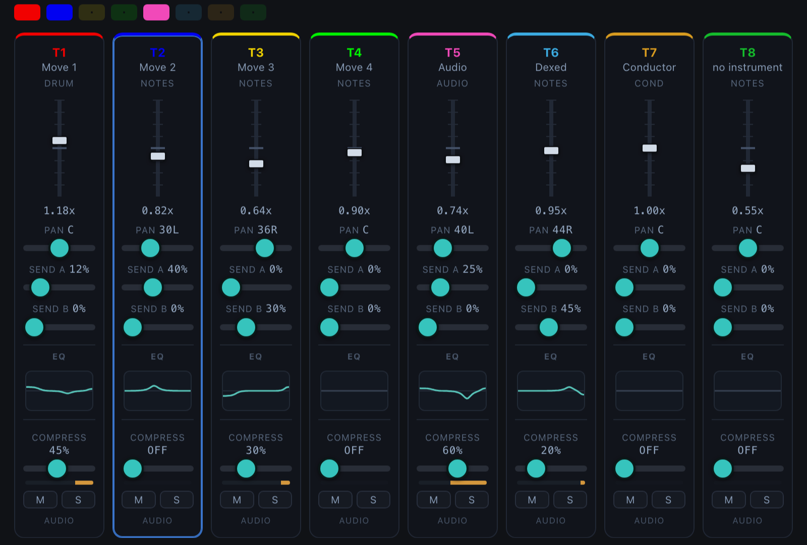
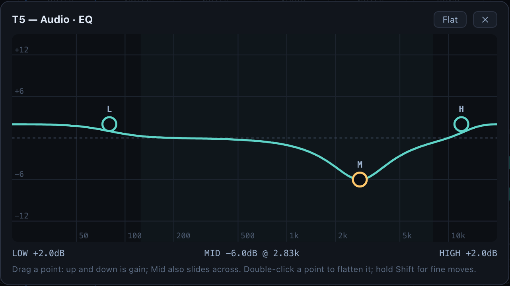

<!-- DRAFT-BANNER-START -->
> ⚠️ **WORKING DRAFT — for the next release.** Edit *this* file (`MANUAL-SA.draft.md`) for every user-facing change as it lands. The **released** manual is `MANUAL-SA.md` — do **not** edit it directly; `scripts/cut_release.sh` promotes this draft into `MANUAL-SA.md` (banner stripped) at release time.
>
> **This is the only manual under active development.** `MANUAL.md` documents dAVEBOx running as an ordinary tool on official Schwung and is **frozen** at its final release — do not edit it, and do not port changes into it.
<!-- DRAFT-BANNER-END -->

# The dAVEBOx SA Manual

dAVEBOx is an 8-track sequencer and sampler for Ableton Move. It records, arranges and plays back
notes and automation. Each track plays one of Move's own instruments, a Schwung effect chain, an
external synth on the USB-A port, or samples of its own on an [Audio](#15-audio-tracks) or
[Slicer](#16-slicer-tracks) track.

dAVEBOx runs inside [Schwung](https://github.com/charlesvestal/schwung) and takes over Move's pads,
knobs and screen while it is open. It uses Move's vocabulary of tracks and clips, and
[Coming from Move](#14-coming-from-move) sums up what carries over and what is different.

If you are new to dAVEBOx, start with the [Quick Start](QUICKSTART.md). It takes about fifteen
minutes to go from a new project to a looping pattern with effects and scenes. This manual is the
full reference.

> 🎬 Seven short videos walk through dAVEBOx on a real Move. Watch the
> [whole playlist](https://www.youtube.com/playlist?list=PLYG911Ay8pgk), or start with the
> [four-minute showcase](https://youtu.be/8-Cta7-WApQ). Sections of this manual that a video
> covers link to the moment it starts.
>
> 1. [Getting around](https://youtu.be/3kP6Zwm79_0)
> 2. [Drums](https://youtu.be/qqZKsu6e244)
> 3. [Melodic sequencing](https://youtu.be/36-v3uYKR78)
> 4. [MIDI effects](https://youtu.be/jOnQWmr71JI)
> 5. [Performance](https://youtu.be/rV0Vhle7INg)
> 6. [Mixing and automation](https://youtu.be/nrZD8SnbD6Q)
> 7. [Projects](https://youtu.be/DOw_4zAO6cI)

This manual covers dAVEBOx SA, which runs as its own session started from Schwung. If you run
dAVEBOx as an ordinary tool inside official Schwung, read [`MANUAL.md`](MANUAL.md) instead;
[dAVEBOx SA and Schwung](#15-davebox-sa-and-schwung) explains the difference.

---

# 1. Overview

This chapter explains how a dAVEBOx project is put together, the two views you work in, and the
kinds of track a project can hold.

## 1.1 How a Project Is Built

Everything in dAVEBOx nests in the same way:

- A note, or an automation point, sits on a step: one slot of a clip's grid.
- A run of steps makes a clip, the basic unit you program and play. A clip also carries its own
  [sequencer effects](#12-sequencer-effects) and [automation](#13-automation). An Audio clip plays
  a sample instead of steps of notes.
- A track holds 16 clips, and only one of them plays at a time. Most tracks point at one
  instrument. An Audio track has a sample in each clip instead, and a Slicer track has one sample
  that its clips play in slices.
- A scene is one clip from each of the 8 tracks, launched together.
- The whole thing is saved as a dAVEBOx project. See [Projects](#51-the-project-picker).

Tracks and clips are the same objects as on Move; scenes are dAVEBOx's own. dAVEBOx replaces
Move's sequencer, not its instruments.

## 1.2 The Two Views

> 🎬 **Video:** [Tutorial 1.1: Two views](https://youtu.be/3kP6Zwm79_0)

You work in one of two views, and switch between them with [Note/Session] (see
[Switching Views](#33-switching-views)).

| | Track View | Session View |
|---|---|---|
| For | Building one clip in detail | Launching and arranging clips |
| Pads | Play notes or drum lanes | The clip grid |
| Steps | The clip's steps | Launch scenes |

## 1.3 Five Kinds of Track

Each track is one of five types. The type sets how you enter notes and how the track sequences
them.

| Type | How it works |
|---|---|
| Melodic | Scale-snapped notes on the pads and steps. See [Melodic Clips](#8-melodic-clips) |
| Drum | The pads become 32 drum lanes, each its own step sequence. See [Drum Clips](#9-drum-clips) |
| Audio | Each clip plays its own sample, in time with the project. See [Audio Tracks](#15-audio-tracks) |
| Slicer | One sample for the track, cut into slices you play and sequence from the pads. See [Slicer Tracks](#16-slicer-tracks) |
| Conductor | Plays no notes of its own; it transposes the other tracks live. See [The Conductor](#24-the-conductor) |

## 1.4 Coming from Move

dAVEBOx borrows Move's ideas and most of its gestures, so much of what your hands already know
works here. These work as they do on Move:

- Tracks, clips and [Note/Session]. dAVEBOx calls the two views Track View and Session
  View.
- Playing and placing notes. The pads play in key and scale. To place notes, press a pad and then
  a step, or hold a step and press pads. [Left] and [Right] move between pages.
- [Capture]. Play first, then press [Capture] to keep what you played.
- [Loop]. Hold [Loop] to see the clip's pages on the step buttons, and turn the jog while holding it
  to change the length.
- Automation. Turn a knob while recording. To switch a knob's automation off, hold [Mute]
  and touch the knob; to clear it, hold [Delete] and touch it. To set a value for one step, hold
  the step and turn a knob. Holding [Mute] lights automated knobs red.
- [Copy], [Delete] and [Undo], on steps and clips.
- Most [Shift] + Step shortcuts: [Step 1] opens your projects, 2 settings, 5 tempo, 6 the metronome,
  7 groove, 9 key and scale, 10 fixed velocity, 11 the arpeggiator, 15 doubles the loop and 16
  quantizes.

Where dAVEBOx differs:

| On Move | In dAVEBOx |
|---|---|
| There are 4 tracks, chosen with the track buttons. | There are 8 tracks. Tracks 1–4 play Move's instruments and tracks 5–8 Schwung instruments. To choose one, hold [Shift] and turn the jog, or hold the jog and press [Step 1–8]. See [Selecting a track](#35-selecting-a-track). |
| The buttons left of the pads select tracks. | The side buttons launch the track's clips in Track View, and scenes in Session View. |
| Session Mode has a row per track, a column per scene and 8 clips per track. | Session View has a column per track, a row per scene and 16 clips per track. It shows 4 rows at a time; [+] and [−] scroll. See [Session View](#21-session-view). |
| You slide a finger down a column to play a scene. | You press a side button or a step button to launch a scene. See [Scenes](#213-scenes). |
| The knobs play the selected device, and the jog picks the device. | The knobs play a bank: clip settings, sequencer effects, sound, macros or automation. The jog's bank map picks the bank. See [Banks and the Bank Map](#4-banks-and-the-bank-map). |
| When you hold a step, the jog sets length and Volume sets velocity. | When you hold a step, the knobs set pitch, length, velocity, nudge and more. See [Editing notes](#86-editing-notes). |
| You browse a track's presets with the jog. | On a Move track, you open Move's own editor from the track's menu and browse there. See [Choosing a track's sound](#191-choosing-a-tracks-sound). |
| [Mute] and a track button mutes a track; add [Shift] to solo. | In Track View, press [Mute], or hold [Shift] and press [Mute]. In Session View, hold [Mute] and touch a track's knob. See [Mute and solo in Session View](#222-muting-in-session-view). |
| You hold a track button and turn Volume to set its level. | Hold [Shift] and turn the Volume knob to set the active track's volume. In Session View the knobs are a mixer. |
| [Shift] + [Step 8] turns on 16 Pitches for a drum track. | [Shift] + [Step 8] switches the right-hand pads between velocity zones and Note Repeat. See [Drum Clips](#9-drum-clips). |
| You keep Sets, in the Set Overview. | You keep projects, in the project picker ([Shift] + [Step 1]). Your Move Sets are left alone. See [Projects](#51-the-project-picker). |

## 1.5 dAVEBOx SA and Schwung

dAVEBOx SA runs as its own session. You start it from Schwung, and Move restarts straight into the
sequencer, on a fork of the Schwung host that plays the modules, presets and samples installed in
your Schwung. It needs Schwung installed and does not replace it. The two ways to start it are
described in [Open dAVEBOx](#22-open-davebox).

Nothing on your Move is modified permanently:

- Your official Schwung install is untouched, and a reboot returns you to it, unless you made
  dAVEBOx your boot default.
- Samples, presets and modules are shared between the two, but settings are not. See
  [dAVEBOx and official Schwung](#293-davebox-and-official-schwung).
- Your Move Sets are not shared. dAVEBOx keeps its own [projects](#51-the-project-picker).

An earlier form of dAVEBOx runs as an ordinary tool inside official Schwung and is described in
[`MANUAL.md`](MANUAL.md). It still works but is no longer developed, and some of this manual does
not apply to it. It has 2 insert effects per chain instead of 4 and no send effect buses, where
dAVEBOx SA has two (A and B). It opens only from the Tools menu, and leaving it unloads it back to
Schwung instead of handing the device back to official Schwung.

---

# 2. Getting Started

This chapter covers installing dAVEBOx SA, opening it, and what a new project gives you.

## 2.1 Install and Remove

dAVEBOx SA needs Schwung 1.7.3 or newer. To install it:

1. In a browser, open Schwung's web manager at move.local:7700 and go to Modules. Plain move.local
   is Ableton's own Move Manager.
2. Find dAVEBOx SA in the catalog, under Tools, and click Install.
3. On the Move, open dAVEBOx SA as described in [Open dAVEBOx](#22-open-davebox). The first launch
   finishes installing by itself in about a minute.

Updates arrive the same way: the web manager shows when a newer dAVEBOx SA is available. Your
projects carry over.

If dAVEBOx SA isn't in your catalog yet, install it from its
[release page](https://github.com/legsmechanical/dbxhost/releases) instead. Download
davebox-sa-module.tar.gz, then in Modules open Install Custom Module, choose the file under From
Tarball, and click Install from File.

To remove dAVEBOx SA:

1. Download davebox-uninstall-module.tar.gz from the
   [release page](https://github.com/legsmechanical/dbxhost/releases).
2. Install it the same way: in Modules, open Install Custom Module and choose the file under From
   Tarball.
3. Quit dAVEBOx.
4. Choose Uninstall dAVEBOx SA in Schwung's tool menu.

Your projects and settings stay in `/data/UserData/daveboxSA`, so a later install picks them up.

## 2.2 Open dAVEBOx

To open dAVEBOx, hold [Shift] and press [Step 13] (the star) to open Schwung's tool menu, then choose
dAVEBOx SA. Move asks "Move will restart to load dAVEBOx. Proceed?" Click the jog to go on, or
[Back] to stay.

The lights go out for a few seconds while Move restarts under the dAVEBOx host. The loading screen
shows dAVEBOx's version under the wordmark; the web manager's System page lists it too. You then
land on the project picker, with one pad per project.

To load the project you had open last, click the jog. Its pad pulses, and the screen shows it
with Load highlighted. To start a new project, hold [Shift] and tap an empty pad; if you have
templates, it asks Empty or Template first. To load another project, hold [Shift] and tap its pad.
The picker is described in full in [The Project Picker](#51-the-project-picker).

dAVEBOx keeps its own projects, separate from your Move Sets. To leave dAVEBOx from anywhere, hold
[Shift] and press [Back]; it saves first. See
[Saving, Suspending and Leaving](#52-saving-suspending-and-leaving).

You can also open dAVEBOx at power-on. While the screen reads "Loading Schwung — press [Back] to
change", hold [Back], turn the jog to dAVEBOx SA and click the jog.

Note that picking a row in that boot menu also makes it your default, so the next power-on goes
straight there. To change back, hold [Back] at power-on and pick Schwung. Leaving dAVEBOx always
returns you to Schwung; the default only decides what a cold boot does.

## 2.3 Nothing to Set Up

Every new project is ready to play. Tracks 1–4 play Move's four instruments, loaded with a random
stock drum kit, a bass and two polyphonic sounds, like a new Move Set. Track 1 is a drum track.

Tracks 5–8 each have an empty Schwung chain and stay silent until you
[choose a sound](#191-choosing-a-tracks-sound) for them. Until then the header and TRACK CONFIG
show -- for their instrument.

Tracks that play Move instruments need Move's Link setting. dAVEBOx turns Link on each time it
starts, set to Tempo with start/stop sync off. If you turn it off in Move Settings, it stays off
until the next session, and dAVEBOx warns you while it is off.

Ready to make something? The [Quick Start](QUICKSTART.md) walks you through a first pattern, step
by step.

---

# 3. The Basics

This chapter covers the controls and conventions that every later chapter assumes: the transport,
switching views, reading the screen, choosing a track, using menus, and copying, deleting and
undoing.

## 3.1 The Controls


Each named button has its own job, and also works as a modifier when you hold it with another
control. The [Quick Reference](#30-quick-reference), which lists every gesture, writes a held
combination as [Shift] + [Play].

The four side buttons left of the pads launch the active track's clips in Track View, and whole
scenes in Session View. [Left] and [Right] page through a clip. The plus and minus
buttons shift the pads' octave; on a drum track they shift the lane bank, and in Session View the
rows.

## 3.2 Transport

Press [Play] to start and stop the sequencer. [Play] also works with these modifiers:

- To restart from the top, hold [Shift] and press [Play].
- In Track View, hold [Loop] and press [Play] to restart with the current clip at the page you are
  looking at.
- To turn the metronome on or off, hold [Mute] and press [Play].
- To stop every clip while playing, hold [Delete] and press [Play]. While stopped, the same gesture
  sends a MIDI panic.

dAVEBOx runs on its own clock by default. It can instead lock to Move's transport or send clock to
external gear; see [Clock Follow](#272-clock-follow).

## 3.3 Switching Views

Each view opens on its overview: its home screen, with the track row and a header naming the bank
or mixer page.

On either view's overview, press [Note/Session] to switch between Track View and Session View. Hold
it to peek at the other view.

Anywhere else, such as a bank page, a menu, the module editor, a dialog or a picker, pressing
[Note/Session] closes everything and takes you to Session View in one press, however deep you are.

[Back] steps out one level at a time. Hold [Back] to go straight to the overview of the view you are
in.

## 3.4 Reading the Screen

The Track View overview shows, from top to bottom:

- The header: the bank the knobs are on and, at the right, what the track plays. `[MV1]` is
  Move instrument 1, `[CH3]` MIDI channel 3, `[TR2]` track 2's instrument, `[CNDT]` the
  Conductor and `[--]` nothing loaded; otherwise it shows a Schwung instrument's short name.
- The line under it: the key and scale, and the track's input velocity. On a drum track it shows
  the lane bank and the selected lane's note instead of the key. `VEL:LIVE` means velocity follows
  how hard you play.
- The track numbers. A box marks the active track, a muted track's number blinks, and a soloed
  one is filled in.
- The clip letters. Under each track is the clip it is on (A–P), filled while it plays or is about
  to.
- The page bar: one segment per page of the clip's loop. The page you are viewing is solid, the
  page playing is outlined, and a tick marks the playhead. A small mark at either end means there
  are notes outside the loop.
- The footer: what the controls do here. `HLD BANKS` means hold the jog for the
  [bank map](#4-banks-and-the-bank-map), `TCH EDIT` means touch a knob or the jog to see the
  bank's page and edit it, and `SHFT TRK` means [Shift] picks the track. While you hold [Shift] it
  reads `JOG TRACK`: turn the jog to change track.

In Session View the footer reads `HLD BANKS` `TCH MIX`: touch a knob or the jog for the
mixer page. A bank page also shows `HLD BANKS` while no knob is touched.

## 3.5 Selecting a Track

There are no dedicated track buttons. In either view, hold [Shift] and turn the jog to change the
active track.

In Track View you can also hold the jog for the [bank map](#4-banks-and-the-bank-map) and press
[Step 1–8]. Each step is lit in its track's color, and the track you are on blinks.

In Session View, tapping a clip pad selects its track and also launches or stops that clip. To
open the clip in Track View instead, hold [Shift] and tap its pad.

## 3.6 Menus, Lists and Typing

To open Project Settings, hold [Shift] and press [Step 2]. It holds the settings saved with the
project, and a few that apply to the whole Move. Every row is listed in
[Project Settings](#291-project-settings) and
[Settings for the Whole Move](#292-settings-for-the-whole-move). Many settings also have a
[Shift] + Step shortcut, listed in the [Quick Reference](#30-quick-reference).

Every list in dAVEBOx works the same way. Turn the jog to move; the selected row is filled white,
and a scrollbar shows when there is more. A > at the right of a row opens something.

To change a number, press the row, turn the jog, and press again to set it. The value shows in
[brackets] while you change it. A row with a list of choices opens the list: turn to one and press
the jog to set it, or press [Back] to leave it as it was. A two-way setting flips when you press
it.

[Back] steps out. In Project Settings it also cancels a change in progress.

### 3.6.1 Typing a Name

When you name a project or a template, save as, or rename something, the on-screen keyboard opens.
Turn the jog to a key and click the jog to type it. OK saves and [Back] cancels. The last page of
keys holds symbols, the comma among them.

### 3.6.2 Speaking a Name

You can also speak a name. Hold [Record], speak, and let go. Dictation is an add-on that you install
once from Project Settings, as described in [Dictation](#292-settings-for-the-whole-move).

While you hold [Record], a LISTENING card opens over the keyboard, with a meter that moves as it hears
you and a bar counting toward the 30-second limit. [Record] lights red. When you let go
the card reads TRANSCRIBING for a moment while [Record] pulses white, then the words appear in the
name.

If you have not typed anything yet, what you say replaces the name; otherwise it is added after
what you typed. You can still edit the words with the keyboard before you press OK. Commas and the
closing full stop are left out, so type a comma from the symbols page if you want one. Dictation
understands English only.

It listens through the Move's microphone, or through the line input whenever a cable is plugged
in, so a microphone on the line input works too. Anything else playing into the line input will be
heard as well. If input monitoring is on, it is switched off while you talk, so the microphone
doesn't come out of the speakers, and comes back on afterwards.

Press [Back] while it is listening or transcribing to cancel just the dictation, and press [Back] again
to leave the keyboard. While a card is up, the keys under it don't respond; press [Back] to take a
message down. The card can show these messages:

- NO SPEECH: it heard nothing it could use, such as silence or background noise.
- HOLD REC TO TALK: you tapped [Record] instead of holding it.
- STOP TO TALK: the music is playing or counting in. Dictation works only while stopped, and [Record]
  stays dark until then.
- MIC BUSY: the sampler ([Shift] + Volume + Sampling) is in use.

## 3.7 Copy, Delete and Undo

Copying, clearing and resetting work the same way on steps, clips, drum lanes, pages and scenes:

- To copy, hold [Copy], press the thing you want to copy, then press where it should go.
- To cut instead, hold [Shift] as well as [Copy].
- To clear something, hold [Delete] and press it.
- To reset something, clearing it and returning its settings to their defaults, hold [Shift] and
  [Delete] and press it.

What each one keeps is described with the thing itself: [steps](#86-editing-notes),
[clips](#73-switching-clips), [drum lanes](#95-copying-clearing-and-muting-lanes),
[pages](#74-clip-length-and-the-loop), [scenes](#213-scenes),
[Audio and Slicer clips](#156-copying-clearing-and-undo), [banks](#44-resetting-a-bank) and
[projects](#51-the-project-picker).

To reverse the last edit, press [Undo]. To redo it, hold [Shift] and press [Undo]. [Undo] is one step deep,
so only the last change can be undone. It covers step and clip edits, copying and clearing,
resets, recording, captures, bakes, flattens, sample loads and imports.

Note that a few changes cannot be undone: a committed [Key or Scale transpose](#62-key-and-scale),
and a Trim or Normalize that overwrites a sample (see [SAMPLE](#152-the-sample-editor)).

---

# 4. Banks and the Bank Map

> 🎬 **Video:** [Tutorial 1.3: The bank map](https://youtu.be/3kP6Zwm79_0?t=160) (from 2:40)

In Track View the eight knobs play a bank: one page of related controls, such as the clip's
timing, a sequencer effect or the track's levels. To choose a bank, hold the jog for the bank
map, tap a pad, and let go to play.

Each track remembers its bank, MIX and MACROS included, across track switches, suspend, and
quitting and relaunching. A melodic track starts on CLIP, a drum track on DRUM LANE and a
Conductor on CLIP.

In Session View the knobs are the mixer, and holding the jog brings up the Session map
instead. See [The session mixer](#203-the-session-mixer).

## 4.1 The Bank Map

Hold the jog and the map appears as soon as you press. The left 4×4 pads become a map of the
track's banks, and the screen shows the same map.

Tap a pad to land on that bank. You can tap as many as you like while the map is up, then let go
of the jog to play again. Letting go without tapping changes nothing. The map is up only while
the jog is held, so a quick press leaves nothing on screen.

The four columns of pads are groups, and each group's banks run from top to bottom:

- IN: what you play into the track. PAD MODE, LIVE ARP and RPT GROOVE.
- CTRL: what moves the parameters. MACROS, AUTOMATION, and MIX at the foot.
- SEQ: the sequence. STEP, CLIP, DRUM LANE, ALL LANES and INPUT.
- FX: the sequencer effects, in the order the notes pass through them. NOTE FX, HARMONY, DELAY,
  SEQ ARP and REMIX. On a drum track they act on the selected lane.

A bank the track doesn't have leaves its pad dark, and nothing moves up to fill the gap, so a bank
is always on the same pad. The table gives each pad by its column and its row, counted from the
top. Pads not listed are dark on every track type.

| Pad | Melodic | Drum | Audio | Slicer | Conductor |
|---|---|---|---|---|---|
| Column 1, row 1 | PAD MODE | — | — | PAD MODE | — |
| Column 1, row 2 | LIVE ARP | RPT GROOVE | LIVE ARP | LIVE ARP | — |
| Column 1, row 4 | CONFIG | CONFIG | CONFIG | CONFIG | CONFIG |
| Column 2, row 1 | MACROS | MACROS | MACROS | MACROS | ON/OFF |
| Column 2, row 2 | AUTO | AUTO | AUTO | AUTO | OCTAVE |
| Column 2, row 3 | — | — | — | — | TIMING |
| Column 2, row 4 | MIX | MIX | MIX | MIX | — |
| Column 3, row 1 | STEP | STEP | — | STEP | CLIP |
| Column 3, row 2 | CLIP | DRUM LANE | CLIP | CLIP | STEP |
| Column 3, row 3 | — | ALL LANES | INPUT | — | — |
| Column 3, row 4 | INST | INST | SAMPLE | SLICER | — |
| Column 4, row 1 | NOTE FX | NOTE FX | — | NOTE FX | NOTE FX |
| Column 4, row 2 | HARMONY | — | — | — | — |
| Column 4, row 3 | DELAY | DELAY | REMIX | REMIX | — |
| Column 4, row 4 | SEQ ARP | — | — | — | — |

The pads wear their group's color, and the bank you are on is white. CONFIG, MIX and INST wear the
track's color. On a drum track the screen draws DRUM LANE and ALL LANES as one box, because they
are two views of the same lanes.

On a Conductor the second column is the RSPD group, which sets how the other tracks respond. See
[The Conductor's banks](#243-the-conductors-banks).

### 4.1.1 Screens on the Map

Three pads on the map open screens rather than banks. CONFIG opens the track's
[TRACK CONFIG](#192-track-config) menu, AUTO the [AUTOMATION](#13-automation) screen, and INST the
track's instrument.

Tap one and its pad turns white; the screen opens when you let go of the jog. If you tap a bank
after it, nothing opens.

Opening a screen never changes the bank you are on, so the overview and a knob peek still show
that bank. [Back] from the screen's top level returns you exactly where you were.

On Audio and Slicer tracks, SAMPLE and SLICER take INST's pad. They are banks: the pages of the
sample editor.

### 4.1.2 More on the Map

The map also lets you change track, open module editors and switch view.

In Track View, [Steps 1–8] are the tracks, each lit in its track's color. The track you are on blinks
between its color and white. Press one to switch track; the screen flashes TRACK n and what that
track plays. The map stays up, now showing the new track's banks, so the bank you want there is
your next tap. [Steps 9–16] are dark and do nothing.

In Track View, the right-hand pads open the track's module editors. In the third column, MIDI FX
(cyan) sits above INSTRUMENT (in the track's color), and FX 1–4 (orange) run down the far-right
column. Tap one and the screen flashes its name and what is loaded there, or Empty. Like CONFIG,
it opens when you let go. A MIDI track has only MIDI FX, and a Conductor has none.

To switch view under the map, keep holding the jog and press [Note/Session]. The view changes and
the map stays up, now showing the new view's map. If you hold [Note/Session] to peek, the map comes
along there and back.

To jump straight to LIVE ARP, hold [Shift] and hold [Step 11].

### 4.1.3 From Inside a Screen

Inside a menu, TRACK CONFIG, a module's editor or the AUTOMATION screen, hold the jog for about a
third of a second and the same map comes up over it. Tap a pad to leave the screen for that bank.
If you let go without tapping, the screen is exactly as you left it. A quick press of the jog is
still a press there, and lands as you let go.

This works inside Move's own editor for a Move instrument too. The map shows over Move's screen,
and Move's editor is back untouched when you let go.

Note that the map doesn't come up over the on-screen keyboard, over a question that needs an
answer, or while [Shift], [Delete], [Copy], [Mute] or [Loop] is held.

## 4.2 Playing a Bank

Touch a knob to see the bank's page while you touch it; let go and the overview is back.
[Card Hold](#291-project-settings) in Project Settings keeps the page up for half a second, one or
two after you let go, so you can read what you set. Touching the jog shows the same page while
your finger rests on it.

When you turn a knob that sets a number, such as an octave, an offset, a rate, a length or a
count, its cell becomes an arc while you touch it, so the value moves the way the knob does. An
knob with named choices, such as an arp style or a direction, opens its list instead, over a
dimmed copy of the page.

The knob LEDs light on every bank: knobs 1–4 white and 5–8 amber, with brightness following
the value. A dark LED means nothing is on that knob. On the Conductor's ON/OFF, OCTAVE and
TIMING banks, each knob lights in its track's color.

Turning the jog never changes the bank. On a bank with pages it flips the pages, and the header
says which page you are on (1/2, 2/3). The paged banks are MIX (the levels, then the
[channel strip](#202-the-channel-strip)), an Audio clip's SAMPLE and a Slicer's SLICER editor.
To step through the tracks, hold [Shift] and turn the jog.

Pages you open on purpose stay up until you press [Back]. These are LIVE ARP opened with [Shift] and a
held [Step 11], the module editors, AUTOMATION and TRACK CONFIG.

## 4.3 Touch and Click

Some controls do more than turning can. To reach them, touch the knob and click the jog. A
cell that takes a press wears corner brackets, and while you touch it the bottom of the screen
shows CLK and what the press will do. A touch and press does one of these:

- It switches a knob marked Alt in the bank tables to its alternate: Res to Zoom, Shift to
  Nudge, Dir to Reverse Style, Rand to Algo, and Rate to Clock Feedback. Only that knob changes.
  Touch and press again, press [Back], or leave the bank to switch it back.
- It runs a one-shot action, such as Crop or Legato.
- It opens an editor. Steps (knob 5) on SEQ ARP and LIVE ARP opens Arp Steps, any knob on RPT
  GROOVE switches between its Velocity and Nudge pages, and a knob on MACROS opens that macro.

On AUTOMATION, hold [Delete] and click the jog to clear the lane under the cursor.

## 4.4 Resetting a Bank

To reset every parameter in the bank you are on, hold [Delete] and click the jog. One-shot actions
(Stretch, Shift, Legato and Crop) are left alone, and on a paged bank only the page showing is
reset. This doesn't work on ALL LANES, STEP, or the Conductor's ON/OFF, OCTAVE and TIMING banks.
On a drum track's RPT GROOVE bank, or on any bank while Note Repeat is on, it resets the selected
lane's groove.

On MACROS, the same gesture unassigns all eight macros on the track, after asking. Their
values and automation are left alone.

To reset all the sequencer effects (NOTE FX, HARMONY, DELAY and SEQ ARP), hold [Shift] and [Delete] and
click the jog. The CLIP, lane, STEP, MACROS and MIX banks, and automation, are left alone. To
reset the whole clip, notes and all parameters, hold [Shift] and [Delete] and press the clip's side
button.

Resets can be undone. [Undo] takes back a bank reset or a macro clear, and [Shift] + [Undo] re-applies
it.

Note that resetting a parameter also clears its [automation](#13-automation). A bank reset clears
the automation for that bank's parameters only, and clearing or resetting a clip clears all of its
automation. On a drum track, clearing a single lane leaves automation alone, because a drum clip's
automation covers the whole clip.

## 4.5 Where Each Bank Is Covered

| Bank | Where it is covered |
|---|---|
| PAD MODE | [Pad layouts](#82-pad-layouts) (melodic), [The SLICER editor](#162-the-slicer-editor) (Slicer) |
| LIVE ARP, RPT GROOVE | [Live input modifiers](#125-live-input-modifiers) |
| MACROS | [The MACROS bank](#231-the-macros-bank) |
| AUTOMATION | [Automation](#13-automation) |
| MIX | [Track levels](#201-track-levels) and [the channel strip](#202-the-channel-strip) |
| STEP | [Editing notes](#86-editing-notes) |
| CLIP, DRUM LANE, ALL LANES | [Clip Timing and Grid](#11-clip-timing-and-grid); an Audio clip's CLIP in [The banks](#155-the-banks) |
| INPUT | [Recording into an Audio clip](#181-recording-into-an-audio-clip) |
| SAMPLE, SLICER | [SAMPLE](#152-the-sample-editor), [The SLICER editor](#162-the-slicer-editor) |
| NOTE FX, HARMONY, DELAY, SEQ ARP | [Sequencer Effects](#12-sequencer-effects) |
| REMIX | [REMIX](#17-remix) |
| ON/OFF, OCTAVE, TIMING | [The Conductor's banks](#243-the-conductors-banks) |

---

# 5. Projects

dAVEBOx SA keeps its own projects, separate from your Move Sets. Launching dAVEBOx sets your Move
Sets aside, untouched, and leaving puts them back. Move and official Schwung never see the
projects, and dAVEBOx never sees or changes your Move Sets.

This chapter covers opening and managing projects, how dAVEBOx saves, save states, templates, and
backing up.

## 5.1 The Project Picker

> 🎬 **Video:** [Tutorial 7.1: Projects and Save state](https://youtu.be/DOw_4zAO6cI)

To open the project picker, hold [Shift] and press [Step 1], from anywhere, or choose Projects... in
Project Settings. The pads become your project shelf, with one pad per project and 32 slots:

- A lit pad is a project, in its own color.
- Solid white is the open project.
- The selected project pulses in its color, or white if it is also the open one.
- Dim red is a project whose song file is damaged or missing. It shows CAN'T OPEN and won't load,
  but you can still rename, recolor or delete it.

The screen shows the selected project: its name, then Load, Rename and Color. On the open project
the name reads CURRENT, and Resume replaces Load. Resume closes the picker, as do [Back] and
[Note/Session]. If your last project no longer exists, the screen says Select project until you tap
a pad.

[Back] steps out one level at a time, from Color to the project's screen to closed. To leave
dAVEBOx SA, hold [Shift] and press [Back].

### 5.1.1 Opening a Project

Tap a project to select it, turn the jog to choose a row, and click the jog to select the row.
Load stops playback first, and the lights go dark while the project loads. To load a project at
once, hold [Shift] and tap its pad.

### 5.1.2 Creating a Project

To create a project, tap an empty pad and confirm. The new project gets a two-word name of its
own, such as Quiet Harbor or Amber Finch, which you can rename whenever you like. It opens when
you choose Load. To create a project and open it in one press, hold [Shift] and tap the empty pad.

Once you have saved a [template](#54-templates), creating a project asks Empty or Template,
with Template selected. Holding [Shift] and tapping asks too. Choose Template to open the list of your
templates, then pick one, and the project is made from it.

### 5.1.3 Renaming and Coloring

Rename opens the on-screen keyboard. The new name takes effect at once, even on the open project.
Two projects can't share a name; if you try, the screen shows NAME TAKEN.

Color lists the palette. Turn the jog to move through it, and the pad previews each color live.
Click the jog to set it.

### 5.1.4 Copying and Deleting

To copy a project, hold [Copy], tap the project, then tap an empty pad. Releasing [Copy] before then
cancels. The copy is named "Name Copy" and holds the project as it is now, colors and all. Later
edits to the original don't follow it.

To delete a project, hold [Delete], tap the project, then tap it again to confirm. It blinks red in
between, and releasing [Delete] cancels. The project is removed straight away.

You can delete the project you are in. The screen warns that dAVEBOx will restart, and dAVEBOx
returns a few seconds later at the project picker with nothing loaded.

### 5.1.5 When a Project Won't Open

PROJECT DID NOT OPEN means Move couldn't open the project you chose. dAVEBOx saves nothing until a
project is open. Choose Retry to try the same project again, or [Back] to return to the picker.

If the project list itself can't be read, the screen says so and offers Retry or Quit.

## 5.2 Saving, Suspending and Leaving

> 🎬 **Video:** [Tutorial 7.1: Projects and Save state](https://youtu.be/DOw_4zAO6cI)

dAVEBOx saves as you go: when you stop the transport, a moment after your last edit while stopped,
at the end of a recording, and whenever you suspend, quit or switch projects. It never saves during
playback, and there is no manual save. For named backups, use [Save state](#53-save-states).

Note that a project has a size limit of about 1 MB, far more than most projects use. Past it,
dAVEBOx shows PROJECT TOO BIG / SAVES ON QUIT ONLY / REMOVE SOME CLIPS and stops saving as you go.
Your work is still written in full when you quit or suspend. Remove some clips and it saves as you
go again, showing PROJECT SAVED.

If a save cannot be written because storage is full, dAVEBOx shows SAVE FAILED / CHECK STORAGE and
tries again.

### 5.2.1 Leaving and Suspending

To leave dAVEBOx and hand the device back to official Schwung, hold [Shift] and press [Back] from
anywhere, or choose Quit in Project Settings. Either one saves first. Leaving, or a reboot, even
after a power cut mid-session, brings back your official install, your own Move Sets included.

To use Move while dAVEBOx keeps playing in the background, choose Suspend session in Project
Settings. To come back, hold [Shift] and hold [Step 13] for half a second, or press [Shift] + [Step 13]
twice quickly, or pick dAVEBOx SA in the Tools menu. Everything is as you left it.

Quit and Suspend session ask first, opening on No. Turn to Yes and click the jog.

If dAVEBOx is your boot default, a reboot returns to dAVEBOx instead of official Schwung. To go
back, hold [Back] at power-on and pick Schwung.

### 5.2.2 Powering Off

To turn the Move off, tap or hold the power button. POWER OFF? asks first, opening on No; it never
skips the question, even when you hold the button. Turn to Yes and click the jog. dAVEBOx saves
your project, its instruments and effects, and the Move Set, shows Powering off..., and turns the
Move off.

To start the Move again, press the power button as usual.

## 5.3 Save States

dAVEBOx [saves as you go](#52-saving-suspending-and-leaving). For named backups, choose Save state in
Project Settings, which keeps up to 16 snapshots per project. Each is stamped with the date and
time. Saving asks first, and when all 16 are used it asks which one to replace. To restore a
snapshot, choose Load state.

Snapshots belong to the project and survive Clear Sess, which clears the whole project back to
empty.

Note that snapshots saved by a different dAVEBOx version can't be loaded. Load state offers to
delete them.

The other kinds of preset and snapshot are compared in
[Presets and Snapshots at a Glance](#3011-presets-and-snapshots-at-a-glance).

## 5.4 Templates

A template is a starting point for new projects. To save one, choose Save as Template... in Project
Settings and give it a name; the name starts as the project's. This saves a copy of the project you
are in.

A template keeps the project settings, the instrument and effects on each track with their
settings, the MACROS, and the track settings. The track settings are each track's type, layout,
transpose, VelIn, aftertouch, looper, and where it plays, such as a MIDI track's program or a drum
track's pad notes.

No clips, notes or automation come along, and every sequencer bank (NOTE FX, HARMONY, DELAY, SEQ
ARP, LIVE ARP and the rest) starts at its default. A Slicer comes along whole: its sample, which is
copied into each new project, its chops, Tempo and Warp. Audio tracks arrive empty.

The template is its own copy, so changing or deleting the project afterwards doesn't touch it. Each
save adds a new template, and two templates can't share a name. To make a project from a template,
see [Creating a Project](#512-creating-a-project).

To manage your templates, choose Templates... in Project Settings; the row is shown while you have
any. Press a template for its menu:

- Rename gives it a new name.
- Replace with Current asks first, then saves the project you are in over it. It keeps its name.
- Delete asks first. Projects made from the template aren't touched. If you delete the last one,
  new projects start empty again.

[Back] steps out one level at a time: from the confirm to the template's menu, to the list, to
Project Settings.

Note that if a template uses a module this Move doesn't have, the new project starts with that slot
empty and the screen names what is missing (MODULES MISSING).

## 5.5 Backing Up and Moving Projects

The Projects page of the web manager lists your projects. To open it, go to move.local:7700 in a
browser during a session. The web manager is described in
[dAVEBOx and official Schwung](#293-davebox-and-official-schwung).

Download saves one project as a single file on your computer. Download all saves every project and
your templates in one file. Stop playback before you download the open project, or its last second
of edits may not be in the file.

To restore, upload a downloaded file, on this Move or another one. Each project in it is added as a
new project on the first free pad. Nothing on the Move is replaced, so restoring a project you
still have gives you a second one named "Name (imported)". Templates come back too, unless you
still have them. New projects appear the next time you open the picker.

The page says what came in, what didn't and why, such as a file saved by a different dAVEBOx
version, or no free pad. It also names any instrument or effect this Move doesn't have; those slots
open empty until you install it.

Note that samples and recordings from your Move library aren't part of a project and don't travel
with it.

## 5.6 Compatibility and What's Saved

A project saves all its notes, effects, automation and timing; each track's settings and sound; the
project settings; mute and solo state and all snapshots; Performance Mode presets 9–16; and Note
Repeat masks and rates.

dAVEBOx opens every project an earlier version saved. Projects made before dAVEBOx 1.1 are
converted when they open and play the same; once saved, dAVEBOx 1.0.0 opens them without their
automation. A project made with the Swing Amt and Swing Res settings of earlier versions opens with
Swing 1/16 or Swing 1/8 and sounds the same.

A project saved by a newer dAVEBOx says PROJECT TOO NEW and is left as it is, never erased.

Note that dAVEBOx 1.1.3 and earlier can't read a project saved by this version, and ask to erase
it. If you go back to one of those versions, answer No.

If you used dAVEBOx when it worked in your Move Sets, the work you made then stays in those Sets,
visible from Move and official Schwung. dAVEBOx projects start fresh.

---

# 6. Tempo, Key and Groove

Tempo, metronome, key, scale and groove belong to the project. You set them in Project Settings:
hold [Shift] and press [Step 2], turn the jog to a row, click it, turn to change the value, and press
again to set it. Every row is listed in [Project Settings](#291-project-settings).

## 6.1 Tempo and Metronome

> 🎬 **Video:** [Tutorial 1.4: Tempo and key](https://youtu.be/3kP6Zwm79_0?t=227) (from 3:47)

BPM sets the tempo, from 40 to 250. While [Clock Follow](#272-clock-follow) is on, it reads Move
and the project follows Move's tempo.

To tap the tempo, hold [Shift] and press [Step 5]. Tap any pad in time, or turn the jog to adjust.
Click the jog or [Back] when you are done.

Metro sets when the metronome sounds: Off (never), Cnt-In (during the count-in only), Play (while
playing) or Always. The default is Cnt-In. Metro Vol sets the metronome's level, from 0 to 150 %;
the default is 100 %.

To switch Metro between Cnt-In and Always, hold [Shift] and press [Step 6]. The step's icon is lit while
the metronome plays (Play or Always). To turn the metronome on and off from the transport, hold
[Mute] and press [Play].

## 6.2 Key and Scale

Key sets the project's root note, from C to B. Scale sets the scale that melodic tracks snap to. A
new project starts in a random key and scale. To jump straight to Scale, hold [Shift] and press
[Step 9].

The scales are Major, Minor, Dorian, Phrygian, Lydian, Mixolydian, Locrian, Harmonic Minor, Melodic
Minor, Pentatonic Major, Pentatonic Minor, Blues, Whole Tone and Diminished.

Scale Aware sets whether scale-aware parameters move by scale degree (On, the default) or by
semitone (Off).

Instruments and MIDI effects that can follow the host's key, with a Host setting, follow dAVEBOx's
key, scale and tempo live, including while you preview a new key.

### 6.2.1 Moving Your Clips to a New Key

When you change Key or Scale, dAVEBOx offers to move your melodic clips with it:

1. Press Key or Scale to open its list, turn the jog to choose, and press to pick.
2. If any melodic clip holds notes, TRANSPOSE CLIPS? asks first. While it asks, the pads show the
   new key and, if the music is playing, you hear the clips in it.
3. Choose Yes to move the notes to the new key, or No to keep the old key. [Back] cancels too.

With no notes to move, the pick takes effect straight away.

Key moves notes by the shortest distance. A new scale remaps notes by scale degree between scales of
the same size, and otherwise to the nearest in-scale note. Drum tracks are untouched.

Note that a committed transpose can't be undone, so check the preview before you confirm.

## 6.3 The Groove

> 🎬 **Video:** [Tutorial 6.4: Groove and swing](https://youtu.be/nrZD8SnbD6Q?t=443) (from 7:23)

One groove plays for the whole project. Groove picks it, and Groove Amt sets how much of it you
hear; at none, everything is on the grid. To jump to Groove Amt, hold [Shift] and press [Step 7].

| Setting | What it does | Values | Default |
|---|---|---|---|
| Groove | The project's timing feel | Off, Browse..., Swing 1/16, Swing 1/8, the loaded groove | Swing 1/16 |
| Groove Amt | How much of the groove is applied. On a swing it reads as swing depth: 50 % is straight, 66 % is triplet swing | 0–100 % (50–75 % on a swing) | 0 % (reads 50 % on a swing, which is straight) |
| Grv Timing | How much of the loaded groove's timing shifts are applied | 0–100 % | The groove's own |
| Grv Velocity | How far notes are pulled toward the groove's velocities | 0–100 % | The groove's own |
| Grv Random | How much each note wanders from its place, differently every time | 0–100 % | The groove's own |

Grv Timing, Grv Velocity and Grv Random are shown only for a loaded groove.

Swing 1/16 and Swing 1/8 delay every other 1/16 or 1/8 note. Off plays straight, whatever Groove
Amt says.

### 6.3.1 Loading a Groove

Browse... opens a list of MIDI files and Ableton groove files (.agr). Turn the jog to a file and
you hear it at once, over whatever is playing. Click the jog to keep it and return to Project
Settings. Press [Back] to leave without keeping anything, and the groove you had comes back.

The list opens on the file the project's groove was loaded from, or at the top of your files when
the project has none.

A MIDI file is read over its whole length, on the grid its notes were played on: 1/16 notes for a
1/16 pattern, 1/8 notes for swung 1/8s, and triplets for triplets, up to 128 positions. If a file
has several parts, dAVEBOx asks which one to use. An Ableton groove brings its own grid, length and
amounts.

A loaded groove is a repeating pattern of small timing shifts, some notes a little late and some a
little early, and velocities, one per grid position. Notes the sequencer plays are moved both ways.
Arps, repeats, delay echoes and the looper are only ever moved later.

The loaded groove appears at the foot of the Groove list under its name, so you can go to a swing
and come back. It is saved inside the project, so the project keeps its feel even if the file is
later removed.

### 6.3.2 Groove on Each Track

Each track follows the project's amounts until you give it its own. In a track's
[settings](#197-track-settings), Grv Amt reads Global. Turn it and that track takes its own amount
instead, from 0 to 100 % in 5 % steps: more than the rest, less, or 0 % to play straight.

With a loaded groove, Grv Timing, Grv Velocity and Grv Random work the same way on each track. A
hi-hat can wander while the kick stays put, or one track can take the groove's accents while
another ignores them. Turn a row back down to Global and the track follows the project again.

### 6.3.3 Recording Under a Groove

With Input Quantize off, what you play is stored so that the groove plays it back at the moment you
played it; it is not grooved a second time. With Input Quantize on, the note snaps to the grid and
the groove moves it from there.

---

# 7. Tracks and Clips

This chapter covers what every track and clip has in common, whatever its type: the type itself, switching clips, and setting a clip's length.

dAVEBOx has 8 tracks. Each track holds 16 clips and plays one clip at a time. A track plays one instrument (see [Choosing an instrument](#194-choosing-an-instrument)), except an Audio or Slicer track, which plays samples.

Track View is where you build one clip: always the current clip of the active track. The pads play the track's notes on a melodic track, or trigger its drum lanes on a drum track. The 16 step buttons hold the clip's pattern. To choose the bank that shapes the clip, hold the jog for the [bank map](#4-banks-and-the-bank-map) and tap a pad.

What goes into a clip is covered in [Melodic Clips](#8-melodic-clips) and [Drum Clips](#9-drum-clips).

## 7.1 Track Type

A track's type sets how you enter notes into it and how it sequences them.

| Type | Where you set it | How it works |
|---|---|---|
| Melodic | Mode, Melodic | Scale-snapped notes on the pads and steps. See [Melodic Clips](#8-melodic-clips). |
| Drum | Mode, Drums | 32 drum lanes, each its own step sequence. See [Drum Clips](#9-drum-clips). |
| Audio | Instmt/Dest, Audio | A sample per clip, played with the clip. See [Audio Tracks](#15-audio-tracks). |
| Slicer | Instmt/Dest, Slicer | One sample, chopped; each clip is a sequence of slices. See [Slicer Tracks](#16-slicer-tracks). |
| Conductor | Instmt/Dest, Conductor | Plays no notes of its own and transposes the other tracks. See [The Conductor](#24-the-conductor). |

Melodic and Drums are the Mode row of the track's TRACK CONFIG menu. Turning the jog previews the type, and clicking the jog commits it.

Audio, Slicer and Conductor are chosen in the Instmt/Dest picker instead, just after the Move instruments. To open the picker, hold [Shift] and click the jog on the Instmt/Dest row. To turn one of these back into an ordinary track, choose an instrument in the same picker.

Tracks start as melodic tracks, except Track 1 of a new project, which starts as a drum track. A project started from your template keeps the template's track types.

A track keeps its color, clips and routing whatever its type. This holds even for a Conductor, so its instrument is still there when you switch back.

## 7.2 Changing Type

To change a track's type, stop the transport first: a track cannot change type while playing.

Changing type keeps your notes across all 16 clips, with their position, pitch, length and velocity. It resets the sequencer effects (NOTE FX, HARMONY, DELAY and SEQ ARP).

From melodic to drum, dAVEBOx asks you to confirm if the track holds notes. Each pitch becomes its own lane, and per-step conditions are dropped. Note that a clip with more than 32 pitches loses the least-used ones.

From drum to melodic, dAVEBOx does not ask. The lanes merge into one clip, with the length of the first lane that has notes, and per-step conditions are dropped.

Making a track the Conductor always asks first, with MAKE CONDUCTOR?. It keeps the notes and their conditions, and clears effects, arps and automation. Only one track can be the Conductor; if you try on a second track, the screen says which track already is. Choosing an instrument turns a Conductor back into a melodic track, without asking.

Choosing Audio or Slicer clears the track's notes, asking first if there are any: they were pitches, and on a Slicer a pitch is a slice. The track's instrument goes and its effects stay. The track plays through its own Schwung slot; a track that used a Move instrument takes one.

If you choose Audio on a track that plays an instrument and has clips, dAVEBOx first asks Resample the clips?. Yes records each clip with notes and turns it into an Audio clip that plays its own recording, so the track sounds the same. No converts without recording, and the notes are cleared. [Back] on the question changes nothing. How the recording is made, and what happens to the track's effects, is explained in [Flattening a track](#183-flattening-a-track), which does the same from TRACK CONFIG.

Leaving Audio or Slicer, by choosing an instrument or the other of the two, clears every clip's steps and lets go of the samples, asking first. One [Undo] brings it all back. The files stay in the project until you [purge them](#184-the-projects-samples).

## 7.3 Switching Clips

The four side buttons, to the left of the pads, launch the active track's clips. They follow the four clip rows shown in [Session View](#21-session-view), and the lit button is the clip you are editing.

To select and launch a clip, press its side button. To stop the playing clip at the end of its page, press its side button; press it again to cancel.

To scroll the four visible clips up or down by one, hold [Shift] and press the top or bottom side button. The window is the same for every track.

The side buttons also take the general copy and delete gestures described in [Copy, Delete and Undo](#37-copy-delete-and-undo). On a clip they do the following:

- [Copy] and a side button, then another side button, copies the clip to that slot. [Shift] and [Copy] cuts it.
- [Delete] and a side button clears the clip's notes and automation, and frees its length for the next recording.
- [Shift], [Delete] and a side button resets the clip: notes and all parameters.

## 7.4 Clip Length and the Loop

> 🎬 **Video:** [Tutorial 3.9: Loop length and pages](https://youtu.be/36-v3uYKR78?t=610) (from 10:10)

A clip plays its loop: a run of up to 256 steps, shown as pages of 16. The loop is the clip's length, and it normally starts on [Step 1]. This applies to every kind of clip; on a drum track, each lane has its own loop, set the same way (see [Per-lane loops](#93-per-lane-loops)).

To move between the pages inside the loop, press [Left] and [Right].

To grow or shrink the loop by one step, hold [Loop] and turn the jog. To double the loop and copy what is in it into the new half, hold [Shift] and press [Step 15].

Note that the loop length cannot be changed while a take is recording.

### 7.4.1 Seq Follow

Seq Follow keeps the step buttons on the page that is playing. It is one switch for the whole device and is remembered between sessions.

To turn Seq Follow on or off, hold [Left] or [Right] and press [Play]. The screen shows FOLLOW ON or FOLLOW OFF. That press does nothing else: the transport is not started or stopped. It works in the module editors too, but not in Session View.

On the track overview, a small play-to-bar mark to the left of `Vel:` shows that Seq Follow is on. The mark is gone when Seq Follow is off.

If you press [Left] or [Right] while the transport runs, Seq Follow pauses, so the page stays where you went, and the mark blinks. It follows again the next time the transport stops. Restarting with [Shift] and [Play], or [Loop] and [Play], is not a stop, so the pause stays.

### 7.4.2 The Loop View

Hold [Loop] for the loop view. The step buttons now stand for pages, and a page inside the loop lights in the track color, pulsing if it holds notes. While you hold [Loop]:

- Turn the jog to grow or shrink the loop from its end.
- Press a step button to end the loop on that page. The loop runs from page 1, or from the loop's start if it starts later.
- Hold one step button and press another to set the loop to the range between them.

For example, to make a 2-bar clip on the 1/16 grid, hold [Loop] and press [Step 2]. Press [Step 2] again on a 2-page loop to go back to one page. Notes outside the loop are kept, and return when you widen it.

To set the loop with your hands free, tap [Loop] instead of holding it. The loop view stays up and [Loop] blinks white, and the pads keep playing. To close it, press [Loop] again or press [Back]. Switching to Session View or opening a menu closes it too.

Note that a press of [Loop] that already does something else still does only that. On a drum track with a latched repeat it releases the repeat, and while the arpeggiator's latch holds notes it clears them.

### 7.4.3 Copying Pages

You can copy one page of a clip onto another.

1. Hold [Loop] and [Copy].
2. Press a lit page. It blinks.
3. Press another page. It becomes an exact copy: every note, velocity, length and step setting, and the empty steps too.

Keep holding [Copy] to paste onto more pages. [Shift] and [Copy] cuts instead of copying. One [Undo] takes a paste back.

A paste past the end of the clip makes the clip longer, and a paste before the loop's start moves the start back. Only what plays is copied: steps outside the loop count as empty. Automation stays where it is.

On a drum track, page copying copies the selected lane, or every lane on the ALL LANES bank.

### 7.4.4 Cropping the Loop

The clip transforms (Stretch, Shift, Nudge, Legato and Zoom) need the loop to start on [Step 1]. On a loop that starts later they do nothing, and the screen says LOOP STARTS AFTER STEP 1 / CROP FIRST.

To make the loop the whole clip, use Crop: on the CLIP bank, touch knob 6 and click the jog. The loop moves to [Step 1] and everything outside it is removed. One [Undo] brings it back.

---

# 8. Melodic Clips

A melodic clip is a sequence of scale-snapped notes on a step grid. This chapter covers playing and placing notes, the pad layouts, and editing notes. The [Sequencer Effects](#12-sequencer-effects) and [Automation](#13-automation) that shape a clip have their own chapters, and recording into a clip is in [Recording and Capture](#10-recording-and-capture).

## 8.1 Playing and Placing Notes

> 🎬 **Video:** [Tutorial 3.1: Placing notes](https://youtu.be/36-v3uYKR78)

The pads play notes from the current [key and scale](#62-key-and-scale). To shift the pads by an octave, press [+] or [−]. A new track's pads start one octave up.

While you hold notes, on the pads or an external keyboard, the screen names them in brackets at the right of the key and scale row. It shows the note, such as `[F#3]`, or the chord. Middle C is C3, as on Move. Only what you play is shown, never the sequencer's notes.

- A raised dot after a chord name, as in `[A♭MAJ7˙]`, means the chord is played without its third.
- A combination with no common name shows its notes instead, as in `[C C# D]`.
- Flat keys are spelled with flats, the key label included, as in `B♭ MINOR`.

### 8.1.1 Placing Notes on the Steps

To place a note, play it on a pad, then press an empty step button. The step gets the last note you played, at velocity 100, or at the track's fixed VelIn if it has one. If you have not played anything yet, the screen says NO NOTE. To clear a step, press it again.

Steps past the clip's length are dimmed. These step gestures work on drum steps too (see [Drum Clips](#9-drum-clips)).

To edit a step, hold it: the knobs on screen now act on that step (see [Editing notes](#86-editing-notes)). An empty step stays empty until you tap a pad while holding it.

To stretch a note, hold its step and press a later step. If you turned a knob to set a lock while holding the step, pressing a later step stretches the lock's value instead. Both are explained in [Editing notes](#86-editing-notes).

If you press several steps at once, each empty step gets the last note. On a melodic track, a filled step after the first is silenced but keeps its notes; do it again to bring them back. On a drum track, a filled step is cleared.

To copy a step's notes within the clip, hold [Copy], press the step, then press another step. [Shift] and [Copy] cuts. To clear a step and any automation on it, hold [Delete] and press the step. A lock is a knob value set for one step (see [Automation](#13-automation)).

## 8.2 Pad Layouts

Each melodic track has its own pad layout, whatever its instrument: Move, Schwung or MIDI. There are five layouts.

- Scale (the default) shows only in-scale notes, with the root in the track color. Each row starts three scale notes above the row below.
- Chrom shows all 12 semitones, with in-scale notes highlighted. Each row carries on from the end of the row below.
- Piano shows two keyboard octaves, and can switch to a bass neck. See [Piano and Bass](#821-piano-and-bass).
- Chord plays a whole chord from one pad. See [The Chord layout](#83-the-chord-layout).
- Custom puts chords you build yourself on the bottom row, and the Scale layout on the other three. See [The Custom layout](#84-the-custom-layout).

To choose a layout, open the Pad Mode bank (the top pad of the IN column on the bank map) and turn knob 1, Mode. The other knobs are that layout's own settings. Each layout keeps its settings when you switch to another and back.

You can also hold [Shift] and press [Step 8] to step through the five layouts in that order. The screen shows IN-SCALE, CHROMATIC, PIANO or CUSTOM CHORDS. On Chord it shows no name; instead the track goes to its Pad Mode bank, which shows the Chord layout.

To reset the current layout's settings, hold [Delete] and click the jog on the Pad Mode bank. Mode and Piano's Instr stay as they are, and so do your Custom chords. [Undo] brings the settings back.

Note that a Conductor's pads have Scale and Chrom only, chosen with [Shift] and [Step 8]. A Conductor has no Pad Mode bank.


### 8.2.1 Piano and Bass

The Piano layout shows two keyboard octaves from C. The lower octave is on the bottom two rows and the higher one on the top two. In each octave, the bottom row is the white keys, from C to the next C, and the row above it is the black keys, each sitting between its two white keys. Pads with no black key are dark and silent. The root is in the track color, and in-scale keys are brighter than the rest.

On the Pad Mode bank, Oct A and Trans A move the bottom octave (zone A), and Oct B and Trans B move the top one (zone B), each on its own.

The Instr knob switches the pads to Bass: four strings, E A D G from the bottom row up, with the open string and seven frets across each. Bass has one Oct and one Trans for the whole neck. Piano and Bass each keep their own settings.

### 8.2.2 Splitting the Pads

The Scale and Chrom layouts can split the pads into two zones, each with its own octave and starting note. Set this on the Pad Mode bank:

- Split is None, Vert or Horz. Vert makes the left 4x4 and the right 4x4 two separate note grids; Horz splits the bottom two rows from the top two. Zone A is always the left or bottom one, and zone B the right or top one.
- Oct A and Oct B set each zone's octave. With no split there is one Oct for the whole grid.
- Trans A and Trans B set where each zone starts. In Scale they count scale notes, so the pads stay in key (+2 in C major starts on E). In Chrom they count semitones.

Zone B shows its colors the other way round, with the root dim white and the other notes in the track color, so the two zones read apart. Scale and Chrom share the split and the octaves; each keeps its own Transpose.

### 8.2.3 The Octave Buttons

[+] and [−] move the whole pad surface by an octave.

To move only zone B, hold [Shift] and press [+] or [−]. Zone B is the B split, Piano's top octave, or the pads above the chords in the Chord and Custom layouts. Where there is no zone B, with no split or on Bass, [Shift] makes no difference.

## 8.3 The Chord Layout

> 🎬 **Video:** [Tutorial 3.8: The Chord layout](https://youtu.be/36-v3uYKR78?t=532) (from 8:52)

The Chord layout plays a whole chord from one pad, always in the track's key and scale. Switching to it with [Shift] and [Step 8] puts the track on its Pad Mode bank.


The four rows of pads do the following:

- The bottom row holds eight chords. By default they are I ii iii IV V vi vii° and I an octave up; the Map knob regroups them. They are colored by function (tonic, subdominant, dominant) and follow key and scale changes.
- Row 2 holds modifiers: 7, 9, sus2, sus4, add9 and 5. Hold one while you tap a chord to change it, or tap one while a chord is held to change it as it sounds.
- The last two pads of row 2, Inv− and Inv+, move the voicing down or up one note. Hold one before a chord for that tap, or tap it while a chord is held; each tap moves it further.
- Row 3 holds the notes of the last chord you played, rising, to strum or pick. They stay after you let go.
- The top row is the scale, with the key's root on the fourth pad: three notes below it and four above (`G A B C D E F G` in C major).

While you hold a chord, Track View names it with its numeral, as in `[vi · AMIN]`. Lowercase numerals are minor, and ° is diminished. To write a whole chord into a step, hold the step and tap the chord.

### 8.3.1 The Chord Layout's Settings

On the Pad Mode bank, after Mode, the Chord layout's knobs are these:

| Knob | Setting | What it does |
|---|---|---|
| Map | Diatonic, Function | How the chords sit on the bottom row. Diatonic: I ii iii IV V vi vii° I. Function groups them by job: the home chords (I vi iii), the away chords (IV ii), the ones that pull home (V vii°), then I an octave up. |
| Voicing | | Moves every chord at once. |
| Smooth | Off, Follow, Anchor | Follow gives each chord the voicing nearest the one you played last. Anchor gives every chord the voicing nearest one chord you choose on the Anchor knob, which appears only in this mode. |
| Bass | Off, −1, −2 | Adds the root one or two octaves below. |
| Pad Oct | | Moves rows 3 and 4 (the pads above the chords) by octaves. [Shift] and [+] or [−] does the same. |
| Slots | Play, Select | In Select, the chord pads are silent and only choose what row 3 strums. |

A chord you have edited moves with its degree to its new pad when you change Map.

### 8.3.2 Editing a Chord

To edit a chord, hold its pad while on the Pad Mode bank. The page switches to that chord, titled with its numeral and name (`vi · AMIN`), and switches back when you let go. Its knobs are Root, Stack, Inversion, Spread, Bass (Off, Root, 3rd or 5th) and Octave. To reset the chord, touch knob 8, Reset, and click the jog.

On every other bank, a held chord leaves the knobs alone, so you can play chords and turn sound or sequencer knobs at the same time.

Note that a stack with no in-key version on that chord, such as sus4 on IV in a major key, plays the plain chord, and the page says so.

## 8.4 The Custom Layout

The Custom layout gives you eight chords of your own on the bottom row. The other three rows are the Scale layout, starting from the root at the left of row 2. A chord keeps the exact notes you put in it; changing the key or scale does not change it. Chords are saved per track.

To play a chord, tap its pad. A pad with a chord is cyan, so the row stands apart from the note pads; an empty one is dark and silent. Track View names the held chord, as in `[CMAJ7]`. To write a whole chord into a step, hold the step and tap the chord.

### 8.4.1 Building a Chord

To build or edit a chord, hold its pad and tap pads on the upper rows. Each tap adds that note, or removes it if the chord already has it. A chord holds up to six notes.

While you hold a chord, its notes are lit white on the upper rows. Each pad sounds as you tap it, and a chord that is already sounding changes as you edit it. An empty chord stays silent while you fill it; you hear the whole chord the next time you tap its pad. Notes added this way are not written into a recording in progress.

You can also work notes first: hold the notes on the upper rows and tap an empty chord pad, and it takes them (the lowest six). A pad that already has a chord just plays, so holding notes over the chords never changes one.

Both ways work from a USB keyboard too. Hold a chord pad and play keys, or hold keys and tap an empty chord pad. Keys behave just like the pads: each adds or removes a note, and they sound as you play them. They are not recorded or captured. The keyboard must be on dAVEBOx's MIDI-in channel.

### 8.4.2 Copying, Moving and Clearing Chords

- To copy a chord, hold [Copy], tap the chord, then tap each pad that should get it. [Shift] and [Copy] moves it instead. [Undo] takes back the last paste.
- To move one chord an octave, hold its pad and press [+] or [−]. This works only when Hold is set to Assign.
- To clear a chord, hold [Delete] and tap its pad. [Undo] brings it back.

[+] and [−] move the whole surface, and the screen shows OCTAVE. [Shift] and [+] or [−] moves only the upper rows, and the screen shows PAD OCTAVE; use it to reach notes in another octave while building a chord.

### 8.4.3 The Custom Layout's Settings

On the Pad Mode bank, the Custom layout's knobs are these:

| Knob | What it does |
|---|---|
| Hold | Assign (the default): holding a chord pad edits it. Play: holding a chord pad just plays it, so you can play the scale pads with it and nothing is added; holding notes never fills an empty pad either. |
| Chd Oct | The chord row's octave. |
| Pad Oct | The upper rows' octave. Chd Oct and Pad Oct are the same two settings the octave buttons move. |
| Trans | Where the upper rows start, counted in scale notes, so they stay in key. |

To build a chord by name, hold a chord pad while on the Pad Mode bank. The page becomes its card, with the same knobs as the Chord layout's card, titled with the chord:

- Root: any note.
- Stack: Maj, Min, Dim, Aug, Sus2, Sus4, 7, Maj7, Min7, m7b5, Dim7, 6, Min6, Add9, 9, Maj9, Min9, 7sus4 or 5.
- Inv: the inversion.
- Sprd: Open lifts the second-lowest note an octave.
- Bass: Off, Root, 3rd or 5th.
- Oct: the octave.
- Reset: touch knob 8 and click the jog, and the pad empties.

The card starts from the chord the pad already holds, and a turn replaces its notes with the chord on the card. One [Undo] brings back what the pad held before you picked it up. The card works with Hold set to Assign or Play.

## 8.5 Several Notes on One Step

A step holds up to eight notes. You can build a chord on a step in two ways.

To work pads first, hold one or more pads, then press a step.

To work step first, hold a step, then tap pads one at a time. Tap a held note again to remove it.

## 8.6 Editing Notes

> 🎬 **Video:** [Tutorial 3.2: Editing a step](https://youtu.be/36-v3uYKR78?t=62) (from 1:02)

Holding a step points whatever knobs are on screen at that step.

On the STEP bank, the knobs are the note's own settings, listed below. The STEP bank is the top pad of the SEQ column on the bank map, above CLIP. With no step held, it reads Hold step to edit.

On a module editor, MACROS, or a sequencer-effect bank (NOTE FX, HARMONY, DELAY, SEQ ARP, and CLIP's Dir), the knobs write a lock at that step (see [Automation](#13-automation)). LIVE ARP and the rest of CLIP do nothing under a held step.

| Knob | Adjusts |
|---|---|
| 1 · Note | Pitch, by scale degree |
| 2 · Oct | Pitch, by octave |
| 3 · Leng | Note length (gate) |
| 4 · Vel | Velocity |
| 5 · Nudg | Timing, up to ±1 step |
| 6 · Iter | Iteration (see [Per-step conditions](#863-per-step-conditions)) |
| 7 · Prob | Probability |
| 8 · Ratch | Ratchet |

Edits apply to every note in the step, and one hold is one undo. To reach higher or lower notes, press [+] or [−] to move the octave range. A note nudged past half a step moves to the neighbouring step when you let go.

### 8.6.1 Reaching the Note Settings From Any Bank

You can open a step's STEP page from any bank. Hold a step with notes and turn the jog right; turn it left, or let go, to return. A JOG RIGHT / Edit step card appears as the hold begins. The footer reads JOG STEP while you hold and JOG BACK on the step page. Empty steps have no step page.

### 8.6.2 Stretching a Note or a Lock

To stretch a note, hold its step until the Edit step card shows, then press a later step. The note's length reaches up to it. Press that step again to shorten the note by one step. [Left] and [Right] still page, so a note can stretch past the current page.

Note that pressing steps together, without the pause, toggles them instead.

If the last thing you did while holding the step was turn a knob to set a lock, pressing a later step stretches that lock's value up to and including it instead. This works as on the [AUTOMATION screen](#132-the-automation-screen). Press the end again to shorten the range, or turn the knob again to change the whole range. While you hold, the range lights orange rather than the note-length color, so you can tell which you are stretching.

Only the parameter you turned last is stretched. Editing the note again, with a STEP knob or a pad, puts the press back to stretching the note.

### 8.6.3 Per-Step Conditions

> 🎬 **Video:** [Tutorial 3.4: Steps that decide for themselves](https://youtu.be/36-v3uYKR78?t=261) (from 4:21)

Three settings decide whether and how a step fires. Each is off by default: Iter and Ratch read `--`, and Prob reads 100 %.

- Iteration (Iter) plays the step only on certain passes of the loop: `2:3` plays on the 2nd pass of every three. The counter resets when you stop the transport and press [Play] again.
- Probability (Prob) gives the step a chance of playing, from 100 % down to 1 %. The roll is per note, so chords thin out unevenly.
- Ratchet (Ratch) retriggers the step 2, 3 or 4 times within its slot.

They act in that order: iteration decides if the step plays, probability rolls per note, and a note that plays fires all its ratchets.

The conditions belong to the step's notes. Removing the step's last note, by tapping its pad while holding the step, clears them, as clearing the step does.

---

# 9. Drum Clips

On a drum track, each sound is a lane: its own step sequence, with its own length, timing and effects. A track has 32 lanes, each mapped to a MIDI note that triggers one sound in the instrument. This chapter covers the drum pads, placing hits, per-lane loops, Note Repeat, and managing lanes.

## 9.1 The Drum Pads

On a drum track the pad grid splits in two. The left 4x4 holds 16 drum lanes: tap one to hear its sound and select it, and the step buttons then show that lane. The right 4x4 holds velocity zones, or a [Note Repeat](#94-note-repeat) mode.

The left pads show 16 lanes at a time. To switch between lane bank A and bank B, press [+] or [−]. The screen shows the active bank.

The pads light differently on the DRUM LANE bank than on the rest:

- On DRUM LANE, the selected lane is the track's color (dim if it has no hits), lanes with hits are light grey, empty lanes are dark grey, and the velocity pads are dim track color.
- On every other bank, ALL LANES included, the selected lane is white, lanes with hits are the track's color, and the velocity pads are grey.

A muted lane is always off.


## 9.2 Placing Hits

> 🎬 **Video:** [Tutorial 2.1: Lanes, hits and velocity](https://youtu.be/qqZKsu6e244)

To place hits, select a lane, then press the step buttons to add or clear its hits. The step buttons always show the selected lane.

The velocity zones on the right 4x4 set the velocity of the hits you place next. There are 16 zones, from 8 at the bottom left to 127 at the top right. A zone pad also plays the selected lane at that velocity. With a step held, a zone pad sets that hit's velocity, or places the hit if the step was empty. While you hold a step with a hit, the zone nearest its velocity lights white.

A lane's sound is set by its MIDI note, on the [NOTE FX bank](#121-note-fx): knob 1 moves it by an octave and knob 2 by a semitone. The screen shows the note, such as `Pad: C1 (36)`. A new drum track's bank A plays notes 36–51, the notes of a Move drum kit's 16 pads, so a Move kit lines up pad for pad.

Editing a hit works the same as [editing a note](#86-editing-notes), without the pitch knobs: Leng, Vel and Nudg are on knobs 1–3, and Iter, Prob and Ratch on 5–7. Note that on a drum hit, pressing the same later step again does not shorten it.

## 9.3 Per-Lane Loops

> 🎬 **Video:** [Tutorial 2.2: Euclidean rhythms and per-lane loops](https://youtu.be/qqZKsu6e244?t=99) (from 1:39)

Each lane has its own loop length. Lanes of different lengths, such as a kick of 16 steps, a hat of 12 and percussion of 10, make a polyrhythm from one clip.

To set the selected lane's length, hold [Loop] and turn the jog. On the ALL LANES bank, [Loop] and the jog, and the loop view gestures, set every lane at once. The loop view itself is described in [Clip length and the loop](#74-clip-length-and-the-loop).

As on a melodic clip, the transforms need a lane's loop to start on [Step 1]; on ALL LANES, every lane's loop. Crop moves it there: touch knob 6 on DRUM LANE for the selected lane, or knob 5 on ALL LANES for every lane, and click the jog.

## 9.4 Note Repeat

> 🎬 **Video:** [Tutorial 2.3: Note Repeat](https://youtu.be/qqZKsu6e244?t=188) (from 3:08)

Note Repeat retriggers a lane at a steady rate. To use it, hold [Shift] and press [Step 8]: this cycles the right pads between velocity zones and the two repeat modes. Entering a repeat mode names it on the screen and puts the track on its RPT GROOVE bank. Opening a project puts the right pads back on velocity zones.

The bottom two rows of the right pads are rates, straight and then triplet. The top two rows are an 8-step gate mask (see the [drum pad diagram](#91-the-drum-pads)).

In Rpt1, the selected lane repeats while you hold a rate pad. Velocity follows pad pressure, and you can change lanes while holding.

In Rpt2, any lane repeats at a rate you assign it. Tap a rate pad to assign it to the selected lane, then hold a lane pad. Hold several lane pads for layered repeats.

### 9.4.1 Latching a Repeat

Latch keeps a repeat going after you let go. To latch, hold [Loop] and tap a rate pad in Rpt1, or a lane pad in Rpt2; you can also press [Loop] while already holding one. Latched lanes light cyan.

To release a latched pad, tap it again. To release every latch on the track, press [Loop] with no pads held, or hold [Delete] and press [Loop]. Stopping the transport clears them too.

### 9.4.2 The Gate Mask

The gate mask, on the top two rows of the right pads, is a looping on and off pattern over the repeats. All steps are on by default; tap a gate pad to toggle it.

To set the mask's cycle length, from 1 to 8, hold [Loop] and tap a gate pad. This also turns every gate in the cycle back on, and gates past the cycle show dark grey. To reset a step's groove, hold [Delete] and tap its gate pad.

Per-step velocity and timing are on the [RPT GROOVE bank](#1252-rpt-groove).

## 9.5 Copying, Clearing and Muting Lanes

The lane pads take the general copy and delete gestures described in [Copy, Delete and Undo](#37-copy-delete-and-undo), and a mute and solo of their own:

- To copy a lane, hold [Copy], tap its pad, then tap another lane. The destination keeps its own MIDI note. [Shift] and [Copy] cuts.
- To clear a lane's hits, hold [Delete] and tap its pad. The screen shows LANE CLEARED.
- To reset a lane, hold [Shift] and [Delete] and tap its pad. This resets its hits, length, loop, effects and repeat groove, but keeps its sound. The screen shows LANE RESET.
- To mute a lane, hold [Mute] and tap its pad. To solo it, hold [Shift] and [Mute] and tap its pad. A mute and a solo cancel each other.
- To clear the track's lane mutes and solos, hold [Delete] and press [Mute].

---

# 10. Recording and Capture

This chapter covers getting a performance into a clip on any note track: recording in real time, step recording, and capturing what you have just played.

To record knob moves as automation, see [Making it](#131-making-it). To record audio into an Audio clip, see [Recording into an Audio clip](#181-recording-into-an-audio-clip).

## 10.1 Recording

> 🎬 **Video:** [Tutorial 3.5: Recording](https://youtu.be/36-v3uYKR78?t=340) (from 5:40)

To play notes into the active clip in real time, press [Record]. If the transport is stopped, a 1-bar count-in plays, then recording and playback start together. If the transport is playing, recording starts immediately, from wherever the playhead is.

While the transport plays, [Record] is a punch: press it to drop in, and again to drop out. Both take effect the moment you press.

A take that began with the count-in into an empty clip keeps going, and the clip grows a page at a time for as long as you play. Press [Record] to finish. The clip keeps the page the playhead is in, so press it in the last page you want.

Recording adds to what is there and never erases. For a clean take, clear the clip first: hold [Delete] and press its side button. That also frees the clip's length, so the take sizes itself to what you play.

Notes played in the last half-beat of the count-in land on [Step 1]. You can switch tracks during a take; recording follows the active track.

Note that recording needs the Forward [playback direction](#111-the-clip-bank). A clip set to another direction shows REC UNAVAILABLE. Set its Dir to Fwd, or choose Bake Now (see [Bake](#142-bake)).

## 10.2 Step Recording

> 🎬 **Video:** [Tutorial 3.7: Step recording](https://youtu.be/36-v3uYKR78?t=483) (from 8:03)

Step recording places notes one step at a time, without the transport running. It works on melodic tracks only; drum and Conductor tracks do not have it.

To start, stop the transport and hold [Shift] and press [Record]. [Record] turns white and one step blinks white. This is the cursor, and it starts at the first step of the page you are viewing.

To enter notes, tap a pad, or several together for a chord. The notes land on the cursor step, and the cursor moves on when you let go.

To tie a note longer, press [Right] while holding its pads; each press extends it by a step. Press [Left] with the pads held to take one step back off. The steps the note is held over light in the tail color as you go, as they do when you hold a step.

To enter a rest, press [Right] alone: the cursor moves on and writes nothing. Pressing [Left] alone steps back and erases what you entered there in this session; notes already in the clip stay. The cursor stops at the clip's last step and never wraps.

To leave step recording, hold [Shift] and press [Record], or press [Record] or [Back]. You can also press [Play] to hear the result. One [Undo] takes back the whole step recording session.

Note that [Live Merge](#143-live-merge) is unavailable while step recording is open; leave it first.

## 10.3 Capture

> 🎬 **Video:** [Tutorial 3.6: Capture](https://youtu.be/36-v3uYKR78?t=393) (from 6:33)

dAVEBOx is always listening, as Move is: play something, then press [Capture] to keep it. Notes you play while not recording are held in a buffer, and [Capture] writes them into the clip. [Capture] blinks white while there is something to keep. [Capture] works on melodic and drum clips.

The buffer includes notes from an external MIDI keyboard or controller, and your knob moves, which land as [automation](#13-automation). With LIVE ARP on, what is kept is the arpeggio you heard, not the pads you held. With Note Repeat, each repeated hit is kept, the same as when recording. With a MIDI effect set to Pre, what is kept is what the effect played (see [Editing a module](#195-editing-a-module)).

One [Undo] takes back any capture. To clear the buffer, knob moves included, hold [Shift] and press [Capture].

### 10.3.1 What Capture Does

What [Capture] does depends on the transport and the clip:

| Transport and clip | What [Capture] does |
|---|---|
| Playing | Adds the buffered notes to the current clip where you played them. Into an empty clip, the take keeps the beat you played it on and starts on the next bar. |
| Stopped, empty project | Reads a tempo from your playing, sizes a clip to whole bars, and starts it. |
| Stopped, current clip empty | Fits the take to the current tempo. |
| Stopped, current clip holds notes | Opens Session View, where you choose a slot for the take. |

After a stopped capture into an empty project, a tempo chooser offers the detected BPM and nearby candidates, over a strip of your take against the bars. Playback keeps rolling as you scroll through them.

When the take is fitted to the current tempo, the Fit to bars screen lets you turn the jog to pick how many bars it fills. Hold [Shift] and turn the jog to fine-stretch it.

When Session View opens, tap a blinking empty clip on that track to keep the take. Press [Record] to cancel.

### 10.3.2 What the Buffer Holds

The buffer holds what you have just played: at most the last 8 bars. Playing over a spot you already played on an earlier lap replaces that lap, so four passes of jamming keep the last one.

The buffer starts afresh when you:

- select another track
- edit a clip by hand, such as entering steps or clearing
- launch a clip or scene
- arm [Record]
- start or stop the transport
- pause for about two bars.

Every press of [Capture] empties the buffer, even one that found nothing to keep.

### 10.3.3 Capturing Encoder Moves

Any parameter you turn while the loop runs with [Record] off is kept. One press of [Capture] commits them all into the clip you heard them in, as smooth, editable lanes.

Knob moves are buffered only while the transport runs. Another lap replaces what the last lap kept, and stopping the transport clears them.

---

# 11. Clip Timing and Grid

This chapter covers the banks that set a clip's grid, timing and playback: CLIP on a melodic track, and DRUM LANE and ALL LANES on a drum track.

Some parameters rewrite your notes permanently. They are marked Yes in the Rewrites notes column, and [Undo] reverses them. The rest only change how the clip plays. To reset a bank, see [Banks and the Bank Map](#4-banks-and-the-bank-map).

The CLIP bank holds different things on each track type:

| Track | What CLIP holds | Where it is covered |
|---|---|---|
| Melodic | Grid, stretch, shift, legato, input quantize, crop, direction, MIDI import | [The CLIP Bank](#111-the-clip-bank) |
| Drum | DRUM LANE and ALL LANES take its place | [The DRUM LANE Bank](#112-the-drum-lane-bank) |
| Audio | Mode, Strch and Dir; the sample itself is on SAMPLE | [Audio track banks](#155-the-banks) |
| Slicer | As a melodic clip's, plus >Seq› to lay the slices out as steps | [Slicer track banks](#165-the-banks) |
| Conductor | Timing and direction, plus Cond Lock | [The Conductor's banks](#243-the-conductors-banks) |

## 11.1 The CLIP Bank

> 🎬 **Video:** [Tutorial 3.3: The CLIP bank](https://youtu.be/36-v3uYKR78?t=156) (from 2:36)

The CLIP bank sets a melodic clip's grid and direction, and transforms its notes.

| Knob | What it does | Rewrites notes | Default |
|---|---|---|---|
| 1 · RES | Resolution: keeps the pattern's steps and changes how long a step is. Alternate (ZOOM): keeps the timing and changes how many steps it takes. | Yes | 1/16 |
| 2 · STRCH | Stretch: turn right to double the clip, left to halve it. | Yes | — |
| 3 · SHIFT | Shift: rotates the notes in the loop by whole steps. Alternate (NUDGE): finer. | Yes | 0 |
| 4 · LGTO | Legato: lengthens every note in the loop to reach the next. | Yes | — |
| 5 · INQNT | Input Quantize: snaps recorded notes to the grid (Off, 1/64 … 1/4t). | No | Off |
| 6 · CROP | Crop: the loop becomes the whole clip. | Yes | — |
| 7 · DIR | Direction: Forward, Backward or ping-pong. Alternate (REVRS): Reverse Style. | No | Fwd |
| 8 · IMPRT | Import MIDI: fills the clip from a MIDI file. | Yes | — |

To switch a knob marked Alternate to its alternate parameter, touch the knob and click the jog. Press [Back] to switch it back.

Stretch makes one change per touch. To stretch again, let go of the knob and touch it again. It is refused with COMPRESS LIMIT when notes would collide, and doubling is refused past step 256. Doubling is also refused with NOTES PAST THE LOOP END / CROP FIRST if notes lie past the loop's end.

Shift rotates within the loop: a note pushed off the loop's end comes round to its start.

Legato, Crop and Import MIDI are actions, not values. To use one, touch its knob and click the jog. Turning these knobs does nothing. Legato lengthens the last note to the loop's end. Crop moves the loop to step 1 and removes everything outside it, automation included, as one [Undo]. Import MIDI is covered in [Import a MIDI file](#262-import-a-midi-file).

Zoom, Stretch, Shift and Legato need the loop to start at step 1. If it starts later, Stretch says LOOP STARTS AFTER STEP 1 / CROP FIRST. Crop puts the loop at step 1.

Input Quantize is one value per track, shared with the ALL LANES bank.

### 11.1.1 Direction and Reverse Style

Direction is Forward, Backward, or one of two ping-pong modes. The two ping-pong modes differ only in which end they start from.

Reverse Style, the alternate of DIR, sets what backward playback does to each note:

- Step (the default) reverses the order of the steps. Each note still triggers at its start and sounds unchanged.
- Audio also mirrors each note within its slot, with the note-on at the note's end and the note-off at its start, for a tape-reverse feel. In ping-pong, Audio plays the endpoints twice, so every note gets one forward and one reversed pass.

Recording needs Forward direction. [Bake](#142-bake) and [export](#261-export-to-ableton) freeze the direction into the notes and reset it to Forward.

## 11.2 The DRUM LANE Bank

> 🎬 **Video:** [Tutorial 2.2: Euclidean rhythms and per-lane loops](https://youtu.be/qqZKsu6e244?t=99) (from 1:39)

The DRUM LANE bank sets the selected lane's grid. It is the drum counterpart to the CLIP bank, and its knobs work as they do there, on the selected lane only.

| Knob | What it does | Rewrites notes | Default |
|---|---|---|---|
| 1 · RES | Resolution. Alternate: ZOOM. | Yes | 1/16 |
| 2 · STRCH | Stretch. | Yes | — |
| 3 · SHIFT | Shift. Alternate: NUDGE. | Yes | 0 |
| 4 · LGTO | Legato, for this lane. | Yes | — |
| 5 · EUCLD | Euclid: spreads a number of hits evenly across the lane. | Yes | 0 |
| 6 · CROP | Crop, for this lane. | Yes | — |
| 7 · DIR | Direction. Alternate (REVRS): Reverse Style. | No | Fwd |
| 8 · IMPRT | Import MIDI. | Yes | — |

As on CLIP, Legato, Crop and Import MIDI act when you touch the knob and click the jog. Doubling with Stretch is refused with NOTES PAST THE LOOP END / CROP FIRST if hits lie past the loop's end.

Euclid keeps hand-placed hits on steps the pattern does not use. A hand-placed hit on a step the pattern lands on becomes part of it, and turning Euclid down removes it. Try Euclid on an empty lane, and pair it with Shift on knob 3 for variations.

To set the lane's length, hold [Loop] and turn the jog. The lane's MIDI note is on the [NOTE FX bank](#121-note-fx).

Zoom, Stretch, Shift and Legato need the lane's loop to start at step 1. Crop puts it there.

## 11.3 The ALL LANES Bank

The ALL LANES bank applies one setting to all 32 lanes at once. It opens like any other bank: the knobs, [Loop] and the [Shift] + Step shortcuts act on every lane straight away.

| Knob | What it does | Rewrites notes |
|---|---|---|
| 1 · RES | Resolution for all lanes. | Yes |
| 2 · STRCH | Stretch all lanes. | Yes |
| 3 · SHIFT | Shift. Alternate: NUDGE. | Yes |
| 4 · QUANT | Quantize all lanes at playback. | No |
| 5 · CROP | Crop every lane. | Yes |
| 6 · INQNT | Recording input quantize for the track. | No |
| 7 · DIR | Direction for all lanes. Alternate (REVRS): Reverse Style. | No |
| 8 · RSYNC | Repeat Sync: held repeats wait for the beat grid (On) or fire at once (Off). | No |

To switch SHIFT or DIR to its alternate, touch the knob and click the jog. To crop, touch knob 5 and click the jog.

Stretch shows NO ROOM if any lane can't fit. Doubling is refused if hits lie past the loop's end; crop first. Stretch and Shift are refused with LOOP STARTS AFTER STEP 1 / CROP FIRST if any lane's loop starts later than step 1.

The track's velocity input, VelIn, is in [TRACK CONFIG](#197-track-settings). You can also hold [Shift] and press [Step 10].

# 12. Sequencer Effects

> 🎬 **Video:** [Tutorial 4.5: The signal flow](https://youtu.be/jOnQWmr71JI?t=385) (from 6:25)

This chapter covers the effects that work on notes before they reach the instrument. For audio effects such as reverb, see [FX 1–4](#193-the-menu).

There are two kinds:

- Sequencer effects (NOTE FX, HARMONY, DELAY and SEQ ARP) reshape every note, sequenced or live, at playback, per clip. They are non-destructive: return a knob to its default and the clip plays exactly as written.
- [Live input modifiers](#125-live-input-modifiers) act only on what you play live, before it is sequenced. They are LIVE ARP on melodic tracks, and on drum tracks [Note Repeat](#94-note-repeat), shaped by RPT GROOVE.

Drum tracks have NOTE FX and DELAY only. A knob marked Alternate switches to its alternate parameter when you touch it and click the jog. Press [Back] to switch it back.

Everything runs as one chain, the live modifier first, then the effects:

```
 LIVE INPUT ──▶ [LIVE ARP / Note Repeat] ──┐
                                           ├─▶ NOTE FX ─▶ HARMONY ─▶ DELAY ─▶ SEQ ARP ─▶ OUT
 SEQUENCED NOTES ──────────────────────────┘
```

A track's MIDI FX module comes before all of this. Set to Post, the default, it plays first and the effects work on what it plays. Set to Pre, it sits on what you play live, before LIVE ARP and before recording. See Position — Pre or Post in [Editing a module](#195-editing-a-module).

The project's [groove](#63-the-groove) is applied after the chain. [Performance Mode](#25-performance-mode) comes last.

## 12.1 NOTE FX

> 🎬 **Video:** [Tutorial 4.1: NOTE FX and HARMONY](https://youtu.be/jOnQWmr71JI)

NOTE FX shifts every note's pitch, velocity, timing and length. It is on melodic and drum tracks.

| Knob | What it does | Default |
|---|---|---|
| 1 · OCT | Octave shift (±4). | 0 |
| 2 · OFFST | Note offset, in scale degrees or semitones (±24). | 0 |
| 3 · VEL | Velocity offset (±127). | 0 |
| 4 · QUANT | Quantize at playback (0–100 %). | 0 % |
| 5 · LEN> | Fixed note length in step-multiples (-- = as written). | -- |
| 6 · GATE | Scales the length, 0–400 %. Under 100 % shortens, over 100 % lengthens. | 100 % |
| 7 | Empty. | |
| 8 · RAND | Pitch randomness (0–24; -- at 0). Alternate (ALGO): Pure, Gaus or Walk. | -- |

The ALGO choices set how RAND spreads its notes: Pure spreads them evenly, Gaus clusters them near the note, and Walk drifts from note to note.

On a drum track, knobs 1 and 2 (OCT, NOTE) set the selected lane's MIDI note. Knobs 3–6 apply to that lane, and 7–8 are empty.

### 12.1.1 Three Kinds of Quantize

dAVEBOx has three ways to pull notes onto the grid:

- INQNT, on CLIP and ALL LANES, snaps notes as you record them.
- QUANT, here and on ALL LANES, pulls notes toward the grid as they play, and leaves the clip as written.
- Holding [Shift] and pressing [Step 16] sets QUANT to 100 %.

## 12.2 HARMONY

> 🎬 **Video:** [Tutorial 4.1: NOTE FX and HARMONY](https://youtu.be/jOnQWmr71JI)

HARMONY adds up to four voices to every note. It is on melodic tracks.

| Knob | What it does |
|---|---|
| OCT | An octave voice, ±4 octaves. |
| HARM1–HARM3 | Harmony intervals, ±24: scale degrees with Scale Aware on, semitones with it off. |

A value of 0 turns that voice off. Negative values add the voice below the note.

## 12.3 DELAY

> 🎬 **Video:** [Tutorial 4.2: MIDI DELAY](https://youtu.be/jOnQWmr71JI?t=118) (from 1:58)

DELAY echoes every note in rhythm. It is on melodic and drum tracks.

| Knob | What it does | Default |
|---|---|---|
| 1 · RATE | Delay time, dotted and triplet values included. Alternate (CLKFB, ±100): Clock Feedback. | 1/8D |
| 2 · LEVEL | Echo velocity. | 127 |
| 3 · REPTS | Number of echoes (0 = off). | 0 |
| 4 · VELFB | Velocity change per repeat. | 0 |
| 5 · PITFB | Pitch change per repeat (scale-aware). | 0 |
| 6 · GATE | Fixed echo length (-- = natural). | -- |
| 7 · RETRG | A new note clears the echoes in flight. | On |
| 8 · RAND | Pitch randomness on echoes. Alternate (ALGO): Pure, Gaus or Walk. | -- |

Clock Feedback makes each echo come sooner (negative values) or later (positive values) than the last, like a bouncing ball.

On a drum track DELAY has no pitch controls, and knobs 5–7 are Gate, Clock Feedback and Retrigger.

## 12.4 SEQ ARP

> 🎬 **Video:** [Tutorial 4.3: SEQ ARP](https://youtu.be/jOnQWmr71JI?t=201) (from 3:21)

SEQ ARP is an arpeggiator that runs after DELAY, on both sequenced and live notes. It is on melodic tracks and is set per clip.

| Knob | What it does | Default |
|---|---|---|
| 1 · STYLE | Style: Up, Down, Up/Down, Converge, Diverge, Ordered, Random, and more. | Off |
| 2 · RATE | Arp rate. | 1/16 |
| 3 · OCT | Octave range (±4). Negative values extend downward. | Off |
| 4 · GATE | Note length. Under 100 % shortens, over lengthens. | 100 % |
| 5 · STEPS | How silenced steps behave: rest (Mute) or skip (Step). | Mute |
| 6 · RETRG | Restarts the arp on each new note. | On |
| 7 · SYNC | Waits for the next rate boundary. | On |

The extra octaves set by OCT join the notes the style orders. For example, Down with OCT at +1 plays from the top octave down.

### 12.4.1 The Arp Steps Editor

Each arp step can have its own pitch offset and velocity. To open the per-step editor, touch knob 5 (STEPS) and click the jog. The editor works the same on LIVE ARP. The knob's cell has corner brackets, and the bottom of the screen reads CLK STEPS while you touch it.

In the editor:

- Knobs 1–8 set each step's pitch offset (±24 scale degrees). With [Shift] held, they set each step's velocity. Thru passes the incoming velocity.
- On the pads, the column is the step and the row is one of four velocity levels, bottom to top. Press the bottom row again to turn the step off. Hold [Delete] and tap a pad to set Thru.
- To set the step-loop length (1–8), hold [Loop] and tap a pad.

To close the editor, turn the jog or press [Back].

## 12.5 Live Input Modifiers

Live input modifiers shape what you play live, on the pads or over external MIDI, before it is sequenced. The stored clip is left untouched.

### 12.5.1 LIVE ARP

> 🎬 **Video:** [Tutorial 4.4: LIVE ARP](https://youtu.be/jOnQWmr71JI?t=309) (from 5:09)

LIVE ARP is an arpeggiator for live pad and external input. Sequenced notes are left alone. It is set per track, not per clip.

The controls match [SEQ ARP](#124-seq-arp), except that Retrigger defaults to Off. Knob 8 adds Latch (LATCH), which keeps the arp running after you let go of the pads.

- To latch, press [Loop] while holding pads. Press [Loop] again with pads held to unlatch.
- Press [Loop] with no pads held to clear the latched notes. Latch stays on.
- Stop, [Delete] + [Play], or switching to Session View unlatches.

On Slicer and Audio tracks, Step replaces Oct; see [Slicer track banks](#165-the-banks).

To turn LIVE ARP on or off with the last style, hold [Shift] and press [Step 11].

To open LIVE ARP's page, hold [Shift] and hold [Step 11] for about half a second. The page stays on screen until you press [Back], and the knobs edit it. Touch knob 5 and click the jog to open the Arp Steps editor. LIVE ARP is an ordinary bank: the knobs stay on it after the page closes, and it is on the bank map, as the second pad of the IN column.

Note that LIVE ARP can't be automated, because its settings belong to the track rather than a clip. It is still available as a macro destination.

### 12.5.2 RPT GROOVE

Repeat Groove shapes the 8-step gate mask of a drum lane's [Note Repeat](#94-note-repeat). It is set per lane, and you hear it while a repeat mode is active.

RPT GROOVE has two pages. To switch pages, touch any knob and click the jog. The bottom of the screen says KNB+CLK NUDGE or KNB+CLK VELOCITY, whichever page is next.

| Knob | Velocity page | Nudge page |
|---|---|---|
| 1–8 | Velocity per gate step: Thru (the pad's own velocity) or a value 1–127 | Nudge per gate step (±50 % of the step) |

To reset the selected lane's groove, hold [Delete] and click the jog. This works whether or not a repeat mode is on.

# 13. Automation

> 🎬 **Video:** [Tutorial 6.2: Automation](https://youtu.be/nrZD8SnbD6Q?t=82) (from 1:22) · [Tutorial 6.3: Automating sounds and effects](https://youtu.be/nrZD8SnbD6Q?t=248) (from 4:08)

Almost anything you can turn in dAVEBOx, you can automate: a Schwung instrument's or effect's parameter, a level, a bank knob, or a MIDI target. There is no lane to arm. The knob that plays a parameter records it.

Note that a Move instrument's own parameters can't be automated. On a track that plays one of Move's instruments, such as Drift, Wavetable or a drum rack, the sound is edited in Move's own editor, and dAVEBOx can't reach those knobs. Holding a step and turning one writes no lock, and recording doesn't capture it. The track's levels, its MACROS (Aftertouch, Pitch Bend) and dAVEBOx's own bank knobs still automate there.

## 13.1 Making It

There are two ways to make automation: record it, or lock a step.

### 13.1.1 Recording It

With the transport playing and [Record] armed, turn a knob. The move is written at the playhead for as long as your hand is on the knob, round the loop as many times as you hold it. Parameters you don't touch keep what they had. See [Recording](#101-recording).

Each time you start, a notice says how long the lane you are recording onto is, for example ● LANE: 2 BAR, or ● LANE: 13 ST when it isn't whole bars. That is the cycle the move will repeat on.

### 13.1.2 Locking a Step

To lock a step, hold the step and turn a knob. The step takes a lock, also called a punch: the value is held flat for the whole step. The parameter jumps to it as the step starts, and jumps back to what the lane was doing when the step ends. To stretch the lock across several steps, press a later step while you hold; see [Editing a Lane on the Steps](#133-editing-a-lane-on-the-steps). See also [Editing notes](#86-editing-notes).

To place a point instead, tap [Shift] while you hold the step, before or after turning. A notice says POINT, and the step gets a single point, which the lane glides into and on from. Tap [Shift] again for PUNCH. Every hold starts as a punch, and the footer says what a tap switches to (SHFT POINT). Holding [Shift] while you turn is still fine adjustment.

While you hold a step, every automated parameter on screen shows the value it plays at that step: a lock, a recorded point, or the glide between them. It goes back to its own value when you let go.

To remove the automation on a step, on every lane, hold [Delete] and press the step. Deleting a punch gives the lane back as it was before it.

### 13.1.3 How a Lane Plays

Each lane is one envelope. Its points glide into each other, and a lock is where it jumps. Parameters that are a choice or a switch step from value to value instead.

A lane starts where its parameter rests. Its first point also puts one on the lane's first step, carrying the resting value. At the end of the loop the lane does what its Wrap says; see [Lane Operations](#134-lane-operations).

The resting value is where a parameter sits when nothing automates it: on Stop, and in clips without automation for it. There is one per parameter on its track. Turn the knob while stopped, or while a clip with no automation for it is playing, and that becomes the new resting value. While the playing clip does automate it, turning the knob without [Record] takes the parameter over until you let go.

Switching clips returns the old clip's automated parameters to rest. A clip that automates the same parameter starts where its own lane starts, straight away. A parameter whose automation you muted stays where you put it.

### 13.1.4 What Can Be Automated

You can automate:

- A Schwung module's editor pages.
- The levels on MIX and in the session mixer.
- The eight MACROS.
- These dAVEBOx bank knobs: CLIP and ALL LANES direction, NOTE FX (all but LEN>), HARMONY, DELAY, and SEQ ARP (all but STEPS).
- An Audio clip's Gain, Pitch, Detune and Tempo on SAMPLE, and Dir on its CLIP bank, listed as Smp>Gain and so on.
- A Slicer's every-slice settings ([Shift] on the SLICER editor), listed as Slcs>Attack and so on.

Holding a step of an Audio or Slicer parameter opens that editor. On a drum track, NOTE FX is set per lane and isn't automated. See [Banks and the Bank Map](#4-banks-and-the-bank-map) and [Sequencer Effects](#12-sequencer-effects).

### 13.1.5 Seeing, Muting and Clearing a Parameter

An automated knob shows a dot on its cell and a blinking ring.

To mute a parameter's automation, hold [Mute] and touch its knob. In the session mixer, [Mute] + touch still mutes the track.

To clear a parameter's automation, hold [Delete] and touch its knob. This also works on a module page with its own hold-[Delete] gesture, such as DR32's pad pages: the touch clears the automation, and a pad you pick later in the same hold is left alone.

## 13.2 The AUTOMATION Screen

The AUTOMATION screen lists everything automated in the current clip and lets you see and edit each lane. To open it, hold the jog for the bank map, tap AUTO and let go. The screen opens on a list of parameters, levels, MIDI targets and the pads' aftertouch, with the cursor on the first row. The knobs do nothing here; the jog does everything.

Each row shows its cycle, the length it repeats over:

- 4 BAR, in whole bars.
- 13 ST, in steps when it isn't whole bars, or 13 ST/32 when its steps aren't sixteenths.
- CLIP, when it follows the clip.
- OFF for a muted row, EMPTY and its length for a cleared one, and PADS for the pads' aftertouch.

With nothing automated, the list has only + Add lane.

### 13.2.1 What the Steps Show

With the cursor on a row, the step buttons, pages and screen show that row's lane instead of the clip's notes.

- The step buttons are coloured by the value the lane plays on each step: dim for low, bright for high.
- A step with a point on it blinks off briefly. That is a lock, the step after a lock (where the lane jumps back), a recorded point, or the lane's first step.
- Steps past the end of the cycle are dark grey.
- The playhead shows where the lane is in its own cycle.

[Left] and [Right] page through the lane's own length. A 4-bar lane under a 1-bar clip has four pages. The header shows the cycle and page, for example 2 BAR PG 1/2.

With Seq Follow on, the lane's page follows its playhead while the transport runs, as the note steps do. To turn Seq Follow on or off, hold [Left] or [Right] and press [Play]. A step you are holding keeps its page, and paging by hand pauses Seq Follow until you stop.

### 13.2.2 Closing the Screen

Press [Back] at the list to close the screen. You return to the bank you were on, and the step buttons show the clip again. Leaving by the bank map, for another bank or an editor from its right-hand pads, does the same.

## 13.3 Editing a Lane on the Steps

You can set a lane's value on any step from the AUTOMATION screen, without finding the parameter first.

### 13.3.1 Holding a Step

Hold any step of the lane to jump to where its parameter is edited: its bank, its module's page (for a per-pad parameter, that pad's), MIX for a level, or MACROS for a MIDI target or a SnapMorph knob. Turn the knob to set the value on that step, whether it held one or not. Let go to come back, on the same row and page.

On a bank, the header shows the step, for example <AUTO S7. The parameter's cell is highlighted. While the step is held it shows the value the lane plays there, but the parameter doesn't move until you turn the knob. A module's page keeps its graphics, such as a filter curve or envelope, while you are there.

On a bank, MIX, MACROS or a module's page, the lane's current page of 16 steps is drawn over the half of the screen the parameter isn't in. The held step is marked between dotted lines, and the playhead shows when it is on that page. The drawing's bottom edge is the lane's page bar, one segment for each page, with the page shown drawn thicker.

In a module's editor only the held lane's knob turns while you hold. Turning another shows its name with ONLY in the header for a moment, and the editor stays on its page. The footer says what a [Shift] tap switches to (SHFT POINT or SHFT PUNCH).

### 13.3.2 Setting a Range of Steps

You can stretch a held step's value across several steps, the way a held note stretches to a tapped step.

1. Hold a step.
2. Turn the knob to set a value, if you want a new one.
3. Press a later step. The value now runs up to and including that step.

The value is the one you turned or, before any turn, what the lane plays on the held step, even between two points. Anything already set in between is replaced. As a punch, the range jumps back after its last step to what the lane played there. As a point ([Shift] tapped), it holds flat to its last step and glides on from there.

While you hold, every step of the range blinks like a set value, and you can still:

- Page the lane with [Left] and [Right], so the range can reach into later bars.
- Press an earlier step to wrap the range round the end of the cycle.
- Press the end step again to shorten the range by one, or a step inside it to shorten it there. The steps you give back play what they did before.
- Turn the knob again to give the whole range the new value.

One [Undo] takes back the whole hold.

### 13.3.3 Jumping to a Parameter

To go to where a lane's parameter is edited and stay there, hold [Shift] and click the jog on its row. Press [Back] to return to the list, on the same row.

The step buttons keep showing the lane while you are there, so you can hold a step and turn the knob to set it, and the bank map still marks AUTO. On a bank, MIX, MACROS or a module's page, the lane's current page is drawn as it is for a held step. In a module's editor only the lane's knob turns, another shows ONLY in the header, and the editor stays on its page until you press [Back]. Leave that place any other way and the jump is over.

## 13.4 Lane Operations

Each lane has a short menu of operations. To open it, click the jog on the lane's row. The menu opens at the top of the screen, and the rest of the screen shows the lane itself: its whole length as a graph, as it plays, with the page bar along its bottom edge and the playhead running through both. The graph follows each change you make here, and new recording.

| Operation | What it does |
|---|---|
| Mute / Unmute | Mutes or unmutes the lane. |
| Wrap | What the lane does at the end of its loop: Reset (default) or Carry. |
| Link | Whether the automation moves with the notes: On (default) or Off. |
| Loop | The lane's own loop length in steps, or CLIP to follow the clip. |
| Match pad | On a drum track only: makes the lane's cycle the selected lane's. |
| Rate | /16 to ×16, the loop stretching to match. |
| Scale | 0–200 %: how far the lane moves. |
| Clear | Removes every value, but keeps the lane and its settings. |
| Delete | Removes the lane altogether. |

Wrap Reset holds the last value to the end of the loop, then jumps back to the lane's start. Carry glides from the last point into the start across the loop point.

With Link on, the automation is transformed with the note sequence. Resolution and Stretch scale it. Shift and Nudge move it, inside the clip's loop, as they move its notes. Doubling the loop copies it forward, so the doubled clip plays as the old loop did twice. Crop moves it to step 1 with the loop and removes what lay outside. On a drum track these are the ALL LANES versions, and a lane with its own Loop is left as it is. With Link off, the automation stays put whatever you do to the notes.

Loop can be shorter than the clip, so the lane repeats inside it, or longer, up to 256 steps, so it runs across several passes of the clip. A lane with its own Loop runs in step with the song, and restarts when its clip is launched at Launch 1-bar; see [Launching clips](#211-launching-clips). On a drum track, Loop shows the lane's cycle; see [On a Drum Track](#135-on-a-drum-track).

Scale moves the lane toward zero or, on a centred parameter such as pan or pitch bend, toward and away from its centre.

After Clear the row reads EMPTY and its length, for example EMPTY 4 BAR, ready for new values. On a drum track, set Loop on the empty lane, and new recording or step input lands at that length.

The pads' aftertouch row (PADS) has only Delete.

### 13.4.1 Adding a Lane

You can add an empty lane to set its Wrap, Loop, Rate and Scale before writing anything into it.

1. Click the jog on + Add lane, after the lanes.
2. Choose where the parameter is, as you would for a macro: a module, a bank, Levels or MIDI. On an Audio track or a Slicer you can also choose Sample, and on a Slicer All Slices.
3. Choose the parameter. See [The MACROS bank](#231-the-macros-bank).

You come back to the list with the new lane's operations open. Press [Back] in the picker to return without adding one. Choosing a parameter that already has a lane in this clip opens that lane.

### 13.4.2 Clearing Lanes

To clear just one lane, put the cursor on it, hold [Delete] and click the jog. Its points go and the row stays. To clear everything, click the jog on the last row, Clear all.

Every operation is one [Undo], and [Back] closes one layer at a time. Conductor tracks don't have the AUTOMATION screen.

## 13.5 On a Drum Track

On a drum track, automation belongs to the whole track, and each automated parameter has its own cycle. The cycle is taken from the lane that was selected when you first recorded or locked the parameter.

For example, select a 12-step hat lane and record a filter sweep. The sweep repeats every 12 steps while the 16-step kick carries on around it.

The cycle stays put. Recording more onto it from another lane, editing it, or changing the lanes' lengths afterwards doesn't change it. Two operations do: Loop sets it in the parameter's own steps, and it can run longer than any lane and plays in full. Match pad makes it the selected lane's.

ALL LANES Shift, Nudge, Resolution, Stretch and doubling the loop move each parameter's automation inside its own cycle.

The clip as a whole runs the length of its longest lane. Shorter lanes loop inside it.

## 13.6 Copying Clips with Automation

Copying or cutting a clip takes its automation with it.

When you copy to another track, automation of the track's levels and of dAVEBOx's own knobs always comes along. Automation of an instrument or effect parameter comes along only when the destination has the same instrument or effect in the same place. Anything left behind is counted in a notice, for example AUTOMATION / 1 LANE NOT CARRIED.

## 13.7 MIDI Targets

A macro can point at Aftertouch or Pitch Bend on any track, and at any MIDI CC on a MIDI track. Setting this up is covered in [The MACROS bank](#231-the-macros-bank).

As lanes, MIDI targets record, lock, mute and clear like any other parameter, and appear in the AUTOMATION list by name. Aftertouch played from the pads is recorded on its own and shows in the list as its own row, PADS, which has only Delete.

# 14. Bake and Live Merge

This chapter covers two ways to make sequencer effects, automation and performances permanent, as plain notes in a clip. Bake renders a clip's effects instantly. Live Merge records what your tracks play in real time.

## 14.1 The Sample Menu

Bake, Live Merge and resampling start from the [Sample] menu. To open it, press [Sample]. Turn the jog to choose an item and click the jog to go. [Back] steps back a level.

The menu offers different items in each view:

- In Session View: Bake scene, Resample scene, Resample clip and Live merge.
- In Track View: Bake clip, Resample clip and Live merge track.

Bake scene and Resample scene then ask for the row: press a side button, or a step button for any of the 16. Resample clip in Session View asks for the clip: tap its pad. In Track View it takes the track's current clip. Resampling is covered in [Resampling a scene or clip](#182-resampling-a-scene-or-clip).

## 14.2 Bake

> 🎬 **Video:** [Tutorial 4.6: Bake](https://youtu.be/jOnQWmr71JI?t=481) (from 8:01)

Bake renders a clip's sequencer effects (NOTE FX, HARMONY, DELAY and SEQ ARP) into plain notes, then resets those effects. The clip sounds the same, with a clean effects chain to build on.

To bake a melodic clip:

1. In Track View, press [Sample] and choose Bake clip.
2. Choose the loop count: 1×, 2× or 4×.
3. Choose whether to wrap the delay tails, for a seamless loop.

On a drum clip, Bake first asks whether to bake the whole clip or just the selected lane.

To bake a scene, press [Sample] in Session View, choose Bake scene, choose the row, then make the same choices. Empty clips are skipped.

A Slicer clip bakes its [REMIX](#171-the-remix-bank) first. The remixed steps, with their reversals and pitches written onto each step's own sound, become the clip's, and then NOTE FX bakes over them. The slices themselves are never changed, so the Slicer's other clips sound the same.

An Audio clip has no notes to bake. Bake clip records what the clip plays, its [REMIX](#171-the-remix-bank) included, into a new sample in its place (BAKE CLIP), and the clip starts over with it; this is an In place resample, described in [Resampling a scene or clip](#182-resampling-a-scene-or-clip).

### 14.2.1 Applying the Conductor

When you bake a scene whose [Conductor](#24-the-conductor) clip has responding tracks, a last step, Apply Conductor?, can fold its transposition into those clips. Baking a single clip never applies the Conductor.

An Audio clip has no notes to transpose. When the Conductor holds one shift wherever the clip hears it, the shift goes into the clip's Pitch and the track stops following. When the shift changes, the clip is left alone and the track keeps following the Conductor live. The notice names the tracks that still follow.

### 14.2.2 Baking with a MIDI FX Module

When the clip's track has a MIDI FX module set to Post, loaded and not bypassed, Bake runs the module too. Pick the loop count, and in a moment (BAKING) the clip holds what you would hear: the module's notes with dAVEBOx's effects on them. It works with the transport running or stopped, and nothing is played.

The module is then bypassed, not removed, so the clip isn't processed twice. [Undo] puts the clip back. [Back] cancels and leaves the clip as it was. A Pre module is already in the clip, so the clip bakes instantly as usual.

If a module bakes differently from how it plays, print it live instead: hold [Shift] on the confirm. With the transport stopped, the clip plays alone after a one-bar count-in (PRINTING), and what you hear becomes the clip. BAKE FAILED also suggests printing.

On a drum clip, each of the module's hits lands on the lane whose note it is, with that lane's effects. A hit that no lane plays is dropped.

Note that scene bakes and [Export to Ableton](#261-export-to-ableton) stay instant and leave a Post MIDI FX module out. They tell you which tracks.

## 14.3 Live Merge

Live Merge records the actual output of your tracks, arps, delays, knob moves and all, into plain clips.

1. With the transport stopped, press [Sample] and choose Live merge, or Live merge track in Track View. A notice says what it will capture and Press Rec to start.
2. Press [Record]. A 1-bar count-in plays, then a clean take starts from the top.
3. Press [Record] again to stop. The take also stops at the 256-step limit.
4. Choose where the take goes.

The view you arm from sets the scope. From Session View, Live Merge captures all 8 tracks, and you place them in a scene row: press a side button, or a step button for the scene. From Track View it captures the active track alone. When you stop, Session View opens with that track's empty clips blinking; tap one to keep the take.

[Back] cancels at any point, even while you are placing the take.

### 14.3.1 Audio and Slicer Tracks

An Audio track records its sound, not notes: everything the track plays, before its effects. Each Audio track gets its own recording, which goes into that track's clip at the destination as a Loop sample, so it still plays through the track's effects. An Audio track that made no sound keeps its clip. With an Audio track in the merge, [Record] stops at the end of the bar, so the recording loops.

A Slicer track is captured as notes, as a melodic track is: the slices it plays, from its clip and from the pads, become the new clip's steps.

---

# 15. Audio Tracks

An Audio track plays samples instead of sending notes. Each clip holds its own sample and plays it with the clip, locked to the clip's playhead and kept in time with the project. Use it for loops, stems and whole recordings.

dAVEBOx has two kinds of track that play samples. This table helps you choose.

| | Audio | Slicer |
|---|---|---|
| What holds the sample | Each clip has its own | One sample for the whole track |
| What a clip is | The sample, played from Start for the clip's length | A step sequence of slices |
| What the pads do | Show where the loop is; tapping does nothing | Play the slices |
| What it is for | Loops, stems, recordings | Breaks, and chopping up anything |

To make an Audio track, hold [Shift] and click the jog on the Instmt/Dest row of TRACK CONFIG, then choose Audio. For one sample cut into slices you play from the pads, see [Slicer Tracks](#16-slicer-tracks). What happens to a track's notes and instrument when you change it to Audio is explained in [Flattening a Track](#183-flattening-a-track).

An Audio track plays through its own Schwung slot, so its effects, fader, pan, sends and mute apply. Nothing on it receives MIDI.

## 15.1 How It Plays

Each clip knows its sample's own Tempo, from 0.1 to 999.9 BPM. dAVEBOx guesses it when you pick the sample. A tempo in the file's name ("84 bpm") is taken as it is, even with a tail after the loop. Otherwise dAVEBOx uses bars in the name ("4bar"), then where the sample's beats fall, then the project's tempo. If the guess is wrong, turn Tempo to correct it.

When you pick a sample, the clip is set to the sample's length in whole bars at that Tempo, up to 256 bars. The sample plays from Start each time the clip comes round, for the clip's own length.

Two settings on the SAMPLE editor's TIME page decide how the sample meets the project's tempo. Note that a Slicer also has a setting called Sync, but it means something different: see [How It Plays](#161-how-it-plays) in Slicer Tracks.

| Setting | Values | What it does |
|---|---|---|
| Sync | Grid (default) | The clip keeps to the sequencer, fitted to the project's tempo. |
| | Free | The clip plays on its own, off the sequencer's timing. See [Free Clips](#153-free-clips). |
| Warp | Warp (default) | Time-stretches the loop and keeps its pitch. |
| | Vintage | Cuts the sample into tiny pieces and starts each on its place, with the grit of an old sampler. |
| | Pitch | Speeds the loop up or slows it down to the tempo, like a record. |

With Warp, the loop sounds as recorded at any tempo, only faster or slower, and Pitch and Detune transpose it without changing its length. Warp is processor-intensive. One or two warped tracks are fine, but warping many at once can overload the Move and cause clicks or dropouts.

With Vintage, the pieces follow the sequencer's own clock, finer than any step, and each starts on its place at the sample's Tempo, crossfading into the next. You hear the sample's own sound at its own tempo, and in time at any other.

With Pitch, the tempo sets the speed, so Pitch and Detune give way. Vintage and Pitch cost almost nothing.

To set the loop, use the [Loop] gestures as on any clip. The clip plays the part of the sample under those steps, laid over it from Start at its Tempo. The SAMPLE screen shows this too.

### 15.1.1 What the Pads and Steps Show

The pads show where the loop is. The clip is divided into 32 even sections, one per pad, dim in the track colour. The sections played this time round are bright, and the one playing pulses. On a pass that plays backwards they fill from the end. When the transport is stopped, all the pads are dim.

Sections past the end of the sample show grey; the clip never plays them. Tapping a pad does nothing.

The step buttons show where the loop is too. They are dim, with the playhead in white, and follow it page by page while it plays. An Audio clip has no sequence, so it has no STEP, NOTE FX or PAD MODE bank.

In Track View at rest, the screen shows an Audio clip as SAMPLE does zoomed out: its bars across, the audio where it lands at the sample's Tempo, the beats under it and the playhead moving through. The line above shows its Tempo, for example Loop 112. A [Free](#153-free-clips) clip shows its Speed instead, for example Loop Free 100% or Shot Free 50%. A Slicer shows the page bar and playhead, as any sequenced track does.

## 15.2 The SAMPLE Editor

SAMPLE is an Audio clip's editor, and works as the track's instrument. It follows the clip.

To open it, hold the jog for the [bank map](#4-banks-and-the-bank-map) and tap the SAMPLE pad, which sits where INST is on other tracks. You can also click the jog on the instrument row of TRACK CONFIG. A Slicer has its own editor instead: see [The SLICER Editor](#162-the-slicer-editor).

If the clip has no sample, the screen reads CLICK TO LOAD SAMPLE. Click the jog to open the sample chooser (see [Choosing a Sample](#154-choosing-a-sample)).

SAMPLE has three pages. Turn the jog for the next; the header reads 1/3, 2/3 or 3/3. Each setting sits on the same knob on every page that has it.

### 15.2.1 Page 1: The Waveform

Page 1 shows the clip's waveform.

| Knob | What it does | Values |
|---|---|---|
| 1 · Start | Where the loop begins | A screen pixel per detent; a single sample when zoomed all the way in |
| 2 · Zoom | Zooms the waveform | — |
| 3 · End | Where the loop ends | Off (default), or any point up to the end of the sample |
| 4 · Offset | Where in the audio the clip starts | As on the TIME page |
| 5 · Pitch | Transposes the whole sample | — |
| 6 · Detune | Fine-tunes the whole sample | — |
| 7 · Tempo | The sample's own tempo, which Warp follows | 1 BPM per detent; hold [Shift] for 0.1 |
| 8 · Gain | The whole sample's level | — |

Start and End mark the loop, for a sample that isn't a perfect loop. Nothing past End sounds. End reads Off until you turn it down. It goes as far as the end of the sample, and one detent past that turns it Off again. Moving End never changes the speed; Bars, on the TIME page, does that.

Start and End are drawn as lines on the waveform. The audio outside them stays on screen, dotted, so you can see what you are cutting. Zoom in to scroll before Start.

Offset is marked by a small arrow on top of the waveform. When the transport is stopped, the playhead rests there, and [Step 1] plays from it. The waveform itself never moves.

The knob you are turning reads out at the top of the screen, and the waveform is drawn at the gain it plays at. When zoomed in, the view stays on what you touched last.

The clip's length is set with the [Loop] gestures (see [Clip length & the loop](#74-clip-length-and-the-loop)), by the bar or the step. It works as a sequence's loop does: it picks which part of the loop plays and for how long. A clip longer than the loop plays it once and is silent until it comes round. For example, a 1-bar loop in a 2-bar clip plays one bar, then rests one.

Zoomed all the way out, the screen shows the clip itself: from Start for its length, with the audio drawn where it lands at the sample's Tempo. It squeezes or stretches as you turn Tempo, and is empty where the length runs past the end of the sample. A tick under it marks each beat, and a taller one each bar. A margin either side shows a little of the sample before Start and after the clip, dithered, so you can see where you are in the file.

### 15.2.2 Page 2: TIME

| Knob | What it does | Values |
|---|---|---|
| 1 · Sync | How the clip keeps time | Grid (default), Free |
| 2 · Warp | How the speed is changed | Warp (default), Vintage, Pitch |
| 3 · Nudge | Moves the sample against the bar | 5 ms per detent; hold [Shift] for 1 ms |
| 4 · Offset | Where in the audio the clip starts | A step of the clip's resolution per detent |
| 7 · Tempo | The sample's own tempo | 1 BPM per detent; hold [Shift] for 0.1 |
| 8 · Bars | How many bars the sample lasts | Whole bars per detent |

Sync works with Loop and Shot clips alike. The three Warp values are described in [How It Plays](#151-how-it-plays).

Offset reads as a note value: 3/16 means three 1/16 steps in. [Step 1] plays from there, and what lies before it comes round at the end of the loop. The waveform stays as it is. When stopped, the playhead rests at the Offset point, and the beat ticks count from it. The pads, which follow the clip, start from it too.

While you touch Offset, Tempo or Bars, the clip's waveform comes up over the page, with Start and End, the Offset arrow and the beats, so you can see what the turn does. A knob that does nothing on this clip reads --.

### 15.2.3 Page 3: SOUND

| Knob | What it does |
|---|---|
| 5 · Pitch | Transposes the whole sample |
| 6 · Detune | Fine-tunes the whole sample |
| 8 · Gain | The whole sample's level |

The top row of this page is empty.

### 15.2.4 Tempo and Bars

Tempo and Bars sit in a frame together, because both describe the sample itself, not the clip. A small arrow after Tempo or Bars marks the one in charge: the one that stays put when Start or End moves.

Bars is how many bars the sample lasts from Start to End, or to the end of the sample when End is Off. It moves in whole bars, odd numbers included. When you set Bars, the Tempo follows, so the loop plays in time. If you move Start or End afterwards, Bars stays put and the Tempo adjusts.

Until you set it, Bars reads what the Tempo makes of the sample, for example 1.7, and the first detent lands on the nearest whole bar in that direction. Turning Tempo hands the speed back to Tempo, and Bars then reads what the new Tempo makes.

To fit a sample that isn't neatly cut:

1. Set Start on the first beat.
2. Set End where the loop repeats.
3. Set Bars to how long that is.

The clip's length is separate. Make it as long as you want the clip to run.

To open Tempo's menu, touch Tempo and click the jog, on page 1 or the TIME page. A Free clip has no Tempo menu, because its knob there is Speed.

- Fit to clip sets Bars to the clip's length, so Start to End (or to the end of the sample) lasts exactly as long as the clip, and Warp stretches it to fit. It fits once: if you change the clip's length afterwards, Bars stays as it is. One [Undo] puts it back. A fit outside 0.1–999.9 BPM shows OUT OF RANGE.
- Original tempo makes the sample's Tempo the project's, so it plays exactly as recorded.

### 15.2.5 Trim and Normalize

To open the waveform page's menu, click the jog on page 1. Holding [Shift] and clicking the jog does the same.

- Load sample opens the sample chooser.
- Trim cuts the file to what the clip plays, from Start for its length. Start moves to the beginning.
- Normalize raises the file's loudest point to full scale.

Trim and Normalize then ask where to write the result. New, the default, makes a new sample named "… trim" or "… norm" and keeps the original in the project. Overwrite changes the project's copy itself, so everything using it changes. [Back] changes nothing. Both write a 16-bit WAV, and the clip's settings stay.

If a Trim or Normalize can't be done, the sample stays and the screen says why, for example NOT NORMALIZED / NOTHING TO RAISE on a silent file.

### 15.2.6 Automating a Sample

Gain, Pitch, Detune, Tempo and the CLIP bank's Dir can be automated like any knob (see [Automation](#13-automation)). Record them, or hold a step and turn.

While a lane plays, the knob shows the value it is playing at and the sound follows it. The setting comes back when you stop. A lane on Dir turns the loop round at its step.

### 15.2.7 Leaving SAMPLE

Press [Back] to leave SAMPLE. The [Shift] shortcuts work here as anywhere: hold [Shift] and press a step button, or hold [Shift] and use the jog, and dAVEBOx leaves SAMPLE and does what that shortcut always does.

## 15.3 Free Clips

A Free clip plays off the sequencer's timing. To make one, set Sync on the TIME page to Free.

When launched, a Free clip plays Start to End on its own, at the sample's own speed. The project's tempo, the clip's length and its loop don't touch it, so a loop of any length drifts against the beat as it likes. In Loop mode it loops Start to End for as long as the clip plays. In Shot mode it plays Start to End once, then the clip stops, even when that is longer than the clip.

On a Free clip, the TIME page changes:

- Warp offers two values. Pitch changes speed and pitch together, as a tape does: faster is higher. Warp changes the time alone, at the same pitch.
- Speed takes Tempo's knob: 1–400% of the sample's own speed, 1% per detent (hold [Shift] for 0.1%). Knob 7 on page 1 turns it too. Touching it shows no waveform, because it changes how fast the sample plays, not what the waveform shows.
- Offset and Nudge work as on the grid. A launch starts that far into Start to End, less the Nudge. The Offset is measured at the sample's Tempo and wraps round inside Start to End. The Offset arrow is on the waveform.

Pitch and Detune still tune a Free clip, so with Warp, time and pitch are fully apart. Bars reads --, because there is no grid, and the waveform shows Start to End with no beats.

The Tempo, Bars and Warp you had are kept, so switching back to Grid puts them where they were. REMIX works on bars, so it has nothing to do on a Free clip: its settings are kept and read --.

Note that a Warp start comes about 15 ms after the launch, because the stretcher needs a head start. A Pitch start is on the launch.

## 15.4 Choosing a Sample

The sample chooser opens from Load sample, or from an empty clip's CLICK TO LOAD SAMPLE. The list starts with This project (the samples the project already holds), dAVEBOx Resample, Recordings, Samples and the Core Library. Turn the jog and click it to go into a folder.

The file under the cursor plays as you rest on it. The chooser takes WAV and AIFF files. Click the jog on a file to pick it. dAVEBOx copies it into the project, so the project keeps its sounds when it is copied or when the library changes. See [The Project's Samples](#184-the-projects-samples) for limits and storage.

None clears the clip. On a Slicer it asks first, because the sample and its slices go; the steps stay.

Note that starting the transport partway through an Audio clip, changing Dir, or moving Start or the length while it plays can leave a few milliseconds of silence before the sample comes in, on time.

## 15.5 The Banks

An Audio track has three banks of its own besides the mix banks.

| Bank | What it does |
|---|---|
| CLIP | How the clip plays: Mode, Strch and Dir |
| LIVE ARP | As on a melodic track, but Step replaces Oct: each repeat moves one slice up (or down), up to 15 |
| REMIX | Rearranges the loop as it plays; see [REMIX](#17-remix) |

There is no RPT GROOVE, HARMONY, SEQ ARP, DELAY, NOTE FX or MIDI FX on an Audio track. Everything else about the sample is on [SAMPLE](#152-the-sample-editor)'s pages.

### 15.5.1 The CLIP Bank

| Knob | What it does | Values |
|---|---|---|
| 1 · Mode | Whether the clip loops or plays once | Loop (default), Shot |
| 2 · Strch | Stretches or squeezes the clip | x2, /2 |
| 7 · Dir | Which way the sample plays | Fwd (default), Bwd, PPf, PPb |

In Loop mode the clip plays round and round. In Shot mode it is a one-shot: when launched, the clip plays its length once from the top, then stops, so you can fire it off like a sample. Launch it again to replay it. Every other setting stays as it is when you switch Mode.

Strch works as a sequence's does, in audio. x2 doubles the clip's length and the sample's Tempo, so the loop plays at half speed across twice the bars; /2 does the reverse. If Bars is set, Bars doubles instead of the Tempo, with the same result. On a Free clip, x2 halves the Speed and /2 doubles it. Past 256 steps or the Tempo's range, the screen shows BEAT STRETCH / EXPAND LIMIT (or COMPRESS LIMIT). While you touch Strch, the clip's waveform comes up over the bank, except on a Free clip.

Dir works as a MIDI clip's does. Bwd plays the sample backwards. PPf and PPb play ping-pong: a pass forwards, the next backwards, in turn; PPb starts backwards. A Shot plays one pass, so it offers only Fwd and Bwd. A ping-pong set before plays in its first direction, and comes back when you switch to Loop.

To put Mode back to Loop and Dir to Fwd, hold [Delete] and click the jog.

## 15.6 Copying, Clearing and Undo

Copying, clearing and [Undo] work on Audio and Slicer clips with the gestures every clip uses (see [Copy, Delete and Undo](#37-copy-delete-and-undo)). What a copy carries depends on the kind of clip:

- An Audio clip onto an Audio clip carries its sample and settings.
- An Audio clip onto a Slicer that has no sample gives the Slicer that sample. The part the clip plays becomes the Slicer's range, cut into 16 even slices and laid on the clip's steps in order, so it sounds just as the loop did. Then you can move the slices around.
- A Slicer's clip onto another Slicer's carries its steps and their automation. They play the destination's slices.
- A Slicer's clip onto an Audio clip gives that clip the Slicer's sample. The steps don't come, because an Audio clip has none.

Nothing crosses between these and a melodic or drum track, and a cut stays on its own kind.

When you paste an Audio clip onto a Slicer, Pitch, Detune, Gain and Tempo come too. Warp Pitch becomes Sync Pitch, and Warp Warp becomes Sync Warp on a sample up to a minute long. Vintage becomes Off. A Slicer that already has a sample refuses the paste and shows CAN'T PASTE; clear it with None first.

### 15.6.1 Clearing and Resetting

To clear an Audio clip, hold [Delete] and press its side button. The screen asks REMOVE SAMPLE?, with No selected. Yes clears the sample, and [Undo] brings it back. Hold [Shift] and [Delete] and press the side button to reset the clip completely, sample and all.

On a Slicer, [Delete] and the side button clear the clip's steps, and [Shift] and [Delete] reset the clip. The sample belongs to the track and stays.

### 15.6.2 What Undo Covers

[Undo] covers the sample too. Each of these comes back with one [Undo]:

- loading a sample, or choosing None;
- a [Shift] and [Delete] reset;
- a Resample In place, or a Flatten track (one [Undo] for every clip);
- a Trim or Normalize to a New sample;
- a visit to a chopping tool or the slice editor;
- pasting an Audio clip onto a Slicer.

Turning a setting isn't an [Undo] step of its own, and an Overwrite can't be undone.

---

# 16. Slicer Tracks

A Slicer holds one sample for the whole track, cut into slices that you play, sequence and rearrange from the pads. Every clip of the track plays the same slices: a clip is a step sequence of slices. Use it for breaks, and for chopping up anything.

To make a Slicer, hold [Shift] and click the jog on the Instmt/Dest row of TRACK CONFIG, then choose Slicer. For a sample per clip, played with the clip, see [Audio Tracks](#15-audio-tracks).

A Slicer plays through its own Schwung slot, so its effects, fader, pan, sends and mute apply.

## 16.1 How It Plays

A Slicer's clips are sequences, and each step holds one slice. You place and record slices as on any track: hold a step and tap a pad to place that slice. Chopping is what you do to a sample; a slice is a piece it makes.

One slice plays at a time, so a new slice cuts off the last. The exception is the next piece of the sample, reached right where the last one has got to: that one simply plays on.

Every slice plays at one level, because velocity is ignored. For more voices or velocity, use [Convert to Kit](#164-convert-to-kit) and play the result on a drum track.

Loading a sample doesn't chop it. It is one slice, from Start to End, until you chop it (see [Making Slices](#163-making-slices)). The steps you already have stay. A Slicer takes samples up to 4 minutes long.

### 16.1.1 Each Step's Sound

Each step has its own sound. Hold a step to set it:

| Knob | What it does | Values |
|---|---|---|
| 1 · Slice n | Picks the step's slice | — |
| 2 · Pitch | Transposes the step, on top of the slice's own pitch | ±24 semitones |
| 3 · Length | How much of its slice the step plays | 100% (default) is all of it |
| 3 · Start | Where in the slice the step begins (touch knob 3 and click the jog) | 0% (default) |
| 4 · Dir | Which way the step plays | Slice (default), forwards, backwards |

With Dir at Slice, the step plays as its slice does. The forwards and backwards arrows override whatever the slice says. So one slice can play whole on one step, just its tail backwards on the next, and an octave up on a third. A step left at 100%, 0% and Slice plays the slice as it is.

These settings stay with the step through every edit, copy and [Undo], and a ratchet repeats them. A pad you play by hand always plays the slice as it is. REMIX's Revrs turns a step round whatever its Dir.

### 16.1.2 The Range

Start and End on page 3 of the SLICER editor set the Slicer's range. Slices play only inside it. A slice crossing Start or End plays just the part inside. A slice wholly outside is silent and its pad dark grey; it is still there to pick, and it plays again as soon as the range covers it.

Moving the range never moves or re-cuts the slices. Every way of making slices stays inside the range.

### 16.1.3 The Pads

The pads are the slices, in time order, 32 to a page. A slice that is playing, or a pad you hold, is white. The picked slice is in the track color and the others are dim. Pads past the slice count are dark.

A Slicer holds up to 128 slices. Press [+] or [−] to show the next or previous 32.

The PAD MODE bank sets how the slices sit on the pads:

- 4 Rows: 8 to a row, from the bottom-left.
- 16 Pads: the left 4×4, then the right 4×4. These are two banks, the right one in the colours of its partner track: 1 with 5, 2 with 6, 3 with 7, 4 with 8.

From an external keyboard, note 36 plays slice 1.

### 16.1.4 Tempo and Sync

A Slicer has its own Tempo, guessed when the sample loads, as an Audio clip's is. Its Sync setting, on page 3 of the SLICER editor, decides how the slices meet the project's tempo. Note that this is not the same setting as an Audio clip's Sync: a Slicer's Sync works more like an Audio clip's Warp.

| Value | What it does |
|---|---|
| Off (default) | Plays the slices at their own speed, as cut. |
| Pitch | Speeds the slices up or slows them down by the project's tempo against the sample's Tempo, as a record would. |
| Warp | Stretches the whole sample to the project's tempo at its own pitch. Offered for samples up to a minute long. |

With Warp, a tempo change re-stretches the sample in the background a moment later.

### 16.1.5 Following the Conductor

A Slicer follows the [Conductor](#24-the-conductor) as any track does, through the Conductor's ON/OFF bank. Note that a Slicer starts with its ON/OFF switch off, both when the track becomes a Slicer and when a Conductor is made, because a break isn't usually something to move with the key.

## 16.2 The SLICER Editor

The SLICER editor is a Slicer's instrument. To open it, hold the jog for the [bank map](#4-banks-and-the-bank-map) and tap the SLICER pad, which sits where INST is on other tracks. You can also click the jog on the instrument row of TRACK CONFIG.

The editor has three pages. Turn the jog for the next; the header reads 1/3, 2/3 or 3/3. On pages 1 and 2, the pads pick the slice the knobs edit.

The editor works as an instrument's editor. Press [Back] to return to the bank you were on. The sequence keeps working while the editor is up: you can tap or hold steps, press [Record], and hold a step and turn the jog right for its step page. The [Shift] shortcuts work here as anywhere: hold [Shift] and press a step button, or hold [Shift] and use the jog, and dAVEBOx leaves the editor and does what that shortcut always does.

### 16.2.1 Page 1: SLICES

Page 1 shows the waveform with the slices on it. The picked slice is bracketed, and the audio outside the range is dotted.

| Knob | What it does |
|---|---|
| 1 · Start | Moves the picked slice's start, one screen pixel per detent |
| 2 · Zoom | Zooms the waveform |
| 3 · End | Moves the picked slice's end, one screen pixel per detent |
| 4 · Play | How the slice plays: One, Gate or Thru |
| 5 · Pitch | The slice's pitch, on top of the sample's |
| 6 · Detune | The slice's fine tuning, on top of the sample's |
| 7 · Revrs | Plays the slice backwards |
| 8 · Gain | The slice's level, on top of the sample's |

A slice ends where the next begins, and End then reads E NEXT. Turn its end away to give the slice its own end. Once you have touched or turned End, picking another slice shows that slice's end, until you touch Start or leave the slice editor.

Play has three values. One plays to the slice's end. Gate plays as long as the step. Thru plays on to the range's End, until the next slice cuts it off.

To remove a slice, hold [Delete] and tap its pad. It joins the slice before it. Slice 1 always stays.

### 16.2.2 Page 2: SHAPE

| Knob | What it does |
|---|---|
| 1 · Attk | The slice's attack |
| 2 · Decay | The slice's decay |

Decay falls away as a drum pad's does: quickly, then a long tail. Its knob is finest at the short end, 1 ms per detent.

### 16.2.3 Setting Every Slice at Once

On pages 1 and 2, hold [Shift] and turn Play, Revrs, Attk or Decay to set every slice at once. Where the slices differ, the value reads --.

While [Shift] is held, Start, Zoom and End rest: their rings go dark and their values leave the screen. Pitch, Detune and Gain do nothing with [Shift]. To move every slice's pitch, tuning or level together, use page 3, which keeps each slice's own difference.

### 16.2.4 Page 3: SAMPLE

Page 3 is the whole file. A strip of the waveform sits over knobs 1–3, with the range marked on it and the audio outside it dotted.

| Knob | What it does | Values |
|---|---|---|
| 1 · Start | The range's start | A strip pixel per detent; hold [Shift] for a single sample |
| 2 · Zoom | Zooms the strip round the edge you moved last | — |
| 3 · End | The range's end | A strip pixel per detent; hold [Shift] for a single sample |
| 4 · Sync | How the slices meet the project's tempo | Off (default), Pitch, Warp |
| 5 · Pitch | The sample's pitch | — |
| 6 · Detune | The sample's fine tuning | — |
| 7 · Tempo | The sample's own tempo | 1 BPM per detent; hold [Shift] for 0.1 |
| 8 · Gain | The sample's level | — |

A magnifier marks the edge Zoom works round. While you touch Start, Zoom, End or Gain, the waveform comes up large over the page, with the range and the slices on it.

Sync, Pitch, Detune, Tempo and Gain are the sample's: the base every slice adds its own to. Sync is described in [Tempo and Sync](#161-how-it-plays). To make the sample's Tempo the project's, touch Tempo, click the jog and choose Original tempo.

To open the SAMPLE menu, click the jog on page 3, with or without [Shift]. It offers Load sample, Trim and Normalize. Trim cuts the file to the range and keeps your slices, each on the same sound. A slice wholly outside the range has no audio left and goes, and its steps join the nearest slice kept. Trim and Normalize ask New or Overwrite, as on an Audio clip (see [Trim and Normalize](#152-the-sample-editor)).

### 16.2.5 Resetting a Page

To reset the page showing, hold [Delete] and click the jog:

- Page 1 resets the picked slice's Play, Pitch, Detune, Revrs and Gain. With [Shift], it resets every slice's Play and Revrs.
- Page 2 resets the picked slice's Attk and Decay. With [Shift], it resets every slice's.
- Page 3 resets the sample's Gain, Pitch and Detune.

A reset takes the automation lanes of what it reset with it, and one [Undo] brings it all back.

### 16.2.6 Automating a Slicer

The sample's Gain, Pitch, Detune and Tempo automate as an Audio clip's do. So do every slice's Attack, Decay, Revrs and Play, set with [Shift] held. While such a lane plays, every slice plays at the lane's value, and when you stop, each goes back to its own. A single slice's own sound isn't automated.

A Slicer's sample belongs to every clip, so a lane only holds it while the lane plays. It never rewrites the setting.

## 16.3 Making Slices

You can cut slices by count, by the sample's hits, or by ear, and adjust them one by one in the slice editor.

To open the SLICE menu, hold [Shift] and click the jog on page 1 or 2 of the SLICER editor. You can't open it from inside the slice editor, where clicking the jog adds a slice.

- Load sample opens the sample chooser (see [Choosing a Sample](#154-choosing-a-sample)).
- Even cuts the range into equal slices.
- Transient cuts at the sample's hits.
- Lazy chops by ear, as you tap.
- Clear all removes every slice.
- Convert to kit makes a drum kit from the slices (see [Convert to Kit](#164-convert-to-kit)).

### 16.3.1 Even and Transient

With Even, turn the jog for the number of slices, from 2 to 128. The pads light for each slice as you turn.

With Transient, turn the jog to set Sens. Lower keeps only the strongest hits, higher every small one. Watch the slices move on the waveform; the count shows top right, reading 128+ past the first 128.

In both, press [Back] to keep the cut. Click the jog to keep it and go straight into the slice editor at the same view, to nudge, add or remove a slice.

### 16.3.2 Lazy

Lazy lets you chop by ear:

1. Choose Lazy. Pad 1 lights white.
2. Tap pad 1. The range starts to play.
3. Tap the next white pad to drop a slice where the sample has got to. The slices so far stay lit.
4. Repeat until you are done.

Lazy ends at the range's end, when you press [Back], or when you click the jog. Pressing [Back] before the first tap changes nothing.

### 16.3.3 The Slice Editor

To enter the slice editor, click the jog on page 1; the corner brackets on screen say so. Turn the jog to move a cursor through the range, and click it to add a slice there. Everything else works as outside the slice editor. Press [Back] to leave it.

### 16.3.4 Clear All

Clear all asks CLEAR ALL SLICES?. Yes leaves one slice covering the range, as a fresh load does.

### 16.3.5 Slices and Your Steps

A slice's sound settings belong to its number. Adding or removing a slice renumbers the steps of every clip of the track, so each step keeps playing the same piece of the sample.

One [Undo] takes back a whole visit to a chopping tool or the slice editor: every slice it made or moved, and every clip's steps with them.

## 16.4 Convert to Kit

Convert to kit makes a Move drum rack preset from the slices, so you can play them on a drum track. Choose it from the SLICE menu.

The kit has a pad for each slice inside the range, up to 32, in order. First the sample is resampled as it sounds: just the range, stretched to the project's tempo if Sync is Warp, retuned by Sync Pitch and the sample's Pitch and Detune, at its Gain. This takes a moment, and the screen shows BAKING. The file goes into Samples → dAVEBOx → Exported kits.

Every pad plays its slice of that file. The preset goes to Track Presets → dBx-slice, named after the project and track. Move's own drum tracks load it and play the first 16 pads; all 32 stay in the preset. An instrument that loads Move drum racks with more pads, such as DR32, gets them all.

Each pad takes its slice's own Pitch, Detune, Gain, Attk and Decay, and its Play setting. One plays the pad through, Thru plays on to the range's end, and Gate holds it as long as you hold the pad.

A slice set to Revrs plays from a second file, the resample reversed ("… rev"), so a kit holds at most two files. A slice crossing Start or End keeps only the part inside, as it plays. The pads cut each other off, as the slices do.

Unlike a slice, a pad responds to velocity, as a stock kit's does. A full-velocity hit plays at the slice's level, and softer hits are quieter. Note that turning a pad's velocity amount up past that can clip on hard hits, as it can on any Move kit.

## 16.5 The Banks

| Bank | What it does |
|---|---|
| CLIP | As a melodic clip's, with >Seq› added (below) |
| PAD MODE | Layout: 4 Rows or 16 Pads, how the slices sit on the pads |
| LIVE ARP | As on a melodic track, but Step replaces Oct: each repeat moves one slice up (or down), up to 15 |
| REMIX | Rearranges the loop as it plays; see [REMIX on a Slicer](#174-on-a-slicer) |
| NOTE FX | As on a drum track, with nothing that changes a pitch. Quant lives here only |

There is no RPT GROOVE, HARMONY, SEQ ARP, DELAY or MIDI FX on a Slicer. In the step editor, knob 1 reads Slice n and picks the step's slice, and knobs 2–4 are the step's Pitch, Length / Start and Dir (see [Each Step's Sound](#161-how-it-plays)).

The CLIP bank has a melodic clip's Res, Strch, Shift, InQnt, Crop› and Dir. It has no Legato, because a step holds one slice.

On knob 8, >Seq› lays the sample out as a sequence: touch it and click the jog. It writes one step per slice, each at its place at the sample's Tempo, so the clip plays the sample back as it was, now as slices you can rearrange. A clip whose length you never set grows to hold all of it, at a coarser resolution past 256 steps. A length you set stays, and the slices past it wait beyond the loop's end.

To copy, clear or undo on a Slicer, see [Copying, Clearing and Undo](#156-copying-clearing-and-undo).

---

# 17. REMIX

REMIX chops the bar up and plays it back rearranged, with reversed bits, stutters, breaks and pitch jumps, without changing your clip. It works on Audio and Slicer tracks alike, and each clip has its own settings.

## 17.1 The REMIX Bank

To open REMIX, hold the jog for the [bank map](#4-banks-and-the-bank-map) and tap the third pad of the FX column.

| Knob | What it does | Values |
|---|---|---|
| 1 · Remix | Turns REMIX on or off (turn deliberately) | Off, On |
| 2 · Chop | How the bar is cut into pieces, from big to small | 10+6, 6+6+4, … 8ths, … 16ths |
| 3 · Order | Where the pieces go | Numbered from gentlest to wildest; Rev |
| 4 · Shufl | How many pieces follow the Order | 0% to 100% |
| 5 · Revrs | How much of what plays runs backwards | — |
| 6 · Stutr | How many stutters (quick repeats) play | — |
| 7 · Gaps | How many gaps cut into the bar | — |
| 8 · Pitch | How far the pitched pieces move | −24 to +24 semitones |

Chop 10+6 cuts the bar into two pieces, 10 and 6 sixteenths long. The Orders run from the gentlest, a phrase repeated, to the wildest, pieces from all over. How many there are depends on the Chop. Rev plays the whole bar backwards.

Shufl at 0% plays the bar as written, and at 100% the whole Order. On Pitch, values below 0 move the pieces the other way: what went up goes down.

Three knobs have a second setting behind them. Touch the knob and click the jog to switch:

- Order opens Presets…: the 80 remixes of the Yamaha RS7000 (Normal, Reverse, Roll, Break and Pitch, 1–16 each). Turn the jog to pick one and click it to load it, with its Order and all its amounts. [Back] leaves things as they were.
- Stutr switches to Rate (Orig, 1/32 or 1/64: how fast the stutters repeat), then to Vel. With Vel On, the repeats ramp in level as the RS7000's do; with Off, every repeat is at full level.
- Gaps switches to Depth: how hard a gap cuts, from 100% (silent) down to a slight shortening.

Every amount works on what you hear: each turn up changes something that plays, on any Order, and the same settings always give the same bar. The effects combine, so you can reverse a few pieces of an Order and then add a stutter. A change lands at the next bar line.

To put the clip's REMIX back as a new clip has it (Off, the first Chop and Order, and their amounts), hold [Delete] and click the jog. One [Undo] brings it back.

## 17.2 Reading the Pop-up

When you turn any REMIX knob, a pop-up comes up over the page and goes when you let go. The knob's name and value run across the top. Under them is the bar the remix makes, a column per 1/16. Each column is as tall as the part of the loop it plays, so in order they rise like a stair. A tick under the bar marks each piece's start.

- A hollow column is reversed.
- A dotted column is stuttered.
- A narrow column is cut short.
- An empty column is silent.
- A caret marks a pitched piece.

The line under the bar names the Chop and how much of the bar the Order moves, for example 6/16 MOVED. It reads OFF while REMIX is off.

On an Audio clip the pads follow the remix: the 1/16 you are hearing pulses, and the rest are dim.

## 17.3 Keeping a Remix

To keep a remix, bake the clip (see [Bake](#142-bake)). On an Audio clip, Bake records the remix into a new sample. REMIX then turns off, so it isn't applied twice.

REMIX has nothing to do on a [Free](#153-free-clips) clip, because it works on bars.

## 17.4 On a Slicer

The REMIX bank works on a Slicer as on an Audio clip, with the same knobs and the same pop-up. On a Slicer it rearranges your steps bar by bar: a remixed step plays its slice reversed or pitched as the remix says, on top of the step's own sound.

When you bake a Slicer clip, the remixed steps, their reversals and pitches are written into the clip, and REMIX turns off, so it isn't applied twice.

---

# 18. Recording and Resampling

Audio comes into dAVEBOx in three ways: recorded from the Move's input into an Audio clip, resampled from what dAVEBOx itself plays, or caught with Schwung's samplers. You can also turn a whole track into audio by flattening it.

## 18.1 Recording into an Audio Clip

On an Audio track, [Record] records the Move's audio input into the active clip. The Move picks the source itself: the line-in jack when a cable is plugged in, otherwise the built-in microphone.

To record into an empty clip:

1. Select an empty clip on an Audio track.
2. Press [Record]. When the transport is stopped, you get a one-bar count-in, as for MIDI, and recording starts from the top. When it is playing, the take waits for the next bar.
3. Press [Record] again to stop. Recording stops at the end of that bar, up to 64 bars, and the clip becomes that many bars long.

A clip that already has a sample records a new layer: one pass of the clip, with what you play mixed over the clip as you hear it. When playing, the take waits for the clip's next loop. Pitch, Start, Dir, Speed, REMIX and the rest are baked into the new sample, which the clip then plays as it is. Mode and Free stay as they were, because the file is the pass you heard. On a Shot clip the take is its one pass, and on a Free one-shot it lasts however long that pass runs.

To punch out, press [Record] during the pass. What you played stays, and the rest of the pass keeps the old sound.

### 18.1.1 What You See and Hear

While the take waits, the screen heading shows WAIT and [Record] blinks red. While it records, the heading shows REC and the bar, and [Record] is solid red. In Session View, the clip's pad blinks white while it waits and pulses white while it records.

In Track View the pads go white. Recording into an empty clip, each pad is a bar: the bars recorded are bright, the one recording pulses, and the rest of a set length is dim. A clip with a sample keeps its sections: the part recorded so far is bright, the playhead pulses, and the rest is dim.

You hear the input through the track's effects and fader while the take runs. The take itself is recorded without them.

### 18.1.2 After the Take

The take is saved as a new sample in the project, so [Undo] brings back the clip as it was. Stopping the transport cancels a take, and a take that heard nothing is dropped.

Note that with the speakers on and nothing plugged into line-in, the Move asks first, because the microphone would hear the speakers. On a Slicer, [Record] still records slices from the pads.

### 18.1.3 The INPUT Bank

The INPUT bank sets the input. To open it, hold the jog for the [bank map](#4-banks-and-the-bank-map) and tap the green pad above SAMPLE.

| Knob | What it does | Values |
|---|---|---|
| 1 · Monitor | When you hear the input | Off, Rec (default), On |
| 2 · Input | Both channels, or one on both sides | Stereo (default), Mono L, Mono R |
| 3 · Gain | The input's level, for the take and what you hear | −24 to +24 dB (0 dB default) |
| 4 · Length | How long a take into an empty clip is | Free (default), 1, 2, 4, 8 bars |
| 5 · Overdub | What a take into a clip with a sample does | Layer (default), Replace |

Monitor Rec plays the input through the track while a take runs. On plays it always: straight to the output, and through the track while a take runs. Length Free records until you press [Record] again. Overdub Layer records over what the clip plays. With Replace, the clip's sound is left out while you record and comes back after a punch-out.

Monitor, Input and Gain are one setting for the whole Move. The same three are in [Project Settings](#291-project-settings), so you can set them with no Audio track at all. Length and Overdub belong to the track and are saved with the project.

To put all five back to their defaults, hold [Delete] and click the jog.

While INPUT is up, the track's overview shows the input's level where the waveform is, and CLIP when it reaches full scale.

## 18.2 Resampling a Scene or Clip

Resampling records what dAVEBOx plays into a sample, cut to loop exactly. [Sample] opens a short menu of what it can do (see [Bake, Merge & Export](#14-bake-and-live-merge)).

### 18.2.1 Resampling a Scene

1. Stop the transport. Clock Follow must be off.
2. Press [Sample], choose Resample scene, then choose the row.
3. Set the options (below).
4. Click the jog on Start.

The scene plays from the top with no count-in and the metronome silent, and RESAMPLING counts the bars. When it is done, RESAMPLED says what it recorded. Press [Back] to cancel; the other buttons wait until it is done.

The options:

- Length starts where all the scene's clips line up again. If that is past 32 bars, it starts at the longest clip's length. Turn the jog to change it.
- Warm-up plays the scene once first, so delay and reverb tails carry into the start of the loop. It starts off.
- Tail records extra bars after the clips stop, for the ring-out. The file is then longer than the loop. It starts off.

A scene resample records the whole mix, after Master FX. Files go to the sample library under Samples → dAVEBOx → Resample, named after the project, scene, length and tempo (mngk Scene C 4bar 120bpm.wav), where Move's own sampler can use them. They are not part of the project.

### 18.2.2 Resampling a Clip

To resample a clip, press [Sample] and choose Resample clip, then follow the same steps. Only that track plays while it records. The file is named like an exported clip (mngk 3B 2bar 120bpm.wav).

A clip resample adds a Source option. Wet records the track as you hear it, with its send effects and Master FX. Dry records just the track's own instrument and effects at its level; for a Move instrument, that is its Move track through its FX 1–4. See [The Audio Path](#206-the-audio-path) for where each is taken.

Warm-up starts on for a Move instrument, because it sounds a few milliseconds late. A muted track, or one that plays MIDI out, has nothing to record.

### 18.2.3 Audio and Slicer Clips

Audio and Slicer tracks resample like any other. An Audio clip plays its sample with no steps, so its length is the clip's own; a Slicer clip's length is its sequence's.

An Audio clip's options add In place. With In place on, the recording goes into the project instead of the library and replaces the clip, which starts over with the recording as its sample, at default settings. It is recorded before the track's effects and volume, which go on playing on it, so they apply once; Source shows -. In place is a flatten of one clip; see [Flattening a Track](#183-flattening-a-track).

A Slicer has no In place, because its sample belongs to the whole track.

After any resample, the clips you had armed are armed again, so [Play] carries on from where you were.

## 18.3 Flattening a Track

Flattening turns a track into audio. Every clip with notes is recorded on its own, one after another, and the track becomes an [Audio track](#15-audio-tracks) with each clip playing its recording. The notes and the instrument go.

To flatten a track:

1. Stop the transport. Clock Follow must be off.
2. Open the track's TRACK CONFIG menu, turn to Flatten track and click the jog.
3. Set the options (below).
4. Click the jog on Flatten.

Press [Back] on the options to change nothing. Pressing [Back] while it records cancels the whole flatten.

The options:

- Effects. Pre, the default, records the instrument before the track's effects, which stay on the Audio track and keep sounding, so you can still change them. Post records through the effects, then bypasses them so they don't apply twice. They stay in place, so you can switch them back on.
- Warm-up plays each clip once before recording it, so delay and reverb tails carry into the start of the loop. It starts on for a Move instrument, which sounds a few milliseconds late, and off otherwise.

Either way, the recording leaves out the track's volume and pan, which the Audio track still has, and its sends. See [The Audio Path](#206-the-audio-path) for where Pre and Post are taken.

A Move instrument's effects are the ones on its Move track's FX 1–4. They are copied onto the Audio track, with the Move track's volume, pan and sends, and the originals stay where they were. The same goes for a track that plays another track's instrument.

### 18.3.1 Which Tracks Flatten

Melodic and drum tracks flatten, and so does a MIDI track that plays another track's instrument: it records that instrument with this track's notes. A Slicer becomes an Audio track the same way.

An Audio track flattens in place. Every clip with a sample is recorded and starts over with its recording, at default settings, as In place does for one clip.

A track that plays MIDI out, has no instrument, is muted, or has no notes (or samples) has nothing to flatten.

### 18.3.2 Changing a Track to Audio or Slicer

Choosing Audio or Slicer in the Instmt/Dest picker also changes what the track holds. The transport must be stopped.

Choosing Audio or Slicer clears the track's notes, because they were pitches, and on a Slicer a pitch is a slice. dAVEBOx asks first if there are any. The track's instrument goes and its effects stay. The track plays through its own Schwung slot; a Move track takes one.

Choosing Audio on a track that plays an instrument and has clips first asks Resample the clips?:

- Yes records each clip with notes, one after another and each alone, then converts the track. Every clip becomes an Audio clip playing its own recording. The instrument is recorded before its effects, which stay on the track, so it sounds the same. A Move instrument's FX 1–4 are copied as described above. The recordings go straight into the project. Pressing [Back] while it records cancels the whole change.
- No converts without recording, and the notes are cleared.
- [Back] changes nothing.

Flatten track does the same from TRACK CONFIG, and lets you record the effects too.

### 18.3.3 Leaving Audio or Slicer

Choosing an instrument on an Audio or Slicer track, or choosing the other of the two, clears every clip's steps and lets go of the samples. dAVEBOx asks first, and one [Undo] brings it all back. The files stay in the project until you [purge them](#184-the-projects-samples).

### 18.3.4 Undoing a Flatten

[Undo] right after a flatten brings the track back as it was: its notes (or drum clips), its type, its instrument with its own sound, its routing, and its effects and levels as they were. Effects that Post bypassed are switched back on. Hold [Shift] and press [Undo] to flatten it again.

Choosing Audio in Instmt/Dest comes back with [Undo] the same way. As with any [Undo], only the last change can be undone.

### 18.3.5 Faster Than Real Time

Most flattens of Schwung instruments and Audio tracks record faster than real time. Move instruments and Wet takes always record in real time. When a take records in real time, the card says why, for example REAL TIME: MODULATION, so you know what to change to make it fast.

A Flatten, or a Resample clip In place, of a track that plays a Schwung instrument, or of an Audio track, records without playing. The clips aren't heard, and each takes a fraction of its length. Dry takes record this way too, and the track's MIDI effects and the automation the take can hear come along.

It records in real time instead when the sound can't be copied:

- a modulation source, such as an LFO, on the track;
- an effect that listens to MIDI;
- voices sent to buses;
- the line input;
- a knob mapped to a controller the clip sends;
- the track's own macro lane;
- automation of a MIDI effect;
- a MIDI effect that plays into the sequencer.

## 18.4 The Project's Samples

When you pick a sample, dAVEBOx copies it into the project, so the project keeps its sounds when it is copied or when the library changes. Recordings, In place resamples, flattens and New Trims or Normalizes are saved in the project too.

Scene and clip resamples go to Samples → dAVEBOx → Resample in the sample library, and are not part of the project. Convert to kit writes its files to Samples → dAVEBOx → Exported kits and its preset to Track Presets → dBx-slice.

An Audio clip takes samples up to 30 minutes long, and a Slicer up to 4 minutes. A sample longer than a minute plays from the card as it goes, so a long one costs little memory. A sample whose file has gone reads MISSING: name and stays silent.

[Export to Ableton](#261-export-to-ableton) brings Audio and Slicer tracks across as Live audio tracks.

### 18.4.1 Purging Samples

Samples you no longer use stay in the project. To remove them, choose Purge samples in [Project Settings](#291-project-settings). It removes every sample that no clip, no Slicer, no [Undo] step and no saved state uses, after saying how many there are and how much space it frees.

## 18.5 Schwung's Samplers

For anything else, use Schwung's two samplers. Both work inside dAVEBOx.

- Quantized Sampler: hold [Shift], touch the Volume knob and press [Sample].
- Skipback: hold [Shift], touch the Volume knob and press [Capture]. Set its length under Host Settings... → Audio → Skipback Len.

---

# 19. Instruments and Effects

This chapter covers a track's sound: its instrument and its effects. Both are set in the track's
own menu, TRACK CONFIG. The track's levels are covered in [Mixing](#20-mixing).

Playback carries on while TRACK CONFIG is open, and the pads and step buttons stay with the
sequencer, so you can keep playing.

## 19.1 Choosing a Track's Sound

> 🎬 **Video:** [Tutorial 1.5: Instruments](https://youtu.be/3kP6Zwm79_0?t=308) (from 5:08) · [Tutorial 1.6: Adding effects](https://youtu.be/3kP6Zwm79_0?t=374) (from 6:14)

To give a track an instrument and effects:

1. Hold the jog, tap the CONFIG pad at the bottom left of the bank map, and release the jog.
   TRACK CONFIG opens on the Instmt/Dest row, just below MIDI FX.
2. Hold [Shift] and click the jog to choose what the track plays: one of Move's four instruments,
   a Schwung instrument, a MIDI channel and more.
3. Click the jog on Instmt/Dest to edit the instrument. On a Move track this opens Move's own
   editor, where you change the kit or preset as you would on Move. Press [Back] at the top of Move's
   editor to return, or press [Note/Session] to go to Session View.
4. Click the jog on an empty FX row to add an audio effect after the instrument.
5. Click the jog on the empty MIDI FX row to add a MIDI effect in front of the instrument. This
   works on Move and MIDI tracks too.

A module you pick from this menu loads and leaves you on the menu, on its row. Click the jog on
the row to edit it.

The right-hand pads of the [bank map](#4-banks-and-the-bank-map) open these editors directly: MIDI
FX, INSTRUMENT and FX 1–4. On an empty one, the pad opens the module list, and the module you pick
opens in its editor. While an editor is open, the bank map marks it instead of the bank underneath.
The instrument also lights INST.

## 19.2 TRACK CONFIG

TRACK CONFIG is the track's own menu. To open it, hold the jog, tap the CONFIG pad on the bank
map, and release the jog. The menu opens over the bank you were on. Turn the jog to move the
cursor, and click the jog to use a row.

Once open, the menu stays up until you leave it:

- Press [Back] to step out one level. From the top of the menu, [Back] returns to the bank you were on.
- Hold [Back] to return to the track overview. When you come back, the menu comes back with you.
- Press [Note/Session] to close the menu and go to Session View.

From the bank map you can also go straight to a module. Tap INST to go to the track's instrument.
Tap MIDI FX, INSTRUMENT or FX 1–4 on the right-hand pads to open that module's editor when you
release the jog. [Back] then returns you.

Outside a module's own pages, knobs 1–4 stay the track's levels.

Every list works as described in [Menus, lists and typing](#36-menus-lists-and-typing). Deeper
screens open over the screen you came from, with a breadcrumb at the top (`T3 > Macros > Knobs`).
A setting with more than two choices opens a list to pick from, and backing out leaves it
unchanged. The track's own settings at the foot of the menu are the exception: clicking the jog
hands the setting to the jog, as described in [Track Settings](#197-track-settings).

## 19.3 The Menu

> 🎬 **Video:** [Tutorial 1.6: Adding effects](https://youtu.be/3kP6Zwm79_0?t=374) (from 6:14)

The rows run from top to bottom in groups, with a line between the groups. They follow the signal,
so MIDI FX sits above the instrument. A track shows only the rows it has.

| Row | What it does |
|---|---|
| MIDI FX | A Schwung MIDI effect in front of the instrument, separate from the [sequencer effects](#12-sequencer-effects). On Move and MIDI tracks too: the notes pass through it on their way to Move or the MIDI port. |
| Instmt/Dest | What the track plays. Click the jog to edit it; hold [Shift] and click the jog to change it. See [Choosing an instrument](#194-choosing-an-instrument). The menu opens on this row. |
| FX 1–4 | Four audio insert effects after the instrument. Click the jog on an empty one to pick an effect. On a Move track these are the track's Move FX bus. |
| Volume, Pan, Send A, Send B | The track's levels. |
| Buses | Voice groups, on instruments that can split their voices. See [Presets, LFOs and buses](#196-presets-lfos-and-buses). |
| Presets | Save and load the whole chain. |
| LFOs | Two LFOs for the track. |
| Mode through Parallel | The track's own settings. See [Track settings](#197-track-settings). |

To reach a send's own effects from this menu, hold [Shift] and click the jog on Send A or Send B.
You can also touch the send's knob on MIX and click the jog. [Back] brings you home.

On the Instmt/Dest and effect rows, a hint band at the foot of the menu says what pressing the
jog and holding [Shift] do.

To bypass one effect without muting the track, hold [Mute] and click the jog on its row. Muting
and soloing the track are on [Mute].

### 19.3.1 Swapping and Reordering Effects

To swap an effect for another, hold [Shift] and click the jog on its row. The module list opens
with the loaded module in [brackets]. Pick another module to swap it.

To change the order of the effects, use the `<Move up` and `>Move down` rows indented under an
effect. Each swaps the effect with its neighbour, and each appears only toward a block that holds
an effect. The effect keeps playing through the move, so a reverb keeps its tail. Its automation,
macros and preset name go with it.

The same rows reorder the effects on the Master, Send and Move FX buses.

## 19.4 Choosing an Instrument

> 🎬 **Video:** [Tutorial 1.5: Instruments](https://youtu.be/3kP6Zwm79_0?t=308) (from 5:08)

The Instmt/Dest row sets where the track's notes go. To change it, hold [Shift] and click the jog
on the row. The picker is one list, in groups:

| Group | Makes the track |
|---|---|
| List: All | A filter, not an instrument. See below. |
| None | A Schwung track with no instrument loaded, as tracks 5–8 of a new project start. Its MIDI FX, effects, levels and Presets stay, so you can load a chain preset straight away. On a Schwung track, None removes the instrument. |
| Move 1–4 | Play one of Move's four instruments. |
| Conductor | A [Conductor](#24-the-conductor). The track converts after a confirmation, with the transport stopped. |
| Audio, Slicer | An [Audio or Slicer track](#71-track-type). |
| Every Schwung instrument, by name | A Schwung track with that instrument loaded. |
| MIDI Ch 1–16 | A MIDI track, sending out the USB-A port on that channel. |
| Track N | Play another track's instrument. |

A new project starts with tracks 1–4 on Move 1–4 and tracks 5–8 on Schwung. Several tracks can go
to MIDI channels at once, for a multitimbral rig.

Tracks that play Move instruments need Move's Link setting, which dAVEBOx turns on each time it
starts. If you turn it off, dAVEBOx warns you with LINK AUDIO ROUTE.

A Move instrument belongs to one track at a time. One that another track already plays shows that
track's number (`Move 2 - T3`), and the cursor steps over it. To play it from a second track, point
that track at the owner with Track N.

If a change would leave macros or automation lanes with nothing to drive, dAVEBOx says how many and
asks first: CHANGE TO …?

Clicking the jog on Instmt/Dest without [Shift] does nothing on a MIDI channel or on a track that
plays another track's instrument. On a Schwung track with no instrument, or one set to None, it
opens the picker.

### 19.4.1 Instrument Lists

The List: All row at the top of the picker filters the Schwung instruments to a list of your own.
Click the jog on it to choose a list or to manage your lists with New List…, Rename, Delete and
Clear. To add an instrument to a list or take it out, hold [Shift] and click the jog on it.

Your Favorites wear a `★`, in every list and in the effect browser.

### 19.4.2 Editing a Move Instrument

To change a Move instrument's kit or preset, click the jog on the Instmt/Dest row, or tap INST
on the bank map. This opens Move's own editor for that instrument, in Track View only. Work with it
as you would on Move.

While Move's editor is open, Move has the screen, the jog, the knobs, [Back], [Mute] and [Shift], so
holding [Shift] and turning the jog works in Move's editor. The pads, step buttons and transport
stay with dAVEBOx, and dAVEBOx's own [Shift] gestures still work.

Hold the jog and the [bank map](#4-banks-and-the-bank-map) comes up over Move's screen. Tap a
bank or a track to leave for it, or release the jog to stay. A quick press of the jog still
goes to Move, landing as you release it.

To leave Move's editor:

- Press [Back] at the top of Move's editor (the instrument's main screen) to return to dAVEBOx.
- Press [Note/Session] to go to Session View.
- Hold the jog and press [Step 1–8] to go straight to that track.

## 19.5 Editing a Module

Click the jog on an instrument or effect to open its module editor. The knobs edit its
parameters and the jog turns the pages. Hold [Shift] and turn the jog to switch track, and the
editor follows to the new track's instrument.

A module that draws some of its own cells, such as a waveform or a picture of its mode, shows them
in place of a plain dial.

Drum modules follow the pad you hit: playing a pad brings that drum's parameters up on screen. Only
a pad you physically press counts. A playing pattern or incoming MIDI never moves the editor.

### 19.5.1 The Sequencer's Page

[Left] and [Right] page the sequencer from the module editor, as they do on the track
overview.

While the transport runs, the bottom row shows the track's page bar in place of the hints. The page
you are on is solid, the page playing is outlined, and the playhead moves across them. The hints
come back when the transport stops.

With the transport stopped, or on the TRACK CONFIG menu, each press shows SEQUENCER PAGE with the
page number instead. 2/4 means page 2 of a 4-page loop.

### 19.5.2 Modules With Their Own Screen

Some modules draw their own editor in Schwung instead of the standard pages. dAVEBOx shows that same
screen, opened the same way, and the knobs, the jog and the module's own gestures behave as
they do in Schwung.

If the module takes the pads, a pad goes to the module first and still plays and records on the
track. A drum module that jumps to the drum you hit is an example.

The module's knobs record automation like any editor knob: hold a step and turn for a lock,
or turn while recording.

[Back] steps back inside the module, then leaves it. Holding [Shift] and turning the jog leaves at
once. Volume, [Note/Session], [Play] and [Record] stay with dAVEBOx while the module's screen is up.

### 19.5.3 Files, Text and Long Lists

For a parameter a knob cannot turn well, touch its knob and click the jog:

- A file opens the file browser.
- Text opens the keyboard. OK writes it, and either way you return to the page.
- A long list opens a picker.
- A sample marker opens a full-screen waveform. The jog moves the marker, knob 8 zooms, and
  holding [Shift] and clicking the jog picks the file.

### 19.5.4 My Presets and Module

The last two pages are the same for every module.

My Presets holds the module's own presets. Preset opens the list, which auditions each preset as
you scroll. [Save current…] sits at the top of the list. To delete a preset, hold [Shift] and press
the jog on it. Save As sits beside Preset, and Save and Delete appear once one of your presets is
loaded.

Module holds these rows:

- Module Menu: the module's full parameter list, for settings the knob pages don't show.
- Module Help, when the module has it.
- Buses, when the instrument can split its voices. This is the same screen as the Buses row in
  TRACK CONFIG.
- Swap Module and Remove Module. Remove Module is the way to empty an effect slot.
- Position (Post or Pre), on a MIDI effect. See below.

Swapping or removing a module asks first if macros or automation would be left behind.

### 19.5.5 Position: Pre or Post

Position sets where a MIDI effect module sits, on any kind of track. Post is the default.

On Post, what you play is recorded as you played it, and the effect plays on top, on the clip and
on your playing, on the way to the instrument. The effect comes first: the clip's notes go into the
module, and the track's own sequencer effects (NOTE FX, HARMONY, DELAY, SEQ ARP) work on what the
module plays. So DELAY echoes an arpeggiator's notes, and HARMONY stacks on a chord module's chords.
Note length (Gate, Len) is set before the module.

On Post, Bake and Live Merge record the module's output into the clip and then bypass the module,
so the clip doesn't play through it twice. The module stays loaded, so you can undo or switch it
back on.

On Pre, what you play goes through the effect, and the effect's output is what you hear, what
[Record] writes into the clip and what [Capture] keeps. The clip then plays back without the effect. A
chord effect records chords, an arpeggiator records its arpeggio, and nothing is played twice.

On a drum track, each note the module plays goes to the lane whose note it is, with that lane's
effects. On Post, a note no lane plays is not heard. On Pre, it is heard but not recorded.

The pads and an external keyboard both go through the effect. So does aftertouch, in either
position, so an effect that responds to pressure hears it. On Pre, the clip's recorded aftertouch
also plays through the effect: [Record] keeps the effect's notes, so this is how its response to
pressure is heard again on playback.

Position is saved with the project, and goes back to Post when the effect is removed.

### 19.5.6 How the Encoders Feel

These rules apply in a module editor, on MACROS, and to pan and the sends on MIX and in the session
mixer:

- Every knob sweeps its whole range in the same gesture. Turning faster moves further.
- A count or a list of up to about 48 values, such as voices, a pad number or a transpose, takes 4
  clicks per step.
- An On/Off or two-choice knob goes On, or to its second choice, turning right, and Off turning
  left. It doesn't wrap.
- Hold [Shift] for fine control: a tenth of the step, or one option per click on a list.

## 19.6 Presets, LFOs and Buses

These three rows sit below the levels in TRACK CONFIG.

### 19.6.1 Chain Presets

Presets opens the SLOT PRESETS screen, which saves and loads the track's whole chain: instrument,
effects and [macros](#231-the-macros-bank).

- [Save] overwrites the loaded preset, after asking first.
- [Save as…] names a new preset.
- Click the jog on a preset to load it. Hold [Shift] and click the jog to delete it.

A `*` marks the loaded preset.

### 19.6.2 LFOs

LFOs opens LFO 1 and LFO 2, on Schwung and Move tracks.

| Setting | Range |
|---|---|
| Target | Any parameter of the track's modules, or the other LFO's Depth, Rate or Phase |
| Enabled | On, Off |
| Shape | Sine, Tri, Saw, Square, S&H, Swishy |
| Mode | Unipolar, Bipolar |
| Sync | Free, Sync |
| Rate | 0.1–20 Hz free, or 16 bars to 1/32T synced |
| Depth | −1 to 1 |
| Phase | Start point of the wave |
| Retrigger | Restart the wave with each note |

### 19.6.3 Buses

Buses appears below Send B only on an instrument that can split its voices, such as a drum module.
It is also on the module editor's Module page. It lists the instrument's buses and New Bus.

Each bus has:

- Voices: which voices play through it. Play a pad and the list jumps to that voice, then press the
  jog to take it. A voice belongs to one bus at a time.
- Its own Inserts, and Send A and Send B levels.
- Rename and Delete.

## 19.7 Track Settings

The track's own settings sit at the foot of TRACK CONFIG, in short groups below the sound rows.
They are not in Project Settings.

To change one, click the jog on the row to give it the jog, turn to change the value, then
click the jog or [Back] to let go. Rows that don't apply to the track's type or route are hidden,
so the list is shorter on a MIDI track or a Conductor.

| Setting | Values | What it does |
|---|---|---|
| Mode | Melodic, Drums | The [track type](#71-track-type). Scrolling previews it; clicking the jog commits it. |
| Transpose | −24 to +24 st | Shifts everything the track plays. |
| VelIn | Live, 1–127 | A fixed value overrides the input velocity. |
| AftTch | Off, Poly, Chan | Pad-pressure aftertouch, on melodic tracks. A Move track offers Off and Poly. |
| Looper | On, Off | Feeds [Performance Mode](#25-performance-mode). |
| Mute Mode | MIDI, Audio | What muting the track does. See below. |
| Grv Amt | Global, 0–100 % in 5 % steps | How much of the project's [groove](#63-the-groove) this track takes. Global follows Project Settings; 0 % plays straight. |
| Grv Timing, Grv Velocity, Grv Random | Global, 0–100 % in 5 % steps | Shown when a groove is loaded: this track's own setting for each, or Global to follow Project Settings. |
| Export to MIDI | (press) | Saves the clip you are on, as it plays, as a MIDI file. See [Export a clip as a MIDI file](#263-export-a-clip-as-a-midi-file). |
| Flatten track | (press) | Records every clip and turns the track into an Audio track. See [Flattening a track](#183-flattening-a-track). |
| Parallel | On, Off | Lets the instrument share the work across the Move's processor cores. See below. |

Mute Mode: MIDI stops the track's notes. Audio lets the notes play on and mutes the track's sound
at its mixer channel, so held notes and tails are still there when you unmute. A solo elsewhere
mutes the track the same way. Mute Mode is not on a MIDI track or the Conductor.

Flatten track records the effects Pre or Post. On an Audio track it records each clip in place.
It is not on the Conductor.

Parallel appears on Schwung tracks with an instrument. On, it lets the instrument render alongside
the others on another of the Move's processor cores, so you can run more instruments before the
audio breaks up. Turn it off if an instrument misbehaves when it is on. The setting belongs to the
instrument, not the track: it applies to every track that uses that instrument, on this Move, in
every project. It starts on.

---

# 20. Mixing

Every track has a fader, pan, two sends and a channel strip with an EQ and a compressor. You set
them track by track on the MIX bank, or across all eight tracks with the session mixer. The tracks
then feed three buses: Master FX and the two sends.

## 20.1 Track Levels

The track's levels are on MIX, the bottom pad of the CTRL column. Knobs 1–4 are Volume, Pan,
Send A and Send B.

To reach a send's effects, touch the Send A or Send B knob and click the jog. The knobs wear
corner brackets to show you are there. [Back] returns to MIX. The session mixer does the same on its
SEND A and SEND B pages: touch any track's knob and click the jog.

On a MIDI track, MIX holds that track's controllers instead: Expression, Pan, Mod, Sustain,
Program, Bank MSB and Bank LSB.

## 20.2 The Channel Strip

Each track has a channel strip, like a mixing desk's channel. To open it, turn the jog on MIX to
its second page, MIX 2. Turn the jog back for the levels.

| Knob | Control | Range |
|---|---|---|
| 1 · Low | A shelf at 100 Hz | ±15 dB |
| 2 · Mid | A broad peak at the Mid Freq | ±15 dB |
| 3 · Freq | Where the Mid acts | 250 Hz to 5 kHz (about 1.1 kHz at the middle) |
| 4 · High | A shelf at 10 kHz | ±15 dB |
| 5 · Comp | A one-knob compressor | Off to 100% |

Each gain moves 0.5 dB per detent, or 0.1 dB while you hold [Shift]. It stops at 0 dB on its way
across, like a desk's centre detent. Touch or turn an EQ knob to see the EQ curve over the page.

Comp is a desk-style compressor: one knob lowers the threshold, raises the ratio and adds
make-up gain together. At 100% that is −30 dB, 4:1 and +7 dB. A dot on the knob shows how much
it is turning the sound down right now.

The compressor comes first, then the EQ, then the track's fader and pan, so the sends hear the
strip. Where the strip sits among the recording points is shown in [The Audio
Path](#206-the-audio-path).

The strip is saved with the project, can be automated, and is included in track snapshots and
SnapMorph. A flat strip with the compressor off does no processing at all, so you can leave it on
every track without using up any of the Move's power.

## 20.3 The Session Mixer

> 🎬 **Video:** [Tutorial 6.1: The session mixer and the sends](https://youtu.be/nrZD8SnbD6Q)

In Session View, the knobs are the mixer. Touch a knob, or the jog, to see the mixer page.

To choose what the knobs control, hold the jog. The Session map comes up:

- The MIXER column is Volume, Pan, Send A and Send B.
- The second column is the [channel strip](#202-the-channel-strip): EQ over COMPRESS.
- The fourth column, after a gap, is the FX column. It opens the Master, Send A and Send B effects
  directly, each level with its mixer row. The sends share a color.

As on a track, the map stays up while you hold the jog, and the FX pads open their effects when
you release it. The indicator at the top right names the mixer mode. The step buttons stay with the
scenes.

On EQ, the knobs set one band on every track at once. Low comes first, and turning the jog
steps through Mid, Mid Freq and High. The EQ pad reopens the band you were last on. Touch or turn
a knob to see that track's EQ curve over the page.

On COMPRESS, each knob is a track's compressor, with the dot showing how hard it is working.

On the Send A or Send B page, touch a track's send and click the jog to open that send's effects.

Mixer knobs record automation like any other: turn one while recording and it records into that
track's clip.

A track that plays another track's instrument has no strip, and its column shows a cross. On a MIDI
track, Volume is CC 7 and Pan is CC 10.

## 20.4 Volume

The Volume knob controls Move's master output, everywhere.

To set the active track's volume, hold [Shift] and turn the Volume knob. This also works
everywhere: in Track View, in Session View and in the module editor.

A Schwung track's level and a Move track's mixer level are the same values the mixer rows show, and
they are saved with the project.

A MIDI track sends standard MIDI volume (CC 7) on its channel out the USB port. A track that plays
another track's instrument has no output of its own, and says so.

## 20.5 Master FX and the Sends

The three buses are MASTER FX and the two sends, SEND FX A and SEND FX B. Each has four effect
blocks, edited exactly like a track's.

Master FX processes everything on its way out.

A send is fed by each track's Send A or Send B level, so several tracks can share one reverb or
delay. Each send's Return level sets how much comes back into the mix.

To reach a bus, hold the jog in Session View, tap MASTER, SEND A or SEND B on the Session map,
and release the jog. [Back] from a bus's top level returns to the Session overview.

## 20.6 The Audio Path

Each track's sound passes through the same stages in order. The numbers mark where a resample or a
flatten records it.

```
 INSTRUMENT ─▶ FX 1–4 ─▶ COMP ─▶ EQ ─▶ FADER, PAN ─┬──────────────▶ MASTER FX ─▶ OUT
            ┆         ┆                          ┆ └─▶ SEND A, B ───────┘         ┆
            1         2                          3                                4
```

1. Flatten with Effects set to Pre, and Resample clip with In place on.
2. Flatten with Effects set to Post. This is taken before the channel strip and the fader, which
   go on working on the flattened track.
3. Resample clip with Source set to Dry: the track's effects, strip, fader and pan, without the
   sends or Master FX.
4. Resample clip with Source set to Wet, and Resample scene: the sound as you hear it, after Master
   FX. Resample clip plays only that track while it records.

On a Move track, FX 1–4 are the effects on its Move FX bus, and the stages after them are the same.
Per-pad and module-bus sends are taken inside the instrument, before the strip. Resampling and
flattening are covered in [Resampling a scene or clip](#182-resampling-a-scene-or-clip) and
[Flattening a track](#183-flattening-a-track).

---

# 21. Session View

> 🎬 **Video:** [Tutorial 1.2: Clips, scenes and the session grid](https://youtu.be/3kP6Zwm79_0?t=69) (from 1:09)

Session View is where you arrange: you launch clips and scenes from a grid of all eight tracks.
This chapter covers launching, copying and clearing clips, and scenes.

The pads show the clip grid, with a column for each of the 8 tracks and a row for each scene. Four
rows are visible at a time. Press [+] and [−] to scroll one row at a time through
all 16 rows. The knobs are a mixer in Session View, as described in
[The Session Mixer](#203-the-session-mixer).


## 21.1 Launching Clips

To launch a clip, tap its pad. Launching a clip replaces whatever was playing on that track.

Clips launch at once by default. To have them wait for the next beat or bar, set Launch in
[Project Settings](#291-project-settings). While a launch waits, the clip is queued until the next
boundary.

- To stop the playing clip, tap it. It stops at the end of its page. Tap it again to cancel the stop.
- To cancel a queued launch, tap the queued clip.
- To switch a track to an empty slot, tap the empty clip. The track goes quiet, and recording lands
  in that slot.
- To open a clip in Track View, hold [Shift] and tap it. While the transport is stopped, a clip with
  notes opens without launching; an empty clip launches.

Where a launched clip starts depends on the Launch setting. At 1-bar, it starts from its
beginning: its notes, every drum lane, and any automation lane with its own Loop. At every other
setting (Now, 1/16 … 1/2), it launches in step with the song. It plays from wherever it would be
had it been running since you pressed [Play].

Note that switching to a track launches its current clip only if that clip is empty.

## 21.2 Copying and Clearing Clips

Clips copy and clear the same way as everything else in dAVEBOx, described in
[Copy, Delete and Undo](#37-copy-delete-and-undo).

- To copy a clip, hold [Copy] and tap the clip, then tap the slot to copy it to. To cut it instead,
  hold [Shift] and [Copy].
- To paste one clip into several slots, keep holding [Copy] and tap each slot. Releasing [Copy] empties
  the clipboard.
- To clear a clip's notes, hold [Delete] and tap the clip. The clip keeps playing. On an Audio clip,
  the screen asks whether to remove its sample.
- To reset a clip completely, hold [Shift] and [Delete] and tap the clip.

## 21.3 Scenes

A scene launches one clip from every track at once. To launch a scene, press the side button
beside its row, or one of the step buttons ([Step 1] … [Step 16]) for any of the 16 rows. To launch it
at the end of the current page, hold [Shift] and press the side button.

Launching a scene switches every track to that row, so a track whose clip in that row is empty
falls silent.

You can copy, capture and clear a whole row:

- To copy all 8 clips of a row, hold [Copy] and press its side button, then press the side button of
  the row to copy them to.
- To cut a row, hold [Shift] and [Copy] and press its side button.
- To copy the clips that are playing into a row, hold [Capture] and press the row's side button.
- To clear a row's notes, hold [Delete] and press its side button.
- To reset a row's clips, hold [Shift] and [Delete] and press its side button.

---

# 22. Mute and Solo

You can mute and solo tracks from [Mute] in Track View, and from the knobs in Session
View. This chapter covers both, and mute snapshots, which store mute and solo states to recall.

Each track's **Mute Mode** decides what muting does. You set it in the track's
[track settings](#197-track-settings).

- MIDI stops the track's notes. A live pad you hold still plays through the muted track.
- Audio lets the notes play on and silences the track's sound, so tails and held notes are there
  again the moment you unmute. A live pad is silenced too. A solo on another track mutes the track
  the same way.

Note that a MIDI track and the Conductor have no Mute Mode setting.

## 22.1 Muting in Track View

To mute the active track, press [Mute]. To solo it, hold [Shift] and press [Mute].

To clear every mute and solo, hold [Delete] and press [Mute]. On a drum track, this clears only that
track's lane mutes and solos. To mute a single drum lane, see
[Drum Clips](#95-copying-clearing-and-muting-lanes).

## 22.2 Muting in Session View

> 🎬 **Video:** [Tutorial 5.1: Mutes and mute snapshots](https://youtu.be/rV0Vhle7INg)

In Session View, each of knobs 1–8 stands for its track.

- To mute a track, hold [Mute] and touch its knob.
- To solo a track, hold [Shift] and [Mute] and touch its knob.
- To clear every mute and solo, hold [Delete] and press [Mute].

The knob LEDs show each track's state. An LED shows the track's color when the track is
playing, is dark when it is muted, and blinks when it is soloed.

## 22.3 Mute Snapshots

> 🎬 **Video:** [Tutorial 5.1: Mutes and mute snapshots](https://youtu.be/rV0Vhle7INg)

You can store up to 16 mute and solo states and recall them in Session View. They persist across
reboots.

In Session View, hold [Mute]. The step buttons light grey for an empty slot and yellow for a saved
one.

- To save the current mute and solo state, hold [Mute] and [Shift] and press a step button.
- To recall a state, hold [Mute] and press its step button.
- To clear a slot, hold [Mute] and [Delete] and press its step button.

To store the sound itself rather than the mutes, use [sound snapshots](#232-sound-snapshots).

---

# 23. Macros and Sound Snapshots

There are two ways to play a track's sound live. Macros put any parameters on the knobs. Sound
snapshots store whole sounds to recall, or to morph between with one knob.

## 23.1 The MACROS Bank

> 🎬 **Video:** [Tutorial 5.4: Macros](https://youtu.be/rV0Vhle7INg?t=238) (from 3:58)

MACROS is the top pad of the CTRL column on the bank map, with AUTO below it. Its eight knobs
play whatever you assign to them.

Each cell shows its target's value the way the module editor does: a dial, a big number, a list
square, or a fader for a level. A knob with no target, or whose target was swapped away, shows
`--` and reads UNASSIGNED when touched.

To assign a macro:

1. Touch a knob. Every macro's cell has corner brackets, and the bottom of the screen reads
   CLK ASSIGN.
2. Click the jog.
3. Choose a module, or a bank, Levels, MIDI or SnapMorph.
4. Choose a parameter. The screen returns to the MACROS page.

To clear a knob, choose (None) at the top of the list. If the same module sits in two slots,
the slot is shown beside its name.

On an Audio or Slicer track, the list also has Sample, which offers SAMPLE's Gain, Pitch, Detune
and Tempo. On a Slicer, it also has All Slices, the every-slice settings that [Shift] shows on the
SLICER editor. The knob turns the clip the track is on, as the editor's own knob would, and
records the same lane. Of the banks, these tracks offer only CLIP and NOTE FX.

Assignments belong to the project, and a saved chain preset carries them with it.

### 23.1.1 One Knob, Several Parameters

Once a knob has a target, touching it and clicking the jog opens it instead. The screen reads
CLK EDIT while you touch it. It shows a short list of everything the knob drives, each entry with
its Lo, Hi and Travel:

```
Ctff          Syn>cutoff
  Lo                  0%
  Hi                100%
  Travel         Bounded
+ Add target
```

To put another parameter on the same knob, choose + Add target. Each target has its own range.
To point an entry somewhere else, click the jog on it; it keeps its range. To remove an entry,
hold [Shift] and click the jog on it.

Lo and Hi set how far the parameter travels as the knob goes from bottom to top. You hear a range
as you set it, and once it is set the knob's dial runs from Lo to Hi. If you set Hi below Lo,
the parameter runs backwards, so one knob can open a filter while it closes a reverb. On a list
parameter, Lo and Hi choose a span of the list.

A module parameter's range is a percentage. A dAVEBOx bank knob's or an Audio clip setting's
range is in its own units: Tempo is in BPM, 1 BPM per detent, or 0.1 BPM with [Shift] held. A new
Tempo target starts with Hi at 400 BPM; raise it here if you need more.

Travel has two values. Bounded, the default, keeps the parameter's own feel and stops at the range.
Full spreads the range across the knob's whole sweep. Full suits a filter, not a parameter with
only a few values. On a dAVEBOx bank knob or an Audio clip's setting, Bounded steps as finely as
the range is narrow: Tempo held to 120–140 BPM moves 0.1 BPM per detent.

A knob on a single target behaves like that target, with its own dial and its own steps. An
knob on several targets shows its own position as a percentage under a short name (`MAC1`,
`MAC2` and so on, numbered in knob order). Touch it and the header says what it drives
(`CTFF +2`).

### 23.1.2 Recording a Macro

A macro records as its parameters. Turn it while recording and each parameter records its own
lane. Turn it while holding a step and that step takes a lock.

- To clear all of a macro's lanes at once, hold [Delete] and touch its knob.
- To switch all of its lanes off together, hold [Mute] and touch its knob.

A parameter recorded separately is pulled back in line by the next turn of the macro.

Note that a macro on a LIVE ARP setting moves it but is never recorded.

### 23.1.3 MIDI Targets

Any track can point a macro at Aftertouch or Pitch Bend: choose MIDI in the list. A MIDI track can
also point one at any MIDI CC: choose MIDI CC, then the number.

Pitch bend springs back to centre when you let go of the knob. To latch it, hold [Shift] while you
turn.

## 23.2 Sound Snapshots

> 🎬 **Video:** [Tutorial 5.5: Sound snapshots and SnapMorph](https://youtu.be/rV0Vhle7INg?t=372) (from 6:12)

A sound snapshot stores a whole sound in one of 16 slots. Hold [Capture] and the step buttons become
the slots. In Track View they hold the active track's sound; in Session View, the whole device's.

- To save the sound into a slot, hold [Capture] and [Shift] and press a step button.
- To recall it, hold [Capture] and press its step button.
- To clear a slot, hold [Capture] and [Delete] and press its step button.

[Undo] takes back a recall.

A snapshot holds every module's settings, the effect buses, the mixer levels and the macro
positions. It does not hold mutes; for those, use [mute snapshots](#223-mute-snapshots).

## 23.3 SnapMorph

SnapMorph turns one knob into a path between two or more of the track's sound snapshots.

To set it up:

1. Touch an unassigned macro and click the jog.
2. Choose SnapMorph, the last entry.
3. Click the jog on the snapshot slots in the order the knob should travel: `[1]` at the
   bottom of the turn, `[2]` next, and so on.

The knob is live as soon as two snapshots are in. It shows its position under MORPH, and Lo and
Hi window the path.

Numbers that the snapshots share glide from one to the next. Volume moves in dB, the way the fader
travels. A choice, such as a waveform or a switch, flips halfway across.

A block whose module differs between the snapshots stays out of the morph. On a Move track, the
morph covers the track's bus effects and levels. A MIDI track has nothing to morph.

SnapMorph records as one lane, shown as `SnapMorph K4` on the AUTOMATION screen. It does not export
to Live.

---

# 24. The Conductor

> 🎬 **Video:** [Tutorial 5.3: The Conductor](https://youtu.be/rV0Vhle7INg?t=146) (from 2:26)

A **Conductor** is a track that transposes every playing melodic clip in real time, following the
note it plays. Sequence a progression on it and every responding track follows.

The Conductor sends no MIDI of its own: its sequence and live pads only steer the transposition.
The other tracks' written notes never change, because the shift is live. A project can hold one
Conductor at a time.

## 24.1 Creating a Conductor

To make a track the Conductor:

1. Stop the transport.
2. Open the track's TRACK CONFIG menu. It opens on the Instmt/Dest row, just below MIDI FX.
3. Hold [Shift] and click the jog on Instmt/Dest.
4. Choose Conductor, just after the Move instruments.
5. The screen asks `Make Conductor?`. Confirm.

The track's notes carry over; its effects, arps and automation reset. If another track is already
the Conductor, the screen says which. Route that track back first.

A Conductor's TRACK CONFIG menu has only the Instmt/Dest row and the track's own settings. It has no
FX slots, mixer controls, LFOs or presets. The track's instrument is parked: choose an instrument
from the same picker and it returns with everything attached, and the track is ordinary again.

To pause conducting, mute the Conductor. The responding tracks snap back to their written pitch.

## 24.2 How the Shift Works

Zero transposition is the project's root note in middle C's octave (C3). On a new Conductor that
note sits mid-grid. In a seven-note scale it is the second row's fifth pad, and the same note is on
the third row's second pad and the bottom row's last pad. The bottom-left pad is an octave down.

Play the root and nothing shifts. Play higher and the responding tracks rise; play lower and they
fall. The Conductor's own octave scales the move, so an octave up on the Conductor is an octave of
transposition.

The shift follows the global Scale Aware setting. When it is on, tracks move by scale degree and
stay in key. When it is off, they move by semitone.

Between Conductor notes, the responding tracks return to zero, unless Cond Lock is on (see
[The Conductor's Banks](#243-the-conductors-banks)). A muted Conductor always holds them at zero.

Drum tracks never respond.

### 24.2.1 Audio and Slicer Tracks

An Audio track responds by playing its audio higher or lower. A Slicer responds the same way when
its cell on the ON/OFF bank is on. A Slicer's cell starts off: it is switched off when a track
becomes a Slicer, and when a Conductor is created. A Slicer never responds by changing which slice
plays.

The move is in semitones. With Scale Aware on, it is as far as the key's root moves by the
Conductor's degrees. With TIMING set to Next, a slice takes the new pitch as it starts, and an Audio
clip when it comes round. With Now, what is sounding moves at once.

Note that an Audio clip whose Warp is set to Pitch keeps its tempo's speed, so it does not move.

## 24.3 The Conductor's Banks

A Conductor has six banks on its map, starting on CLIP. Its CONFIG, the TRACK CONFIG menu, is on the
bank map too. ON/OFF, OCTAVE and TIMING are grouped as RSPD.

ON/OFF, OCTAVE, TIMING and Cond Lock belong to the Conductor's current clip, so different Conductor
clips can steer different tracks.

| Bank | Controls |
|---|---|
| CLIP | The clip's timing and direction, with Cond Lock (`CDLK`) on knob 6. |
| STEP | Edits the held step, as on any track. |
| NOTE FX | Shapes the Conductor's note before the shift is worked out: an octave, an offset, and a per-note random amount. Knobs 3–6 show `-`. |
| ON/OFF | An on/off cell per track (`TR1`…`TR8`). On means the track follows. |
| OCTAVE | A per-track octave (−4…+4) added on top of the shift while the Conductor sounds. |
| TIMING | Per track: Next or Now. |

Cond Lock has two values. Off holds the shift only for the length of each Conductor note. Lock
holds it until the next Conductor note.

On the ON/OFF bank, every cell starts on, except a Slicer's, which starts off. A drum track's cell
is empty, and the Conductor's own cell reads `CNDCT`.

On the TIMING bank, Next means a responding track takes the shift at its next note. Now means a
sounding note is retriggered at the new pitch at once.

## 24.4 Making It Permanent

The Conductor's shift is live, but you can fold it into the responding clips. Both
[Bake](#142-bake) and [Export to Live](#261-export-to-ableton) offer an `Apply Conductor?` step to do so.
The Conductor track itself has no bake, and exports as a silent placeholder.

---

# 25. Performance Mode

> 🎬 **Video:** [Tutorial 5.2: Performance Mode](https://youtu.be/rV0Vhle7INg?t=73) (from 1:13)

Performance Mode captures a short loop of what is playing and lets you transform it live from a
grid of effects, called mods. It runs in Session View.

## 25.1 Entering and Exiting

To lock Performance Mode on hands-free, tap [Loop]. To use it only while you hold it, hold [Loop].

To leave, tap [Loop], [Back] or [Note/Session]. The captured loop stops, but latched mods stay on for
next time.

To toggle Latch, hold [Shift] and press [Loop].

The header shows the recalled preset, or Performance if none is recalled. A preset of your own shows
as its slot, such as Slot 12. Under the header are the engaged mods, or NO MODS ENGAGED.

## 25.2 The Grid

The pads are arranged in four rows. From the top: the wild mods (blue), the velocity and gate mods
(yellow), the pitch mods (magenta, melodic tracks only), and capture length and mode on the bottom
row.

### 25.2.1 Capture Length and Mode

The bottom row sets the capture length and mode:

| Pad | Sets |
|---|---|
| 1–5 | Capture length: a 1/32, 1/16, 1/8, 1/4 or 1/2 note |
| 6 | Hold: keep the loop while you hold this pad |
| 7 | Sync: clock-aligned capture |
| 8 | Latch: sticky mods |

Sync and Latch start on.

To keep a length looping after you let go, hold [Shift] and tap its length pad. Lengths stack, and
Hold clears them.

### 25.2.2 The Mods

The three mod rows transform the loop. With Latch on, tapping a mod pad turns its mod on until you
tap it again. With Latch off, a mod runs only while you hold its pad. To turn a mod off, press its
lit pad.

<details>
<summary><b>Pitch mods</b> (magenta, melodic only)</summary>

| Pad | Name | Effect |
|---|---|---|
| 1 | Oct Up | Alternates octave up / original |
| 2 | Oct Down | Alternates octave down / original |
| 3 | Scale Up | +1/+2/+3 scale degrees over 3 loops, then resets |
| 4 | Scale Down | −1/−2/−3 over 3 loops |
| 5 | Fifth | Up 4, 8, then 12 scale degrees (stacked fifths), then resets |
| 6 | Tritone | Up 3, 6, then 9 scale degrees over 3 loops, then resets |
| 7 | Drift | ±1 random walk, drifts to ±6 |
| 8 | Storm | Random ±6 scale degrees per note — chaotic, in key |

</details>

<details>
<summary><b>Velocity / gate mods</b> (yellow, all tracks)</summary>

| Pad | Name | Effect |
|---|---|---|
| 1 | Decrescendo | −15 % velocity each loop, down to 10 % |
| 2 | Swell | 16-loop triangle |
| 3 | Crescendo | +15 % velocity each loop, up to full |
| 4 | Pulse | Even loops full, odd loops 20 % |
| 5 | Sidechain | −15 % per successive note in a loop |
| 6 | Staccato | Gates to 1/8 of the loop |
| 7 | Legato | Gates to the full loop |
| 8 | Ramp Gate | Gate ramps up across notes |

</details>

<details>
<summary><b>Wild mods</b> (blue)</summary>

| Pad | Name | Effect |
|---|---|---|
| 1 | Half Time | Every other loop dropped |
| 2 | 3 Skip | Every third loop dropped |
| 3 | Phantom | Ghost note an octave below, ¼ velocity |
| 4 | Sparse | ~50 % of notes dropped |
| 5 | Glitch | ±2 scale-degree shift per note |
| 6 | Stagger | Notes offset +0, +1, +2… scale degrees |
| 7 | Shuffle | Pitch/hit order shuffled each loop |
| 8 | Backwards | Pitch/hit order reversed each loop |

</details>

Note that Glitch and Stagger move pitches, so like the pitch mods they act only on melodic tracks.

## 25.3 Which Tracks It Captures

A track feeds Performance Mode when its Looper setting is on. You set it in the track's
[track settings](#197-track-settings). While Performance Mode is locked on, you can also touch an
knob to toggle its track's Looper. The knob LED shows the track's color when Looper is on.

Performance Mode loops the notes a track plays, so what it does depends on the kind of track:

- A melodic or MIDI track takes every mod.
- A drum track takes every mod that does not move a pitch. Shuffle and Backwards change the order of
  its hits.
- A Slicer loops the slices it plays. It takes the same mods as a drum track, except Phantom.
  Shuffle and Backwards change the order of its slices. A Slicer plays every slice at the same
  level, so the velocity mods do not change it.
- An Audio track plays no notes, so Performance Mode leaves it playing as it is.
- The Conductor is never captured.

## 25.4 Presets

The step buttons are 16 preset slots while Performance Mode is locked on or [Loop] is held.

- To recall a preset, press its step button. Press it again to turn it off.
- To save the current mods into a slot, hold [Shift] and press a step button.
- To clear a slot, hold [Delete] and press its step button.

A step button LED is white for the recalled preset, blue for a saved slot and grey for an empty one.

Slots 1–8 hold factory combinations: Float, Sink, Heartbeat, Fairy Dust, Robot, Dissolve, Chaos and
Lift. You can save over them, but they return to the factory set at the next launch. Slots 9–16 are
yours and are saved with the project.

---

# 26. Import and Export

This chapter covers moving your work off the Move and back on: exporting a project to Ableton Live, importing a MIDI file into a clip, and exporting a clip as a MIDI file.

Other files are covered where they are made. A Slicer's slices can become a Move drum rack with [Convert to Kit](#164-convert-to-kit). Resampled scenes and clips are saved to the sample library, as described in [Resampling a Scene or Clip](#182-resampling-a-scene-or-clip). To back up a whole project or carry it to another Move, see [Backing Up and Moving Projects](#55-backing-up-and-moving-projects).

## 26.1 Export to Ableton

You can export a project as a bundle that Ableton Live opens directly. To do so, stop the transport, open Project Settings (hold [Shift] and press [Step 2]), turn the jog to Export to Ableton and click it.

The export writes an `.ablbundle` file, and the screen shows where it was saved. Download it from the Files page of the [web manager](#293-davebox-and-official-schwung), in the `daveboxSA/davebox-exports` folder. The set opens in Live as 8 tracks with 16 scene slots, at the project's tempo and root note. The scale does not come across: the set opens in Major.

The bundle carries its own samples. Move Drum Racks need Live 12.1 or later. Export is one-way: nothing comes back from Live.

### 26.1.1 What Comes Across

Each kind of track exports in its own way:

- Move tracks export the real Move instrument and preset.
- Schwung, MIDI and Conductor tracks get a placeholder instrument, switched off. So does a Move track with no matching Move instrument. The notes are there, but nothing plays until you drop in your own instrument.
- Audio tracks become Live audio tracks, with each clip recorded as it sounds (see below).
- Every track keeps its dAVEBOx color.
- Schwung tracks are named for what they played, such as `SCH-nusaw`, or `SCH-nusaw - Big Lead` when the module reports a patch name. Most modules don't.

Notes are baked: each clip exports what you hear. Effects are rendered, delay tails are wrapped, drum polymeters are flattened, and a randomized clip is written as several loops of variation. A remix exports as you hear it too. An Audio or Slicer clip with [REMIX](#171-the-remix-bank) on is rendered with it, since Live has no remix of its own, and a Slicer's steps play their own Pitch, Length, Start and Dir.

Send levels come across, along with two empty return tracks to send to. Level and pan come across as automation.

A track's channel strip comes across as Live devices: a Compressor with the same threshold, ratio and make-up, then a Channel EQ. Live's Channel EQ has its own fixed shelves and a Mid of ±12 dB at most, so the EQ is an approximation, and the screen names those tracks with EQ/Comp approx. Automation of the strip does not come across. An Audio track's strip is already in its recording.

The export asks APPLY CONDUCTOR?, as [Bake](#142-bake) does. Your answer only affects the export and never changes your live set.

### 26.1.2 How Audio Tracks Are Recorded

Before it writes the bundle, the export plays every Audio clip once to warm up, then records it. The recording goes through the track's effects, at its level and pan, with its automation, and with the Conductor if you answered Yes to APPLY CONDUCTOR?. A muted or soloed-out track is recorded too. The recordings do not include the Master FX; sends come across as for any other track.

Each recording is exactly as long as the clip loops, up to 256 bars, or until it and the Conductor's clip line up. It therefore loops in Live as it does in dAVEBOx.

Most clips are rendered much faster than they play, and the card counts up a percentage. A clip whose sound cannot be copied is recorded in real time instead, with the same result, and the card says why, for example Modulation, Line input or A macro lane.

To cancel the export while it records, press [Back]. Your project is not changed.

### 26.1.3 What Automation Carries

These lanes come across:

- Volume, pan and both sends, as clip automation on the track's mixer.
- Aftertouch, on any track.
- Pitch bend, on Move-routed tracks, scaled to that instrument's own bend range.

Aftertouch and pitch bend are written onto the notes rather than as a separate lane, so they exist only while a note is sounding.

Each lane has the same shape in Live as it plays in dAVEBOx: it glides and jumps in the same places. A lane set to Wrap: Reset holds its last value to the end of its loop and drops straight back to its start. Points left outside a lane's loop after the loop was shortened don't play in dAVEBOx, so they aren't exported.

These do not come across:

- CC automation. A Move set has no place for a CC curve.
- SnapMorph lanes. A morph knob has no Live equivalent, and the parameters it drove aren't exported either.
- Pitch bend on Schwung tracks. The bend range is set by the synth, and a Schwung track exports as a placeholder.
- An Audio track's automation, as lanes. It is already in each clip's recording, and only the sends come across as automation.
- Automation inside a Schwung module, and dAVEBOx's own bank parameters. Neither exists in Live.
- The part of a lane that runs past its clip. In dAVEBOx a lane can be longer than its clip, such as a 4-bar filter sweep over a 1-bar loop. In Live a clip's automation loops with the clip, so the export keeps only the stretch inside the clip and repeats it.

## 26.2 Import a MIDI File

> 🎬 **Video:** [Tutorial 7.2: MIDI import and export](https://youtu.be/DOw_4zAO6cI?t=61) (from 1:01)

You can fill a clip with the notes from a standard MIDI file (`.mid`, `.midi`, `.smf`, `.kar` or `.rmi`). This works on any track except a Conductor, whatever the track plays through. The notes are copied into the clip, so the file is not needed afterwards.

To open the MIDI browser, go to the CLIP or DRUM LANE bank, touch knob 8 and click the jog.

Keep your MIDI files anywhere in your user data folder. The Files page of the [web manager](#293-davebox-and-official-schwung) uploads there. Your own exports are in the `daveboxSA` folder, which shows only its `MIDI` folder. No MIDI files come with dAVEBOx.

The browser has three layers: the list, the card and the load question. [Back] steps out of one at a time.

### 26.2.1 The List

On a track's first visit, the browser opens on your user data folder. Turn the jog to move through it. Every file plays as you land on it, in place of what the track plays: in time with the song while the track is playing, otherwise on its own. Each file shows its length in bars, and `DRM` if it is all drums.

To go into a folder (`NAME/`), click the jog on it; `..` at the top goes up. A file with several parts, such as a song with a lead, a bass line and drums, shows `NAME>` and its part count. Click the jog on it to go in, and its parts are laid out like files. A name too long for its row scrolls while the cursor is on it.

To pick a file or part, click the jog on it, and its card comes up.

[Back] goes up a level, as `..` does. At the top it leaves the browser, asking first if you had picked a file. To leave from anywhere, hold [Back].

Each track remembers its own last file while you work, so a drum track and a melodic track can each come back to their own folder.

### 26.2.2 The Card

The card is the file you picked, still playing. Its knobs work like a bank's: touching one names it, and turning Stretch (or Map, on a drum track) brings up its list. Each new file starts at Start 1, Res 1/16, Stretch x1 and its own length.

| Knob | Parameter | What it does |
|---|---|---|
| 1 · Start | Start | The bar of the file to start from |
| 2 · Bars | Bars | How many bars land in the clip. Never more than the file has from Start, nor more than the clip holds at this resolution (1/16 holds 16 bars of 4/4) |
| 3 · Res | Resolution | The clip's step size, 1/32 to a whole bar, as on the CLIP bank. It doesn't move the notes: each keeps its timing |
| 4 · Stretch | Stretch | Play it at /8, /4, /2, x1, x2, x4 or x8 of its length |
| 5 · Oct | Octave | Move it up or down, up to three octaves |
| 6 · Semi | Semitone | Move it up or down, up to eleven semitones |
| 7 · Scale | Scale | On folds every note into the project's key and scale (a note between two scale notes goes up); Off plays it as written |
| 8 | Tempo | Shows the file's tempo in BPM, if it has one |

Oct and Semi move the notes before Scale folds them, so they set where the fold lands.

On a drum track, knob 5 is Map instead. It sets where the file's drum sounds go: GM (the lanes playing their General MIDI notes), Move (Move's own kit layout) or Off (starting from the lane you are on). The right-hand pads are the file's sounds, each in its color. Hold one to hear it alone and see where every sound goes, and tap a lane pad to put it there. Tap the lane pad again to take it off. Up to eight sounds are placed.

The line under the top knobs shows the file's notes. The brackets mark what will land, notes outside them are dotted, and a playhead follows the preview. The top right says what won't land: CUT (outside the brackets), OVER (past the clip's note limit) or OFF (drum sounds with no lane). It shows REPLACES when the clip already has notes.

To mute or unmute the preview, hold [Shift] and click the jog. The notes on the line blink while it is muted. Turning the jog brings the list back.

### 26.2.3 Loading

To load the file, click the jog on the card. LOAD INTO CLIP A? asks first: turn the jog to Yes and click it. The notes go into the clip you are on and replace it. On a drum track only the lanes a sound goes to are replaced; the other lanes keep their notes. One [Undo] takes the whole load back.

If you press [Back] on the card with a file picked, it asks whether to load it first. Yes loads and leaves; No or [Back] leaves without loading. Either way you return to the CLIP or DRUM LANE bank.

Note that only notes come in: no controllers, pitch bend or program changes. The file's tempo isn't applied either. The notes play at the project's tempo, and bars follow the file's time signature.

A melodic clip's automation is cleared with the load, so it plays exactly the file's notes. [Undo] brings the automation back with the rest. A melodic clip holds up to 512 notes, and so does a drum lane.

The transport keeps running while you browse. The step buttons are blocked and lit dim.

## 26.3 Export a Clip as a MIDI File

> 🎬 **Video:** [Tutorial 7.2: MIDI import and export](https://youtu.be/DOw_4zAO6cI?t=61) (from 1:01)

You can save the clip you are on as a standard MIDI file. To do so, stop the transport, open the track's TRACK CONFIG menu, turn the jog to Export to MIDI and click it. As with Export to Ableton, it won't run while the transport is playing.

The clip is saved as it plays. NOTE FX, HARMONY, SEQ ARP and DELAY are baked in, a clip with random settings is saved as 8 cycles, and a track that follows the Conductor is saved transposed. A drum clip is saved as one file, with each lane on its own note on channel 10.

Note that a MIDI effect module set to Post is left out. To keep it, [bake](#142-bake) the clip first.

The file goes to the `daveboxSA/MIDI` folder, named after the project, track and clip, for example `mngk 3B.mid`. A second export of the same clip adds ` 2` to the name rather than overwriting the first. Download it from the Files page of the [web manager](#293-davebox-and-official-schwung), using the dAVEBOx MIDI link at the top, or bring it back with [Import a MIDI File](#262-import-a-midi-file).

---

# 27. External MIDI and Sync

This chapter covers playing dAVEBOx from external controllers, sending MIDI out to other gear, and locking dAVEBOx's clock to Move or external gear to dAVEBOx. To send a track to a MIDI channel, see [Choosing an Instrument](#194-choosing-an-instrument).

## 27.1 External MIDI In and Out

A controller plugged into the USB-A port plays the active track. Its notes are moved onto that track's channel. To listen to only one incoming channel, set MIDI In in [Project Settings](#291-project-settings). On a drum track, an incoming note plays the lane set to that note.

What shapes live external input depends on where the track goes:

| Destination | Live external input |
|---|---|
| Schwung | Through the sequencer effects |
| MIDI channel | Through the sequencer effects, out USB-A |
| Another track | Through the sequencer effects, into that track's instrument |
| Move | Straight to Move, without the sequencer effects, which would loop back. With a MIDI FX module loaded, notes go through the module first |

On a track set to a MIDI channel, everything goes out USB-A: the sequence, live pads, effects and automation. Stopping the transport sends note-offs. To send a MIDI panic on every channel, hold [Delete] and press [Play] while the transport is stopped.

### 27.1.1 Bluetooth MIDI

On a Move with a Bluetooth radio, a paired Bluetooth LE MIDI device works like one plugged into USB-A. It plays the active track, and it receives everything sent out USB-A. To turn the radio on or off, use Bluetooth in [Settings for the Whole Move](#292-settings-for-the-whole-move). SysEx is not carried.

## 27.2 Clock Follow

dAVEBOx runs its own clock by default. To lock it to Move's transport instead, set Clock Follow to Move in [Project Settings](#291-project-settings). dAVEBOx then sequences while Move supplies the clock, transport and voices. To return to the internal clock, set Clock Follow to Off.

While Clock Follow is on Move:

- Tempo comes from Move. BPM shows `Move` and can't be changed, and Tap Tempo says Tempo follows Move.
- dAVEBOx's [Play] button starts and stops Move's transport, and both launch from the same downbeat.
- Recording starts Move and counts one bar on Move's clock before it records.

If Move's clock stops, dAVEBOx stops too, although held arpeggios and synced delay keep running at Move's tempo. If Move doesn't start, dAVEBOx plays on at its last tempo and shows CLOCK FOLLOW / Move didn't start.

Note that you should keep Move's own sequencer empty on the tracks dAVEBOx feeds.

## 27.3 Clock Out

To make external gear follow dAVEBOx, set Clock Out to On in [Project Settings](#291-project-settings). dAVEBOx then sends MIDI clock and start/stop out the USB-A port.

Clock Out applies while dAVEBOx runs its own clock. While Clock Follow is on Move, it is suppressed and shows `—`.

---

# 28. The Browser Editor

During a dAVEBOx session, the address `move.local:7700` serves dAVEBOx's own pages. Among them is the browser editor: a sequencer, mixer, sound editor and heads-up display that mirror the Move and let you work on it from a computer, tablet or phone.


## 28.1 Opening It

To open the editor, go to `http://move.local:7700` in a browser on the same network as the Move. The editor mirrors the device both ways. If no session is running, the page waits and opens the editor when one starts.

A slim ribbon along the top links to the other pages of the [web manager](#293-davebox-and-official-schwung). Each opens in a new tab with the same ribbon and an Editor link back:

- Mirror: a live view of the Move's screen and controls, with a fading finger on each control as you use it, for making videos. The Fingers button turns the fingers off. Record saves a video with the device's sound, and Unmute plays that sound in the browser.
- Projects: download projects to back them up, and upload them again. See [Backing Up and Moving Projects](#55-backing-up-and-moving-projects).
- Files: upload files to the device and download them from it.
- Help: this manual and the Quick Start, one page per chapter, served by the Move.
- Config: dAVEBOx's own settings.
- System: the version and system status.

The header holds a connection indicator (Live, Reconnecting or "dAVEBOx not running"), a BPM field, a settings pop-up (⚙) for tempo, key, scale, swing and launch quantize, and Undo and Redo (Cmd-Z and Cmd-Shift-Z).

### 28.1.1 Switching Views

The header's view switcher has four views: the sequencer, Mixer, Sound and HUD. The Mixer and Sound views follow one selected track. To edit a track's sound, press its instrument name in the Mixer, or its track header in the sequencer. To return to the sequencer, press the Sound view's title.

The browser's back button steps between views. The addresses `#seq`, `#mix` and `#sound` can be bookmarked.

## 28.2 The Sequencer

The sequencer view shows the session grid on top and the selected clip's piano roll below.

### 28.2.1 The Session Grid

The session grid shows six scene rows at a time and scrolls to the rest. Press a clip to launch it. To view a clip without launching it, Alt-click or Shift-click it. Drag a clip to move it, or Alt-drag to copy it. A clip's menu (≡) duplicates, copies, cuts, pastes or deletes it. The cells at the left of each row (▶A and so on) launch whole scenes.

Press a track header to open that track in the Sound view. The header's menu (☰) sets the instrument (Schwung, Move or MIDI) and MIDI channel, mutes or solos the track's sequence, and jumps to the Mixer or Sound view.


The level ribbon sits under the session grid. It has one slim cell per track, with a level bar and a unity notch, audio mute and solo, and the track number. Drag a cell to trim the level, and double-click it to return to 1.00x. Press a cell's track number to open the full Mixer there. The arrow at the ribbon's left edge collapses it.

### 28.2.2 The Piano Roll

The Draw tool adds notes and drags them on the toolbar's Snap grid. To delete a note, right-click it or use the Erase tool. The Select tool marquee-selects a group to edit. On drum tracks, drag a hit up or down to move it to another lane.

Keyboard shortcuts:

- B, V and E pick the Draw, Select and Erase tools.
- Delete removes the selection, and the arrow keys move it.
- Cmd-A selects all.
- Holding [Shift] ignores Snap.

Press a step in the step band to set its Iter, Prob, Ratchet, Nudge, Velocity and Gate, or to clear it. The Velocity lane below edits note velocities. To set the loop, drag the loop handles on the ruler. Automation is edited on the device.



To zoom horizontally, drag the strip along the roll's top edge; to zoom vertically, drag the strip down its left edge. Both zoom in as you drag down. Ctrl and the mouse jog do the same horizontally, and Ctrl, Shift and the mouse jog vertically. Fit sits at the roll's bottom-right corner beside Snap, and double-clicking either strip fits too.

### 28.2.3 Audio and Slicer Tracks

A Slicer's roll has a row per slice, with Slice 1 at the bottom. A step holds one slice, as on the device, so adding one replaces what was there. An Audio clip has no steps, so it shows no roll.

The session grid, the Mixer and the Sound view name these tracks Audio and Slicer. The sample, its slices and the clip's NOTE FX are edited on the device. The Sound view shows the track's effects and level.

### 28.2.4 The Transport

The header runs the device's transport on a synced clock. If the two drift apart, the sync button forces a re-read.

## 28.3 Touch Screens

On a tablet, or a phone held sideways, the editor works by touch:

- Tap to add a note, drag to move it, and drag its right edge to resize it.
- Press and hold a note to delete it.
- Drag empty space to scroll, and pinch to zoom.

On a narrow screen, the clip settings and effects open as a drawer from the toolbar's sliders button. On a short screen, the site links move into the settings pop-up (⚙) and the session grid shows fewer rows; the grid button hides it.

A clip's menu adds Edit without launching, and the Select tool shows Select all. These do what Alt-click and Cmd-A do with a keyboard. To run the editor full screen, add the page to your home screen.

## 28.4 Mixer

The Mixer shows all 8 tracks as strips. Each strip shows what the track plays (the instrument's name, "Move 2" or "MIDI") and has:

- A level fader, with unity at 1.00x. Double-click it to reset.
- Pan, with a sticky center.
- Send A and Send B.
- The [channel strip](#202-the-channel-strip)'s EQ, drawn as a small picture of its curve.
- Compress, with a bar under it showing how hard the compressor is working.
- Audio mute and solo.



To edit the EQ, press its picture. Drag the L, M and H points up and down for gain, and drag M sideways to set its frequency. Hold [Shift] for fine moves, double-click a point to flatten it, and press Flat to flatten all three.



The Mixer's mute and solo are for the audio. They are separate from Mute and Solo in the track header's menu, which stop the sequence. Solo is one group: soloing any strip dims the rest. MIDI tracks have no mixer or Sound controls.

Knob moves on the hardware show up live. Fader moves in the browser are heard immediately and saved with the project.

Clip chips ride above the Mixer. The playing clip shows ▶, dashed while it is queued. Press a chip to launch that track's playing or first clip without leaving the view.

## 28.5 Sound

The Sound view shows the selected track's instrument and effects from top to bottom in signal order. Each is a card of editable controls, with preset browsing. The row of track chips at the top switches which track you are editing.

An instrument or effect that ships its own editor page opens as that editor, full width. The Custom UI / Generic switch in the card header falls back to the generated controls, and the choice is remembered for each module. Open in tab gives the editor a whole window.

On generated controls, an instrument that groups its parameters shows each group as a section with a header that opens and closes it. You can open as many as you like; they stack down the card, and the first starts open.

Each effect card has a Bypass button. The track's audio strip, including EQ and Compress, rides the right edge.

On a track that plays a Move instrument, the Sound view shows its effects, and the instrument is edited on the device.

When you come back to a track, or back from the Mixer, its editors show as you left them, at once. The last four tracks you visited are kept loaded.

## 28.6 The HUD

The HUD (heads-up display) is dAVEBOx's own screen, redrawn large and in color as you play. It shows the same page, menu or pop-up as the Move, with room for more, such as every knob and every lane's curve.

While you edit a Move instrument, the HUD shows Move's own screen in the track's color. A page that a module draws itself shows the module's own picture above its knobs.

To open the HUD alone in its own window, for example on a tablet beside the Move, press Pop out.

Some of the HUD works the Move, exactly as your hands would:

- Drag a knob up or down, or scroll over it, to turn it.
- Press a track to select it: a number along the top, a track row or a Session column.
- Press a pad on the bank map.

Everything else on the HUD, such as menus, lists and dialogs, is for looking at. Use the Move to work them.

---

# 29. Settings

This chapter lists every setting in one place. Most belong to the project you have open; a few apply to the whole Move. Anything that belongs to one track is in that track's TRACK CONFIG menu, described in [Track Settings](#197-track-settings).

## 29.1 Project Settings

Project Settings holds the settings saved with each project. To open it, hold [Shift] and press [Step 2]. Many settings also have their own [Shift] + step shortcut, listed in the [Quick Reference](#30-quick-reference).

Turn the jog to a row and click it to change the value, as in [every list](#36-menus-lists-and-typing). The menu groups its rows with a line between each group, in the order below. It also holds the whole-Move rows described in [Settings for the Whole Move](#292-settings-for-the-whole-move).

| Setting | What it does | Values | Default |
|---|---|---|---|
| BPM | Tempo. Reads Move while Clock Follow is on | 40–250 | — |
| Metro | When the metronome sounds: never, during the count-in, while playing, or always | Off, Cnt-In, Play, Always | Cnt-In |
| Metro Vol | Metronome level | 0–150 % | 100 % |
| Clock Follow | Lock to Move's transport and tempo. See [Clock Follow](#272-clock-follow) | Off, Move | Off |
| Clock Out | Send MIDI clock out USB-A to drive external gear. Shows — while Clock Follow is on. See [Clock Out](#273-clock-out) | Off, On | Off |
| Groove | The project's timing feel. See [The Groove](#63-the-groove) | Off, Browse..., Swing 1/16, Swing 1/8, the loaded groove | Swing 1/16 |
| Groove Amt | How much of the groove is applied. For the two swings it reads as swing depth: 50 % is straight, 66 % is triplet swing | 0–100 % (50–75 % for a swing) | 0 % (reads 50 % on a swing, which is straight) |
| Grv Timing | Shown for a loaded groove: how much of its timing shifts are applied | 0–100 % | The groove's own |
| Grv Velocity | Shown for a loaded groove: how far notes are pulled toward its velocities | 0–100 % | The groove's own |
| Grv Random | Shown for a loaded groove: how much each note wanders from its place, differently every time | 0–100 % | The groove's own |
| Key | The project's root note. See [Key and Scale](#62-key-and-scale) | C to B | Random |
| Scale | The scale melodic tracks snap to. See [Key and Scale](#62-key-and-scale) | The scales listed below | Random |
| Scale Aware | Whether scale-aware parameters move by scale degree (On) or by semitone (Off) | On, Off | On |
| Launch | When a launched clip or scene starts: at once (Now) or on the next boundary. At 1-bar it starts from its beginning; otherwise in step with the song. See [Launching Clips](#211-launching-clips) | Now, 1/16, 1/8, 1/4, 1/2, 1-bar | Now |
| Beat Marks | Dim markers on [Steps 1], 5, 9 and 13 | On, Off | On |
| MIDI In | Channel filter for external input: all channels, or one | All, 1–16 | All |
| Projects... | The project picker. See [Projects](#51-the-project-picker) | Action | — |
| Save as Template... | Save this project, under a name you give it, as a starting point for new ones. See [Projects](#51-the-project-picker) | Action | — |
| Templates... | Shown while you have templates: rename, replace or delete them | Action | — |
| Save state / Load state | Save or restore a named snapshot of the project. See [Save States](#53-save-states) | Action | — |
| Clear Sess | Clear the whole project back to empty. Asks first | Action | — |
| Export to Ableton | Write a Live bundle of the project. See [Export to Ableton](#261-export-to-ableton) | Action | — |
| Purge samples | Remove the project's samples that no clip and no saved state uses. Asks first. See [The Project's Samples](#184-the-projects-samples) | Action | — |
| Suspend session | Park dAVEBOx and go back to Move. Asks first. See [Saving, Suspending and Leaving](#52-saving-suspending-and-leaving) | Action | — |
| Quit | Save and hand the device back to official Schwung. Asks first | Action | — |

The scales are Major, Minor, Dorian, Phrygian, Lydian, Mixolydian, Locrian, Harmonic Minor, Melodic Minor, Pentatonic Major, Pentatonic Minor, Blues, Whole Tone and Diminished. A new project starts in a random key and scale.

Tap Tempo has no row of its own. To use it, hold [Shift] and press [Step 5], then tap any pad in time, or turn the jog to adjust. Click the jog or [Back] when you are done.

## 29.2 Settings for the Whole Move

A few rows in Project Settings apply to every project, not just the one you have open. They keep their values when you switch projects.

| Setting | What it does | Values | Default |
|---|---|---|---|
| Card Hold | How long a knob's page stays on screen after you let go of the knob (the mixer page in Session View). See [Banks and the Bank Map](#4-banks-and-the-bank-map) | Off, 0.5 s, 1 s, 2 s | Off |
| Monitor | When you hear the Move's input. See [Recording into an Audio Clip](#181-recording-into-an-audio-clip) | Off, Rec, On | Rec |
| Input | Both input channels, or one on both sides | Stereo, Mono L, Mono R | Stereo |
| Input Gain | The input's level, for recording and for what you hear | −24 to +24 dB | 0 dB |
| Host Settings... | dAVEBOx's copy of Schwung's settings, shown over dAVEBOx. See [dAVEBOx and Official Schwung](#293-davebox-and-official-schwung) | Action | — |
| Move Settings... | dAVEBOx's copy of Move's own settings menu | Action | — |
| Bluetooth | The Bluetooth radio, for [Bluetooth MIDI](#271-external-midi-in-and-out) devices. Shown only when the Move has one | On, Off | — |
| Dictation | Download, update or remove the dictation add-on. Shows its state | Action | — |

Monitor, Input and Input Gain are the same three settings as on an Audio track's INPUT bank, so you can set them with no Audio track at all.

### 29.2.1 Host Settings

Host Settings opens Schwung's settings screen over dAVEBOx. It has sections for Display, Audio (including Skipback Len, the length of Skipback), Screen Reader and Services, plus Help. Closing it returns you to Project Settings.

### 29.2.2 Move Settings

Move Settings shows Move's own settings menu on the screen, with Link, MIDI sync, the inputs and more. Turn the jog to choose, click it to open or change a setting, and press [Back] to step out. The pads, step buttons, knobs and transport stay dAVEBOx's, so the music plays on.

To return to Project Settings, hold [Shift] and press [Step 2], or press [Back] at the top of Move's menu. [Note/Session] goes to Session View.

### 29.2.3 Dictation

Dictation lets you speak a name on the on-screen keyboard instead of typing it, as described in [Menus, Lists and Typing](#36-menus-lists-and-typing). It is an add-on and is not part of the dAVEBOx update. To get it, turn to Dictation in Project Settings and click the jog. It is about 113 MB, so the Move needs to be online. The download carries on with the menu closed.

The row shows the add-on's state:

- Get 113 MB: not installed yet.
- A percentage, Checking or Unpacking: downloading.
- Installed: ready. Press it to remove the add-on again; it asks first.
- Update: a newer version is waiting.
- Retry, Offline or No space: the last try didn't finish.

Until the add-on is installed, holding [Record] on the keyboard shows NOT INSTALLED (or STILL INSTALLING, or UPDATE NEEDED) and points you to PROJECT SETTINGS.

### 29.2.4 The Battery

The header shows the battery at the right: its charge in percent, with a plug in place of the battery while the Move is on the charger. Move reports the level only when it changes by 1 %, so just after launch the header shows the last level dAVEBOx saw.

When Move says the battery is low (around 6 %) and the Move is not on the charger, a LOW BATTERY card comes up over whatever screen you are on. The music keeps playing. To dismiss the card, click the jog. The press does nothing else, and nothing below the card takes a press while it is up. The card comes back every 5 minutes until you plug the Move in.

## 29.3 dAVEBOx and Official Schwung

dAVEBOx runs on a fork of the Schwung host. It is started from your official Schwung install and depends on it, and only one of the two runs at a time. What you install or make is shared, and each keeps its own settings.

The web manager is the set of pages at `move.local:7700` in a browser: the browser editor, Projects, Files, Help, Config and System. During a dAVEBOx session they are dAVEBOx's own. Its Help is this manual and its Config is dAVEBOx's settings. To install modules, use official Schwung's web manager, outside a session.

| What | Between the two |
|---|---|
| Instruments, audio effects and MIDI FX | Shared. Install or update them in official Schwung and they appear in dAVEBOx's pickers. dAVEBOx can't install modules itself |
| Module presets and chain presets | Shared. Save one in either and it is there in both |
| The instrument picker's lists | Shared. There is one set of lists |
| Samples and files | Shared. The Files page shows the same folders from either |
| Move sets and dAVEBOx projects | Separate. See [Projects](#51-the-project-picker) |
| Schwung's settings | Separate. Host Settings in dAVEBOx and Global Settings in official Schwung are two copies; a change in one doesn't reach the other |
| Move's settings | Separate. Move Settings in dAVEBOx changes dAVEBOx's copy, and Move on its own keeps yours. The first dAVEBOx session starts from a copy of your Move settings |
| The web manager | dAVEBOx's own during a session |
| Parallel, exports and logs | dAVEBOx's own |

Note that shared presets and lists are stored in official Schwung's folders, so removing or resetting official Schwung removes them too.

---

# 30. Quick Reference

This chapter lists the gestures, shortcuts, lights and maps of dAVEBOx in tables, for looking up. Each is explained in full in its own chapter.

## 30.1 The Bank Map

Hold the jog in Track View to see the bank map on the left 4×4 pads. The four columns are groups; read each cell from top to bottom. A dash is a dark pad. See [The Bank Map](#41-the-bank-map).

| | IN | CTRL | SEQ | FX |
|---|---|---|---|---|
| Melodic | PAD MODE, LIVE ARP, —, CONFIG | MACROS, AUTO, —, MIX | STEP, CLIP, —, INST | NOTE FX, HARMONY, DELAY, SEQ ARP |
| Drum | —, RPT GROOVE, —, CONFIG | MACROS, AUTO, —, MIX | STEP, DRUM LANE, ALL LANES, INST | NOTE FX, —, DELAY |
| Audio | —, LIVE ARP, —, CONFIG | MACROS, AUTO, —, MIX | —, CLIP, INPUT, SAMPLE | —, —, REMIX |
| Slicer | PAD MODE, LIVE ARP, —, CONFIG | MACROS, AUTO, —, MIX | STEP, CLIP, —, SLICER | NOTE FX, —, REMIX |
| Conductor | —, —, —, CONFIG | ON/OFF, OCTAVE, TIMING (RSPD) | CLIP, STEP | NOTE FX |

While the map is up, [Steps 1–8] switch track. The right-hand pads open the MIDI FX, instrument and FX 1–4 editors.

## 30.2 Track View

| Control | Action |
|---|---|
| Pad | Play a note |
| Pads + step, or step + pads | Enter a chord |
| Step: tap / hold | Toggle the step / edit it |
| Hold a step, turn the jog right | Show the step's STEP page (turn left or let go to return) |
| Steps pressed together | Toggle them all |
| Hold a step, then tap a later one | Stretch the note to reach it |
| Plus / minus buttons | Octave |
| [Left] / [Right] | Page |
| [Shift] + plus / minus | Zone B's octave only (a split, Piano's top octave, the pads above the chords) |
| Hold [Left] or [Right], press [Play] | Seq Follow on / off (FOLLOW ON / OFF) |
| Side buttons | Launch the active track's clips (press the playing one to stop it) |
| [Shift] + top / bottom side button | Scroll the four visible clips up / down one (the same window for every track) |
| Hold the jog | The bank map while you hold: tap a pad to pick, let go to play. Inside a menu, an editor or Move's editor, hold about a third of a second |
| Touch a knob + click the jog | Switch that knob to its Alt (Zoom, Nudge, Reverse Style, Algo, Clock Feedback), or open Arp Steps (knob 5), RPT GROOVE's other page (any knob) or a macro's editor |
| [Shift] + turn the jog | Switch tracks |
| [Loop] (hold, or tap to keep it up) | Loop view |
| [Loop] + turn the jog | Clip length |
| [Loop] + one or two steps | Set the loop to those pages |
| [Loop] + [Copy] + page, then another page ([Shift] = cut) | Copy a whole page |
| [Play] / [Shift] + [Play] / [Loop] + [Play] | Start and stop / restart / restart at the page |
| [Record] / [Shift] + [Record] | Record / step record |
| [Capture] / [Shift] + [Capture] | Keep / clear what you just played |
| [Sample] | Menu: Bake clip, Resample clip, Live merge track |
| [Mute] / [Shift] + [Mute] / [Delete] + [Mute] | Mute / solo / clear all |
| [Mute] + [Play] | Metronome on / off |
| [Mute] + touch a knob / [Delete] + touch a knob | Automation on or off / clear it |
| [Copy] + step / side button ([Shift] = cut) | Copy the step / clip |
| Hold [Capture], then step / [Shift] + step / [Delete] + step | Recall / save / clear a track sound snapshot |
| [Shift] + Volume knob | Active track's volume |
| [Delete] + step / side button | Clear the step / clip |
| [Shift] + [Delete] + side button | Reset the clip |
| [Shift] + [Delete] + click the jog | Reset the sequencer effects |
| [Delete] + click the jog | Reset the bank |
| [Delete] + [Play] | Deactivate clips (playing) / MIDI panic (stopped) |
| [Undo] / [Shift] + [Undo] | Undo / redo |
| [Back]: tap / hold | Step out one level / back to the overview |
| [Shift] + [Back] | Save and leave dAVEBOx (asks first) |
| Power button | Save and turn the Move off (asks first) |
| [Note/Session]: tap / hold | On an overview: switch view / peek. Anywhere else: close it and go to Session View |
| [Shift] + [Step 2] | Project Settings |
| On the keyboard: hold [Record], speak, let go | Dictate a name |
| [Shift] + touch the Volume knob + [Sample] | Schwung's Quantized Sampler |
| [Shift] + touch the Volume knob + [Capture] | Schwung's Skipback |

## 30.3 Drum Tracks

These add to the Track View gestures.

| Control | Action |
|---|---|
| Lane pad | Trigger and select the lane |
| Plus / minus buttons | Lane bank A or B |
| [Shift] + [Step 8] | Cycle velocity / Rpt1 / Rpt2 |
| [Loop] + turn the jog | Lane length |
| [Loop] + rate pad (Rpt1) / lane pad (Rpt2) | Latch a repeat |
| [Loop] (tap) / [Delete] + [Loop] | Release latched repeats |
| [Copy] + lane pad / [Mute] + lane pad / [Shift] + [Mute] + lane pad | Copy / mute / solo the lane |
| [Delete] + lane pad / [Shift] + [Delete] + lane pad | Clear / reset the lane |
| [Delete] + [Mute] | Clear lane mutes and solos |

## 30.4 Audio and Slicer Tracks

| Control | Action |
|---|---|
| [Shift] + click the jog on Instmt/Dest, choose Audio or Slicer | Make the track an Audio or Slicer track |
| SAMPLE or SLICER pad on the bank map | Open the sample editor |
| Turn the jog in SAMPLE or SLICER | Next page |
| [Loop] + steps | Set the loop |
| [Shift] + turn Tempo | Tempo in 0.1 BPM steps |
| Touch Tempo + click the jog | Tempo menu: Fit to clip (Audio), Original tempo |
| Click the jog on SAMPLE's waveform page | Menu: Load sample, Trim, Normalize |
| [Record] (Audio track) | Record the input into the clip. Press again to stop (empty clip) or punch out (a clip with a sample) |
| [Delete] + click the jog on INPUT | Monitor, Input, Gain, Length and Overdub back to their defaults |
| [Delete] + click the jog on an Audio clip's CLIP bank | Mode back to Loop, Dir back to Fwd |
| [Delete] + clip (Audio) | REMOVE SAMPLE? |
| [Delete] + clip (Slicer) | Clear the steps (the sample stays) |
| [Shift] + [Delete] + clip | Reset the clip (on an Audio track, sample and all) |
| Pad (Slicer) | Play a slice, and pick it for the SLICER editor |
| Hold a step + tap a pad (Slicer) | Place that slice |
| Hold a step, knobs 2–4 (Slicer) | The step's Pitch, Length and Dir |
| Hold a step, touch knob 3 + click the jog (Slicer) | The step's Start |
| Plus / minus buttons (Slicer) | Next / previous 32 slices |
| Touch knob 8 + click the jog on a Slicer's CLIP bank | >Seq: one step per slice, as the sample plays |
| Click the jog on SLICER page 1 | Enter the slice editor. There, click the jog to add a slice at the cursor |
| [Shift] + click the jog on SLICER pages 1–2 | SLICE menu: Load sample, Even, Transient, Lazy, Clear all, Convert to kit |
| Click the jog on SLICER page 3 | SAMPLE menu: Load sample, Trim, Normalize |
| Hold [Shift] on SLICER pages 1–2 | Play, Revrs, Attk and Decay set every slice |
| [Delete] + pad (SLICER editor) | Remove the slice |
| [Delete] + click the jog (SLICER editor) | Reset the page showing |

## 30.5 REMIX

| Control | Action |
|---|---|
| Knob 1 | REMIX on / off |
| Touch knob 3 + click the jog | Presets: the 80 RS7000 remixes |
| Touch knob 6 + click the jog | Switch Stutr to Rate, then to Vel |
| Touch knob 7 + click the jog | Switch Gaps to Depth |
| [Delete] + click the jog | Reset the clip's REMIX |

## 30.6 Automation

| Control | Action |
|---|---|
| With [Record] armed and playing, turn a knob | Record automation |
| Hold a step + turn a knob | Lock that step (a punch) |
| Tap [Shift] while holding the step | Switch between POINT and PUNCH |
| [Delete] + step | Remove the automation on that step, on every lane |
| [Mute] + touch a knob / [Delete] + touch a knob | Mute / clear that parameter's automation |
| AUTO pad on the bank map | Open the AUTOMATION screen |
| Turn the jog (AUTOMATION screen) | Choose a lane; the steps show it |
| Click the jog on a lane | The lane's operations: Mute, Wrap, Link, Loop, Rate, Scale, Clear, Delete |
| [Shift] + click the jog on a lane | Jump to where the parameter is edited |
| [Delete] + click the jog on a lane | Clear that lane |
| Hold a lane's step | Jump to the parameter and set that step |
| Hold a step, then press a later one | Stretch the held step's value up to it |
| [Left] / [Right] | Page through the lane's own length |

## 30.7 TRACK CONFIG

| Control | Action |
|---|---|
| CONFIG pad on the bank map | Open it |
| [Shift] + click the jog on Instmt/Dest | Choose what the track plays |
| Click the jog on Instmt/Dest | Edit the instrument (on a Move track, Move's own editor) |
| Click the jog on an empty FX row / [Shift] + click the jog on an FX row | Add an effect / swap or move it |
| [Mute] + click the jog on an FX row | Bypass that effect |
| [Back] / hold [Back] / [Note/Session] | Step out / back to the overview / go to Session View |

## 30.8 Shift and Step Shortcuts

Hold [Shift] and press a step button:

| Step | Action | Views |
|---|---|---|
| 1 | Projects (the project picker) | Both |
| 2 | Project Settings | Both |
| 5 | Tap Tempo | Both |
| 6 | Metro (Cnt-In or Always); the icon is lit while it plays (Play or Always) | Both |
| 7 | Groove: jump to Groove Amt in Project Settings | Both |
| 8 | Pad layout (Scale, Chrom, Piano, Chord, Custom) / cycle the right-pad mode | Track |
| 9 | Scale: jump to Scale in Project Settings | Both |
| 10 | VelIn (Live or 100); the icon is lit while fixed | Track |
| 11 | Tap: LIVE ARP on or off; the icon is lit while on. Hold: LIVE ARP's page, until [Back] (the knobs stay on LIVE ARP) | Track (melodic) |
| 13 | Hold: come back from Suspend | Both |
| 15 | Double the loop and copy its contents into the new half | Track |
| 16 | Set NOTE FX Quantize to 100 % | Track |

## 30.9 Session View

| Control | Action |
|---|---|
| Clip pad | Launch or queue; tap the playing clip to stop it, a queued one to cancel |
| Empty clip pad | Switch the track to it (silence; recording lands there) |
| [Shift] + clip pad | Open it in Track View |
| Side button / [Steps 1–16] | Launch a scene |
| [Shift] + side button | Launch at the end of the page |
| Plus / minus buttons | Scroll rows |
| Knobs 1–8 | Each track's Volume / Pan / Send A / Send B |
| Hold the jog | The Session map: what the knobs set (Volume, Pan, Send A, Send B, EQ, Compress) and the Master and Send FX |
| Touch a knob or the jog | Show the mixer page |
| [Mute] + touch a knob / [Shift] + [Mute] + touch a knob | Mute / solo that track |
| [Delete] + [Mute] | Clear every mute and solo |
| [Mute] + step / [Mute] + [Shift] + step / [Mute] + [Delete] + step | Recall / save / clear a mute snapshot |
| Hold [Capture], then step / [Shift] + step / [Delete] + step | Recall / save / clear a device sound snapshot |
| [Copy] + clip pad / side button | Copy the clip / row |
| [Capture] + side button | Copy the playing clips to a row |
| [Sample] | Menu: Bake scene, Resample scene, Resample clip, Live merge |
| [Delete] + clip pad / side button | Clear the clip / row (an Audio clip asks to remove its sample) |
| [Shift] + [Delete] + clip pad / side button | Reset the clip / the row's clips |
| [Loop]: tap / hold | Lock / hold Performance Mode |
| [Shift] + [Loop] | Performance Mode Latch |
| [Loop] + step / [Loop] + [Shift] + step / [Loop] + [Delete] + step | Recall / save / clear a Performance preset (no [Loop] needed while it is locked) |

## 30.10 Lights and Screen

Clip pads and side buttons:

- Off (grey on a side button): empty. Dim track color: holds notes.
- Solid: the current clip, or set to play when you press [Play].
- Flashing: playing (1/8) or queued (1/16).
- In Session View the side buttons light only as you press them.

Step buttons:

- Track View: white is the playhead, track color a filled step, dim the beat markers, grey outside the loop.
- Session View: red marks the rows in view (blinking while playing), white out-of-view content.
- Session View, holding [Mute]: yellow is a saved mute snapshot, grey is empty.

Knob lights:

- A ring is lit when its knob does something on this page: knobs 1–4 white, 5–8 amber, brighter for a higher value.
- A ring blinks when its parameter is [automated](#13-automation) in this clip.
- Holding [Mute] or [Delete]: red means automation is on, white off.
- In Session View each ring is its track's color: dark when muted, flashing when soloed.

[Back] button:

- Lit when a tap does something: closes a menu, picker or dialog, puts away the bank map or a bank page, steps out of a screen, switches an alt knob back, or unlocks Performance Mode.
- Dark on the overviews, where a tap does nothing. Holding [Back] still works.

Track numbers, in the lower half of the overview:

- The active track's number sits inside a box.
- A muted track's number blinks, and a soloed track's number is filled in.
- The header names the bank you are on.

## 30.11 Presets and Snapshots at a Glance

| Kind | Holds | Kept | Recall |
|---|---|---|---|
| [Save state](#53-save-states) | The whole project | With the project, 16 | Project Settings, Load state |
| [Sound snapshots](#232-sound-snapshots) | A track's sound (Track View) or every track's (Session View) | With the project, 16 | Hold [Capture], tap a step |
| [Mute snapshots](#223-mute-snapshots) | Mute and solo states | With the project, 16 | Session View: [Mute] + step |
| [Performance presets](#254-presets) | A combination of Performance mods | With the project (1–8 are factory) | Performance Mode: a step |
| [Chain presets](#196-presets-lfos-and-buses) | A track's whole chain: instrument, effects, macros | On the device, for every project | TRACK CONFIG, Presets |
| [Module presets](#195-editing-a-module) | One instrument's or effect's settings | On the device, for every project | The module's My Presets page |
